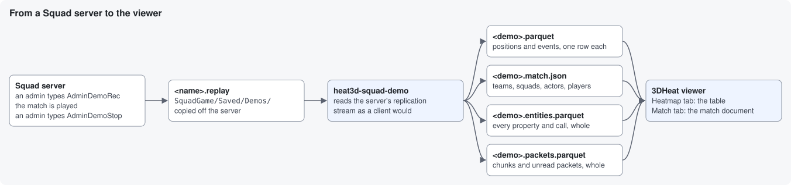

# 3DHeat Squad demo reader

**What is it?** A small program that turns a recording of a Squad match into
files the [3DHeat](https://github.com/Holdi601/3DHeat) viewer can draw: where
every player was, second by second, and what happened where.

**Why would I use it?** To see a match from above: where the fighting was,
which routes squads took, where vehicles died. Load the result in 3DHeat as a
heatmap, or read it with any tool that reads Parquet and JSON.

**Example:** `match.replay` (recorded on a Squad server) -> `match.parquet`
(one row per position or event) + `match.match.json` (teams, squads, players).



**Documentation:** [holdi601.github.io/3DHeat-Ext-Squad](https://holdi601.github.io/3DHeat-Ext-Squad/),
a page per step and per output. Part of [3DHeat](https://github.com/Holdi601/3DHeat)
([documentation](https://holdi601.github.io/3DHeat/)).

Each game reader is its own small project with its own licence file, releases and issue
tracker, so it can be installed, updated, maintained - or withdrawn on a rights holder's
request - on its own, without affecting the viewer or the other tools.

## The standalone program

No Python needed: download the file for your system (Windows, Linux) from the
[latest release](https://github.com/Holdi601/3DHeat-Ext-Squad/releases/latest), check it against
`SHA256SUMS`, unpack it and start `heat3d-squad`. Its window finds a Squad server's demo folder on this
machine (or lets you choose one), converts the demos into the matches folder the viewer opens, and asks
before it updates itself. `heat3d-squad --help` lists its commands (every command below runs through it
too: `heat3d-squad <demos> -o <folder>`); `--check --json` is for scripts. The 3DHeat app's Extractors
panel can install and update it for you. See
[Before you start](https://holdi601.github.io/3DHeat-Ext-Squad/before-you-start.html).

## Quick start for new users

You need: Windows, [Python](https://www.python.org/downloads/) 3.10 or later
("Add python.exe to PATH" ticked in its installer), and Squad demos
(`.replay` files). They are recorded on a Squad server, not by the game: an
admin with the `demos` permission runs `AdminDemoRec <name>` in the game's
console and `AdminDemoStop` at the end; the server writes
`<server>\SquadGame\Saved\Demos\<name>.replay` (70 to 80 MB an hour for a
small match). Copy them to your PC. No Git is needed.

1. Install the tool (one line, in PowerShell or a command prompt):

   ```bash
   python -m pip install https://github.com/Holdi601/3DHeat-Ext-Squad/archive/refs/tags/v0.1.0.zip
   ```

2. Convert a demo, or every demo in a folder (the tool does not search: name
   the files or the folder):

   ```bash
   heat3d-squad-demo match.replay -o out
   heat3d-squad-demo D:\SquadDemos -o out
   ```

3. You should see one line per demo:
   `match.replay: <layer>, <n> players, <n> rows -> out\<map>\match.parquet`.
   Each demo becomes four files in `out\<map>\` (`--flat` puts them straight
   into `out`): `<demo>.parquet` (the table to open), `<demo>.match.json`
   (teams, squads, players) and two sidecars (`.entities.parquet`,
   `.packets.parquet`).
4. Open it in the [3DHeat viewer](https://github.com/Holdi601/3DHeat#quick-start):
   download the viewer (**Code -> Download ZIP**, unpack) and double-click
   `start.bat`; it offers to install [Node.js](https://nodejs.org/) when it is
   missing and opens Chrome or Edge at `http://127.0.0.1:5273`. There,
   **Source -> Files...**, pick `<demo>.parquet` (or drop it on the Source
   panel) and click **Load file**.

When a new release is out, the tool says so when it starts and offers to
update itself (`python -m heat3d_ext_squad.update` does the same).

## Install from a checkout

New to the command line? Read [Before you start](https://holdi601.github.io/3DHeat-Ext-Squad/before-you-start.html) first.

1. Install Python 3.10 or later.
2. `git clone https://github.com/Holdi601/3DHeat-Ext-Squad` (or download the ZIP)
   and open a terminal in that folder.
3. Install the command:

```bash
python -m pip install -e .              # installs the heat3d-squad-demo command
heat3d-squad-demo match.replay -o out   # or a folder of .replay files
```

You should see one line per demo:
`match.replay: <layer>, <n> players, <n> rows -> out\<map>\match.parquet`.


## Options

```text
heat3d-squad-demo <demos or folders> -o <folder> [--flat] [--json]
python -m heat3d_ext_squad ...          the same, without the command installed
```

| Option | Does |
|---|---|
| `demos` | `.replay` files, or folders holding them (one or more) |
| `-o`, `--out` | the folder to write into (required); each demo goes into `<out>/<map>/` |
| `--flat` | write straight into the folder, without `<map>/` |
| `--json` | one line of JSON per demo on stdout, for programs: `demo`, `ok`, `parquet`, `match`, `sidecars`, `lost`, `rows`, `players`, `layer`, `recorded_unix`; a demo that failed gives `demo`, `ok: false`, `error` |
| `--version` | print the version |

Exit status 0 when every demo was converted, 1 when any failed (the rest are
still written) or none was found. Full list: [Command reference](https://holdi601.github.io/3DHeat-Ext-Squad/cli-reference.html).

```bash
heat3d-squad-demo D:\SquadDemos -o out                 # every demo in a folder (use your own folder)
heat3d-squad-demo one.replay two.replay -o out --flat  # straight into out/
```

Squad demos are recorded on the server by an admin (`AdminDemoRec <name>`,
then `AdminDemoStop`): see [Recording a demo](https://holdi601.github.io/3DHeat-Ext-Squad/recording.html).

## What comes out

**Output: loose files**, not a one-file `.3dheat` container. Per demo, in `out/<map>/`:

| File | What it holds |
|---|---|
| `<demo>.parquet` | the table: positions and events, one row each (below) |
| `<demo>.match.json` | the match document: map, layer, length, teams, squads, actors, a line per player and bot, the self-check |
| `<demo>.entities.parquet`, `<demo>.packets.parquet` | the sidecars: everything else the demo holds, kept whole |

The 3DHeat viewer opens the table directly (Heatmap tab) and the match
document in its Match tab. The viewer's file formats, including the
one-file-a-match container other converters write, are described in
[One file a match (.3dheat)](https://holdi601.github.io/3DHeat/container.html).

| Column | What it is |
|---|---|
| `time` | seconds since the recording started |
| `x`, `y`, `z` | position in Unreal units (centimetres), Z up |
| `dirX`, `dirY`, `dirZ` | where a soldier looks: the body's yaw and the view's pitch, as a unit vector (a vehicle's: level) |
| `yaw`, `pitch` | the same in degrees; `pitch` up from the horizon, soldiers only |
| `health` | the soldier's, bot's or vehicle's health at that moment, where the server sent it (a soldier's falls below 0 while wounded) |
| `speed` | the replicated speed, cm/s |
| `player` | the player's name; `bot <id>` for a bot; for a vehicle or deployable nobody owns, its class; for a shot from a vehicle's weapon, the player seated on that vehicle |
| `team`, `faction` | Squad's team number (1, 2) and its faction setup, **at that moment**: players can change sides |
| `squad` | the squad number, -1 when not in one |
| `event` | `position` on foot, `vehicle` while in a ground vehicle or helicopter (the row then has the vehicle's position); `wounded`, `revived`, `death` (soldiers and bots); `spawn`, `damaged`, `destroyed`, `removed` (vehicles, deployables, emplacements, crates, helicopters: where they were); `seat` (a player took a seat); `fire` (a shot: where it left, its direction as `yaw`/`pitch`/`dirX..Z`); `hit` (a vehicle hit: where) |
| `pawn` | the soldier blueprint (`SQSquidBot` for a bot), the vehicle, or for `fire` the weapon |
| `seat` | for a turret or passenger seat, the seat's own pawn |
| `detail` | for `fire` the weapon's call that placed the shot, for `hit` the damage type, for `removed` why the channel closed (`Destroyed`, `Dormancy`...) |
| `entity` | the actor the row is about (its net GUID): the `entity` of the sidecars' rows |
| `match` | the demo's name |

Positions are in centimetres (Unreal units), Z up. The match document's
top-level keys include `map`, `layer`, `duration_s`, `recorded_unix`, `rows`,
`teams`, `squads`, `game_state`, `actors`, `players`, `events` and
`selfCheck`: see [The match document](https://holdi601.github.io/3DHeat-Ext-Squad/output-match.html).

The 3DHeat Watcher runs this converter on new demos when it is installed
(adapter `squad-demos`). The Watcher never imports this package, so a problem
here touches nothing else.

## How it works, limits, personal data

How a demo is read and how it was checked: [How a demo is read](https://holdi601.github.io/3DHeat-Ext-Squad/how-it-works.html).
What is not read and what a game update can break: [Limits](https://holdi601.github.io/3DHeat-Ext-Squad/limits.html).

**Personal data.** A demo holds the names and online IDs of everyone on the
server. The table and match document carry names, not IDs; the sidecars keep
the IDs as the demo does (not decoded). Treat all of them like the demo itself.

## The 3DHeat tools

| Tool | What it does | Code | Docs |
|---|---|---|---|
| 3DHeat viewer | shows the data: heatmaps, race analysis, match review | [3DHeat](https://github.com/Holdi601/3DHeat) | [docs](https://holdi601.github.io/3DHeat/) |
| GameFiles | levels and courses from a game's own files | [3DHeat-GameFiles](https://github.com/Holdi601/3DHeat-GameFiles) | [docs](https://holdi601.github.io/3DHeat-GameFiles/) |
| GameCapture | lap telemetry, and levels rebuilt from gameplay video | [3DHeat-GameCapture](https://github.com/Holdi601/3DHeat-GameCapture) | [docs](https://holdi601.github.io/3DHeat-GameCapture/) |
| Unreal Exporter | an Unreal Editor plugin: a level as one `.glb` | [3DHeat-UnrealExporter](https://github.com/Holdi601/3DHeat-UnrealExporter) | [docs](https://holdi601.github.io/3DHeat-UnrealExporter/) |
| CS2 | Counter-Strike 2 demos and maps | [3DHeat-CS2](https://github.com/Holdi601/3DHeat-CS2) | [docs](https://holdi601.github.io/3DHeat-CS2/) |
| Watcher | records what games publish while you play | [3DHeat-Watcher](https://github.com/Holdi601/3DHeat-Watcher) | [docs](https://holdi601.github.io/3DHeat-Watcher/) |
| Ext-WarThunder | War Thunder replays | [3DHeat-Ext-WarThunder](https://github.com/Holdi601/3DHeat-Ext-WarThunder) | [docs](https://holdi601.github.io/3DHeat-Ext-WarThunder/) |
| Ext-WoT | World of Tanks replays | [3DHeat-Ext-WoT](https://github.com/Holdi601/3DHeat-Ext-WoT) | [docs](https://holdi601.github.io/3DHeat-Ext-WoT/) |
| Ext-WoWs | World of Warships replays | [3DHeat-Ext-WoWs](https://github.com/Holdi601/3DHeat-Ext-WoWs) | [docs](https://holdi601.github.io/3DHeat-Ext-WoWs/) |
| Ext-Squad | Squad server demos | [3DHeat-Ext-Squad](https://github.com/Holdi601/3DHeat-Ext-Squad) | [docs](https://holdi601.github.io/3DHeat-Ext-Squad/) |
| Ext-DCS | DCS World maps as 3D levels | [3DHeat-Ext-DCS](https://github.com/Holdi601/3DHeat-Ext-DCS) | [docs](https://holdi601.github.io/3DHeat-Ext-DCS/) |
| Ext-IL2 | IL-2 Sturmovik maps as 3D levels | [3DHeat-Ext-IL2](https://github.com/Holdi601/3DHeat-Ext-IL2) | [docs](https://holdi601.github.io/3DHeat-Ext-IL2/) |
| Ext-Dota | the Dota 2 map from your own install as a 3D level | [3DHeat-Ext-Dota](https://github.com/Holdi601/3DHeat-Ext-Dota) | [docs](https://holdi601.github.io/3DHeat-Ext-Dota/) |
| Ext-DotaReplay | Dota 2 replays | [3DHeat-Ext-DotaReplay](https://github.com/Holdi601/3DHeat-Ext-DotaReplay) | [docs](https://holdi601.github.io/3DHeat-Ext-DotaReplay/) |
| Ext-Riot | League of Legends and VALORANT replays (what they carry unencrypted) | [3DHeat-Ext-Riot](https://github.com/Holdi601/3DHeat-Ext-Riot) | [docs](https://holdi601.github.io/3DHeat-Ext-Riot/) |
| Ext-Forza | Forza courses, races and cars from your own install | [3DHeat-Ext-Forza](https://github.com/Holdi601/3DHeat-Ext-Forza) | [docs](https://holdi601.github.io/3DHeat-Ext-Forza/) |
| Ext-Battlefield | Battlefield levels (Frostbite) as 3D levels | [3DHeat-Ext-Battlefield](https://github.com/Holdi601/3DHeat-Ext-Battlefield) | [docs](https://holdi601.github.io/3DHeat-Ext-Battlefield/) |
| Ext-BeamNG | BeamNG.drive courses | [3DHeat-Ext-BeamNG](https://github.com/Holdi601/3DHeat-Ext-BeamNG) | [docs](https://holdi601.github.io/3DHeat-Ext-BeamNG/) |
| Ext-ACRally | Assetto Corsa Rally stages as courses | [3DHeat-Ext-ACRally](https://github.com/Holdi601/3DHeat-Ext-ACRally) | [docs](https://holdi601.github.io/3DHeat-Ext-ACRally/) |
| Ext-Reforger | Arma Reforger worlds (Enfusion) as 3D levels | [3DHeat-Ext-Reforger](https://github.com/Holdi601/3DHeat-Ext-Reforger) | [docs](https://holdi601.github.io/3DHeat-Ext-Reforger/) |
| Ext-R6 | Rainbow Six Siege match replays | [3DHeat-Ext-R6](https://github.com/Holdi601/3DHeat-Ext-R6) | [docs](https://holdi601.github.io/3DHeat-Ext-R6/) |

## Licence and sources

MIT; see [`LICENSE`](LICENSE). Everything here was written for this package;
the only dependencies are pyarrow (Apache-2.0) and numpy (BSD-3-Clause).
Facts about the format came from Unreal.Core in
[FortniteReplayDecompressor](https://github.com/Shiqan/FortniteReplayDecompressor) (MIT)
and from [squad-replay](https://github.com/Codycody31/squad-replay) (MPL-2.0),
whose published test demos were also used as an independent cross-check; no
code of either was copied or translated.

This package reads the demo files a Squad server writes; it does not touch the
game, its code or its archives, and nothing from the game is included or
redistributed. What it writes stays on your machine.

3DHeat is not affiliated with or endorsed by Offworld Industries. Squad and
related names and trademarks belong to their owners. Rights holders: open an
issue at <https://github.com/Holdi601/3DHeat-Ext-Squad/issues> - we respond
quickly and remove anything on request.
