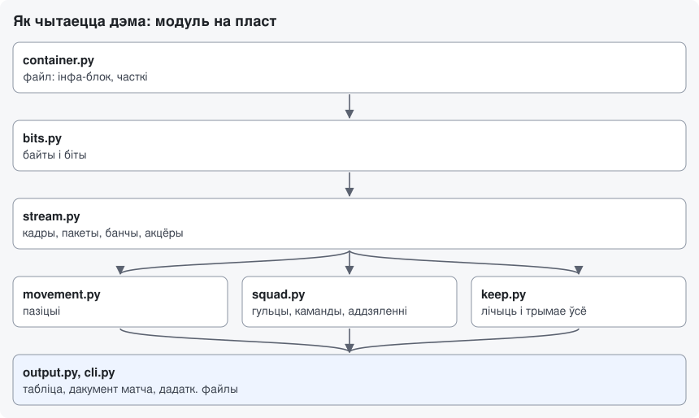

# Як чытаецца дэма {#how-a-demo-is-read}

Прастымі словамі: сервер Squad адпраўляе пазіцыю кожнага гульца кожнаму іншаму гульцу. Файл дэма — гэта запіс гэтага трафіку. Гэты інструмент прайграе яго і запісвае, хто дзе быў.



Сеткавы рэплей Unreal — гэта ўласны трафік рэплікацыі сервера, запісаны яго драйверам дэма. Чытаць яго — значыць чытаць гэты трафік так, як гэта рабіў бы кліент.

| Модуль | Пласт |
|---|---|
| `container.py` | Файл лакальнага streamer-а файлаў: інфармацыйны блок (magic `0x1CA2E27F`), потым часткі. Тыпы частак: загаловак (`FNetworkDemoHeader`, magic `0x2CF5A13D`), даныя рэплею, кантрольныя пункты і падзеі. |
| `bits.py` | Байтавыя архівы для кадраў і бітавыя архівы для пакетаў. Пакеты чытаюцца з малодшага біта. |
| `stream.py` | Кадры, пакеты, банчы (часткавыя банчы злучаны), каналы акцёраў, з'яўленні акцёраў і блокі змесціва. Кожны блок змяшчае рэплікаваныя ўласцівасці як handle, колькасць бітаў і біты, потым выклікі па сетцы і палі з карыстальніцкай дэльтай як handle ў групе `_ClassNetCache` класа. Аб'ектам, якіх экспарты не называюць, клас даецца пасля чытання ўсяго дэма (гл. ніжэй). |
| `movement.py` | Уласны `FRepMovement` рухавіка і рух верталётаў Squad. |
| `keep.py` | Кожны сустрэты элемент падлічаны і захаваны: радкі дапаможных файлаў і самаправерка. |
| `squad.py` | Якія класы Squad што нясуць. `SQPlayerState` змяшчае імя, стан каманды, стан аддзялення і бягучы pawn; `SQTeamState` — нумар каманды і фракцыю; `SQSquadState` — нумар аддзялення. Уладальнік pawn-а месца — яго тэхніка. |
| `output.py`, `cli.py` | Табліца і дакумент матча. |

Рэплей сам называе свае палі. Ён нясе шляхі класаў і назвы ўласцівасцей для кожнага handle, а таксама шляхі аб'ектаў, на якія спасылаецца. Таму кожную ўласцівасць можна знайсці па імені без кода гульні. Толькі для бітаў уласцівасці патрэбен яе тып. Для руху гэта ўласны тып рухавіка; для ўласцівасцей Squad тыпы простыя: радкі, цэлыя лікі, спасылкі на аб'екты і імёны.

Некаторыя аб'екты названы толькі самімі сабой: акцёры ўзроўню — сваім імем асобніка (`Team1SpawnPoint3`), кампаненты — сваім (`MovementComponent`, `wheel_L1`). Іх клас знаходзіцца па табліцах экспарту, пасля патоку: драйвер дэма экспартуе поле класа ў кадры, дзе яно ўпершыню адпраўляецца (так з кожнай першай адпраўкай названага аб'екта ў тэставых дэма), таму класам з'яўляецца тая адзіная група, што экспартавала якраз гэтыя handle ў кадрах, дзе аб'ект іх упершыню адправіў; інакш — любая група, у якой да таго часу былі ўсе яе handle, калі ўсе даюць ім аднолькавыя назвы; інакш — клас аб'екта з такім жа імем, без лічбаў, або адзіная група, у чыёй назве ёсць назва аб'екта. З handle аб'ектаў, названых такім чынам, чый клас адпраўляе іх з адной фіксаванай колькасцю бітаў, усе прыйшлі з гэтай колькасцю (ніводнага з іншай). Тое, што нічога з гэтага не вырашае, застаецца цалкам у дапаможным файле entities.

## Расшыфроўка ўласцівасцей {#decoding-properties}

Кожная рэплікаваная ўласцівасць расшыфроўваецца настолькі, наколькі яе біты кажуць, чым яна з'яўляецца: адзін біт — флаг, спасылка на аб'ект (яго net GUID) там, дзе імя заканчваецца як у спасылкі (`...State`, `...Seat`, `...Pawn`, `...Class`...), даўжыня і столькі байтаў — радок, імя, 8/16/32/64 біты — лік (float, калі так кажа імя ўласцівасці: здароўе, час, хуткасць, увод...), усё астатняе — яго біты ў hex з радкамі, знойдзенымі ўнутры. Выклікі па сетцы чытаюцца гэтак жа, па назвах параметраў, якія дэма экспартуе для кожнай функцыі.

## Як чытаюцца падзеі {#how-the-events-are-read}

`Health` і `bWounded` салдата прыходзяць ад сервера: паранены, калі `bWounded` уключаецца, ажыўлены, калі выключаецца пры здароўі вышэй за 0, мёртвы, калі здароўе падае ніжэй за -100 (гулец, што здаецца або знясільваецца ад страты крыві, атрымлівае -300); бот, які ніколі не бывае паранены, гіне пры 0. Тэхніка або размяшчальны аб'ект `damaged` (пашкоджаны) пры кожным падзенні яго `Health`, `destroyed` (знішчаны) пры 0 або ніжэй. З'яўленні і выдаленні — гэта адкрыццё і закрыццё канала акцёра; месца — гэта `CurrentSeat` стану гульца (спасылка на кампанент месца, які адпраўляецца на сваёй тэхніцы). Нахіл погляду — гэта `RemoteViewPitch` салдата, байт ад прама ўніз (0) да прама ўверх (255). Стрэл — гэта `MulticastFireProjectile` зброі (пачатак і кірунак) або яе `MulticastFireMultipleProjectileEffects`, дзе такога выкліку з тым жа кірункам не было; трапленне — гэта `MulticastPlayDamageEffects` тэхнікі (месца ўдару, тып пашкоджання).

## Што правілена і як {#what-was-verified-and-how}

Гэта правярана на двух публічных серверных дэма Squad v10.3.1 (Unreal Engine 5.5.4, сеткавая версія рухавіка 36) з тэставых фікстур праекта squad-replay:

- **Лічбы.** Колькасці кадраў, пакетаў, адкрыццяў акцёраў, груп экспарту і экспартаваных шляхоў аб'ектаў дакладна супадаюць з незалежным парсерам таго праекта. Таксама і колькасць адзнак руху салдат.
- **Рух супраць хуткасці.** Крок кожнай адзнакі салдата ад папярэдняй, падзелены на час паміж імі, супадае з хуткасцю, якую нясе адзнака. Медыяна адносіны ў межах ад 0,8 да 1,2 у гульцоў, што рухаюцца.
- **Каманды супраць чарцяжоў.** Каманда кожнага радка — гэта каманда, чыёй фракцыі належыць чарцёж салдата. Гэта вытрымалася і для гульца, які змяніў бок падчас матча.
- **Памылкі.** На дэма застаецца адна памылка патоку: заблукалы біт у канцы адкрывальнага банча ўласнага акцёра-назіральніка запісчыка, які нічога не нясе з выкарыстоўванага тут.
- **Страты супраць забойстваў таго праекта.** Кожнае забойства з яго спісу — гэта раненне або смерць, прачытаныя тут, у той жа час і таго ж гульца; яго забойствы тэхнікі — гэта тэхніка, прачытаная тут, што дасягнула здароўя 0 або ніжэй.
- **Размяшчальныя аб'екты.** Акцёры, прачытаныя тут са станам будаўніцтва або патрабаваннем FOB, супадаюць з размяшчальнымі аб'ектамі таго праекта з дакладнасцю да аднаго.
- **Нахіл.** Байт нахілу погляду ляжыць каля 120 у спакоі і дасягае 255 (прама ўверх): чытаецца як байт над -90..+90. Калі б чытаць яго як звычайны байт рухавіка для поўнага павароту, салдаты апынуліся б да 128 градусаў ніжэй за гарызонт, чаго яны не могуць.
- **Боты.** На дэма фазы seeding кожны бот (`SQSquidBot`) мае свой трэк, а боты, што гінуць, прачытаны як смерці.
- **Рух верталётаў** (`SQHelicopterMovementComponent.ReplicatedMovement`, уласнае размяшчэнне Squad: без флагаў, месца ў сотых, хуткасць і вуглавая хуткасць, тры неабавязковыя 16-бітныя вуглы, гадзіннік сервера як float). Кожная адзнака верталёта запаўняе свае біты дакладна. Месца і yaw прыпаркаванага верталёта — яго з'яўлення, з дакладнасцю да сантыметра і адзінкі вугла. У палёце крок паміж адзнакамі, падзелены на крок гадзінніка, — гэта хуткасць (медыянная частка 0,997), а гадзіннік крочыць з часам дэма (медыяна 0,4 мс). Вуглавая хуткасць ідзе за хуткасцю yaw (карэляцыя 0,91), але яе адзінка не вызначана дакладна: яна захаваная, не выкарыстоўваецца.
- **Месцы.** `CurrentSeat` стану гульца — гэта спасылка (спакаваны net GUID), а не лік, як чыталася раней: пры такім чытанні пры кожнай змене гэта месца, якое ўласны `MulticastUpdateCurrentSeat` салдата называе момантам раней, і змены — як у squad-replay.
- **Стрэлы і трапленні.** Кожны `ShootDir` — адзінкавы вектар (даўжыня 1 з дакладнасцю да 0,00003); пачатак кожнага `MulticastFireMultipleProjectileEffects`, падзелены на 10, — гэта `OriginZeroBased` адпаведнага `MulticastFireProjectile` з дакладнасцю да 1 мм; дзе вядома пазіцыя стралка або пацярпелай тэхнікі, пачатак стрэлу або ўдар у медыяне за 0,45 м ад яе.
- **Уводы тэхнікі.** Прачытаныя як float, газ, тармаз і ручны тармаз гусенічнай тэхнікі ляжаць у 0..1, а рулявое кіраванне ў -1..1, у кожным абнаўленні.
- **Прычыны закрыцця.** Кожны акцёр, чый канал адкрыўся зноў, быў закрыты з `Dormancy`; ніводзін, закрыты з `Destroyed`, не адкрываўся зноў.

Тэсты на дэма, якія самі тэсты і будуюць, пакрываюць кантэйнер, архівы, паток і ўвесь шлях да табліцы, а таксама тое, што дэма з адным элементам кожнага віду нічога не губляе ([`tests/test_completeness.py`](https://github.com/Holdi601/3DHeat-Ext-Squad/blob/main/tests/test_completeness.py)):

```bash
python -m pip install -e .[test]
pytest                                   # synthetic demos
HEAT3D_SQUAD_DEMOS=<folder> pytest       # plus real demos in that folder
```
