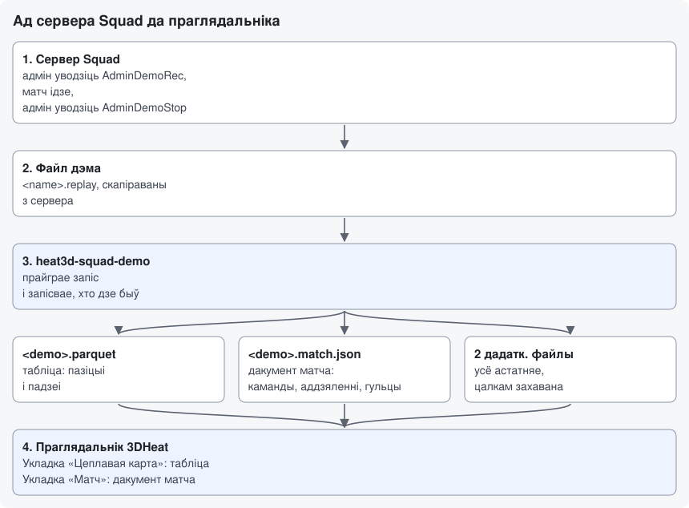

# 3DHeat Squad {#dheat-squad}

**Што гэта?** Маленькая праграма, якая ператварае запіс матча Squad у
файлы, якія можа намаляваць праглядальнік [3DHeat](https://github.com/Holdi601/3DHeat)
([дакументацыя](https://holdi601.github.io/3DHeat/)): дзе быў кожны
гулец, секунда за секундай, і што дзе адбывалася.

**Навошта гэта мне?** Каб паглядзець матч зверху: дзе ішлі баі,
якімі маршрутамі хадзілі аддзяленні, дзе гінула тэхніка.

**Прыклад:** `match.replay` (дэма, запісанае на серверы Squad) ->
`match.parquet` (адзін радок на пазіцыю або падзею) + `match.match.json` (дакумент
матча: каманды, аддзяленні, гульцы). Вынікі — звычайныя файлы Parquet
і JSON, таму іх можа прачытаць і любая іншая праграма.

Для чаго гэта карысна:

- **Дзе ішоў матч.** Пазіцыя кожнага гульца і бота, пешшу, у наземнай тэхніцы
  і ў верталётах, каля васьмі разоў за секунду, з камандай, фракцыяй,
  аддзяленнем, здароўем і вуглом погляду ўверх-уніз.
- **Што дзе адбылося.** Раненні, ажыўленні і смерці; кожны стрэл і кожнае
  трапленне ў тэхніку; уся тэхніка, размяшчальныя аб'екты і ўстаноўкі:
  як яны з'явіліся, былі пашкоджаны, знішчаны і прыбраны.
- **Увесь матч у адным дакуменце.** Каманды, аддзяленні, стан гульні, кожны
  акцёр, радок на кожнага гульца і бота, а таксама самаправерка, што нічога з
  таго, што ёсць у дэма, не страчана.



## Хуткі старт {#quick-start}

Упершыню ў камандным радку? Спачатку прачытайце [Перад пачаткам](before-you-start.md).

```bash
python -m pip install -e .              # installs the heat3d-squad-demo command
heat3d-squad-demo match.replay -o out   # or a folder of .replay files
```

Вы ўбачыце па радку на кожнае дэма. Потым загрузіце `out/<map>/<demo>.parquet` на ўкладцы «Цеплавая карта» праглядальніка
([Як загрузіць даныя](https://holdi601.github.io/3DHeat/getting-data-in.html)).

## Старонкі {#pages}

| Старонка | Пра што яна |
|---|---|
| [Перад пачаткам](before-you-start.md) | Python, тэрмінал, першы запуск |
| [Запіс дэма](recording.md) | як прымусіць сервер пісаць дэма і як яго знайсці |
| [Канвертаванне дэма](converting.md) | каманда, усе опцыі, прыклад вываду |
| [Табліца](output-table.md) | кожны слупок і кожная `event` |
| [Дакумент матча і дапаможныя файлы](output-match.md) | `.match.json`, два дапаможныя файлы, самаправерка |
| [Як чытаецца дэма](how-it-works.md) | пласты чытача і што было правілена |
| [Абмежаванні, абнаўленні і ўмовы](limits.md) | што не чытаецца, што можа зламаць абнаўленне Squad, асабістыя даныя, ліцэнзія |
| [Даведнік каманд](../cli-reference.md) | кожная опцыя і слупок, створаныя з кода |
| [Падтрымка гэтай дакументацыі](maintaining.md) | спіс для выпуску |

## Звязанае {#related}

- Праглядальнік 3DHeat: [github.com/Holdi601/3DHeat](https://github.com/Holdi601/3DHeat),
  дакументацыя на [holdi601.github.io/3DHeat](https://holdi601.github.io/3DHeat/).
- Фарматы файлаў, якія чытае праглядальнік, у тым ліку кантэйнер
  «адзін файл на матч»: [Адзін файл на матч (.3dheat)](https://holdi601.github.io/3DHeat/container.html).
  Гэты канвертар піша асобныя файлы: табліцу, дакумент матча
  і яго дапаможныя файлы побач.
- 3DHeat Watcher запускае гэты канвертар на новых дэма, калі ён
  усталяваны (адаптар `squad-demos`): [3DHeat Watcher](https://holdi601.github.io/3DHeat-Watcher/).
- Кожны модуль чытання гульні - асобны невялікі праект з уласным файлам ліцэнзіі, выпускамі і трэкерам задач, таму яго можна ўсталёўваць, абнаўляць, падтрымліваць - або адклікаць па просьбе праваўладальніка - асобна, не закранаючы праглядальнік і іншыя інструменты.

## Інструменты 3DHeat {#the-3dheat-tools}

| Інструмент | Што ён робіць | Код | Дакументацыя |
|---|---|---|---|
| Праглядальнік 3DHeat | паказвае даныя: цеплавыя карты, аналіз гонак, разбор матчаў | [3DHeat](https://github.com/Holdi601/3DHeat) | [дакументацыя](https://holdi601.github.io/3DHeat/) |
| GameFiles | узроўні і трасы з уласных файлаў гульні | [3DHeat-GameFiles](https://github.com/Holdi601/3DHeat-GameFiles) | [дакументацыя](https://holdi601.github.io/3DHeat-GameFiles/) |
| GameCapture | тэлеметрыя кругоў і ўзроўні, узноўленыя з відэа гульні | [3DHeat-GameCapture](https://github.com/Holdi601/3DHeat-GameCapture) | [дакументацыя](https://holdi601.github.io/3DHeat-GameCapture/) |
| Unreal Exporter | убудова Unreal Editor: узровень як адзін `.glb` | [3DHeat-UnrealExporter](https://github.com/Holdi601/3DHeat-UnrealExporter) | [дакументацыя](https://holdi601.github.io/3DHeat-UnrealExporter/) |
| CS2 | дэма і карты Counter-Strike 2 | [3DHeat-CS2](https://github.com/Holdi601/3DHeat-CS2) | [дакументацыя](https://holdi601.github.io/3DHeat-CS2/) |
| Watcher | запісвае тое, што гульні публікуюць, пакуль вы гуляеце | [3DHeat-Watcher](https://github.com/Holdi601/3DHeat-Watcher) | [дакументацыя](https://holdi601.github.io/3DHeat-Watcher/) |
| Ext-WarThunder | рэплеі War Thunder | [3DHeat-Ext-WarThunder](https://github.com/Holdi601/3DHeat-Ext-WarThunder) | [дакументацыя](https://holdi601.github.io/3DHeat-Ext-WarThunder/) |
| Ext-WoT | рэплеі World of Tanks | [3DHeat-Ext-WoT](https://github.com/Holdi601/3DHeat-Ext-WoT) | [дакументацыя](https://holdi601.github.io/3DHeat-Ext-WoT/) |
| Ext-WoWs | рэплеі World of Warships | [3DHeat-Ext-WoWs](https://github.com/Holdi601/3DHeat-Ext-WoWs) | [дакументацыя](https://holdi601.github.io/3DHeat-Ext-WoWs/) |
| Ext-Squad | дэма сервераў Squad | [3DHeat-Ext-Squad](https://github.com/Holdi601/3DHeat-Ext-Squad) | [дакументацыя](https://holdi601.github.io/3DHeat-Ext-Squad/) |
| Ext-DCS | карты DCS World як 3D-узроўні | [3DHeat-Ext-DCS](https://github.com/Holdi601/3DHeat-Ext-DCS) | [дакументацыя](https://holdi601.github.io/3DHeat-Ext-DCS/) |
| Ext-IL2 | карты IL-2 Sturmovik як 3D-узроўні | [3DHeat-Ext-IL2](https://github.com/Holdi601/3DHeat-Ext-IL2) | [дакументацыя](https://holdi601.github.io/3DHeat-Ext-IL2/) |
