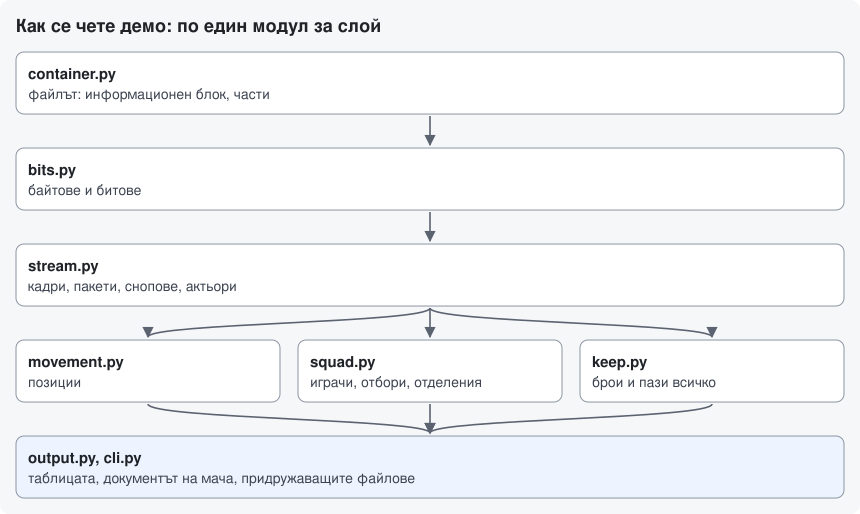

# Как се чете демото {#how-a-demo-is-read}

С прости думи: сървър на Squad изпраща позицията на всеки играч на всеки друг играч. Файлът на демото е запис на този трафик. Този инструмент го пуска обратно и записва кой къде е бил.



Повторение на мрежата на Unreal е самият мрежов трафик на сървъра, записан от неговия драйвер за демота. Четенето му е четене на този трафик така, както би го прочел клиент.

| Модул | Слой |
|---|---|
| `container.py` | файлът на локалния потоков четец: информационен блок (магия `0x1CA2E27F`), после части. Видовете части са заглавката (`FNetworkDemoHeader`, магия `0x2CF5A13D`), данните за повторението, контролните точки и събитията. |
| `bits.py` | архиви на байтове за кадри и битови архиви за пакети. Пакетите се четат най-ниският бит първи. |
| `stream.py` | кадри, пакети, снопове (частични снопове, съединени заедно), канали на актьори, появяванията на актьори и блоковете със съдържание. Всеки блок носи репликирани свойства като обработчик, брой битове и битове, после отдалечени извиквания и полета с потребителска разлика като обработчици в групата `_ClassNetCache` на класа. Обектите, които експортите не назовават, получават своя клас, след като цялото демо е прочетено (вижте по-долу). |
| `movement.py` | `FRepMovement` на двигателя и движението на хеликоптерите на Squad. |
| `keep.py` | всеки елемент, срещнат, преброен и запазен: редовете на придружаващите файлове и самопроверката. |
| `squad.py` | кои класове на Squad какво носят. `SQPlayerState` съдържа името, състоянието на отбора, състоянието на отделението и текущия пешак; `SQTeamState` - номера на отбора и фракцията; `SQSquadState` - номера на отделението. Собственикът на пешак на седалка е неговото превозно средство. |
| `output.py`, `cli.py` | таблицата и документът на мача. |

Повторението назовава собствените си полета. То носи имената на пътищата на класовете и на свойствата за всеки обработчик и пътищата на обектите, които реферира. Така всяко свойство може да се намери по име без кода на играта. Само битовете на свойството се нуждаят от типа му. За движението това е собственият тип на двигателя; за свойствата на Squad типовете са прости: низове, цели числа, референции към обекти и имена.

Някои обекти са назовани само от самите себе си: актьорите на нивото - по името на инстанцията им (`Team1SpawnPoint3`), компонентите - по своите (`MovementComponent`, `wheel_L1`). Класът им се намира от таблиците на експорта, след потока: драйверът на демото експортира полето на клас в кадъра, в който то е изпратено за първи път (вярно за всяко първо изпращане на назован обект в тестовите демота), така че класът е групата, която е експортирала точно тези обработчици в кадрите, в които обектът за първи път ги е изпратил; иначе всяка група, която е имала всичките си обработчици дотогава, когато всички дават едни и същи имена; иначе класът на обект със същото име, без номерата, или единствената група, чието име съдържа името на обекта. От обработчиците на обекти, назовани така, чийто клас ги изпраща с един фиксиран брой битове, всички са дошли с този брой (нито един с друг). Това, което нито едно от тези не решава, остава в придружаващия файл на същностите, цяло.

## Декодиране на свойствата {#decoding-properties}

Всяко репликирано свойство се декодира толкова, колкото битовете му казват какво е: един бит - флаг; референция към обект (неговият мрежов GUID), когато името завършва както при референция (`...State`, `...Seat`, `...Pawn`, `...Class`...); дължина и толкова байта - низ; име; 8/16/32/64 бита - число (число с плаваща запетая, когато името на свойството го казва: здраве, време, скорост, вход...); всичко друго - битовете му в hex, с низовете, намерени вътре. Отдалечените извиквания се четат по същия начин, по имената на параметрите, които демото експортира за всяка функция.

## Как се четат събитията {#how-the-events-are-read}

`Health` и `bWounded` на войник идват от сървъра: ранен, когато `bWounded` се включи; съживен, когато се изключи, а здравето е над 0; мъртъв, когато здравето падне под -100 (играч, който се предаде или изкърви, се задава на -300); бот, който никога не е бил ранен, умира при 0. Превозно средство или разполагаемо е `damaged` при всяко падане на неговото `Health`, `destroyed` при 0 или под него. Появяванията и премахванията са отварянето и затварянето на канала на актьора; седалката е `CurrentSeat` на състоянието на играча (референция към компонента на седалката, който се изпраща на превозното му средство). Наклонът на погледа е `RemoteViewPitch` на войника, байт от право надолу (0) до право нагоре (255). Изстрел е `MulticastFireProjectile` на оръжие (начало и посока) или неговото `MulticastFireMultipleProjectileEffects`, когато няма такова извикване със същата посока; попадение е `MulticastPlayDamageEffects` на превозно средство (място на удара, тип повреда).

## Какво е проверено и как {#what-was-verified-and-how}

Проверено е върху две публични сървърни демота на Squad v10.3.1 (Unreal Engine 5.5.4, мрежова версия на двигателя 36), от тестовите набори на проекта squad-replay:

- **Броения.** Броят на кадрите, пакетите, отворените актьори, групите на експорта и експортираните пътища на обекти съвпада точно с този на независимия анализатор на проекта. Така е и с броя на отчитанията на движението на войниците.
- **Движение спрямо скорост.** Стъпката на всяко отчитане на войник спрямо предишното, разделена на времето между тях, съвпада със скоростта, която отчитането носи. Средното съотношение е между 0,8 и 1,2 при движещи се играчи.
- **Отбори спрямо плановете.** Отборът на всеки ред е отборът, чиято фракция принадлежи на плана на войника. Това важеше и за играч, който смени страната по време на мача.
- **Грешки.** Остава по една грешка на поток на демо: случаен бит в края на началната част на собствения актьор наблюдател на записващия, който не носи нищо използвано тук.
- **Загуби спрямо убийствата на този проект.** Всяко убийство, което той изброява, е рана или смърт, прочетена тук, в същото време и на същия играч; убийствата на превозни средства са превозни средства, прочетени тук, достигнали здраве 0 или под.
- **Разполагаеми.** Актьорите, прочетени тук, със състояние на строеж или изискване за FOB, съвпадат с разполагаемите на този проект, с точност до едно.
- **Наклон.** Байтът на наклона на погледа е около 120 в покой и достига 255 (право нагоре): прочетен като байт в диапазона -90..+90. Прочетен като обичайния байт на двигателя за цял оборот, би поставил войниците до 128 градуса под хоризонта, където не могат да гледат.
- **Ботове.** На демо за запълване всеки бот (`SQSquidBot`) има собствена траектория, а ботовете, които умират, се четат като смъртни случаи.
- **Движение на хеликоптер** (`SQHelicopterMovementComponent.ReplicatedMovement`, собственото оформление на Squad: без флагове, позицията в стотни, скоростта и ъгловата скорост, три незадължителни 16-битови ъгъла, часовникът на сървъра като число с плаваща запетая). Всяко отчитане на хеликоптер запълва битовете си точно. Позицията и курсът на паркиран хеликоптер са тези на мястото му на появяване, до сантиметъра и единицата за ъгъл. Във въздуха стъпката между отчитанията, разделена на стъпката на часовника, е скоростта (средно съотношение 0,997), а часовникът се движи заедно с времето на демото (средно 0,4 ms между стъпките). Ъгловата скорост следва скоростта на завъртане (корелация 0,91), но мерната ѝ единица не е уточнена: пази се, не се използва.
- **Седалки.** `CurrentSeat` на състоянието на играча е референция (опакован мрежов GUID), а не число, както се четеше преди: прочетено така, при всяка смяна това е седалката, която собственото `MulticastUpdateCurrentSeat` на войника посочва малко по-рано, а смените са тези на squad-replay.
- **Изстрели и попадения.** Всеки `ShootDir` е единичен вектор (дължина 1 с точност до 0,00003); всяко `MulticastFireMultipleProjectileEffects` начало, разделено на 10, е `OriginZeroBased` на съответното `MulticastFireProjectile` с точност до 1 mm; където позицията на стрелеца или на уцеленото превозно средство е известна, началото на изстрела или ударът е на медиана 0,45 m от нея.
- **Входове на превозни средства.** Прочетени като числа с плаваща запетая, газта, спирачката и ръчната спирачка на верижните превозни средства са в 0..1, а управлението им - в -1..1, при всяко обновяване.
- **Причини за затваряне.** Всеки актьор, чийто канал се е отворил отново, е бил затворен с `Dormancy`; никой, затворен с `Destroyed`, не се е отворил отново.

Тестовете върху демота, създадени от самите тестове, покриват контейнера, архивите, потока и целия път до таблицата, и че демо с по един елемент от всеки вид не губи нито един ([`tests/test_completeness.py`](https://github.com/Holdi601/3DHeat-Ext-Squad/blob/main/tests/test_completeness.py)):

```bash
python -m pip install -e .[test]
pytest                                   # синтетични демота
HEAT3D_SQUAD_DEMOS=<folder> pytest       # плюс истински демота в тази папка
```
