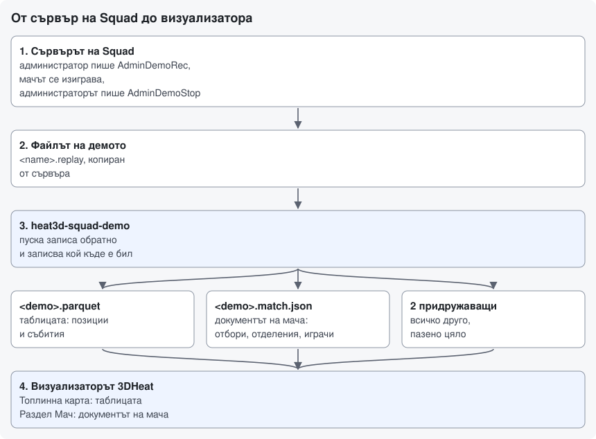

# 3DHeat Squad {#dheat-squad}

**Какво е?** Малка програма, която превръща запис на мач от Squad във файлове, които
визуализаторът [3DHeat](https://github.com/Holdi601/3DHeat) ([документация](https://holdi601.github.io/3DHeat/)) може да начертае: къде е бил всеки играч, секунда по секунда, и какво се е случило къде.

**Защо да я използвам?** За да видите мача отгоре: къде е било боят, по кои маршрути са минавали отделенията, къде са загивали превозните средства.

**Пример:** `match.replay` (демо, записано на сървър на Squad) ->
`match.parquet` (по един ред за всяко положение или събитие) + `match.match.json` (документът на мача: отбори, отделения, играчи). Изходите са обикновени файлове Parquet и JSON, така че и всичко друго може да ги чете.

За какво е полезна:

- **Къде е бил воден мачът.** Позицията на всеки играч и бот, пешком, в наземни превозни средства и в хеликоптери, около осем пъти в секунда, с отбор, фракция, отделение, здраве и наклон на погледа.
- **Какво се е случило къде.** Рани, съживявания и смърти; всеки изстрел и всяко попадение в превозно средство; всяко превозно средство, разполагаемо и укрепление, появено, повредено, унищожено и премахнато.
- **Целият мач в един документ.** Отбори, отделения, състоянието на играта, всеки актьор, по един ред за всеки играч и бот и самопроверка, която потвърждава, че нищо от демото не е загубено.



## Бърз старт {#quick-start}

Нов ли сте в командния ред? Първо прочетете [Преди да започнете](before-you-start.md).

```bash
python -m pip install -e .              # инсталира командата heat3d-squad-demo
heat3d-squad-demo match.replay -o out   # или папка с файлове .replay
```

Ще видите по един ред за всяко демо. После заредете `out/<map>/<demo>.parquet` в раздела Топлинна карта на визуализатора
([Получаване на данни](https://holdi601.github.io/3DHeat/getting-data-in.html)).

## Страници {#pages}

| Страница | Какво съдържа |
|---|---|
| [Преди да започнете](before-you-start.md) | Python, терминал, първо пускане |
| [Записване на демо](recording.md) | как сървърът записва демо и как да го намерите |
| [Преобразуване на демота](converting.md) | командата, всяка опция, примерен изход |
| [Таблицата](output-table.md) | всяка колона и всяко `event` |
| [Документът на мача и придружаващите файлове](output-match.md) | `.match.json`, двата придружаващи файла, самопроверката |
| [Как се чете демото](how-it-works.md) | слоевете на четеца и какво е проверено |
| [Ограничения, обновления и условия](limits.md) | какво не се чете, какво може да счупи обновление на Squad, лични данни, лиценз |
| [Справка за командите](../cli-reference.md) | всяка опция и колона, генерирани от кода |
| [Поддръжка на тези документи](maintaining.md) | списъкът за издаване |

## Свързано {#related}

- Визуализаторът 3DHeat: [github.com/Holdi601/3DHeat](https://github.com/Holdi601/3DHeat),
  документацията е на [holdi601.github.io/3DHeat](https://holdi601.github.io/3DHeat/).
- Файловите формати, които чете визуализаторът, включително контейнера с един файл на мач:
  [Един файл на мач (.3dheat)](https://holdi601.github.io/3DHeat/container.html).
  Този преобразувател записва отделните файлове: таблицата, документа на мача и придружаващите файлове един до друг.
- 3DHeat Watcher пуска този преобразувател върху нови демота, когато е инсталиран
  (адаптер `squad-demos`): [3DHeat Watcher](https://holdi601.github.io/3DHeat-Watcher/).
- Всеки четец на игра е отделен малък проект със собствен лицензен файл, издания и система за проблеми, така че може да се инсталира, обновява, поддържа - или да бъде оттеглен по искане на притежател на права - самостоятелно, без това да засяга визуализатора или другите инструменти.

## Инструментите на 3DHeat {#the-3dheat-tools}

| Инструмент | Какво прави | Код | Документация |
|---|---|---|---|
| визуализатор 3DHeat | показва данните: топлинни карти, анализ на състезания, преглед на мача | [3DHeat](https://github.com/Holdi601/3DHeat) | [документация](https://holdi601.github.io/3DHeat/) |
| GameFiles | нива и трасета от собствените файлове на играта | [3DHeat-GameFiles](https://github.com/Holdi601/3DHeat-GameFiles) | [документация](https://holdi601.github.io/3DHeat-GameFiles/) |
| GameCapture | телеметрия от обиколки и нива, възстановени от видеозаписи на игра | [3DHeat-GameCapture](https://github.com/Holdi601/3DHeat-GameCapture) | [документация](https://holdi601.github.io/3DHeat-GameCapture/) |
| Unreal Exporter | приставка за Unreal Editor: ниво като един `.glb` | [3DHeat-UnrealExporter](https://github.com/Holdi601/3DHeat-UnrealExporter) | [документация](https://holdi601.github.io/3DHeat-UnrealExporter/) |
| CS2 | демота и карти на Counter-Strike 2 | [3DHeat-CS2](https://github.com/Holdi601/3DHeat-CS2) | [документация](https://holdi601.github.io/3DHeat-CS2/) |
| Watcher | записва какво публикуват игрите, докато играете | [3DHeat-Watcher](https://github.com/Holdi601/3DHeat-Watcher) | [документация](https://holdi601.github.io/3DHeat-Watcher/) |
| Ext-WarThunder | повторения на War Thunder | [3DHeat-Ext-WarThunder](https://github.com/Holdi601/3DHeat-Ext-WarThunder) | [документация](https://holdi601.github.io/3DHeat-Ext-WarThunder/) |
| Ext-WoT | повторения на World of Tanks | [3DHeat-Ext-WoT](https://github.com/Holdi601/3DHeat-Ext-WoT) | [документация](https://holdi601.github.io/3DHeat-Ext-WoT/) |
| Ext-WoWs | повторения на World of Warships | [3DHeat-Ext-WoWs](https://github.com/Holdi601/3DHeat-Ext-WoWs) | [документация](https://holdi601.github.io/3DHeat-Ext-WoWs/) |
| Ext-Squad | демота от сървъри на Squad | [3DHeat-Ext-Squad](https://github.com/Holdi601/3DHeat-Ext-Squad) | [документация](https://holdi601.github.io/3DHeat-Ext-Squad/) |
| Ext-DCS | карти на DCS World като 3D нива | [3DHeat-Ext-DCS](https://github.com/Holdi601/3DHeat-Ext-DCS) | [документация](https://holdi601.github.io/3DHeat-Ext-DCS/) |
| Ext-IL2 | карти на IL-2 Sturmovik като 3D нива | [3DHeat-Ext-IL2](https://github.com/Holdi601/3DHeat-Ext-IL2) | [документация](https://holdi601.github.io/3DHeat-Ext-IL2/) |
