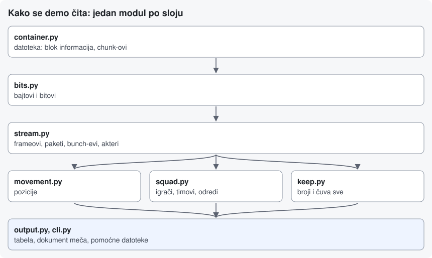

# Kako se demo čita {#how-a-demo-is-read}

Jednostavno rečeno: Squad server šalje poziciju svakog igrača svakom drugom igraču. Demo datoteka je snimak tog saobraćaja. Ovaj alat ga reproducira i bilježi ko je gdje bio.



Unreal mrežni replay je vlastiti replikacijski saobraćaj servera, zapisan njegovim demo driverom. Čitati ga znači čitati taj saobraćaj kao što bi ga čitao klijent.

| Modul | Sloj |
|---|---|
| `container.py` | Datoteka lokalnog streamera datoteka: blok informacija (magic `0x1CA2E27F`), zatim chunk-ovi. Vrste chunk-ova su zaglavlje (`FNetworkDemoHeader`, magic `0x2CF5A13D`), podaci replaya, kontrolne tačke i događaji. |
| `bits.py` | Arhivi bajtova za frameove i arhivi bitova za pakete. Paketi se čitaju od najnižeg bita. |
| `stream.py` | Frameovi, paketi, bunch-evi (djelomični bunch-evi spojeni), kanali aktera, spawnovi aktera i blokovi sadržaja. Svaki blok drži replicirana svojstva kao handle, broj bitova i bitove, zatim udaljene pozive i polja s prilagođenom razlikom kao handle-ove u grupu `_ClassNetCache` te klase. Objektima koje izvozi ne imenuju klasa se dodjeljuje kad se pročita cijeli demo (vidi dolje). |
| `movement.py` | Engineov `FRepMovement` i Squadovo kretanje helikoptera. |
| `keep.py` | Svaka susretnuta stavka, izbrojana i sačuvana: redovi pomoćnih datoteka i samoprovjera. |
| `squad.py` | Koje Squad klase nose šta. `SQPlayerState` drži ime, stanje tima, stanje odreda i trenutni pawn; `SQTeamState` broj tima i frakciju; `SQSquadState` broj odreda. Vlasnik pawna sjedala je njegovo vozilo. |
| `output.py`, `cli.py` | Tabela i dokument meča. |

Replay imenuje vlastita polja. Nosi putanje klasa i imena svojstava za svaki handle, te putanje objekata na koje upućuje. Zato se svako svojstvo može naći po imenu bez koda igre. Samo bitovi svojstva trebaju njegov tip. Za kretanje to je engineov vlastiti tip; za Squadova svojstva tipovi su jednostavni: stringovi, cijeli brojevi, reference na objekte i imena.

Neki objekti su imenovani samo vlastitim imenom: akteri nivoa po nazivu instance (`Team1SpawnPoint3`), komponente po svome (`MovementComponent`, `wheel_L1`). Njihova klasa se nalazi iz tabela izvoza, nakon toka: demo driver izvozi polje klase u frameu u kojem se prvi put pošalje (što vrijedi za svako prvo slanje imenovanog objekta u testnim demoima), pa je klasa ona jedina grupa koja je izvezla tačno te handle-ove u frameovima u kojima ih je objekat prvi put poslao; inače bilo koja grupa koja je do tada imala sve svoje handle-ove, kad im sve daju ista imena; inače klasa objekta istog imena, bez brojeva, ili jedina grupa čije ime sadrži ime objekta. Od handle-ova objekata imenovanih na ovaj način čija klasa šalje njih s jednim fiksnim brojem bitova, svi su došli s tim brojem (nijedan s drugim). Ono što ništa od ovoga ne riješi ostaje cjelovito u pomoćnoj datoteci entiteta.

## Dekodiranje svojstava {#decoding-properties}

Svako replicirano svojstvo dekodira se koliko god njegovi bitovi kažu šta je: jedan bit je zastavica; referenca na objekat (njegov net GUID) tamo gdje ime završava kao ime reference (`...State`, `...Seat`, `...Pawn`, `...Class`...); dužina i toliko bajtova je string; ime; 8/16/32/64 bita je broj (float gdje to kaže ime svojstva: zdravlje, vrijeme, brzina, unos...); sve ostalo su njegovi bitovi u heksadecimalnom zapisu sa stringovima pronađenim unutra. Udaljeni pozivi čitaju se na isti način, po imenima parametara koje demo izvozi za svaku funkciju.

## Kako se čitaju događaji {#how-the-events-are-read}

Vojnikov `Health` i `bWounded` dolaze od servera: ranjen kad se `bWounded` uključi, oživljen kad se isključi uz zdravlje iznad 0, mrtav kad zdravlje padne ispod -100 (igrač koji odustane ili iskrvari postavlja se na -300); bot, koji nikad nije ranjen, umire na 0. Vozilo ili postavljivi objekat je `damaged` pri svakom padu njegovog `Health`, `destroyed` na 0 ili ispod. Spawnovi i uklanjanja su otvaranje i zatvaranje kanala aktera; sjedalo je `CurrentSeat` stanja igrača (referenca na komponentu sjedala, koja se šalje na njegovom vozilu). Nagib pogleda je vojnikov `RemoteViewPitch`, bajt od pravo dolje (0) do pravo gore (255). Hitac je poziv oružja `MulticastFireProjectile` (porijeklo i smjer), ili njegov `MulticastFireMultipleProjectileEffects` tamo gdje nijedan takav poziv nije došao s istim smjerom; pogodak je vozilov `MulticastPlayDamageEffects` (lokacija udara, vrsta štete).

## Šta je provjereno i kako {#what-was-verified-and-how}

Ovo je provjereno prema dva javna Squad v10.3.1 serverska demoa (Unreal Engine 5.5.4, mrežna verzija enginea 36), iz testnih fixtura projekta squad-replay:

- **Brojevi.** Brojevi frameova, paketa, otvaranja aktera, grupa izvoza i izvezenih putanja objekata tačno se poklapaju s nezavisnim parserom tog projekta. Isto vrijedi za broj uzoraka kretanja vojnika.
- **Kretanje prema brzini.** Korak svakog uzorka vojnika od prethodnog, podijeljen vremenom između njih, poklapa se s brzinom koju uzorak nosi. Medijan omjera je unutar 0,8 do 1,2 kod igrača u kretanju.
- **Timovi prema nacrtima.** Tim svakog reda je tim čijoj frakciji pripada nacrt vojnika. Ovo je vrijedilo i za igrača koji je tokom meča promijenio stranu.
- **Greške.** Po demou ostaje jedna greška toka: zalutali bit na kraju početnog bunch-a vlastitog aktera posmatrača snimača, koji ne nosi ništa što se ovdje koristi.
- **Žrtve prema ubistvima tog projekta.** Svako ubistvo koje navodi je ranjavanje ili smrt pročitana ovdje, u isto vrijeme i istog igrača; njegova ubistva vozila su vozila pročitana ovdje kako dosežu zdravlje 0 ili ispod.
- **Postavljivi objekti.** Akteri pročitani ovdje sa stanjem gradnje ili zahtjevom FOB-a poklapaju se s postavljivim objektima tog projekta, s tolerancijom od jednog.
- **Nagib.** Bajt nagiba pogleda leži oko 120 u mirovanju i dosiže 255 (pravo gore): čitan kao bajt preko -90..+90. Čitan kao engineov uobičajeni bajt cijelog okreta, stavio bi vojnike do 128 stepeni ispod horizonta, što oni ne mogu gledati.
- **Botovi.** Na demou seedinga svaki bot (`SQSquidBot`) ima vlastitu stazu, a botovi koji umiru čitaju se kao smrti.
- **Kretanje helikoptera** (`SQHelicopterMovementComponent.ReplicatedMovement`, Squadov vlastiti raspored: bez zastavica, lokacija u stotinkama, brzina i ugaona brzina, tri neobavezna 16-bitna ugla, serverski sat kao float). Svaki uzorak helikoptera tačno popunjava svoje bitove. Lokacija i yaw parkiranog helikoptera su iz njegovog spawna, do centimetra i ugaone jedinice. U letu je korak između uzoraka podijeljen korakom sata brzina (medijan omjera 0,997), a sat napreduje s vremenom demoa (medijan 0,4 ms razmaka). Ugaona brzina prati brzinu yawa (korelacija 0,91), ali njena jedinica nije utvrđena: čuva se, ne koristi.
- **Sjedala.** `CurrentSeat` stanja igrača je referenca (pakirani net GUID), a ne broj kako je ranije čitano: čitano tako, pri svakoj promjeni to je sjedalo koje vojnikov vlastiti `MulticastUpdateCurrentSeat` imenuje trenutak ranije, a promjene su one iz squad-replay.
- **Hici i pogoci.** Svaki `ShootDir` je jedinični vektor (dužina 1 unutar 0,00003); porijeklo svakog `MulticastFireMultipleProjectileEffects`, podijeljeno sa 10, je `OriginZeroBased` odgovarajućeg `MulticastFireProjectile` unutar 1 mm; gdje je poznata pozicija strijelca ili pogođenog vozila, porijeklo hica ili udar je medijano 0,45 m od nje.
- **Unosi vozila.** Čitani kao floatovi, gas, kočnica i ručna kočnica gusjeničarskih vozila leže u 0..1, a upravljanje u -1..1, u svakom ažuriranju.
- **Razlozi zatvaranja.** Svaki akter čiji se kanal ponovo otvorio bio je zatvoren s `Dormancy`; nijedan zatvoren s `Destroyed` nije se ponovo otvorio.

Testovi na demoima koje grade sami testovi pokrivaju spremnik, arhive, tok i cijeli put do tabele, te da demo koji drži po jednu stavku svake vrste ne gubi nijednu ([`tests/test_completeness.py`](https://github.com/Holdi601/3DHeat-Ext-Squad/blob/main/tests/test_completeness.py)):

```bash
python -m pip install -e .[test]
pytest                                   # synthetic demos
HEAT3D_SQUAD_DEMOS=<folder> pytest       # plus real demos in that folder
```
