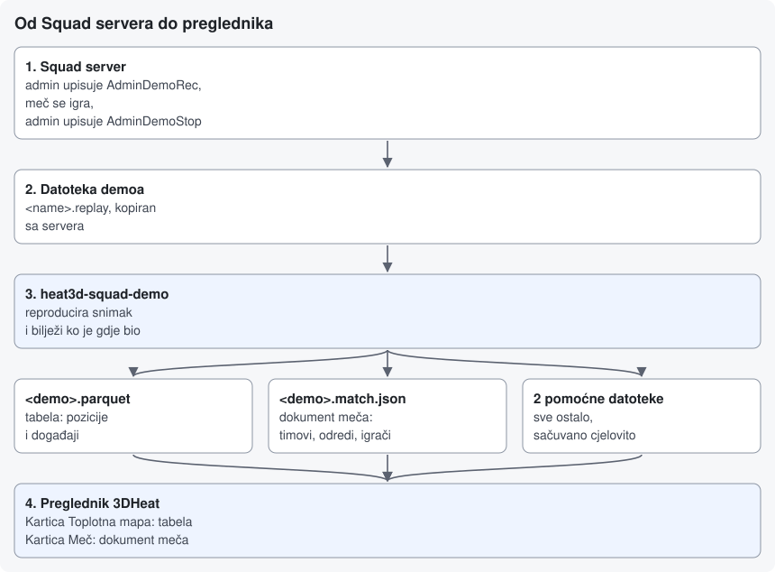

# 3DHeat Squad {#dheat-squad}

**Šta je to?** Mali program koji snimak Squad meča pretvara u datoteke koje
preglednik [3DHeat](https://github.com/Holdi601/3DHeat)
([dokumentacija](https://holdi601.github.io/3DHeat/)) može nacrtati: gdje je
bio svaki igrač, sekundu po sekundu, i šta se gdje dogodilo.

**Zašto bih ga koristio?** Da vidiš meč iz zraka: gdje se vodila borba,
kojim putevima su išli odredi, gdje su stradala vozila.

**Primjer:** `match.replay` (demo snimljen na Squad serveru) ->
`match.parquet` (jedan red po poziciji ili događaju) + `match.match.json`
(dokument meča: timovi, odredi, igrači). Izlazi su obične Parquet i JSON
datoteke, pa ih može čitati i bilo šta drugo.

Za šta je koristan:

- **Gdje se meč vodio.** Pozicija svakog igrača i bota, pješice, u kopnenim
  vozilima i u helikopterima, otprilike osam puta u sekundi, s timom,
  frakcijom, odredom, zdravljem i nagibom pogleda.
- **Šta se gdje dogodilo.** Ranjavanja, oživljavanja i smrti; svaki hitac i
  svaki pogodak u vozilo; svako vozilo, postavljivi objekat i utvrđeni
  položaj: stvaranje, oštećenje, uništenje i uklanjanje.
- **Cijeli meč u jednom dokumentu.** Timovi, odredi, stanje igre, svaki akter,
  red za svakog igrača i svakog bota, te samoprovjera da ništa što demo sadrži
  nije izgubljeno.



## Brzi početak {#quick-start}

Komandna linija ti je nova? Prvo pročitaj [Prije nego počneš](before-you-start.md).

```bash
python -m pip install -e .              # installs the heat3d-squad-demo command
heat3d-squad-demo match.replay -o out   # or a folder of .replay files
```

Trebao bi vidjeti jedan red po demou. Zatim učitaj `out/<map>/<demo>.parquet` u kartici Toplotna mapa preglednika
([Unos podataka](https://holdi601.github.io/3DHeat/getting-data-in.html)).

## Stranice {#pages}

| Stranica | Šta pokriva |
|---|---|
| [Prije nego počneš](before-you-start.md) | Python, terminal, prvo pokretanje |
| [Snimanje demoa](recording.md) | kako natjerati server da napiše demo i gdje ga naći |
| [Pretvaranje demoa](converting.md) | naredba, sve opcije, primjer izlaza |
| [Tabela](output-table.md) | svaka kolona i svaki `event` |
| [Dokument meča i pomoćne datoteke](output-match.md) | `.match.json`, dvije pomoćne datoteke, samoprovjera |
| [Kako se demo čita](how-it-works.md) | slojevi čitača i šta je provjereno |
| [Ograničenja, ažuriranja i uvjeti](limits.md) | šta se ne čita, šta Squad ažuriranje može pokvariti, lični podaci, licenca |
| [Referenca naredbi](../cli-reference.md) | sve opcije i kolone, generirane iz koda |
| [Održavanje ove dokumentacije](maintaining.md) | lista za provjeru pri izdanju |

## Povezano {#related}

- Preglednik 3DHeat: [github.com/Holdi601/3DHeat](https://github.com/Holdi601/3DHeat),
  dokumentacija na [holdi601.github.io/3DHeat](https://holdi601.github.io/3DHeat/).
- Formati datoteka koje preglednik čita, uključujući spremnik s jednom
  datotekom po meču: [Jedna datoteka po meču (.3dheat)](https://holdi601.github.io/3DHeat/container.html).
  Ovaj konverter piše odvojene datoteke: tabelu, dokument meča i njegove
  pomoćne datoteke jedne pored drugih.
- 3DHeat Watcher pokreće ovaj konverter na novim demoima kada je instaliran
  (adapter `squad-demos`): [3DHeat Watcher](https://holdi601.github.io/3DHeat-Watcher/).

## 3DHeat alati {#the-3dheat-tools}

| Alat | Šta radi | Kod | Dokumentacija |
|---|---|---|---|
| 3DHeat preglednik | prikazuje podatke: toplotne mape, analizu utrka, pregled mečeva | [3DHeat](https://github.com/Holdi601/3DHeat) | [dokumentacija](https://holdi601.github.io/3DHeat/) |
| GameFiles | nivoi i staze iz vlastitih datoteka igre | [3DHeat-GameFiles](https://github.com/Holdi601/3DHeat-GameFiles) | [dokumentacija](https://holdi601.github.io/3DHeat-GameFiles/) |
| GameCapture | telemetrija krugova i nivoi rekonstruirani iz video snimka igranja | [3DHeat-GameCapture](https://github.com/Holdi601/3DHeat-GameCapture) | [dokumentacija](https://holdi601.github.io/3DHeat-GameCapture/) |
| Unreal Exporter | dodatak za Unreal Editor: nivo kao jedan `.glb` | [3DHeat-UnrealExporter](https://github.com/Holdi601/3DHeat-UnrealExporter) | [dokumentacija](https://holdi601.github.io/3DHeat-UnrealExporter/) |
| CS2 | Counter-Strike 2 demoi i mape | [3DHeat-CS2](https://github.com/Holdi601/3DHeat-CS2) | [dokumentacija](https://holdi601.github.io/3DHeat-CS2/) |
| Watcher | bilježi ono što igre objavljuju dok igraš | [3DHeat-Watcher](https://github.com/Holdi601/3DHeat-Watcher) | [dokumentacija](https://holdi601.github.io/3DHeat-Watcher/) |
| Ext-WarThunder | War Thunder snimci | [3DHeat-Ext-WarThunder](https://github.com/Holdi601/3DHeat-Ext-WarThunder) | [dokumentacija](https://holdi601.github.io/3DHeat-Ext-WarThunder/) |
| Ext-WoT | World of Tanks snimci | [3DHeat-Ext-WoT](https://github.com/Holdi601/3DHeat-Ext-WoT) | [dokumentacija](https://holdi601.github.io/3DHeat-Ext-WoT/) |
| Ext-WoWs | World of Warships snimci | [3DHeat-Ext-WoWs](https://github.com/Holdi601/3DHeat-Ext-WoWs) | [dokumentacija](https://holdi601.github.io/3DHeat-Ext-WoWs/) |
| Ext-Squad | Squad serverski demoi | [3DHeat-Ext-Squad](https://github.com/Holdi601/3DHeat-Ext-Squad) | [dokumentacija](https://holdi601.github.io/3DHeat-Ext-Squad/) |
| Ext-DCS | DCS World mape kao 3D nivoi | [3DHeat-Ext-DCS](https://github.com/Holdi601/3DHeat-Ext-DCS) | [dokumentacija](https://holdi601.github.io/3DHeat-Ext-DCS/) |
| Ext-IL2 | IL-2 Sturmovik mape kao 3D nivoi | [3DHeat-Ext-IL2](https://github.com/Holdi601/3DHeat-Ext-IL2) | [dokumentacija](https://holdi601.github.io/3DHeat-Ext-IL2/) |
