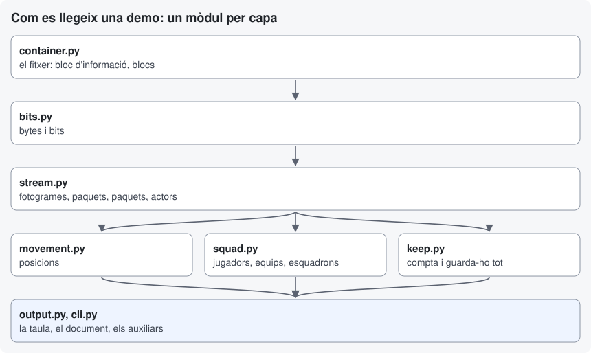

# Com es llegeix una demo {#how-a-demo-is-read}

Dit en paraules senzilles: un servidor de Squad envia la posició de cada jugador a tots
els altres. El fitxer de la demo és una gravació d'aquest trànsit. Aquesta eina el reprodueix
i escriu qui era on.



Una repetició de xarxa d'Unreal és el propi trànsit de replicació del servidor, anotat pel seu
controlador de demo. Llegir-la és llegir aquest trànsit tal com ho faria un client.

| Mòdul | Capa |
|---|---|
| `container.py` | El fitxer del transmissor local de fitxers: un bloc d'informació (magic `0x1CA2E27F`), i després blocs. Els tipus de bloc són la capçalera (`FNetworkDemoHeader`, magic `0x2CF5A13D`), les dades de repetició, els punts de control i els esdeveniments. |
| `bits.py` | Arxius de bytes per als fotogrames i arxius de bits per als paquets. Els paquets es llegeixen primer el bit més baix. |
| `stream.py` | Fotogrames, paquets, paquets (els paquets parcials units), canals d'actor, aparicions d'actors i blocs de contingut. Cada bloc conté les propietats replicades com a identificador, nombre de bits i bits, després les crides remotes i els camps de delta personalitzats com a identificadors dins del grup `_ClassNetCache` de la classe. Els objectes que les exportacions no anomenen reben la seva classe quan s'ha llegit tota la demo (mira més avall). |
| `movement.py` | El `FRepMovement` del motor, i el moviment d'helicòpter de Squad. |
| `keep.py` | Cada element trobat, comptat i guardat: les files dels annexos i la comprovació. |
| `squad.py` | Quines classes de Squad porten què. `SQPlayerState` conté el nom, l'estat d'equip, l'estat d'esquadró i el peó actual; `SQTeamState` el número d'equip i la facció; `SQSquadState` el número d'esquadró. El propietari d'un peó de seient és el seu vehicle. |
| `output.py`, `cli.py` | La taula i el document de partida. |

Una repetició anomena els seus propis camps. Porta les rutes de classe i els noms de propietat de
cada identificador, i les rutes dels objectes als quals fa referència. Així, cada propietat es pot
trobar pel nom sense el codi del joc. Només els bits d'una propietat necessiten el seu tipus. Per al
moviment és el tipus propi del motor; per a les propietats de Squad els tipus són senzills: cadenes,
enters, referències a objectes i noms.

Alguns objectes només es nomenen per ells mateixos: els actors d'un nivell pel seu nom d'instància
(`Team1SpawnPoint3`), els components pel seu propi (`MovementComponent`, `wheel_L1`). La seva classe
es troba a les taules d'exportació, després del flux: el controlador de demo exporta el camp d'una classe
en el fotograma on s'envia per primera vegada (cert per a cada primer enviament d'un objecte amb nom
a les demos de prova), de manera que la classe és l'únic grup que va exportar exactament aquests
identificadors en els fotogrames on l'objecte els va enviar per primera vegada; si no, qualsevol grup que
ja tingués tots els seus identificadors en aquell moment, quan tots donen els mateixos noms; o si no, la
classe d'un objecte del mateix nom, sense els números, o l'únic grup el nom del qual conté el de l'objecte.
Dels identificadors dels objectes anomenats d'aquesta manera, la classe dels quals els envia amb un
nombre de bits fix, tots han arribat amb aquest nombre (cap amb un altre). Allò que cap d'aquests
criteris resol es queda a l'annex d'entitats, sencer.

## Descodificar propietats {#decoding-properties}

Cada propietat replicada es descodifica fins on els seus bits diuen què és: un bit una marca, una
referència a un objecte (el seu GUID de xarxa) quan el nom acaba com el d'una referència (`...State`,
`...Seat`, `...Pawn`, `...Class`...), una longitud i tants bytes una cadena, un nom, 8/16/32/64 bits un
nombre (un real quan el nom de la propietat ho indica: salut, temps, velocitat, entrada...), i tot el
demés els seus bits en hexadecimal amb les cadenes trobades a dins. Les crides remotes es llegeixen de la
mateixa manera, pels noms de paràmetre que la demo exporta per a cada funció.

## Com es llegeixen els esdeveniments {#how-the-events-are-read}

La `Health` i el `bWounded` d'un soldat provenen del servidor: ferit quan `bWounded` s'activa, reanimat quan
es desactiva amb la salut per sobre de 0, mort quan la salut baixa de -100 (un jugador que es rendeix o
es desangra es posa a -300); un bot, que mai no és ferit, mor a 0. Un vehicle o element desplegable és
`damaged` a cada baixada de la seva `Health`, i `destroyed` a 0 o per sota. Les aparicions i les retirades
són l'obertura i el tancament del canal de l'actor; un seient és el `CurrentSeat` de l'estat del jugador (una
referència al component de seient, que s'envia amb el seu vehicle). La inclinació de la vista és el
`RemoteViewPitch` del soldat, un byte des de totalment avall (0) fins a totalment amunt (255). Un tret és el
`MulticastFireProjectile` d'una arma (origen i direcció), o el seu `MulticastFireMultipleProjectileEffects` quan
no hi ha cap crida així amb la mateixa direcció; un impacte és el `MulticastPlayDamageEffects` d'un vehicle
(ubicació de l'impacte, tipus de dany).

## Què es va verificar, i com {#what-was-verified-and-how}

Es van comprovar contra dues demos públiques de servidor de Squad v10.3.1 (Unreal Engine 5.5.4, versió de
xarxa del motor 36), dels accessoris de prova del projecte squad-replay:

- **Recomptes.** Els recomptes de fotogrames, paquets, obertures d'actors, grups d'exportació i rutes d'objectes
  exportats coincideixen exactament amb l'analitzador independent d'aquest projecte. També el nombre de mostres de
  moviment dels soldats.
- **Moviment contra velocitat.** El desplaçament de cada mostra de soldat respecte de l'anterior, dividit pel temps
  entre elles, coincideix amb la velocitat que porta la mostra. La proporció mitjana està entre 0,8 i 1,2 en jugadors
  en moviment.
- **Equips contra plans.** L'equip de cada fila és l'equip a què pertany la facció del pla del soldat. Això es va
  complir per a un jugador que va canviar de bàndol durant la partida.
- **Errors.** Queda un error de flux per demo: un bit perdut al final del paquet d'obertura de l'actor d'espectador
  del propi gravador, que no porta res que aquí s'utilitzi.
- **Baixes contra les morts d'aquest projecte.** Cada mort que llista és una ferida o una mort llegida aquí, al mateix
  temps i del mateix jugador; les seves morts de vehicle són vehicles llegits aquí que arriben a salut 0 o per sota.
- **Elements desplegables.** Els actors llegits aquí amb un estat de construcció o un requisit de FOB coincideixen amb
  els elements desplegables d'aquell projecte, com a molt d'un de diferència.
- **Inclinació.** El byte d'inclinació de la vista se situa al voltant de 120 en repòs i arriba a 255 (totalment amunt):
  es llegeix com un byte sobre -90..+90. Llegit com el byte habitual del motor d'una volta sencera, posaria soldats
  fins a 128 graus per sota de l'horitzó, cosa que no poden mirar.
- **Bots.** En una demo de preparació, cada bot (`SQSquidBot`) té la seva pròpia trajectòria, i els bots que moren es
  llegeixen com a morts.
- **Moviment d'helicòpter** (`SQHelicopterMovementComponent.ReplicatedMovement`, la disposició pròpia de Squad: sense
  marques, la ubicació en centèsimes, la velocitat i la velocitat angular, tres angles opcionals de 16 bits, el rellotge
  del servidor com a real). Cada mostra d'helicòpter omple els seus bits exactament. La ubicació i el guinyament d'un
  helicòpter aparcat són els del seu punt d'aparició, fins al centímetre i a la unitat d'angle. En vol, el pas entre
  mostres dividit pel pas del rellotge és la velocitat (proporció mitjana 0,997), i el rellotge avança amb el temps de
  la demo (mitjana de 0,4 ms de diferència). La velocitat angular segueix la velocitat de guinyament (correlació 0,91),
  però la seva unitat no està fixada: es guarda, no s'utilitza.
- **Seients.** El `CurrentSeat` d'un estat de jugador és una referència (un GUID de xarxa empaquetat), no un nombre com
  es llegia abans: llegit així, a cada canvi és el seient que la pròpia `MulticastUpdateCurrentSeat` del soldat
  esmenta un moment abans, i els canvis són els de squad-replay.
- **Trets i impactes.** Cada `ShootDir` és un vector unitari (longitud 1 dins de 0,00003); cada origen de
  `MulticastFireMultipleProjectileEffects`, dividit per 10, és el `OriginZeroBased` del `MulticastFireProjectile`
  corresponent dins d'1 mm; quan es coneix la posició del tirador o del vehicle impactat, l'origen del tret o l'impacte
  és de mitjana 0,45 m respecte d'ella.
- **Entrades de vehicle.** Llegits com a reals, l'accelerador, el fre i el fre de mà dels vehicles amb cadenes estan
  entre 0 i 1, i la direcció entre -1 i 1, a cada actualització.
- **Motius de tancament.** Cada actor el canal del qual es va tornar a obrir s'havia tancat amb `Dormancy`; cap no es
  va tancar amb `Destroyed` i es va tornar a obrir.

Les proves sobre demos construïdes per les mateixes proves cobreixen el contenidor, els arxius, el flux i tot el camí
fins a la taula, i que una demo que conté un de cada tipus d'element no en perd cap
([`tests/test_completeness.py`](https://github.com/Holdi601/3DHeat-Ext-Squad/blob/main/tests/test_completeness.py)):

```bash
python -m pip install -e .[test]
pytest                                   # demos sintètiques
HEAT3D_SQUAD_DEMOS=<carpeta> pytest       # més les demos reals d'aquella carpeta
```
