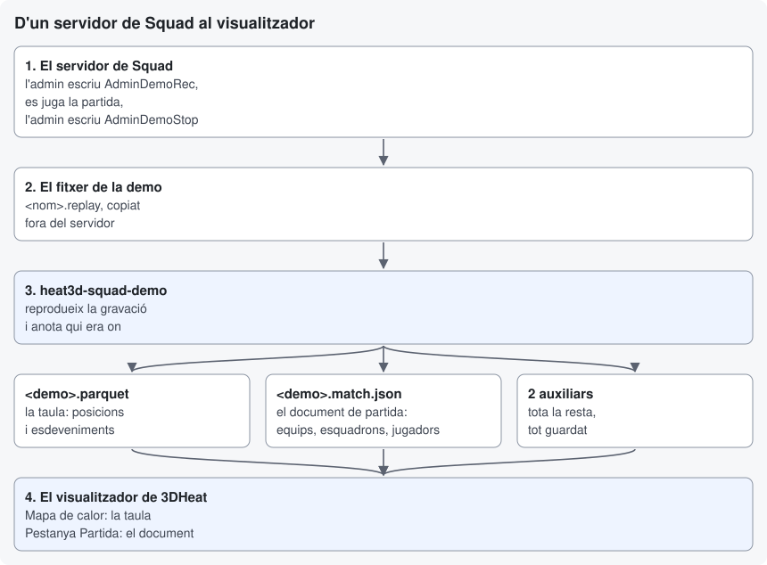

# 3DHeat Squad {#dheat-squad}

**Què és?** Un petit programa que converteix una gravació d'una partida de Squad en
fitxers que el visualitzador de [3DHeat](https://github.com/Holdi601/3DHeat)
([documentació](https://holdi601.github.io/3DHeat/)) pot dibuixar: on era cada
jugador, segon a segon, i què va passar a cada lloc.

**Per què l'utilitzaria?** Per veure una partida des de dalt: on va haver-hi els combats,
quines rutes van seguir els esquadrons i on van morir els vehicles.

**Exemple:** `match.replay` (una demo, gravada en un servidor de Squad) ->
`match.parquet` (una fila per posició o esdeveniment) + `match.match.json` (el
document de partida: equips, esquadrons, jugadors). Els resultats són fitxers
Parquet i JSON corrents, de manera que qualsevol altra eina també els pot llegir.

Per a què serveix:

- **On es va lluitar la partida.** La posició de cada jugador i bot, a peu, en
  vehicles terrestres i en helicòpters, unes vuit vegades per segon, amb equip,
  facció, esquadró, salut i inclinació de la vista.
- **Què va passar a cada lloc.** Ferides, reanimacions i morts; cada tret i cada
  impacte en un vehicle; cada vehicle, element desplegable i emplaçament creat,
  danyat, destruït i retirat.
- **Tota la partida en un sol document.** Equips, esquadrons, l'estat del joc, cada
  actor, una línia per jugador i per bot, i una comprovació que res del que conté
  la demo s'ha perdut.



## Inici ràpid {#quick-start}

Si ets nou amb la línia d'ordres, llegeix primer [Abans de començar](before-you-start.md).

```bash
python -m pip install -e .              # instal·la l'ordre heat3d-squad-demo
heat3d-squad-demo match.replay -o out   # o una carpeta de fitxers .replay
```

Hauries de veure una línia per demo. Després carrega `out/<mapa>/<demo>.parquet` a la
pestanya Mapa de calor del visualitzador
([Introduir dades](https://holdi601.github.io/3DHeat/getting-data-in.html)).

## Pàgines {#pages}

| Pàgina | Què cobreix |
|---|---|
| [Abans de començar](before-you-start.md) | Python, una terminal, una primera execució |
| [Gravar una demo](recording.md) | fer que un servidor escrigui una demo, i trobar-la |
| [Convertir demos](converting.md) | l'ordre, cada opció, exemple de sortida |
| [La taula](output-table.md) | cada columna i cada `event` |
| [El document de partida i els annexos](output-match.md) | el `.match.json`, els dos annexos, la comprovació |
| [Com es llegeix una demo](how-it-works.md) | les capes del lector, i què s'ha verificat |
| [Límits, actualitzacions i condicions](limits.md) | què no es llegeix, què pot trencar una actualització de Squad, dades personals, llicència |
| [Referència de l'ordre](../cli-reference.md) | cada opció i columna, generada a partir del codi |
| [Mantenir aquesta documentació](maintaining.md) | la llista de comprovació de publicació |

## Relacionat {#related}

- El visualitzador de 3DHeat: [github.com/Holdi601/3DHeat](https://github.com/Holdi601/3DHeat),
  documentació a [holdi601.github.io/3DHeat](https://holdi601.github.io/3DHeat/).
- Els formats de fitxer que llegeix el visualitzador, inclòs el contenidor d'un fitxer
  per partida: [Un fitxer per partida (.3dheat)](https://holdi601.github.io/3DHeat/container.html).
  Aquest convertidor escriu els fitxers sols: la taula, el document de partida i
  els seus annexos, un al costat de l'altre.
- El Watcher de 3DHeat executa aquest convertidor sobre les demos noves quan està
  instal·lat (adaptador `squad-demos`): [3DHeat Watcher](https://holdi601.github.io/3DHeat-Watcher/).

## Les eines de 3DHeat {#the-3dheat-tools}

| Eina | Què fa | Codi | Documentació |
|---|---|---|---|
| Visualitzador 3DHeat | mostra les dades: mapes de calor, anàlisi de curses, revisió de partides | [3DHeat](https://github.com/Holdi601/3DHeat) | [documentació](https://holdi601.github.io/3DHeat/) |
| GameFiles | nivells i circuits dels fitxers propis d'un joc | [3DHeat-GameFiles](https://github.com/Holdi601/3DHeat-GameFiles) | [documentació](https://holdi601.github.io/3DHeat-GameFiles/) |
| GameCapture | telemetria de voltes, i nivells reconstruïts a partir de vídeo de joc | [3DHeat-GameCapture](https://github.com/Holdi601/3DHeat-GameCapture) | [documentació](https://holdi601.github.io/3DHeat-GameCapture/) |
| Unreal Exporter | un connector per a l'editor d'Unreal: un nivell com un sol `.glb` | [3DHeat-UnrealExporter](https://github.com/Holdi601/3DHeat-UnrealExporter) | [documentació](https://holdi601.github.io/3DHeat-UnrealExporter/) |
| CS2 | demos i mapes de Counter-Strike 2 | [3DHeat-CS2](https://github.com/Holdi601/3DHeat-CS2) | [documentació](https://holdi601.github.io/3DHeat-CS2/) |
| Watcher | registra el que publiquen els jocs mentre hi jugues | [3DHeat-Watcher](https://github.com/Holdi601/3DHeat-Watcher) | [documentació](https://holdi601.github.io/3DHeat-Watcher/) |
| Ext-WarThunder | repeticions de War Thunder | [3DHeat-Ext-WarThunder](https://github.com/Holdi601/3DHeat-Ext-WarThunder) | [documentació](https://holdi601.github.io/3DHeat-Ext-WarThunder/) |
| Ext-WoT | repeticions de World of Tanks | [3DHeat-Ext-WoT](https://github.com/Holdi601/3DHeat-Ext-WoT) | [documentació](https://holdi601.github.io/3DHeat-Ext-WoT/) |
| Ext-WoWs | repeticions de World of Warships | [3DHeat-Ext-WoWs](https://github.com/Holdi601/3DHeat-Ext-WoWs) | [documentació](https://holdi601.github.io/3DHeat-Ext-WoWs/) |
| Ext-Squad | demos de servidors de Squad | [3DHeat-Ext-Squad](https://github.com/Holdi601/3DHeat-Ext-Squad) | [documentació](https://holdi601.github.io/3DHeat-Ext-Squad/) |
| Ext-DCS | mapes de DCS World com a nivells 3D | [3DHeat-Ext-DCS](https://github.com/Holdi601/3DHeat-Ext-DCS) | [documentació](https://holdi601.github.io/3DHeat-Ext-DCS/) |
| Ext-IL2 | mapes d'IL-2 Sturmovik com a nivells 3D | [3DHeat-Ext-IL2](https://github.com/Holdi601/3DHeat-Ext-IL2) | [documentació](https://holdi601.github.io/3DHeat-Ext-IL2/) |
