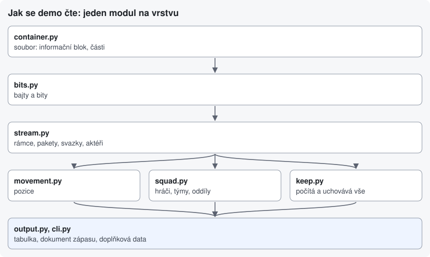

# Jak se demo čte {#how-a-demo-is-read}

Řečeno jednoduše: server Squadu posílá pozici každého hráče všem ostatním hráčům. Soubor dema je záznam tohoto provozu. Tento nástroj ho přehraje a zapíše, kdo byl kde.



Síťové demo Unreal je replikační provoz serveru, který zapsal jeho demo driver. Čtení znamená číst tento provoz tak, jak by ho četl klient.

| Modul | Vrstva |
|---|---|
| `container.py` | Soubor lokálního streameru: informační blok (magic `0x1CA2E27F`), pak části. Typy částí jsou hlavička (`FNetworkDemoHeader`, magic `0x2CF5A13D`), data replikace, kontrolní body a události. |
| `bits.py` | Bajtové archivy pro rámce a bitové archivy pro pakety. Pakety se čtou od nejnižšího bitu. |
| `stream.py` | Rámce, pakety, svazky (částečné svazky se spojují), kanály aktérů, vytvoření aktérů a bloky obsahu. Každý blok nese replikované vlastnosti jako handle, počet bitů a bity, potom vzdálená volání a vlastní delta pole jako handle do skupiny `_ClassNetCache` dané třídy. Objekty, které exporty nepojmenují, dostanou svou třídu, až se přečte celé demo (viz níže). |
| `movement.py` | `FRepMovement` enginu a vrtulníkový pohyb Squadu. |
| `keep.py` | Každá narazená položka, spočítaná a uložená: řádky doplňkových dat a vlastní kontrola. |
| `squad.py` | Které třídy Squadu nesou jaká data. `SQPlayerState` drží jméno, stav týmu, stav oddílu a aktuální pawn; `SQTeamState` číslo týmu a frakci; `SQSquadState` číslo oddílu. Vlastníkem pawnu sedadla je jeho vozidlo. |
| `output.py`, `cli.py` | Tabulka a dokument zápasu. |

Replay pojmenovává svá pole sám. Nese názvy tříd a vlastností pro každý handle a cesty k objektům, na které odkazuje. Každou vlastnost tak lze najít podle jména bez kódu hry. K přečtení bitů vlastnosti je potřeba jen její typ. U pohybu je to vlastní typ enginu; u vlastností Squadu jsou typy jednoduché: řetězce, celá čísla, odkazy na objekty a názvy.

Některé objekty jsou pojmenované jen sami sebou: aktéři úrovně podle jména instance (`Team1SpawnPoint3`), komponenty podle vlastního jména (`MovementComponent`, `wheel_L1`). Jejich třídu najdeme v tabulkách exportů až po přečtení streamu. Demo driver exportuje pole třídy v tom rámci, kde se poprvé odešle (platí to pro každé první odeslání pojmenovaného objektu v testovacích demech). Třída je tedy ta jediná skupina, která v rámcích, kde objekt poprvé odeslal svá pole, exportovala přesně tato pole. Jinak je to libovolná skupina, která do té doby měla všechna svá pole, pokud všechny dávají stejná jména. Jinak je to třída objektu stejného jména bez čísel, nebo jediná skupina, jejíž jméno obsahuje jméno objektu. Z polí objektů pojmenovaných tímto způsobem, která jejich třída posílá s jednou pevnou délkou bitů, všechna přišla s touto délkou (žádná s jinou). Co ani jedno z toho nerozhodne, zůstane celé v doplňkových datech entit.

## Dekódování vlastností {#decoding-properties}

Každá replikovaná vlastnost se dekóduje tak daleko, jak to říkají její bity: jeden bit jako příznak, odkaz na objekt (jeho net GUID) tam, kde jméno končí jako u odkazu (`...State`, `...Seat`, `...Pawn`, `...Class`...), délka a tolik bajtů jako řetězec, jméno, čísla po 8, 16, 32 nebo 64 bitech (desetinné číslo tam, kde to říká jméno vlastnosti: zdraví, čas, rychlost, vstup...), cokoli jiného jako bity v hexadecimální soustavě s řetězci nalezenými uvnitř. Vzdálená volání se čtou stejně, podle názvů parametrů, které demo exportuje pro každou funkci.

## Jak se čtou události {#how-the-events-are-read}

Vojákovo `Health` a `bWounded` pocházejí ze serveru: zraněn je, když se `bWounded` zapne, oživen, když se vypne a zdraví je nad 0, mrtvý, když zdraví klesne pod -100 (hráč, který se vzdá nebo vykrvácí, dostane -300); bot, který nikdy není zraněn, umírá na 0. Vozidlo nebo rozmístitelný prvek je `damaged` při každém poklesu jeho `Health` a `destroyed` na 0 nebo méně. Vytvoření a odstranění jsou otevření a zavření kanálu aktéra; sedadlo je `CurrentSeat` ze stavu hráče (odkaz na komponentu sedadla, která se posílá na jeho vozidle). Úhel pohledu je `RemoteViewPitch` vojáka, bajt od úplně dolů (0) po úplně nahoru (255). Výstřel je `MulticastFireProjectile` zbraně (počátek a směr), nebo jejího `MulticastFireMultipleProjectileEffects`, pokud nepřišlo stejné volání se stejným směrem; zásah je `MulticastPlayDamageEffects` vozidla (místo nárazu, typ poškození).

## Co bylo ověřeno a jak {#what-was-verified-and-how}

Tyto údaje byly ověřeny na dvou veřejných serverových demech Squadu v10.3.1 (Unreal Engine 5.5.4, síťová verze enginu 36) z testovacích dat projektu squad-replay:

- **Počty.** Počty rámců, paketů, otevření aktérů, skupin exportů a exportovaných cest objektů se přesně shodují s nezávislým čtečem toho projektu. Stejně tak počet vzorků pohybu vojáků.
- **Pohyb proti rychlosti.** Krok každého vzorku vojáka od předchozího, vydělený časem mezi nimi, odpovídá rychlosti, kterou vzorek nese. Střední poměr je mezi 0,8 a 1,2 u hráčů, kteří se hýbou.
- **Týmy proti blueprintům.** Tým každého řádku je tým, jehož frakce patří blueprintu vojáka. To platilo i pro hráče, který během zápasu přeběhl na druhou stranu.
- **Chyby.** Zůstává jedna chyba streamu na demo: zbloudilý bit na konci úvodního svazku vlastního diváckého aktéra nahrávače, který nic z toho, co se zde používá, nenese.
- **Úmrtí proti zabitím toho projektu.** Každé zabití, které tento projekt uvádí, je zde přečtené zranění nebo smrt, ve stejný čas a u stejného hráče; zabití vozidel jsou zde přečtená vozidla, jejichž zdraví dosáhlo 0 nebo méně.
- **Rozmístitelné prvky.** Aktéři přečtení zde se stavem sestavení nebo požadavkem FOB odpovídají rozmístitelným prvkům toho projektu, s přesností na jeden.
- **Úhel pohledu.** Bajt úhlu pohledu leží při klidu kolem 120 a dosahuje 255 (úplně nahoru): čte se jako bajt v rozsahu -90 až +90. Čten jako obvyklý bajt enginu pro celou otočku by vojáci měli pohled až 128 stupňů pod obzor, což nemohou.
- **Boti.** Na demu s rozehráváním má každý bot (`SQSquidBot`) vlastní trasu a boti, kteří zemřou, se čtou jako úmrtí.
- **Pohyb vrtulníku** (`SQHelicopterMovementComponent.ReplicatedMovement`, vlastní rozložení Squadu: bez příznaků, poloha v setinách, rychlost a úhlová rychlost, tři volitelné 16bitové úhly, serverové hodiny jako desetinné číslo). Každý vzorek vrtulníku vyplní své bity přesně. Stojící vrtulník má polohu a natočení z místa svého vzniku, na centimetr a jednotku úhlu. Za letu je krok mezi vzorky děleno krokem hodin rychlostí (střední poměr 0,997) a hodiny se posouvají s časem dema (střední rozestup 0,4 ms). Úhlová rychlost sleduje rychlost natočení (korelace 0,91), ale její jednotka není jistá: uchovává se, nepoužívá se.
- **Sedadla.** `CurrentSeat` stavu hráče je odkaz (zabalený net GUID), ne číslo, jak se četlo dříve: přečteno takto, při každé změně je to sedadlo, které vlastní `MulticastUpdateCurrentSeat` vojáka uvedl chvíli předtím, a změny jsou ze squad-replay.
- **Výstřely a zásahy.** Každý `ShootDir` je jednotkový vektor (délka 1 s odchylkou 0,00003); každý počátek `MulticastFireMultipleProjectileEffects`, vydělený 10, je `OriginZeroBased` odpovídajícího `MulticastFireProjectile` s přesností na 1 mm; tam, kde je známá poloha střelce nebo zasaženého vozidla, je počátek výstřelu nebo místo nárazu ve střední vzdálenosti 0,45 m od ní.
- **Vstupy vozidel.** Čteno jako desetinná čísla leží plyn, brzda a ruční brzda pásových vozidel v rozsahu 0 až 1 a řízení v rozsahu -1 až 1, u každé aktualizace.
- **Důvody zavření.** Každý aktér, jehož kanál se znovu otevřel, byl zavřen s `Dormancy`; žádný zavřený s `Destroyed` se neotevřel znovu.

Testy na demech, která si testy samy vytvoří, pokrývají kontejner, archivy, stream a celou cestu až k tabulce, a ověřují, že demo obsahující po jednom každém druhu položky neztratí žádnou ([`tests/test_completeness.py`](https://github.com/Holdi601/3DHeat-Ext-Squad/blob/main/tests/test_completeness.py)):

```bash
python -m pip install -e .[test]
pytest                                   # synthetic demos
HEAT3D_SQUAD_DEMOS=<folder> pytest       # plus real demos in that folder
```
