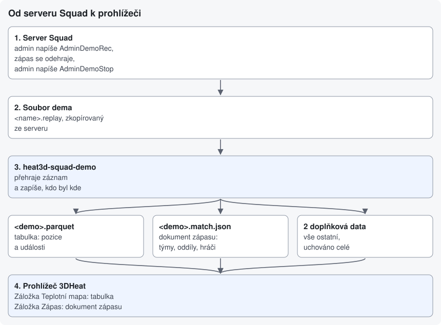

# 3DHeat Squad {#dheat-squad}

**Co to je?** Malý program, který převádí záznam zápasu Squadu na soubory,
které může prohlížeč [3DHeat](https://github.com/Holdi601/3DHeat)
([dokumentace](https://holdi601.github.io/3DHeat/)) vykreslit: kde byl každý
hráč, sekundu po sekundě, a co se kde stalo.

**Proč ho používat?** Abyste viděli zápas shora: kde byly boje, jakými trasami
šly oddíly, kde vozidla zanikla.

**Příklad:** `match.replay` (demo nahrané na serveru Squad) ->
`match.parquet` (jeden řádek na každou pozici nebo událost) + `match.match.json` (dokument
zápasu: týmy, oddíly, hráči). Výstupy jsou běžné soubory Parquet a JSON, takže je
může číst i cokoli jiného.

K čemu se to hodí:

- **Kde se bojovalo.** Pozice každého hráče a bota, pěšky, v pozemních vozidlech i
  ve vrtulnících, asi osmkrát za sekundu, s týmem, frakcí, oddílem, zdravím a
  úhlem pohledu.
- **Co se kde stalo.** Zranění, oživení a úmrtí; každý výstřel a každý zásah
  vozidla; každé vozidlo, rozmístitelný prvek a stanoviště, které vzniklo, bylo
  poškozeno, zničeno a odstraněno.
- **Celý zápas v jednom dokumentu.** Týmy, oddíly, herní stav, každý aktér, řádek
  pro každého hráče a bota, a vlastní kontrola, že se nic z dema neztratilo.



## Rychlý start {#quick-start}

Nikdy jste nepracovali s příkazovým řádkem? Nejdřív si přečtěte [Než začnete](before-you-start.md).

```bash
python -m pip install -e .              # installs the heat3d-squad-demo command
heat3d-squad-demo match.replay -o out   # or a folder of .replay files
```

Uvidíte jeden řádek na každé demo. Potom načtěte `out/<map>/<demo>.parquet` na kartě
Teplotní mapa prohlížeče ([Získání dat](https://holdi601.github.io/3DHeat/getting-data-in.html)).

## Stránky {#pages}

| Stránka | Co obsahuje |
|---|---|
| [Než začnete](before-you-start.md) | Python, terminál, první spuštění |
| [Nahrávání dema](recording.md) | jak nechat server zapsat demo a jak ho najít |
| [Převod dem](converting.md) | příkaz, každá možnost, ukázkový výstup |
| [Tabulka](output-table.md) | každý sloupec a každé `event` |
| [Dokument zápasu a doplňková data](output-match.md) | `.match.json`, dvě doplňková data, vlastní kontrola |
| [Jak se demo čte](how-it-works.md) | vrstvy čtečky a co bylo ověřeno |
| [Omezení, aktualizace a podmínky](limits.md) | co se nečte, co může rozbít aktualizace Squadu, osobní údaje, licence |
| [Přehled příkazů](../cli-reference.md) | každá možnost a sloupec, vygenerováno z kódu |
| [Údržba těchto dokumentů](maintaining.md) | kontrolní seznam pro vydání |

## Související {#related}

- Prohlížeč 3DHeat: [github.com/Holdi601/3DHeat](https://github.com/Holdi601/3DHeat),
  dokumentace na [holdi601.github.io/3DHeat](https://holdi601.github.io/3DHeat/).
- Formáty souborů, které prohlížeč čte, včetně kontejneru jednoho souboru na zápas:
  [Jeden soubor na zápas (.3dheat)](https://holdi601.github.io/3DHeat/container.html).
  Tento převodník zapisuje volné soubory: tabulku, dokument zápasu a jeho
  doplňková data vedle sebe.
- Sledovací nástroj 3DHeat Watcher spouští tento převodník na nová dema, když je nainstalovaný
  (adaptér `squad-demos`): [3DHeat Watcher](https://holdi601.github.io/3DHeat-Watcher/).

## Nástroje 3DHeat {#the-3dheat-tools}

| Nástroj | Co dělá | Kód | Dokumentace |
|---|---|---|---|
| prohlížeč 3DHeat | zobrazuje data: teplotní mapy, analýzu závodů, přehled zápasu | [3DHeat](https://github.com/Holdi601/3DHeat) | [dokumentace](https://holdi601.github.io/3DHeat/) |
| GameFiles | úrovně a tratě ze souborů samotné hry | [3DHeat-GameFiles](https://github.com/Holdi601/3DHeat-GameFiles) | [dokumentace](https://holdi601.github.io/3DHeat-GameFiles/) |
| GameCapture | telemetrie kol a úrovně postavené z videa hry | [3DHeat-GameCapture](https://github.com/Holdi601/3DHeat-GameCapture) | [dokumentace](https://holdi601.github.io/3DHeat-GameCapture/) |
| Unreal Exporter | zásuvný modul pro Unreal Editor: úroveň jako jeden `.glb` | [3DHeat-UnrealExporter](https://github.com/Holdi601/3DHeat-UnrealExporter) | [dokumentace](https://holdi601.github.io/3DHeat-UnrealExporter/) |
| CS2 | dema a mapy Counter-Strike 2 | [3DHeat-CS2](https://github.com/Holdi601/3DHeat-CS2) | [dokumentace](https://holdi601.github.io/3DHeat-CS2/) |
| Watcher | zaznamenává, co hry zveřejňují, když hrajete | [3DHeat-Watcher](https://github.com/Holdi601/3DHeat-Watcher) | [dokumentace](https://holdi601.github.io/3DHeat-Watcher/) |
| Ext-WarThunder | replaye War Thunder | [3DHeat-Ext-WarThunder](https://github.com/Holdi601/3DHeat-Ext-WarThunder) | [dokumentace](https://holdi601.github.io/3DHeat-Ext-WarThunder/) |
| Ext-WoT | replaye World of Tanks | [3DHeat-Ext-WoT](https://github.com/Holdi601/3DHeat-Ext-WoT) | [dokumentace](https://holdi601.github.io/3DHeat-Ext-WoT/) |
| Ext-WoWs | replaye World of Warships | [3DHeat-Ext-WoWs](https://github.com/Holdi601/3DHeat-Ext-WoWs) | [dokumentace](https://holdi601.github.io/3DHeat-Ext-WoWs/) |
| Ext-Squad | dema serverů Squad | [3DHeat-Ext-Squad](https://github.com/Holdi601/3DHeat-Ext-Squad) | [dokumentace](https://holdi601.github.io/3DHeat-Ext-Squad/) |
| Ext-DCS | mapy DCS World jako 3D úrovně | [3DHeat-Ext-DCS](https://github.com/Holdi601/3DHeat-Ext-DCS) | [dokumentace](https://holdi601.github.io/3DHeat-Ext-DCS/) |
| Ext-IL2 | mapy IL-2 Sturmovik jako 3D úrovně | [3DHeat-Ext-IL2](https://github.com/Holdi601/3DHeat-Ext-IL2) | [dokumentace](https://holdi601.github.io/3DHeat-Ext-IL2/) |
