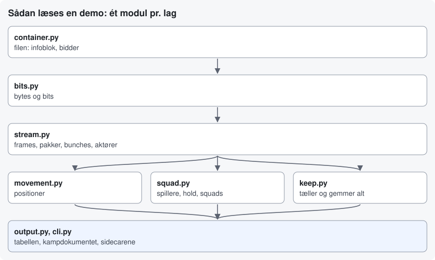

Med almindelige ord: en Squad-server sender hver spillers position til alle de andre spillere. Demo-filen er en optagelse af den trafik. Dette værktøj spiller den af igen og skriver ned, hvem der var hvor.



En Unreal-netværksreplay er serverens egen replikeringstrafik, skrevet ned af dens demo-driver. At læse den er at læse den trafik, sådan som en klient ville.

| Modul | Lag |
|---|---|
| `container.py` | Den lokale filstreamers fil: en infoblok (magisk `0x1CA2E27F`), og derefter bidder. Biddetyperne er headeren (`FNetworkDemoHeader`, magisk `0x2CF5A13D`), replaydata, checkpoints og hændelser. |
| `bits.py` | Byte-arkiver for frames og bit-arkiver for pakker. Pakker læses med den laveste bit først. |
| `stream.py` | Frames, pakker, bunches (delvise bunches samlet), aktørkanaler, aktørspawns og indholdsblokke. Hver blok holder replikerede egenskaber som handle, antal bits og bits, derefter remote calls og custom-delta-felter som handles ind i klassens `_ClassNetCache`-gruppe. Objekter, som eksporterne ikke navngiver, får deres klasse, når hele demoen er læst (se nedenfor). |
| `movement.py` | Motorens `FRepMovement`, og Squads helikopterbevægelse. |
| `keep.py` | Hvert element der mødes, tælles og gemmes: sidefilernes rækker og selvkontrollen. |
| `squad.py` | Hvilke Squad-klasser der bærer hvad. `SQPlayerState` holder navnet, holdtilstanden, squadtilstanden og den aktuelle pawn; `SQTeamState` holdnummeret og fraktionen; `SQSquadState` squadnummeret. Et sædepawns ejer er dens køretøj. |
| `output.py`, `cli.py` | Tabellen og kampdokumentet. |

En replay navngiver sine egne felter. Den bærer klassestierne og egenskabsnavnene for hver handle, og stierne til de objekter, den refererer til. Så hver egenskab kan findes ved navn uden spillets kode. Kun bitsene i en egenskab har brug for dens type. For bevægelse er det motorens egen type; for Squads egenskaber er typerne enkle: strenge, heltal, objektreferencer og navne.

Nogle objekter er kun navngivet ved sig selv: en bane's aktører ved deres instansnavn (`Team1SpawnPoint3`), komponenter ved deres eget (`MovementComponent`, `wheel_L1`). Deres klasse findes i eksporttabellerne, efter streamen: demo-driveren eksporterer en klasses felt i den frame, hvor det først sendes (sandt for hver første afsendelse af et navngivet objekt i testdemoerne), så klassen er den ene gruppe, der eksporterede præcis de handles i de frames, hvor objektet først sendte dem; ellers enhver gruppe, der havde alle sine handles på det tidspunkt, når de alle giver dem de samme navne; ellers klassen for et objekt med samme navn, uden tallene, eller den ene gruppe, hvis navn indeholder objektets. Af handles på objekter, der er navngivet på denne måde, og hvis klasse sender dem med et fast antal bits, kom alle med det antal (ingen med et andet). Det, ingen af disse afgør, bliver i entitets-sidefilen, helt.

## Afkodning af egenskaber

Hver replikeret egenskab afkodes så langt, som dens bits siger, hvad den er: en bit er et flag, en reference til et objekt (dets net-GUID), hvor navnet ender som en references gør (`...State`, `...Seat`, `...Pawn`, `...Class`...), en længde og så mange bytes er en streng, et navn, 8/16/32/64 bits er et tal (et flydende tal, hvor egenskabens navn siger det: helbred, tid, hastighed, input...), alt andet sine bits i hex med de strenge, der findes inde i dem. Remote calls læses på samme måde, efter parameternavnene som demoen eksporterer for hver funktion.

## Sådan læses hændelserne

En soldats `Health` og `bWounded` kommer fra serveren: såret, når `bWounded` tændes, genoplivet, når den slukkes med helbred over 0, død, når helbredet falder under -100 (en spiller, der giver op eller bløder ud, sættes til -300); en bot, som aldrig er såret, dør ved 0. Et køretøj eller deployable er `damaged` ved hvert fald i dets `Health`, `destroyed` ved 0 eller derunder. Spawns og fjernelser er aktørkanalen, der åbnes og lukkes; et sæde er spillertilstandens `CurrentSeat` (en reference til sædekomponenten, som sendes på dets køretøj). Synsvinklens pitch er soldatens `RemoteViewPitch`, en byte fra lige ned (0) til lige op (255). Et skud er et våbens `MulticastFireProjectile` (udgangspunkt og retning), eller dets `MulticastFireMultipleProjectileEffects`, hvor intet sådant kald kom med samme retning; et træf er et køretøjs `MulticastPlayDamageEffects` (nedslagssted, skadetype).

## Hvad der blev verificeret, og hvordan

Dette blev tjekket mod to offentlige Squad v10.3.1-serverdemoer (Unreal Engine 5.5.4, engine-netværksversion 36), fra squad-replay-projektets testfixtures:

- **Antal.** Antallene af frames, pakker, aktøråbninger, eksportgrupper og eksporterede objektstier stemmer præcist med det projekts uafhængige parser. Det gør antallet af soldaters bevægelsesprøver også.
- **Bevægelse mod hastighed.** Hver soldatprøves skridt fra den forrige, divideret med tiden imellem dem, stemmer med den hastighed, prøven bærer. Medianforholdet ligger mellem 0,8 og 1,2 for bevægelige spillere.
- **Hold mod blueprints.** Hver rækkes hold er det hold, hvis fraktion soldatens blueprint hører til. Det holdt for en spiller, der skiftede side under kampen.
- **Fejl.** Én streamfejl pr. demo er tilbage: en løs bit til sidst i den åbnende bunch for optagerens egen tilskuer-aktør, som ikke bærer noget, der bruges her.
- **Dødsfald mod det projekts drab.** Hvert drab, det lister, er et sår eller et dødsfald, læst her, på samme tidspunkt og for samme spiller; dets køretøjsdrab er køretøjer, læst her, der når helbred 0 eller derunder.
- **Deployables.** Aktørerne læst her med en byggetilstand eller et FOB-krav stemmer med det projekts deployables, inden for én.
- **Pitch.** Synsvinkelens pitch-byte ligger omkring 120 i hvile og når 255 (lige op): læst som en byte over -90..+90. Læst som motorens sædvanlige byte for en hel omgang ville den placere soldater op til 128 grader under horisonten, hvilket de ikke kan kigge.
- **Bots.** I en seeding-demo har hver bot (`SQSquidBot`) sin egen bane, og de bots, der dør, læses som dødsfald.
- **Helikoptebevægelse** (`SQHelicopterMovementComponent.ReplicatedMovement`, Squads egen opsætning: ingen flag, positionen i hundredele, hastigheden og vinkelhastigheden, tre valgfri 16-bit-vinkler, serverens ur som et flydende tal). Hver helikopterprøve fylder sine bits præcist. En parkeret helikopters position og gir er dens spawns, til centimeteren og vinkelenheden. Under flyvning er skridtet mellem prøverne over urets skridt hastigheden (medianforhold 0,997), og uret skrider med demoens tid (medianen 0,4 ms fra hinanden). Vinkelhastigheden følger gir-raten (korrelation 0,91), men dens enhed er ikke fastlagt: den gemmes, bruges ikke.
- **Sæder.** En spillertilstands `CurrentSeat` er en reference (et pakket net-GUID), ikke et tal, som tidligere læst: læst sådan, er det ved hver ændring det sæde, soldatens egen `MulticastUpdateCurrentSeat` nævner et øjeblik tidligere, og ændringerne er squad-replays.
- **Skud og træf.** Hver `ShootDir` er en enhedsvektor (længde 1 inden for 0,00003); hver `MulticastFireMultipleProjectileEffects`-udgangspunkt, divideret med 10, er `OriginZeroBased` for den tilsvarende `MulticastFireProjectile` inden for 1 mm; hvor skytten eller det ramte køretøjs position er kendt, ligger skudets udgangspunkt eller nedslaget i median 0,45 m fra den.
- **Køretøjsinput.** Læst som flydende tal ligger de larvebårne køretøjers gas, bremse og håndbremse i 0..1 og deres styring i -1..1, i hver opdatering.
- **Lukkeårsager.** Hver aktør, hvis kanal blev åbnet igen, var lukket med `Dormancy`; ingen lukket med `Destroyed` blev åbnet igen.

Tests på demoer, som testene selv bygger, dækker containeren, arkiverne, streamen og hele vejen til tabellen, og at en demo, der holder ét af hver slags element, ikke mister noget ([`tests/test_completeness.py`](https://github.com/Holdi601/3DHeat-Ext-Squad/blob/main/tests/test_completeness.py)):

```bash
python -m pip install -e .[test]
pytest                                   # synthetic demos
HEAT3D_SQUAD_DEMOS=<folder> pytest       # plus real demos in that folder
```
