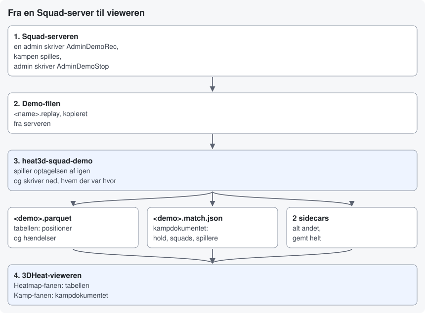

# 3DHeat Squad {#dheat-squad}

**Hvad er det?** Et lille program, der laver en optagelse af en Squad-kamp om til
filer, som [3DHeat](https://github.com/Holdi601/3DHeat)-fremviseren
([dokumentation](https://holdi601.github.io/3DHeat/)) kan tegne: hvor hver spiller
var, sekund for sekund, og hvad der skete hvor.

**Hvorfor skulle jeg bruge det?** For at se en kamp ovenfra: hvor kampene var,
hvilke ruter holdene tog, og hvor køretøjer blev ødelagt.

**Eksempel:** `match.replay` (en demo, optaget på en Squad-server) ->
`match.parquet` (en række pr. position eller hændelse) + `match.match.json` (kampdokumentet:
hold, squads, spillere). Resultaterne er almindelige Parquet- og JSON-filer,
så alt andet kan også læse dem.

Det er nyttigt til:

- **Hvor en kamp blev kæmpet.** Hver spillers og bots position, til fods, i
  landkøretøjer og i helikoptere, cirka otte gange i sekundet, med hold, fraktion,
  squad, helbred og synsvinkel op/ned.
- **Hvad der skete hvor.** Sår, genoplivninger og dødsfald; hvert skud og hvert
  træf på et køretøj; hvert køretøj, deployable og emplacement, der blev spawnet,
  beskadiget, ødelagt og fjernet.
- **Hele kampen i ét dokument.** Hold, squads, spiltilstanden, hver aktør, en linje
  pr. spiller og pr. bot, og en selvkontrol, der viser, at intet af det, demoen
  indeholder, er gået tabt.



## Hurtig start {#quick-start}

Ny til kommandolinjen? Læs [Før du går i gang](before-you-start.md) først.

```bash
python -m pip install -e .              # installs the heat3d-squad-demo command
heat3d-squad-demo match.replay -o out   # or a folder of .replay files
```

Du bør se én linje pr. demo. Indlæs derefter `out/<map>/<demo>.parquet` i
fremviserens Heatmap-fane ([Hent data ind](https://holdi601.github.io/3DHeat/getting-data-in.html)).

## Sider {#pages}

| Side | Hvad den dækker |
|---|---|
| [Før du går i gang](before-you-start.md) | Python, en terminal, en første kørsel |
| [Optag en demo](recording.md) | at få en server til at skrive en demo, og at finde den |
| [Konverter demoer](converting.md) | kommandoen, alle valgmuligheder, eksempel på resultat |
| [Tabellen](output-table.md) | hver kolonne og hver `event` |
| [Kampdokumentet og sidefilerne](output-match.md) | `.match.json`, de to sidefiler, selvkontrollen |
| [Sådan læses en demo](how-it-works.md) | lagene i læseren, og hvad der er blevet verificeret |
| [Begrænsninger, opdateringer og vilkår](limits.md) | hvad der ikke læses, hvad en Squad-opdatering kan ødelægge, personlige data, licens |
| [Kommandoreference](../cli-reference.md) | alle valgmuligheder og kolonner, genereret ud fra koden |
| [Vedligeholdelse af disse dokumenter](maintaining.md) | tjeklisten til udgivelser |

## Relateret {#related}

- 3DHeat-fremviseren: [github.com/Holdi601/3DHeat](https://github.com/Holdi601/3DHeat),
  dokumentation på [holdi601.github.io/3DHeat](https://holdi601.github.io/3DHeat/).
- De filformater, fremviseren læser, inklusive containeren med én fil pr. kamp:
  [Én fil pr. kamp (.3dheat)](https://holdi601.github.io/3DHeat/container.html).
  Denne konverter skriver de løse filer: tabellen, kampdokumentet og
  dets sidefiler side om side.
- 3DHeat Watcher kører denne konverter på nye demoer, når den er installeret
  (adapter `squad-demos`): [3DHeat Watcher](https://holdi601.github.io/3DHeat-Watcher/).

## 3DHeat-værktøjerne {#the-3dheat-tools}

| Værktøj | Hvad det gør | Kode | Dokumentation |
|---|---|---|---|
| 3DHeat-fremviser | viser data: varmekort, løbsanalyse, kampgennemgang | [3DHeat](https://github.com/Holdi601/3DHeat) | [dokumentation](https://holdi601.github.io/3DHeat/) |
| GameFiles | baner og løb fra et spils egne filer | [3DHeat-GameFiles](https://github.com/Holdi601/3DHeat-GameFiles) | [dokumentation](https://holdi601.github.io/3DHeat-GameFiles/) |
| GameCapture | telemetri fra omgange, og baner genskabt ud fra spilvideo | [3DHeat-GameCapture](https://github.com/Holdi601/3DHeat-GameCapture) | [dokumentation](https://holdi601.github.io/3DHeat-GameCapture/) |
| Unreal Exporter | et plugin til Unreal Editor: en bane som én `.glb` | [3DHeat-UnrealExporter](https://github.com/Holdi601/3DHeat-UnrealExporter) | [dokumentation](https://holdi601.github.io/3DHeat-UnrealExporter/) |
| CS2 | Counter-Strike 2-demoer og baner | [3DHeat-CS2](https://github.com/Holdi601/3DHeat-CS2) | [dokumentation](https://holdi601.github.io/3DHeat-CS2/) |
| Watcher | optager det, spil udgiver, mens du spiller | [3DHeat-Watcher](https://github.com/Holdi601/3DHeat-Watcher) | [dokumentation](https://holdi601.github.io/3DHeat-Watcher/) |
| Ext-WarThunder | War Thunder-replays | [3DHeat-Ext-WarThunder](https://github.com/Holdi601/3DHeat-Ext-WarThunder) | [dokumentation](https://holdi601.github.io/3DHeat-Ext-WarThunder/) |
| Ext-WoT | World of Tanks-replays | [3DHeat-Ext-WoT](https://github.com/Holdi601/3DHeat-Ext-WoT) | [dokumentation](https://holdi601.github.io/3DHeat-Ext-WoT/) |
| Ext-WoWs | World of Warships-replays | [3DHeat-Ext-WoWs](https://github.com/Holdi601/3DHeat-Ext-WoWs) | [dokumentation](https://holdi601.github.io/3DHeat-Ext-WoWs/) |
| Ext-Squad | Squad-serverdemoer | [3DHeat-Ext-Squad](https://github.com/Holdi601/3DHeat-Ext-Squad) | [dokumentation](https://holdi601.github.io/3DHeat-Ext-Squad/) |
| Ext-DCS | DCS World-kort som 3D-baner | [3DHeat-Ext-DCS](https://github.com/Holdi601/3DHeat-Ext-DCS) | [dokumentation](https://holdi601.github.io/3DHeat-Ext-DCS/) |
| Ext-IL2 | IL-2 Sturmovik-kort som 3D-baner | [3DHeat-Ext-IL2](https://github.com/Holdi601/3DHeat-Ext-IL2) | [dokumentation](https://holdi601.github.io/3DHeat-Ext-IL2/) |
