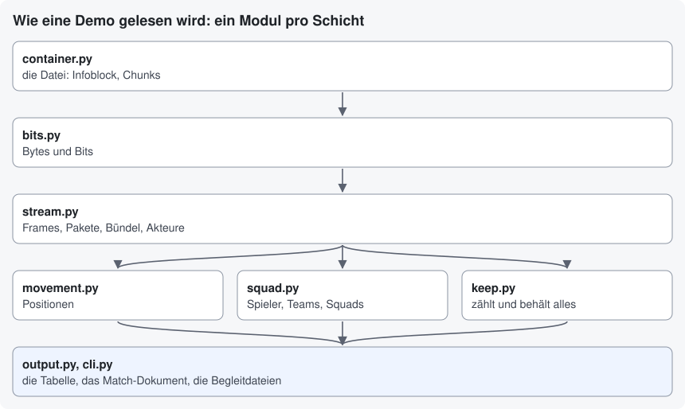

# Wie eine Demo gelesen wird {#how-a-demo-is-read}

Einfach gesagt: Ein Squad-Server schickt jedem Spieler die Position jedes anderen Spielers.
Die Demo-Datei ist eine Aufnahme dieses Verkehrs. Dieses Werkzeug spielt sie ab und schreibt auf,
wer wo war.



Eine Unreal-Netzwerk-Demo ist der Replikationsverkehr des Servers selbst, aufgeschrieben von dessen
Demo-Treiber. Sie zu lesen heißt, diesen Verkehr so zu lesen, wie ihn ein Client empfangen würde.

| Modul | Schicht |
|---|---|
| `container.py` | Die Datei des lokalen Dateistreamers: ein Infoblock (Magic `0x1CA2E27F`), dann Chunks. Chunk-Typen sind der Header (`FNetworkDemoHeader`, Magic `0x2CF5A13D`), Replay-Daten, Checkpoints und Ereignisse. |
| `bits.py` | Byte-Archive für Frames und Bit-Archive für Pakete. Pakete werden vom niedrigsten Bit an gelesen. |
| `stream.py` | Frames, Pakete, Bündel (geteilte Bündel werden zusammengefügt), Akteur-Kanäle, Akteur-Erzeugungen und Content-Blöcke. Jeder Block enthält replizierte Eigenschaften als Handle, Bitanzahl und Bits, dann Remote-Aufrufe und Custom-Delta-Felder als Handles in die Gruppe `_ClassNetCache` der Klasse. Objekte, die die Exporte nicht benennen, erhalten ihre Klasse, sobald die ganze Demo gelesen ist (siehe unten). |
| `movement.py` | Das `FRepMovement` der Engine und die Helikopter-Bewegung von Squad. |
| `keep.py` | Jedes Element, das gefunden wurde, wird gezählt und behalten: die Zeilen der Begleitdateien und die Selbstprüfung. |
| `squad.py` | Welche Squad-Klassen was tragen. `SQPlayerState` enthält den Namen, den Teamstatus, den Squadstatus und die aktuelle Figur; `SQTeamState` die Teamnummer und die Fraktion; `SQSquadState` die Squadnummer. Der Besitzer einer Sitz-Figur ist sein Fahrzeug. |
| `output.py`, `cli.py` | Die Tabelle und das Match-Dokument. |

Eine Replay-Datei benennt ihre Felder selbst. Sie enthält die Klassenpfade und Eigenschaftsnamen für jedes Handle
und die Pfade der Objekte, auf die sie verweist. So lässt sich jede Eigenschaft nach Namen finden,
ohne den Code des Spiels. Nur die Bits einer Eigenschaft brauchen ihren Typ. Bei der Bewegung ist das der
eigene Typ der Engine; bei Squads Eigenschaften sind die Typen einfach: Zeichenketten, Ganzzahlen,
Objektverweise und Namen.

Manche Objekte werden nur durch sich selbst benannt: die Akteure eines Levels durch ihren Instanznamen
(`Team1SpawnPoint3`), Komponenten durch ihren eigenen (`MovementComponent`, `wheel_L1`). Ihre Klasse wird
nach dem Stream aus den Exporttabellen ermittelt: Der Demo-Treiber exportiert das Feld einer Klasse in
dem Frame, in dem es zum ersten Mal gesendet wird (das gilt für jedes erste Senden eines benannten Objekts in
den Test-Demos). Die Klasse ist also die eine Gruppe, die genau diese Handles in den Frames exportierte,
in denen das Objekt sie zuerst sendete; sonst jede Gruppe, die bis dahin alle ihre Handles hatte, wenn alle
denselben Namen ergeben; sonst die Klasse eines Objekts mit demselben Namen, ohne Zahlen, oder die eine
Gruppe, deren Name den Namen des Objekts enthält. Von den Handles solcher Objekte, deren Klasse sie mit einer
festen Bitanzahl sendet, kamen alle mit dieser Anzahl (keiner mit einer anderen). Was keine dieser Regeln
klärt, bleibt ganz in der Begleitdatei der Entitäten.

## Eigenschaften dekodieren {#decoding-properties}

Jede replizierte Eigenschaft wird so weit dekodiert, wie ihre Bits erkennen lassen, was sie ist: ein Bit ein
Flag, ein Verweis auf ein Objekt (seine Net-GUID), wenn der Name so endet wie bei einem Verweis (`...State`,
`...Seat`, `...Pawn`, `...Class`...), eine Länge und so viele Bytes eine Zeichenkette, ein Name, 8/16/32/64 Bit
eine Zahl (eine Gleitkommazahl, wenn der Name das sagt: Gesundheit, Zeit, Rate, Eingabe...), alles
Übrige seine Bits in Hex mit den darin gefundenen Zeichenketten. Remote-Aufrufe werden genauso gelesen,
nach den Parameternamen, die die Demo für jede Funktion exportiert.

## So werden die Ereignisse gelesen {#how-the-events-are-read}

`Health` und `bWounded` eines Soldaten kommen vom Server: verwundet, wenn `bWounded` an geht,
wiederbelebt, wenn es ausgeht und die Gesundheit über 0 liegt, tot, wenn die Gesundheit unter -100 fällt
(ein Spieler, der aufgibt oder ausblutet, wird auf -300 gesetzt); ein Bot, der nie verwundet wird, stirbt bei 0.
Ein Fahrzeug oder ein Verbrauchsgegenstand wird bei jedem Fall seines `Health` als `damaged` gezählt, bei 0
oder darunter als `destroyed`. Erzeugungen und Entfernungen sind das Öffnen und Schließen des Akteur-Kanals;
ein Sitz ist der `CurrentSeat` des Spielerzustands (ein Verweis auf die Sitzkomponente, die auf ihrem
Fahrzeug gesendet wird). Der Blickwinkel ist das `RemoteViewPitch` des Soldaten, ein Byte von senkrecht nach
unten (0) bis senkrecht nach oben (255). Ein Schuss ist ein `MulticastFireProjectile` einer Waffe (Ursprung und
Richtung) oder ihr `MulticastFireMultipleProjectileEffects`, wenn kein solcher Aufruf mit derselben Richtung kam;
ein Treffer ist ein `MulticastPlayDamageEffects` eines Fahrzeugs (Einschlagort, Schadenstyp).

## Was geprüft wurde, und wie {#what-was-verified-and-how}

Diese Punkte wurden an zwei öffentlichen Squad-v10.3.1-Server-Demos geprüft (Unreal Engine 5.5.4, Engine-Netzwerkversion 36),
aus den Testdaten des squad-replay-Projekts:

- **Zählungen.** Die Anzahl der Frames, Pakete, Akteur-Öffnungen, Exportgruppen und exportierten Objektpfade stimmt
  genau mit dem unabhängigen Parser dieses Projekts überein. Ebenso die Anzahl der Bewegungsproben der Soldaten.
- **Bewegung gegen Geschwindigkeit.** Der Schritt jeder Soldaten-Probe von der vorherigen aus, geteilt durch die Zeit
  dazwischen, stimmt mit der Geschwindigkeit überein, die die Probe trägt. Das Medianverhältnis liegt bei
  sich bewegenden Spielern zwischen 0,8 und 1,2.
- **Teams gegen Blueprints.** Das Team jeder Zeile ist das Team, zu dessen Fraktion das Blueprint des
  Soldaten gehört. Das galt auch für einen Spieler, der während des Matches die Seite wechselte.
- **Fehler.** Pro Demo bleibt ein Stream-Fehler: ein loses Bit am Ende des Eröffnungsbündels des
  Spectator-Akteurs des Aufzeichnenden, das hier nichts Verwendetes enthält.
- **Todesfälle gegen die Kills jenes Projekts.** Jeder dort aufgeführte Kill ist hier als Verwundung oder Tod
  gelesen, zur gleichen Zeit und beim gleichen Spieler; seine Fahrzeug-Kills sind hier gelesene Fahrzeuge,
  deren Gesundheit 0 oder darunter erreicht.
- **Verbrauchsgegenstände.** Die hier gelesenen Akteure mit einem Bauzustand oder einer FOB-Anforderung stimmen
  bis auf einen Unterschied mit den Verbrauchsgegenständen jenes Projekts überein.
- **Blickwinkel.** Das Blickwinkel-Byte liegt im Ruhezustand bei etwa 120 und erreicht 255 (senkrecht nach oben):
  gelesen als Byte über -90..+90. Gelesen als das übliche Byte der Engine für eine volle Drehung, käme man
  auf Soldaten, die bis zu 128 Grad unter dem Horizont blicken, was sie nicht können.
- **Bots.** In einer Seeding-Demo hat jeder Bot (`SQSquidBot`) eine eigene Spur, und die Bots, die sterben,
  werden als Tode gelesen.
- **Helikopter-Bewegung** (`SQHelicopterMovementComponent.ReplicatedMovement`, Squads eigenes Layout: keine Flags,
  die Position in Hundertsteln, die Geschwindigkeit und Winkelgeschwindigkeit, drei optionale 16-Bit-Winkel,
  die Uhr des Servers als Gleitkommazahl). Jede Helikopter-Probe füllt ihre Bits genau aus. Die Position und
  der Gierwinkel eines geparkten Helikopters sind die seines Spawns, auf den Zentimeter und die Winkeleinheit genau.
  Im Flug ist der Schritt zwischen den Proben geteilt durch den Uhrenschritt die Geschwindigkeit (Medianverhältnis 0,997),
  und die Uhr läuft mit der Zeit der Demo (Median 0,4 ms Abstand). Die Winkelgeschwindigkeit folgt der Gierrate
  (Korrelation 0,91), aber ihre Einheit ist nicht eindeutig festgelegt: sie wird behalten, nicht verwendet.
- **Sitze.** Der `CurrentSeat` eines Spielerzustands ist ein Verweis (eine gepackte Net-GUID), keine Zahl, wie
  es vorher gelesen wurde: So gelesen, ist er bei jeder Änderung der Sitz, den der eigene `MulticastUpdateCurrentSeat`
  des Soldaten einen Moment zuvor nennt, und die Änderungen stammen von squad-replay.
- **Schüsse und Treffer.** Jedes `ShootDir` ist ein Einheitsvektor (Länge 1 bis auf 0,00003); jeder
  Ursprung von `MulticastFireMultipleProjectileEffects`, geteilt durch 10, ist das `OriginZeroBased` des passenden
  `MulticastFireProjectile` bis auf 1 mm; wo die Position des Schützen oder des getroffenen Fahrzeugs bekannt ist,
  liegt der Ursprung des Schusses oder der Einschlag im Median 0,45 m davon entfernt.
- **Fahrzeugeingaben.** Als Gleitkommazahlen gelesen liegen Gas, Bremse und Handbremse der Kettenfahrzeuge
  zwischen 0 und 1, die Lenkung zwischen -1 und 1, in jedem Update.
- **Schließgründe.** Jeder Akteur, dessen Kanal erneut geöffnet wurde, war mit `Dormancy` geschlossen worden;
  keiner, der mit `Destroyed` geschlossen wurde, wurde wieder geöffnet.

Tests mit Demos, die die Tests selbst erzeugen, decken den Container, die Archive, den Stream und den ganzen Weg
bis zur Tabelle ab sowie die Prüfung, dass eine Demo mit einem Element jeder Art nichts verliert
([`tests/test_completeness.py`](https://github.com/Holdi601/3DHeat-Ext-Squad/blob/main/tests/test_completeness.py)):

```bash
python -m pip install -e .[test]
pytest                                   # synthetic demos
HEAT3D_SQUAD_DEMOS=<folder> pytest       # plus real demos in that folder
```
