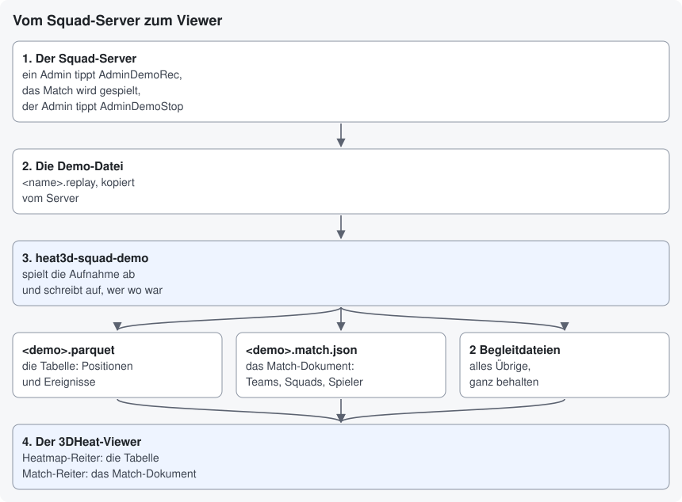

# 3DHeat Squad {#dheat-squad}

**Was ist das?** Ein kleines Programm, das eine Aufnahme eines Squad-Matches in Dateien verwandelt,
die der [3DHeat](https://github.com/Holdi601/3DHeat)-Viewer
([Dokumentation](https://holdi601.github.io/3DHeat/)) zeichnen kann: wo jeder Spieler war, Sekunde für Sekunde,
und was wo passiert ist.

**Wozu brauche ich das?** Um ein Match von oben zu sehen: wo gekämpft wurde, welche Routen die Squads
nahmen, wo Fahrzeuge zerstört wurden.

**Beispiel:** `match.replay` (eine Demo, auf einem Squad-Server aufgenommen) ->
`match.parquet` (eine Zeile pro Position oder Ereignis) + `match.match.json` (das Match-Dokument: Teams,
Squads, Spieler). Die Ausgaben sind gewöhnliche Parquet- und JSON-Dateien, sodass auch andere Programme
sie lesen können.

Wofür es nützlich ist:

- **Wo ein Match ausgetragen wurde.** Die Position jedes Spielers und Bots, zu Fuß, in Bodenfahrzeugen
  und in Helikoptern, etwa achtmal pro Sekunde, mit Team, Fraktion, Squad, Gesundheit und Blickwinkel.
- **Was wo passiert ist.** Verwundungen, Wiederbelebungen und Tode; jeder Schuss und jeder Treffer auf
  ein Fahrzeug; jedes Fahrzeug, jedes aufstellbare Gerät und jedes Geschütz, das erzeugt, beschädigt,
  zerstört und entfernt wurde.
- **Das ganze Match in einem Dokument.** Teams, Squads, der Spielstand, jeder Akteur, eine Zeile pro
  Spieler und pro Bot, und eine Selbstprüfung, dass nichts verloren ging, was die Demo enthält.



## Schnellstart {#quick-start}

Neu in der Kommandozeile? Lies zuerst [Bevor du anfängst](before-you-start.md).

```bash
python -m pip install -e .              # installs the heat3d-squad-demo command
heat3d-squad-demo match.replay -o out   # or a folder of .replay files
```

Du solltest pro Demo eine Zeile sehen. Lade dann `out/<map>/<demo>.parquet` im Heatmap-Tab des Viewers
([Daten hineinbringen](https://holdi601.github.io/3DHeat/getting-data-in.html)).

## Seiten {#pages}

| Seite | Was sie behandelt |
|---|---|
| [Bevor du anfängst](before-you-start.md) | Python, ein Terminal, ein erster Lauf |
| [Eine Demo aufnehmen](recording.md) | einen Server die Demo schreiben lassen, und sie finden |
| [Demos umwandeln](converting.md) | der Befehl, jede Option, Beispielausgabe |
| [Die Tabelle](output-table.md) | jede Spalte und jedes `event` |
| [Das Match-Dokument und die Begleitdateien](output-match.md) | das `.match.json`, die beiden Begleitdateien, die Selbstprüfung |
| [Wie eine Demo gelesen wird](how-it-works.md) | die Schichten des Lesers und was geprüft wurde |
| [Grenzen, Updates und Bedingungen](limits.md) | was nicht gelesen wird, was ein Squad-Update kaputt machen kann, persönliche Daten, Lizenz |
| [Befehlsreferenz](../cli-reference.md) | jede Option und Spalte, aus dem Code erzeugt |
| [Diese Doku pflegen](maintaining.md) | die Checkliste für Releases |

## Verwandtes {#related}

- Der 3DHeat-Viewer: [github.com/Holdi601/3DHeat](https://github.com/Holdi601/3DHeat),
  Dokumentation unter [holdi601.github.io/3DHeat](https://holdi601.github.io/3DHeat/).
- Die Dateiformate, die der Viewer liest, einschließlich des Ein-Datei-pro-Match-Containers:
  [Eine Datei pro Match (.3dheat)](https://holdi601.github.io/3DHeat/container.html).
  Dieser Konverter schreibt die losen Dateien: die Tabelle, das Match-Dokument und
  seine Begleitdateien nebeneinander.
- Der 3DHeat-Watcher führt diesen Konverter bei neuen Demos aus, wenn er installiert ist
  (Adapter `squad-demos`): [3DHeat Watcher](https://holdi601.github.io/3DHeat-Watcher/).

## Die 3DHeat-Werkzeuge {#the-3dheat-tools}

| Werkzeug | Was es tut | Code | Doku |
|---|---|---|---|
| 3DHeat-Viewer | zeigt die Daten: Heatmaps, Rennanalyse, Match-Auswertung | [3DHeat](https://github.com/Holdi601/3DHeat) | [Doku](https://holdi601.github.io/3DHeat/) |
| GameFiles | Levels und Strecken aus den eigenen Dateien eines Spiels | [3DHeat-GameFiles](https://github.com/Holdi601/3DHeat-GameFiles) | [Doku](https://holdi601.github.io/3DHeat-GameFiles/) |
| GameCapture | Rundentelemetrie, und Levels, die aus Spielvideos nachgebaut werden | [3DHeat-GameCapture](https://github.com/Holdi601/3DHeat-GameCapture) | [Doku](https://holdi601.github.io/3DHeat-GameCapture/) |
| Unreal Exporter | ein Plugin für den Unreal Editor: ein Level als eine `.glb` | [3DHeat-UnrealExporter](https://github.com/Holdi601/3DHeat-UnrealExporter) | [Doku](https://holdi601.github.io/3DHeat-UnrealExporter/) |
| CS2 | Counter-Strike-2-Demos und Karten | [3DHeat-CS2](https://github.com/Holdi601/3DHeat-CS2) | [Doku](https://holdi601.github.io/3DHeat-CS2/) |
| Watcher | nimmt auf, was Spiele veröffentlichen, während du spielst | [3DHeat-Watcher](https://github.com/Holdi601/3DHeat-Watcher) | [Doku](https://holdi601.github.io/3DHeat-Watcher/) |
| Ext-WarThunder | War-Thunder-Replays | [3DHeat-Ext-WarThunder](https://github.com/Holdi601/3DHeat-Ext-WarThunder) | [Doku](https://holdi601.github.io/3DHeat-Ext-WarThunder/) |
| Ext-WoT | World-of-Tanks-Replays | [3DHeat-Ext-WoT](https://github.com/Holdi601/3DHeat-Ext-WoT) | [Doku](https://holdi601.github.io/3DHeat-Ext-WoT/) |
| Ext-WoWs | World-of-Warships-Replays | [3DHeat-Ext-WoWs](https://github.com/Holdi601/3DHeat-Ext-WoWs) | [Doku](https://holdi601.github.io/3DHeat-Ext-WoWs/) |
| Ext-Squad | Squad-Server-Demos | [3DHeat-Ext-Squad](https://github.com/Holdi601/3DHeat-Ext-Squad) | [Doku](https://holdi601.github.io/3DHeat-Ext-Squad/) |
| Ext-DCS | DCS-World-Karten als 3D-Levels | [3DHeat-Ext-DCS](https://github.com/Holdi601/3DHeat-Ext-DCS) | [Doku](https://holdi601.github.io/3DHeat-Ext-DCS/) |
| Ext-IL2 | IL-2-Sturmovik-Karten als 3D-Levels | [3DHeat-Ext-IL2](https://github.com/Holdi601/3DHeat-Ext-IL2) | [Doku](https://holdi601.github.io/3DHeat-Ext-IL2/) |
| Ext-Dota | die Dota-2-Karte aus deiner eigenen Installation als 3D-Level | [3DHeat-Ext-Dota](https://github.com/Holdi601/3DHeat-Ext-Dota) | [Doku](https://holdi601.github.io/3DHeat-Ext-Dota/) |
| Ext-DotaReplay | Dota-2-Replays | [3DHeat-Ext-DotaReplay](https://github.com/Holdi601/3DHeat-Ext-DotaReplay) | [Doku](https://holdi601.github.io/3DHeat-Ext-DotaReplay/) |
| Ext-Riot | Replays von League of Legends und VALORANT (was sie unverschlüsselt enthalten) | [3DHeat-Ext-Riot](https://github.com/Holdi601/3DHeat-Ext-Riot) | [Doku](https://holdi601.github.io/3DHeat-Ext-Riot/) |
| Ext-Forza | Forza-Strecken, Rennen und Autos aus deiner eigenen Installation | [3DHeat-Ext-Forza](https://github.com/Holdi601/3DHeat-Ext-Forza) | [Doku](https://holdi601.github.io/3DHeat-Ext-Forza/) |
| Ext-Battlefield | Battlefield-Level (Frostbite) als 3D-Levels | [3DHeat-Ext-Battlefield](https://github.com/Holdi601/3DHeat-Ext-Battlefield) | [Doku](https://holdi601.github.io/3DHeat-Ext-Battlefield/) |
| Ext-BeamNG | Strecken von BeamNG.drive | [3DHeat-Ext-BeamNG](https://github.com/Holdi601/3DHeat-Ext-BeamNG) | [Doku](https://holdi601.github.io/3DHeat-Ext-BeamNG/) |
| Ext-ACRally | Etappen von Assetto Corsa Rally als Strecken | [3DHeat-Ext-ACRally](https://github.com/Holdi601/3DHeat-Ext-ACRally) | [Doku](https://holdi601.github.io/3DHeat-Ext-ACRally/) |
| Ext-Reforger | Welten von Arma Reforger (Enfusion) als 3D-Levels | [3DHeat-Ext-Reforger](https://github.com/Holdi601/3DHeat-Ext-Reforger) | [Doku](https://holdi601.github.io/3DHeat-Ext-Reforger/) |
| Ext-R6 | Replays von Rainbow Six Siege | [3DHeat-Ext-R6](https://github.com/Holdi601/3DHeat-Ext-R6) | [Doku](https://holdi601.github.io/3DHeat-Ext-R6/) |
