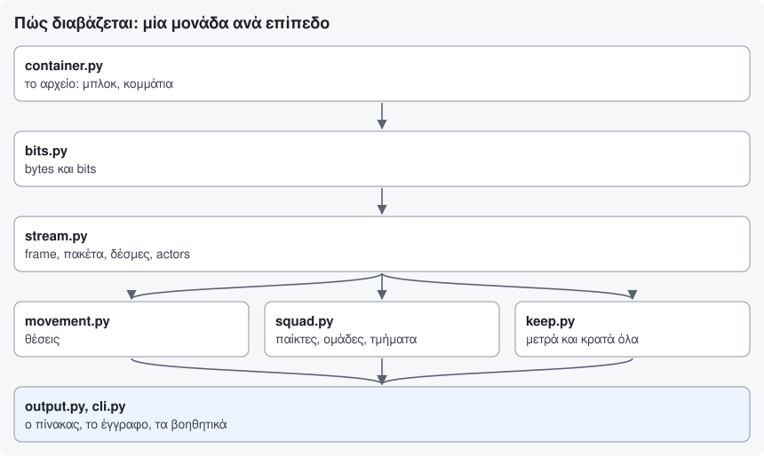

# Πώς διαβάζεται ένα demo {#how-a-demo-is-read}

Με απλά λόγια: ένας server του Squad στέλνει τη θέση κάθε παίκτη σε κάθε άλλον παίκτη. Το αρχείο demo είναι η εγγραφή αυτής της κίνησης. Αυτό το εργαλείο την αναπαράγει και καταγράφει ποιος ήταν πού.



Ένα replay δικτύου του Unreal είναι η δική της κίνηση αναπαραγωγής του server, γραμμένη από τον οδηγό demo του. Το διάβασμα του είναι το διάβασμα αυτής της κίνησης όπως θα την έβλεπε ένας πελάτης.

| Μονάδα | Επίπεδο |
|---|---|
| `container.py` | Το αρχείο του τοπικού streamer αρχείων: ένα μπλοκ πληροφοριών (μαγικός αριθμός `0x1CA2E27F`), και μετά κομμάτια. Οι τύποι κομματιών είναι η κεφαλίδα (`FNetworkDemoHeader`, μαγικός αριθμός `0x2CF5A13D`), τα δεδομένα replay, τα σημεία ελέγχου και τα γεγονότα. |
| `bits.py` | Αρχεία byte για τα frame και αρχεία bit για τα πακέτα. Τα πακέτα διαβάζονται από το χαμηλότερο bit προς τα πάνω. |
| `stream.py` | Frame, πακέτα, δέσμες (μερικές δέσμες ενωμένες), κανάλια οντοτήτων, εμφανίσεις οντοτήτων και μπλοκ περιεχομένου. Κάθε μπλοκ κρατά τις αναπαραγόμενες ιδιότητες ως χειριστή, αριθμό bit και bit, και μετά τις απομακρυσμένες κλήσεις και τα πεδία προσαυξητικής (custom-delta) ως χειριστές μέσα στην ομάδα `_ClassNetCache` της κλάσης. Τα αντικείμενα που δεν ονομάζουν οι εξαγωγές παίρνουν την κλάση τους αφού διαβαστεί όλο το demo (δείτε παρακάτω). |
| `movement.py` | Το `FRepMovement` της μηχανής, και η κίνηση ελικοπτέρου του Squad. |
| `keep.py` | Κάθε στοιχείο που συναντήθηκε, μετρήθηκε και κρατήθηκε: οι γραμμές των βοηθητικών αρχείων και ο αυτοέλεγχος. |
| `squad.py` | Ποιες κλάσεις του Squad φέρουν τι. Το `SQPlayerState` κρατά το όνομα, την κατάσταση ομάδας, την κατάσταση τάγματος και το τρέχον pawn· το `SQTeamState` τον αριθμό ομάδας και τη φατρία· το `SQSquadState` τον αριθμό τάγματος. Ο ιδιοκτήτης ενός pawn θέσης είναι το όχημά του. |
| `output.py`, `cli.py` | Ο πίνακας και το έγγραφο αγώνα. |

Ένα replay ονομάζει τα δικά του πεδία. Φέρει τις διαδρομές των κλάσεων και τα ονόματα των ιδιοτήτων για κάθε χειριστή, και τις διαδρομές των αντικειμένων που αναφέρει. Έτσι κάθε ιδιότητα μπορεί να βρεθεί με το όνομά της χωρίς τον κώδικα του παιχνιδιού. Μόνο τα bit μιας ιδιότητας χρειάζονται τον τύπο της. Για την κίνηση αυτός είναι ο δικός τύπος της μηχανής· για τις ιδιότητες του Squad οι τύποι είναι απλοί: συμβολοσειρές, ακέραιοι, αναφορές αντικειμένων και ονόματα.

Κάποια αντικείμενα ονομάζονται μόνο από τον εαυτό τους: οι actor ενός επιπέδου από το όνομα στιγμιότυπου τους (`Team1SpawnPoint3`), τα εξαρτήματα από τα δικά τους (`MovementComponent`, `wheel_L1`). Η κλάση τους βρίσκεται από τους πίνακες εξαγωγής, μετά τη ροή: ο οδηγός demo εξάγει το πεδίο μιας κλάσης στο frame όπου στέλνεται πρώτη φορά (αληθές για κάθε πρώτη αποστολή ενός ονομασμένου αντικειμένου στα δοκιμαστικά demo)· άρα η κλάση είναι η μοναδική ομάδα που εξήγαγε ακριβώς εκείνους τους χειριστές στα frame όπου το αντικείμενο τους έστειλε πρώτα· αλλιώς οποιαδήποτε ομάδα είχε όλους τους χειριστές της μέχρι τότε, όταν όλες τους δίνουν τα ίδια ονόματα· αλλιώς η κλάση ενός αντικειμένου με το ίδιο όνομα, χωρίς τους αριθμούς, ή η μοναδική ομάδα της οποίας το όνομα περιέχει το όνομα του αντικειμένου. Από τους χειριστές των αντικειμένων που ονομάζονται έτσι, και των οποίων η κλάση τους στέλνει με έναν σταθερό αριθμό bit, όλοι ήρθαν με αυτόν τον αριθμό (κανένας με άλλον). Ό,τι δεν κλείνει με κανέναν από αυτούς τους τρόπους μένει ολόκληρο στο βοηθητικό αρχείο οντοτήτων.

## Αποκωδικοποίηση ιδιοτήτων {#decoding-properties}

Κάθε αναπαραγόμενη ιδιότητα αποκωδικοποιείται όσο λένε τα bit της: ένα bit είναι σημαία, μια αναφορά σε αντικείμενο (το καθολικό του αναγνωριστικό δικτύου, net GUID) όταν το όνομα τελειώνει σαν αναφορά (`...State`, `...Seat`, `...Pawn`, `...Class`...), μήκος και τόσα bytes είναι συμβολοσειρά, ένα όνομα, 8/16/32/64 bit είναι αριθμός (κινητής υποδιαστολής όταν το λέει το όνομα της ιδιότητας: υγεία, χρόνος, ρυθμός, είσοδος...), οτιδήποτε άλλο είναι τα bit του σε δεκαεξαδικό μαζί με τις συμβολοσειρές που βρέθηκαν μέσα. Οι απομακρυσμένες κλήσεις διαβάζονται με τον ίδιο τρόπο, με τα ονόματα παραμέτρων που εξάγει το demo για κάθε συνάρτηση.

## Πώς διαβάζονται τα γεγονότα {#how-the-events-are-read}

Η `Health` και το `bWounded` ενός στρατιώτη έρχονται από τον server: τραυματισμένος όταν ανάβει το `bWounded`, αναζωογονημένος όταν σβήνει με υγεία πάνω από 0, νεκρός όταν η υγεία πέσει κάτω από -100 (ένας παίκτης που παραδίδεται ή αιμορραγεί μέχρι θανάτου ορίζεται σε -300)· ένα bot, που ποτέ δεν τραυματίζεται, πεθαίνει στο 0. Ένα όχημα ή ένα εγκαθιστώμενο αντικείμενο είναι `damaged` σε κάθε πτώση της `Health` του, `destroyed` στο 0 ή κάτω. Οι εμφανίσεις και οι αφαιρέσεις είναι το άνοιγμα και το κλείσιμο του καναλιού της οντότητας· μια θέση είναι το `CurrentSeat` της κατάστασης του παίκτη (αναφορά στο εξάρτημα θέσης, που στέλνεται στο όχημά του). Η γωνία βλέμματος είναι το `RemoteViewPitch` του στρατιώτη, ένα byte από ακριβώς κάτω (0) έως ακριβώς πάνω (255). Ένας πυροβολισμός είναι το `MulticastFireProjectile` ενός όπλου (αρχή και κατεύθυνση), ή το `MulticastFireMultipleProjectileEffects` του όπου δεν ήρθε καμία τέτοια κλήση με την ίδια κατεύθυνση· ένα χτύπημα είναι το `MulticastPlayDamageEffects` ενός οχήματος (σημείο πρόσκρουσης, τύπος ζημιάς).

## Τι ελέγχθηκε, και πώς {#what-was-verified-and-how}

Αυτά ελέγχθηκαν σε δύο δημόσια demo server του Squad v10.3.1 (Unreal Engine 5.5.4, έκδοση δικτύου της μηχανής 36), από τα δοκιμαστικά δεδομένα του έργου squad-replay:

- **Πλήθη.** Τα πλήθη των frame, των πακέτων, των ανοιγμάτων καναλιών, των ομάδων εξαγωγής και των διαδρομών εξαγόμενων αντικειμένων ταιριάζουν ακριβώς με τον ανεξάρτητο αναλυτή εκείνου του έργου. Το ίδιο και το πλήθος των δειγμάτων κίνησης των στρατιωτών.
- **Κίνηση έναντι ταχύτητας.** Το βήμα κάθε δείγματος στρατιώτη από το προηγούμενο, διαιρεμένο με τον χρόνο ανάμεσά τους, ταιριάζει με την ταχύτητα που φέρει το δείγμα. Ο διάμεσος λόγος είναι μεταξύ 0,8 και 1,2 σε κινούμενους παίκτες.
- **Ομάδες έναντι blueprint.** Η ομάδα κάθε γραμμής είναι η ομάδα της οποίας η φατρία ανήκει στο blueprint του στρατιώτη. Αυτό ίσχυσε και για έναν παίκτη που αλλάξτε πλευρά κατά τη διάρκεια του αγώνα.
- **Σφάλματα.** Μένει ένα σφάλμα ροής ανά demo: ένα περιττό bit στο τέλος της αρχικής δέσμης του ίδιου του καταγραφέα (του θεατή), που δεν φέρει τίποτα που χρησιμοποιείται εδώ.
- **Θάνατοι έναντι των φόνων εκείνου του έργου.** Κάθε φόνος που εκείνο καταγράφει είναι τραύμα ή θάνατος που διαβάζεται εδώ, την ίδια στιγμή και για τον ίδιο παίκτη· οι φόνοι οχημάτων του είναι οχήματα που διαβάζονται εδώ να φτάνουν υγεία 0 ή κάτω.
- **Εγκαθιστώμενα αντικείμενα.** Οι actor που διαβάζονται εδώ με κατάσταση κατασκευής ή απαίτηση FOB ταιριάζουν με τα εγκαθιστώμενα εκείνου του έργου, με απόκλιση ενός.
- **Κλίση.** Το byte της γωνίας βλέμματος βρίσκεται γύρω στο 120 σε ηρεμία και φτάνει το 255 (ακριβώς πάνω)· διαβάζεται ως byte στο εύρος -90..+90. Αν διαβαζόταν ως το συνηθισμένο byte της μηχανής για έναν πλήρη κύκλο, θα έβαζε τους στρατιώτες έως 128 μοίρες κάτω από τον ορίζοντα, πράγμα που δεν μπορούν να κοιτάξουν.
- **Bots.** Σε ένα demo συγκέντρωσης κάθε bot (`SQSquidBot`) έχει τη δική του διαδρομή, και τα bots που πεθαίνουν διαβάζονται ως θάνατοι.
- **Κίνηση ελικοπτέρου** (`SQHelicopterMovementComponent.ReplicatedMovement`, η δική της διάταξη του Squad: χωρίς σημαίες, η θέση σε εκατοστά, η ταχύτητα και η γωνιακή ταχύτητα, τρεις προαιρετικές γωνίες 16 bit, και ο χρονομετρητής του server ως αριθμός κινητής υποδιαστολής). Κάθε δείγμα ελικοπτέρου γεμίζει τα bit του ακριβώς. Η θέση και η εκτροπή ενός ελικοπτέρου που είναι σταθμευμένο είναι εκείνες της εμφάνισής του, με ακρίβεια εκατοστού και μονάδας γωνίας. Στην πτήση, το βήμα ανάμεσα στα δείγματα διά του βήματος του χρονομετρητή είναι η ταχύτητα (διάμεσος λόγος 0,997), και ο χρονομετρητής προχωρά με τον χρόνο του demo (διάμεσος 0,4 ms ανά βήμα). Η γωνιακή ταχύτητα ακολουθεί τον ρυθμό εκτροπής (συσχέτιση 0,91), αλλά η μονάδα της δεν έχει καθοριστεί: διατηρείται, δεν χρησιμοποιείται.
- **Θέσεις.** Το `CurrentSeat` της κατάστασης ενός παίκτη είναι αναφορά (ένα συμπιεσμένο net GUID), όχι αριθμός όπως διαβαζόταν πριν: διαβασμένο έτσι, σε κάθε αλλαγή είναι η θέση που ονομάζει το δικό του `MulticastUpdateCurrentSeat` του στρατιώτη λίγο νωρίτερα, και οι αλλαγές είναι αυτές του squad-replay.
- **Πυροβολισμοί και χτυπήματα.** Κάθε `ShootDir` είναι μοναδιαίο διάνυσμα (μήκος 1 με ακρίβεια 0,00003)· κάθε αρχή του `MulticastFireMultipleProjectileEffects`, διαιρεμένη με το 10, είναι το `OriginZeroBased` του αντίστοιχου `MulticastFireProjectile` με ακρίβεια 1 mm· όπου είναι γνωστή η θέση του πυροβολητή ή του χτυπημένου οχήματος, η αρχή του πυροβολισμού ή το σημείο πρόσκρουσης απέχει διάμεσα 0,45 m από αυτήν.
- **Είσοδοι οχημάτων.** Διαβασμένα ως αριθμοί κινητής υποδιαστολής, το γκάζι, το φρένο και το χειρόφρενο των οχημάτων με ερπύστριες βρίσκονται στο 0..1 και το τιμόνι τους στο -1..1, σε κάθε ενημέρωση.
- **Αιτίες κλεισίματος.** Κάθε actor του οποίου το κανάλι ανοίξτε ξανά είχε κλείσει με `Dormancy`· κανένας δεν έκλεισε με `Destroyed` και ανοίξτε ξανά.

Τα τεστ σε demo που φτιάχνουν τα ίδια τα τεστ καλύπτουν το κοντέινερ, τις αρχειοθήκες, τη ροή και ολόκληρη τη διαδρομή μέχρι τον πίνακα, και ότι ένα demo που περιέχει ένα στοιχείο κάθε είδους δεν χάνει κανένα ([`tests/test_completeness.py`](https://github.com/Holdi601/3DHeat-Ext-Squad/blob/main/tests/test_completeness.py)):

```bash
python -m pip install -e .[test]
pytest                                   # synthetic demos
HEAT3D_SQUAD_DEMOS=<folder> pytest       # plus real demos in that folder
```
