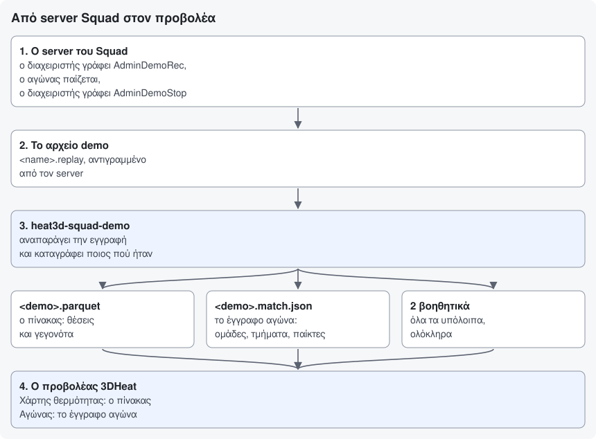

# 3DHeat Squad {#dheat-squad}

**Τι είναι;** Ένα μικρό πρόγραμμα που μετατρέπει την εγγραφή ενός αγώνα του Squad σε
αρχεία που μπορεί να σχεδιάσει ο προβολέας [3DHeat](https://github.com/Holdi601/3DHeat)
([τεκμηρίωση](https://holdi601.github.io/3DHeat/)): πού ήταν κάθε παίκτης, δευτερόλεπτο προς δευτερόλεπτο, και τι συνέβη πού.

**Γιατί να το χρησιμοποιήσω;** Για να δείτε έναν αγώνα από ψηλά: πού έγιναν οι μάχες, ποιες διαδρομές
ακολούθησαν τα τμήματα, πού χάθηκαν τα οχήματα.

**Παράδειγμα:** `match.replay` (ένα demo, εγγεγραμμένο σε server του Squad) ->
`match.parquet` (μία γραμμή για κάθε θέση ή γεγονός) + `match.match.json` (το έγγραφο του
αγώνα: ομάδες, τμήματα, παίκτες). Τα αποτελέσματα είναι συνηθισμένα αρχεία Parquet και JSON, άρα μπορούν να τα διαβάσουν και άλλα εργαλεία.

Σε τι είναι χρήσιμο:

- **Πού έγινε η μάχη.** Η θέση κάθε παίκτη και bot, με τα πόδια, σε χερσαία οχήματα και σε ελικόπτερα,
  περίπου οκτώ φορές το δευτερόλεπτο, με ομάδα, φατρία, τμήμα, υγεία και γωνία βλέμματος.
- **Τι συνέβη πού.** Τραυματισμοί, αναζωογονήσεις και θάνατοι· κάθε πυροβολισμός και κάθε χτύπημα σε όχημα·
  κάθε όχημα, εγκαθιστώμενο αντικείμενο και θέση πυροβολικού που εμφανίστηκε, καταστράφηκε, και αφαιρέθηκε.
- **Ολόκληρος ο αγώνας σε ένα έγγραφο.** Ομάδες, τμήματα, η κατάσταση του παιχνιδιού, κάθε οντότητα,
  μια γραμμή για κάθε παίκτη και bot, και ένας αυτοέλεγχος ότι δεν χάθηκε τίποτα από όσα κρατά το demo.



## Γρήγορη εκκίνηση {#quick-start}

Δεν έχετε ξαναδουλέψει με τη γραμμή εντολών; Διαβάστε πρώτα το [Πριν ξεκινήσετε](before-you-start.md).

```bash
python -m pip install -e .              # installs the heat3d-squad-demo command
heat3d-squad-demo match.replay -o out   # or a folder of .replay files
```

Θα δείτε μία γραμμή για κάθε demo. Μετά φορτώστε το `out/<map>/<demo>.parquet` στην καρτέλα Χάρτης θερμότητας
του προβολέα ([Εισαγωγή δεδομένων](https://holdi601.github.io/3DHeat/getting-data-in.html)).

## Σελίδες {#pages}

| Σελίδα | Τι καλύπτει |
|---|---|
| [Πριν ξεκινήσετε](before-you-start.md) | η Python, ένα τερματικό, μια πρώτη εκτέλεση |
| [Εγγραφή ενός demo](recording.md) | πώς ο server γράφει ένα demo, και πού βρίσκεται |
| [Μετατροπή demo](converting.md) | η εντολή, κάθε επιλογή, παράδειγμα εξόδου |
| [Ο πίνακας](output-table.md) | κάθε στήλη και κάθε `event` |
| [Το έγγραφο αγώνα και τα βοηθητικά αρχεία](output-match.md) | το `.match.json`, τα δύο βοηθητικά αρχεία, ο αυτοέλεγχος |
| [Πώς διαβάζεται ένα demo](how-it-works.md) | τα επίπεδα του αναγνώστη, και τι ελέγχθηκε |
| [Όρια, ενημερώσεις και όροι](limits.md) | τι δεν διαβάζεται, τι μπορεί να χαλάσει μια ενημέρωση του Squad, προσωπικά δεδομένα, άδεια |
| [Αναφορά εντολών](../cli-reference.md) | κάθε επιλογή και στήλη, παραγόμενη από τον κώδικα |
| [Συντήρηση αυτών των σελίδων](maintaining.md) | η λίστα ελέγχου κυκλοφορίας |

## Σχετικά {#related}

- Ο προβολέας 3DHeat: [github.com/Holdi601/3DHeat](https://github.com/Holdi601/3DHeat),
  τεκμηρίωση στο [holdi601.github.io/3DHeat](https://holdi601.github.io/3DHeat/).
- Τα αρχεία που διαβάζει ο προβολέας, μαζί με το κοντέινερ ενός αγώνα σε ένα αρχείο:
  [Ένα αρχείο ανά αγώνα (.3dheat)](https://holdi601.github.io/3DHeat/container.html).
  Αυτός ο μετατροπέας γράφει τα χαλαρά αρχεία: τον πίνακα, το έγγραφο αγώνα και τα βοηθητικά
  αρχεία του, το ένα δίπλα στο άλλο.
- Ο 3DHeat Watcher τρέχει αυτόν τον μετατροπέα σε νέα demo όταν είναι εγκατεστημένος
  (προσαρμογέας `squad-demos`): [3DHeat Watcher](https://holdi601.github.io/3DHeat-Watcher/).

## Τα εργαλεία του 3DHeat {#the-3dheat-tools}

| Εργαλείο | Τι κάνει | Κώδικας | Τεκμηρίωση |
|---|---|---|---|
| προβολέας 3DHeat | δείχνει τα δεδομένα: θερμικούς χάρτες, ανάλυση αγώνα, επισκόπηση αγώνα | [3DHeat](https://github.com/Holdi601/3DHeat) | [τεκμηρίωση](https://holdi601.github.io/3DHeat/) |
| GameFiles | πίστες και διαδρομές από τα αρχεία ενός παιχνιδιού | [3DHeat-GameFiles](https://github.com/Holdi601/3DHeat-GameFiles) | [τεκμηρίωση](https://holdi601.github.io/3DHeat-GameFiles/) |
| GameCapture | τηλεμετρία γύρων, και πίστες ανακατασκευασμένες από βίντεο παιχνιδιού | [3DHeat-GameCapture](https://github.com/Holdi601/3DHeat-GameCapture) | [τεκμηρίωση](https://holdi601.github.io/3DHeat-GameCapture/) |
| Unreal Exporter | ένα πρόσθετο για το Unreal Editor: ένα επίπεδο ως ένα `.glb` | [3DHeat-UnrealExporter](https://github.com/Holdi601/3DHeat-UnrealExporter) | [τεκμηρίωση](https://holdi601.github.io/3DHeat-UnrealExporter/) |
| CS2 | demo και χάρτες του Counter-Strike 2 | [3DHeat-CS2](https://github.com/Holdi601/3DHeat-CS2) | [τεκμηρίωση](https://holdi601.github.io/3DHeat-CS2/) |
| Watcher | καταγράφει όσα δημοσιεύουν τα παιχνίδια όσο παίζετε | [3DHeat-Watcher](https://github.com/Holdi601/3DHeat-Watcher) | [τεκμηρίωση](https://holdi601.github.io/3DHeat-Watcher/) |
| Ext-WarThunder | replay του War Thunder | [3DHeat-Ext-WarThunder](https://github.com/Holdi601/3DHeat-Ext-WarThunder) | [τεκμηρίωση](https://holdi601.github.io/3DHeat-Ext-WarThunder/) |
| Ext-WoT | replay του World of Tanks | [3DHeat-Ext-WoT](https://github.com/Holdi601/3DHeat-Ext-WoT) | [τεκμηρίωση](https://holdi601.github.io/3DHeat-Ext-WoT/) |
| Ext-WoWs | replay του World of Warships | [3DHeat-Ext-WoWs](https://github.com/Holdi601/3DHeat-Ext-WoWs) | [τεκμηρίωση](https://holdi601.github.io/3DHeat-Ext-WoWs/) |
| Ext-Squad | demo από servers του Squad | [3DHeat-Ext-Squad](https://github.com/Holdi601/3DHeat-Ext-Squad) | [τεκμηρίωση](https://holdi601.github.io/3DHeat-Ext-Squad/) |
| Ext-DCS | χάρτες του DCS World ως τρισδιάστατα επίπεδα | [3DHeat-Ext-DCS](https://github.com/Holdi601/3DHeat-Ext-DCS) | [τεκμηρίωση](https://holdi601.github.io/3DHeat-Ext-DCS/) |
| Ext-IL2 | χάρτες του IL-2 Sturmovik ως τρισδιάστατα επίπεδα | [3DHeat-Ext-IL2](https://github.com/Holdi601/3DHeat-Ext-IL2) | [τεκμηρίωση](https://holdi601.github.io/3DHeat-Ext-IL2/) |
