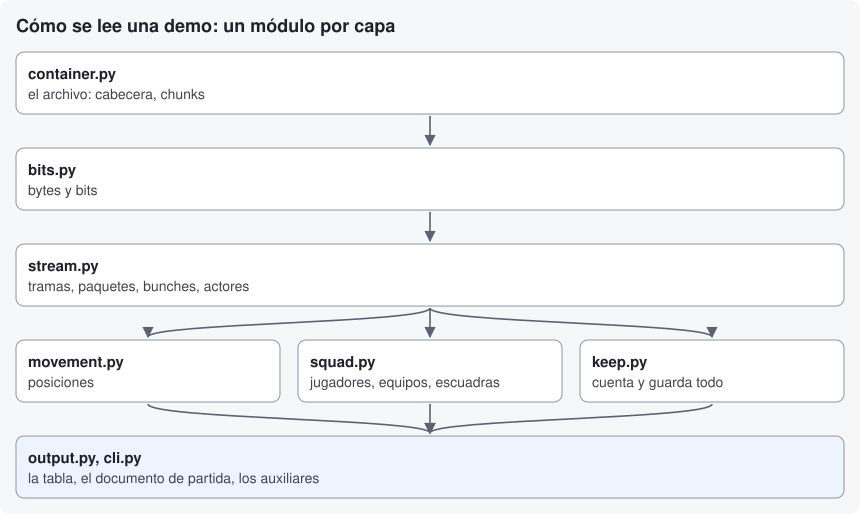

# Cómo se lee una demo {#how-a-demo-is-read}

En pocas palabras: un servidor de Squad envía la posición de cada jugador a todos los demás jugadores. El archivo de demo es una grabación de ese tráfico. Esta herramienta lo reproduce y anota quién estaba dónde.



Una demo de replicación de Unreal es el propio tráfico de replicación del servidor, anotado por su controlador de demos. Leerla es leer ese tráfico como lo haría un cliente.

| Módulo | Capa |
|---|---|
| `container.py` | El archivo del transmisor local de archivos: un bloque de información (magia `0x1CA2E27F`), y luego fragmentos. Los tipos de fragmento son la cabecera (`FNetworkDemoHeader`, magia `0x2CF5A13D`), los datos de repetición, los puntos de control y los eventos. |
| `bits.py` | Archivos de bytes para tramas y archivos de bits para paquetes. Los paquetes se leen del bit menos significativo al más significativo. |
| `stream.py` | Tramas, paquetes, bunches (los bunches parciales se unen), canales de actores, apariciones de actores y bloques de contenido. Cada bloque contiene propiedades replicadas como manejador, número de bits y bits, y después llamadas remotas y campos de delta personalizados como manejadores en el grupo `_ClassNetCache` de la clase. A los objetos que las exportaciones no nombran se les asigna su clase cuando se ha leído toda la demo (ver abajo). |
| `movement.py` | El `FRepMovement` del motor, y el movimiento del helicóptero de Squad. |
| `keep.py` | Cada elemento encontrado, contado y guardado: las filas de los auxiliares y la autocomprobación. |
| `squad.py` | Qué clases de Squad llevan cada cosa. `SQPlayerState` contiene el nombre, el estado del equipo, el estado de la escuadra y el pawn actual; `SQTeamState` el número de equipo y la facción; `SQSquadState` el número de escuadra. El propietario de un pawn de asiento es su vehículo. |
| `output.py`, `cli.py` | La tabla y el documento de la partida. |

Una repetición nombra sus propios campos. Contiene las rutas de clase y los nombres de propiedad de cada manejador, y las rutas de los objetos a los que hace referencia. Así, cada propiedad se puede encontrar por nombre sin el código del juego. Solo los bits de una propiedad necesitan su tipo. Para el movimiento es el tipo propio del motor; para las propiedades de Squad los tipos son sencillos: cadenas, enteros, referencias a objetos y nombres.

Algunos objetos se nombran solo por sí mismos: los actores de un nivel por su nombre de instancia (`Team1SpawnPoint3`), los componentes por el suyo (`MovementComponent`, `wheel_L1`). Su clase se encuentra en las tablas de exportación, después del flujo: el controlador de demos exporta el campo de una clase en el fotograma en que se envía por primera vez (cierto en cada primer envío de un objeto nombrado en las demos de prueba), así que la clase es el único grupo que exportó exactamente esos manejadores en los fotogramas en que el objeto los envió por primera vez; si no, cualquier grupo que tuviera todos sus manejadores para entonces, cuando todos dan los mismos nombres; o si no, la clase de un objeto con el mismo nombre, sin contar los números, o el único grupo cuyo nombre contiene el del objeto. De los manejadores de objetos nombrados así cuya clase los envía con un número fijo de bits, todos llegaron con ese número (ninguno con otro). Lo que nada de esto resuelve se queda en el auxiliar de entidades, completo.

## Decodificar propiedades {#decoding-properties}

Cada propiedad replicada se decodifica hasta donde indican sus bits: un bit un indicador, una referencia a un objeto (su GUID de red) cuando el nombre termina como terminan las referencias (`...State`, `...Seat`, `...Pawn`, `...Class`...), una longitud y tantos bytes una cadena, un nombre, 8/16/32/64 bits un número (un número en coma flotante cuando el nombre de la propiedad lo dice: salud, tiempo, velocidad, entrada...), y cualquier otra cosa sus bits en hexadecimal con las cadenas encontradas dentro. Las llamadas remotas se leen de la misma forma, por los nombres de parámetro que la demo exporta para cada función.

## Cómo se leen los eventos {#how-the-events-are-read}

`Health` y `bWounded` de un soldado vienen del servidor: herido cuando `bWounded` se activa, revivido cuando se desactiva con salud por encima de 0, muerto cuando la salud baja de -100 (un jugador que se rinde o se desangra se pone en -300); un bot, que nunca queda herido, muere en 0. Un vehículo o un elemento desplegable recibe `damaged` en cada bajada de su `Health`, y `destroyed` en 0 o menos. Las apariciones y las retiradas son la apertura y el cierre del canal del actor; un asiento es el `CurrentSeat` del estado del jugador (una referencia al componente del asiento, que se envía en su vehículo). El cabeceo de la vista es el `RemoteViewPitch` del soldado, un byte desde directamente hacia abajo (0) hasta directamente hacia arriba (255). Un disparo es el `MulticastFireProjectile` de un arma (origen y dirección), o su `MulticastFireMultipleProjectileEffects` cuando no llegó ninguna llamada así con la misma dirección; un impacto es el `MulticastPlayDamageEffects` de un vehículo (lugar del impacto, tipo de daño).

## Qué se verificó, y cómo {#what-was-verified-and-how}

Se comprobó con dos demos públicas de servidor de Squad v10.3.1 (Unreal Engine 5.5.4, versión de red del motor 36), de los archivos de prueba del proyecto squad-replay:

- **Recuentos.** Los recuentos de tramas, paquetes, aperturas de actores, grupos de exportación y rutas de objetos exportados coinciden exactamente con el analizador independiente de ese proyecto. También el número de muestras de movimiento de los soldados.
- **Movimiento frente a velocidad.** El desplazamiento de cada muestra de soldado respecto a la anterior, dividido entre el tiempo que pasó entre ambas, coincide con la velocidad que lleva la muestra. La razón mediana está entre 0,8 y 1,2 en jugadores en movimiento.
- **Equipos frente a los blueprints.** El equipo de cada fila es el equipo al que pertenece la facción del blueprint del soldado. Esto se cumplió también con un jugador que cambió de bando durante la partida.
- **Errores.** Queda un error de flujo por demo: un bit suelto al final del bunch de apertura del actor espectador del propio grabador, que no contiene nada de lo que aquí se usa.
- **Bajas frente a las muertes de ese proyecto.** Cada baja que lista es una herida o una muerte leída aquí, en el mismo momento y del mismo jugador; sus bajas de vehículos son vehículos leídos aquí que llegan a salud 0 o menos.
- **Elementos desplegables.** Los actores leídos aquí con un estado de construcción o un requisito de FOB coinciden con los elementos desplegables de ese proyecto, con un margen de uno.
- **Cabeceo.** El byte de cabeceo de la vista está alrededor de 120 en reposo y llega a 255 (directamente hacia arriba): se lee como byte en el rango -90..+90. Leído como el byte habitual del motor para una vuelta completa, pondría a los soldados hasta 128 grados por debajo del horizonte, algo que no pueden mirar.
- **Bots.** En una demo de calentamiento, cada bot (`SQSquidBot`) tiene su propia trayectoria, y los bots que mueren se leen como muertes.
- **Movimiento del helicóptero** (`SQHelicopterMovementComponent.ReplicatedMovement`, el diseño propio de Squad: sin indicadores, la ubicación en centésimas, la velocidad y la velocidad angular, tres ángulos opcionales de 16 bits, el reloj del servidor como número en coma flotante). Cada muestra del helicóptero llena sus bits exactamente. La ubicación y el giro de un helicóptero aparcado son los de su aparición, hasta el centímetro y la unidad de ángulo. En vuelo, el desplazamiento entre muestras dividido entre el paso del reloj es la velocidad (razón mediana 0,997), y el reloj avanza con el tiempo de la demo (mediana de 0,4 ms entre pasos). La velocidad angular sigue a la velocidad de giro (correlación 0,91), pero su unidad no está confirmada: se guarda, no se usa.
- **Asientos.** El `CurrentSeat` de un estado de jugador es una referencia (un GUID de red empaquetado), no un número como se leía antes: así leído, en cada cambio es el asiento que el propio `MulticastUpdateCurrentSeat` del soldado nombra un momento antes, y los cambios son los de squad-replay.
- **Disparos e impactos.** Cada `ShootDir` es un vector unitario (longitud 1, con un margen de 0,00003); cada origen de `MulticastFireMultipleProjectileEffects`, dividido entre 10, es el `OriginZeroBased` del `MulticastFireProjectile` correspondiente con un margen de 1 mm; donde se conoce la posición del tirador o del vehículo alcanzado, el origen del disparo o el impacto está a una mediana de 0,45 m de ella.
- **Entradas de vehículos.** Leídos como números en coma flotante, el acelerador, el freno y el freno de mano de los vehículos de cadenas están entre 0 y 1, y la dirección entre -1 y 1, en cada actualización.
- **Motivos de cierre.** Cada actor cuyo canal se volvió a abrir había sido cerrado con `Dormancy`; ninguno cerrado con `Destroyed` se volvió a abrir.

Las pruebas con demos que construyen las propias pruebas cubren el contenedor, los archivos, el flujo y el camino completo hasta la tabla, y que una demo que contiene un elemento de cada tipo no pierde ninguno ([`tests/test_completeness.py`](https://github.com/Holdi601/3DHeat-Ext-Squad/blob/main/tests/test_completeness.py)):

```bash
python -m pip install -e .[test]
pytest                                   # demos sintéticas
HEAT3D_SQUAD_DEMOS=<folder> pytest       # más las demos reales de esa carpeta
```
