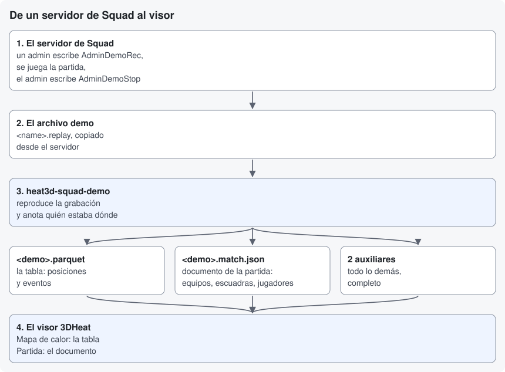

# 3DHeat Squad {#dheat-squad}

**¿Qué es?** Un pequeño programa que convierte la grabación de una partida de Squad en
archivos que el visor [3DHeat](https://github.com/Holdi601/3DHeat)
([documentación](https://holdi601.github.io/3DHeat/)) puede dibujar: dónde estaba cada
jugador, segundo a segundo, y qué pasó en cada lugar.

**¿Para qué lo usaría?** Para ver una partida desde arriba: dónde fue la lucha, qué rutas
siguieron las escuadras, dónde murieron los vehículos.

**Ejemplo:** `match.replay` (una demo, grabada en un servidor de Squad) ->
`match.parquet` (una fila por posición o evento) + `match.match.json` (el documento de la
partida: equipos, escuadras, jugadores). Las salidas son archivos Parquet y JSON corrientes,
así que cualquier otra herramienta también puede leerlos.

Para qué sirve:

- **Dónde se luchó una partida.** La posición de cada jugador y bot, a pie, en vehículos
  terrestres y en helicópteros, unas ocho veces por segundo, con equipo, facción, escuadra,
  salud y cabeceo de la vista.
- **Qué pasó en cada lugar.** Heridas, reanimaciones y muertes; cada disparo y cada impacto en
  un vehículo; cada vehículo, elemento desplegable y emplazamiento que apareció, recibió daño,
  fue destruido o retirado.
- **Toda la partida en un solo documento.** Equipos, escuadras, el estado de la partida, cada
  actor, una línea por jugador y por bot, y una autocomprobación de que no se perdió nada de lo
  que contenía la demo.



## Inicio rápido {#quick-start}

¿Nuevo en la línea de comandos? Lee primero [Antes de empezar](before-you-start.md).

```bash
python -m pip install -e .              # instala el comando heat3d-squad-demo
heat3d-squad-demo match.replay -o out   # o una carpeta con archivos .replay
```

Verás una línea por demo. Después carga `out/<map>/<demo>.parquet` en la pestaña Mapa de calor
del visor ([Cómo cargar datos](https://holdi601.github.io/3DHeat/getting-data-in.html)).

## Páginas {#pages}

| Página | Qué cubre |
|---|---|
| [Antes de empezar](before-you-start.md) | Python, una terminal, una primera ejecución |
| [Grabar una demo](recording.md) | hacer que un servidor escriba una demo, y encontrarla |
| [Convertir demos](converting.md) | el comando, cada opción, un ejemplo de salida |
| [La tabla](output-table.md) | cada columna y cada `event` |
| [El documento de la partida y los auxiliares](output-match.md) | el `.match.json`, los dos auxiliares, la autocomprobación |
| [Cómo se lee una demo](how-it-works.md) | las capas del lector, y lo verificado |
| [Límites, actualizaciones y condiciones](limits.md) | lo que no se lee, lo que puede romper una actualización de Squad, datos personales, licencia |
| [Referencia de comandos](../cli-reference.md) | cada opción y columna, generadas desde el código |
| [Mantenimiento de estas páginas](maintaining.md) | la lista de comprobación de cada versión |

## Relacionado {#related}

- El visor 3DHeat: [github.com/Holdi601/3DHeat](https://github.com/Holdi601/3DHeat),
  documentación en [holdi601.github.io/3DHeat](https://holdi601.github.io/3DHeat/).
- Los formatos de archivo que lee el visor, incluido el contenedor de un archivo por partida:
  [Un archivo por partida (.3dheat)](https://holdi601.github.io/3DHeat/container.html).
  Este convertidor escribe los archivos sueltos: la tabla, el documento de la partida y sus
  auxiliares, uno al lado del otro.
- El 3DHeat Watcher ejecuta este convertidor con las demos nuevas cuando está instalado
  (adaptador `squad-demos`): [3DHeat Watcher](https://holdi601.github.io/3DHeat-Watcher/).

## Las herramientas de 3DHeat {#the-3dheat-tools}

| Herramienta | Qué hace | Código | Documentación |
|---|---|---|---|
| Visor 3DHeat | muestra los datos: mapas de calor, análisis de carrera, revisión de partidas | [3DHeat](https://github.com/Holdi601/3DHeat) | [docs](https://holdi601.github.io/3DHeat/) |
| GameFiles | niveles y circuitos a partir de los archivos propios de un juego | [3DHeat-GameFiles](https://github.com/Holdi601/3DHeat-GameFiles) | [docs](https://holdi601.github.io/3DHeat-GameFiles/) |
| GameCapture | telemetría de vueltas, y niveles reconstruidos a partir de vídeo de juego | [3DHeat-GameCapture](https://github.com/Holdi601/3DHeat-GameCapture) | [docs](https://holdi601.github.io/3DHeat-GameCapture/) |
| Unreal Exporter | un plugin del editor de Unreal: un nivel como un solo `.glb` | [3DHeat-UnrealExporter](https://github.com/Holdi601/3DHeat-UnrealExporter) | [docs](https://holdi601.github.io/3DHeat-UnrealExporter/) |
| CS2 | demos y mapas de Counter-Strike 2 | [3DHeat-CS2](https://github.com/Holdi601/3DHeat-CS2) | [docs](https://holdi601.github.io/3DHeat-CS2/) |
| Watcher | registra lo que publican los juegos mientras juegas | [3DHeat-Watcher](https://github.com/Holdi601/3DHeat-Watcher) | [docs](https://holdi601.github.io/3DHeat-Watcher/) |
| Ext-WarThunder | repeticiones de War Thunder | [3DHeat-Ext-WarThunder](https://github.com/Holdi601/3DHeat-Ext-WarThunder) | [docs](https://holdi601.github.io/3DHeat-Ext-WarThunder/) |
| Ext-WoT | repeticiones de World of Tanks | [3DHeat-Ext-WoT](https://github.com/Holdi601/3DHeat-Ext-WoT) | [docs](https://holdi601.github.io/3DHeat-Ext-WoT/) |
| Ext-WoWs | repeticiones de World of Warships | [3DHeat-Ext-WoWs](https://github.com/Holdi601/3DHeat-Ext-WoWs) | [docs](https://holdi601.github.io/3DHeat-Ext-WoWs/) |
| Ext-Squad | demos de servidores de Squad | [3DHeat-Ext-Squad](https://github.com/Holdi601/3DHeat-Ext-Squad) | [docs](https://holdi601.github.io/3DHeat-Ext-Squad/) |
| Ext-DCS | mapas de DCS World como niveles 3D | [3DHeat-Ext-DCS](https://github.com/Holdi601/3DHeat-Ext-DCS) | [docs](https://holdi601.github.io/3DHeat-Ext-DCS/) |
| Ext-IL2 | mapas de IL-2 Sturmovik como niveles 3D | [3DHeat-Ext-IL2](https://github.com/Holdi601/3DHeat-Ext-IL2) | [docs](https://holdi601.github.io/3DHeat-Ext-IL2/) |
