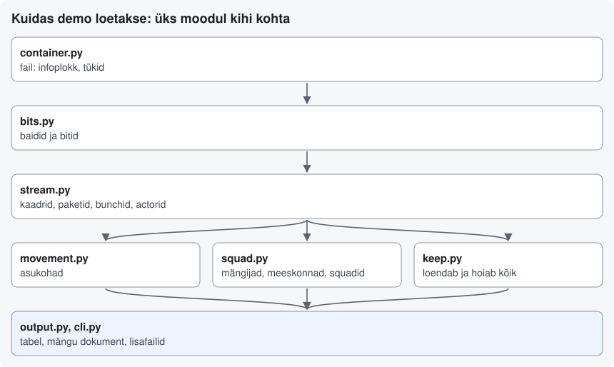

# Kuidas demo loetakse {#how-a-demo-is-read}

Lihtsalt öeldes: Squadi server saadab iga mängija asukoha kõigile teistele mängijatele. Demo fail on selle liikluse salvestus. See tööriist mängib selle tagasi ja kirjutab üles, kes kus oli.



Unreali võrgu-replay on serveri enda replikatsiooniliiklus, mille kirjutab üles tema demo-draiver. Selle lugemine tähendab liikluse lugemist nii, nagu seda teeks klient.

| Moodul | Kiht |
|---|---|
| `container.py` | kohaliku failivoogu faili: infoplokk (magic `0x1CA2E27F`), seejärel tükid. Tükitüübid on päis (`FNetworkDemoHeader`, magic `0x2CF5A13D`), replay-andmed, kontrollpunktid ja sündmused. |
| `bits.py` | baitide arhiivid kaadritele ja bitiarhiivid paketitele. Paketid loetakse madalaima bitiga algades. |
| `stream.py` | kaadrid, paketid, bunchid (osalised bunchid ühendatakse), actor-kanalid, actor-spawnid ja sisuplokid. Iga plokk hoiab replitseeritud omadusi kujul handle, bittide arv ja bitid, seejärel kaugkäske ja custom-delta välju handle'itena klassi `_ClassNetCache` rühmas. Objektid, mida eksportid ei nimeta, saavad oma klassi pärast kogu demo lugemist (vt allpool). |
| `movement.py` | mootori `FRepMovement` ja Squadi helikopteri liikumine. |
| `keep.py` | iga kohatud ja loetud üksus: lisafailide read ja enesekontroll. |
| `squad.py` | millised Squadi klassid mida kannavad. `SQPlayerState` hoiab nime, meeskonna seisundit, squadi seisundit ja praegust kehast; `SQTeamState` meeskonna numbrit ja vormi; `SQSquadState` squadi numbrit. Istmekeha omanik on tema sõiduk. |
| `output.py`, `cli.py` | tabel ja mängu dokument. |

Replay nimetab ise oma väljad. See sisaldab iga handle'i klassi teid ja omaduste nimesid ning viidatud objektide teid. Seega saab iga omaduse leida nime järgi ilma mängu koodita. Ainult omaduse bitid vajavad tüüpi. Liikumise puhul on see mootori enda tüüp; Squadi omaduste tüübid on lihtsad: stringid, täisarvud, objektiviited ja nimed.

Mõned objektid on nimetatud ainult iseenda järgi: taseme actorid oma eksemplari nime järgi (`Team1SpawnPoint3`), komponendid oma nime järgi (`MovementComponent`, `wheel_L1`). Nende klassi leitakse eksporditabelitest pärast voogu. Demo-draiver ekspordib klassi välja selle kaadris, kus see saadetakse esimest korda (kõigi nimetatud objektide esimeste saatmiste puhul testdemodes), nii et klass on see ainus rühm, mis eksportis täpselt need handle'id nende kaadrite jooksul, kus objekt neid esimest korda saatis; muidu mis tahes rühm, millel olid kõik handle'id siiani, kui kõik annavad neile samad nimed; või siis objekti sama nimega eksemplari klass, numbrid välja arvatud, või ainus rühm, mille nimi sisaldab objekti nime. Nii nimetatud objektide handle'idest, mille klass saadab fikseeritud bittide arvuga, tulid kõik selle arvuga (ükski mitte teisega). Mida need kõik ei lahenda, jääb sidefailis tervena.

## Omaduste dekodeerimine {#decoding-properties}

Iga replitseeritud omadust dekodeeritakse nii kaugele, kui tema bitid ütlevad, mis ta on: üks bit on lipp; viide objektile (tema net GUID), kui nimi lõpeb nagu viide (`...State`, `...Seat`, `...Pawn`, `...Class`...); pikkus ja nii mitu baiti on string; nimi; 8/16/32/64 bitti on arv (ujuvkomaarv, kui omaduse nimi nii ütleb: tervis, aeg, kiirus, sisend...); muu on oma bitid heksina koos leitud stringidega. Kaugkäske loetakse samamoodi, demo eksporditud funktsioonide parameetrinimede järgi.

## Kuidas sündmused loetakse {#how-the-events-are-read}

Sõduri `Health` ja `bWounded` tulevad serverist: haavatud, kui `bWounded` lülitub sisse; elustatud, kui see lülitub välja ja tervis on üle 0; surnud, kui tervis langeb alla -100 (mängija, kes annab alla või veritseb välja, seatakse -300-le); bot, kes ei saa kunagi haavatud, sureb 0 juures. Sõiduk või paigaldatav on `damaged` iga `Health` languse korral, `destroyed` kui see on 0 või alla selle. Spawnid ja eemaldamised on actor-kanali avamine ja sulgemine; istmeks on mängija oleku `CurrentSeat` (viide istmekomponendile, mis saadetakse tema sõiduki kaudu). Vaatenurk on sõduri `RemoteViewPitch`, bait otse allapoole (0) kuni otse ülespoole (255). Lask on relva `MulticastFireProjectile` (algus ja suund) või selle `MulticastFireMultipleProjectileEffects`, kui sama suunaga kaugkäsku ei tulnud; tabamus on sõiduki `MulticastPlayDamageEffects` (kokkupuute koht, kahjutüüp).

## Mida kontrolliti ja kuidas {#what-was-verified-and-how}

Need kontrolliti kahe avaliku Squad v10.3.1 serverdemo vastu (Unreal Engine 5.5.4, mootori võrguversioon 36), squad-replay projekti testifailidest:

- **Arvud.** Kaadrite, pakettide, actorite avamiste, eksportrühmade ja eksporditud objektiteede arv vastab selle projekti sõltumatule parserile täpselt. Nii on ka sõduri liikumisproovide arv.
- **Liikumine versus kiirus.** Iga sõduri proovi samm eelmisest, jagatuna nende vahelise ajaga, vastab proovi kaasasolevale kiirusele. Mediaansuhe on liikuvatel mängijatel 0,8 kuni 1,2 vahemikus.
- **Meeskonnad versus plaanid.** Iga rea meeskond on see meeskond, mille vormi kuulub sõduri plaan. See kehtis mängija kohta, kes mängu jooksul pooli vahetas.
- **Vead.** Iga demo kohta jääb üks voo viga: juhuslik bitt algava bunchi lõpus registreerija enda pealtvaataja actoril, mis ei sisalda siin kasutatavat midagi.
- **Surmad versus selle projekti tapmised.** Iga tapmine, mida ta loetleb, on siin loetud haavamine või surm samal ajal ja samal mängijal; tema sõidukite tapmised on siin loetud sõidukid, mis jõudsid tervisele 0 või alla selle.
- **Paigaldatavad.** Siin loetud actorid ehitusseisundi või FOB-nõudega vastavad selle projekti paigaldatavatele täpsusega ühe piires.
- **Vaatenurk.** Vaatenurga bait jääb puhkeasendis umbes 120 kanti ja ulatub 255-ni (otse ülespoole). Seda loetakse baidina vahemikus -90 kuni +90. Kui seda loeta mootori tavalise terve pöörde baidina, paneks see sõdurid kuni 128 kraadi horisondi alla, kuhu nad vaadata ei saa.
- **Botid.** Seeding-demos on igal bottil (`SQSquidBot`) oma rada ja botid, mis surevad, loetakse surmadena.
- **Helikopteri liikumine** (`SQHelicopterMovementComponent.ReplicatedMovement`, Squadi enda paigutus: lipud puuduvad, asukoht sajandikes, kiirus ja nurkkiirus, kolm valikulist 16-bitist nurka, serveri kell ujuvkomana). Iga helikopteri proov täidab oma bitid täpselt. Parkinud helikopteri asukoht ja pöördenurk on tema spawni omad, kuni sentimeetrini ja nurgaühikuni. Lennus on kahe proovi vaheline samm jagatuna kella sammuga kiirus (mediaanisuhe 0,997) ning kell liigub koos demo ajaga (mediaanselt 0,4 ms vahedega). Nurkkiirus järgib pöörde kiirust (korrelatsioon 0,91), kuid selle ühikut ei ole kindlaks tehtud: see jäetakse alles, kuid ei kasutata.
- **Istmed.** Mängija oleku `CurrentSeat` on viide (pakitud net GUID), mitte arv nagu varem loetud: nii loetuna on iga muutus istmel, mille tema enda `MulticastUpdateCurrentSeat` hetk varem nimetab, ja muutused on squad-replay omad.
- **Lasud ja tabamused.** Iga `ShootDir` on ühikvektor (pikkus 1 täpsusega 0,00003); iga `MulticastFireMultipleProjectileEffects` algus, jagatuna 10-ga, on vastava `MulticastFireProjectile` `OriginZeroBased` 1 mm täpsusega; kui lasija või tabatud sõiduki asukoht on teada, on lasu algus või kokkupuude mediaanselt 0,45 m kaugusel sellest.
- **Sõiduki sisendid.** Ujuvkomadena loetuna jäävad roomikutega sõidukite gaas, pidur ja käsipidur vahemikku 0..1 ja juhtimine vahemikku -1..1, igas uuenduses.
- **Sulgemise põhjused.** Iga actor, kelle kanal avati uuesti, oli suletud `Dormancy`-ga; ükski, mis suleti `Destroyed`-ga, ei avanenud uuesti.

Testid katavad enda koostatud demodel konteinerit, arhiive, voogu ja kogu teed tabelini, ning et demo, millel on iga liiki üks üksus, ei kaota ühtegi ([`tests/test_completeness.py`](https://github.com/Holdi601/3DHeat-Ext-Squad/blob/main/tests/test_completeness.py)):

```bash
python -m pip install -e .[test]
pytest                                   # sünteetilised demod
HEAT3D_SQUAD_DEMOS=<folder> pytest       # lisaks päris demod selles kaustas
```
