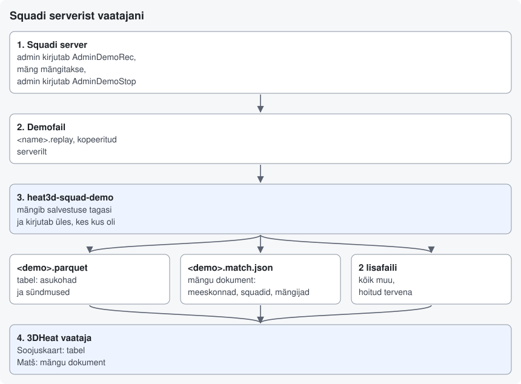

# 3DHeat Squad {#dheat-squad}

**Mis see on?** Väike programm, mis muudab Squadi mängu salvestuse failideks, mida
[3DHeat](https://github.com/Holdi601/3DHeat) vaataja
([dokumentatsioon](https://holdi601.github.io/3DHeat/)) saab joonistada: kus iga
mängija oli, sekund-sekundilt, ja mis kus juhtus.

**Miks ma seda kasutaksin?** Et näha mängu ülalt: kus oli võitlus, millist teed
squadid käisid, kus sõidukid hukkusid.

**Näide:** `match.replay` (demo, salvestatud Squadi serveril) ->
`match.parquet` (üks rida asukoha või sündmuse kohta) + `match.match.json` (mängu
dokument: meeskonnad, squadid, mängijad). Väljundid on tavalised Parquet- ja
JSON-failid, nii et ka teised programmid saavad neid lugeda.

Milleks see kasulik on:

- **Kus mängu võideldi.** Iga mängija ja boti asukoht, jalgsi, maismaasõidukites
  ja helikopterites, umbes kaheksa korda sekundis, koos meeskonna, vormi, squadi,
  tervise ja vaatenurgaga.
- **Mis kus juhtus.** Haavamised, elustamised ja surmad; iga lask ja iga tabamus
  sõidukile; iga sõiduk, paigaldatav ja emplacement, mis tekkis, sai kahju, hävis
  või eemaldati.
- **Kogu mäng ühes dokumendis.** Meeskonnad, squadid, mängu olek, iga actor, rida
  iga mängija ja boti kohta ning enesekontroll, et demo sisust midagi kadunud ei ole.



## Kiire algus {#quick-start}

Pole sul käsurealt kogemust? Loe esmalt [Enne alustamist](before-you-start.md).

```bash
python -m pip install -e .              # paigaldab käsu heat3d-squad-demo
heat3d-squad-demo match.replay -o out   # või .replay failide kaust
```

Näed ühte rida demo kohta. Seejärel laadi `out/<map>/<demo>.parquet` vaataja
Soojuskaart-vahelehel ([Andmete sisestamine](https://holdi601.github.io/3DHeat/getting-data-in.html)).

## Lehed {#pages}

| Leht | Mida see käsitleb |
|---|---|
| [Enne alustamist](before-you-start.md) | Python, terminal, esimene käivitus |
| [Demo salvestamine](recording.md) | serveri demo salvestamine ja selle leidmine |
| [Demode teisendamine](converting.md) | käsk, iga valik, näidisväljund |
| [Tabel](output-table.md) | iga veerg ja iga `event` |
| [Mängu dokument ja lisafailid](output-match.md) | `.match.json`, kaks lisafaili, enesekontroll |
| [Kuidas demo loetakse](how-it-works.md) | lugeja kihid ja mida kontrolliti |
| [Piirangud, uuendused ja tingimused](limits.md) | mida ei loeta, mida võib Squadi uuendus rikkuda, isikuandmed, litsents |
| [Käsu viide](../cli-reference.md) | iga valik ja veerg, koodist genereeritud |
| [Nende dokumentide hooldamine](maintaining.md) | väljalaske kontrollnimekiri |

## Seotud {#related}

- 3DHeat vaataja: [github.com/Holdi601/3DHeat](https://github.com/Holdi601/3DHeat),
  dokumentatsioon aadressil [holdi601.github.io/3DHeat](https://holdi601.github.io/3DHeat/).
- Failivormingud, mida vaataja loeb, sealhulgas üks-fail-mängu kohta mõeldud
  konteiner: [Üks fail mängu kohta (.3dheat)](https://holdi601.github.io/3DHeat/container.html).
  See konverter kirjutab lahtised failid: tabeli, mängu dokumendi ja selle lisafailid
  kõrvuti.
- 3DHeat Watcher käivitab selle konverteri uute demode puhul, kui see on paigaldatud
  (adapter `squad-demos`): [3DHeat Watcher](https://holdi601.github.io/3DHeat-Watcher/).
- Iga mängulugeja on omaette väike projekt oma litsentsifaili, väljalasete ja probleemijälgijaga, nii et seda saab paigaldada, uuendada, hooldada - või õiguste omaja palvel tagasi võtta - eraldi, ilma et see mõjutaks vaaturit või teisi tööriistu.

## 3DHeati tööriistad {#the-3dheat-tools}

| Tööriist | Mida see teeb | Kood | Dokumentatsioon |
|---|---|---|---|
| 3DHeat vaataja | näitab andmeid: soojuskaardid, võistlusanalüüs, mängu ülevaade | [3DHeat](https://github.com/Holdi601/3DHeat) | [dokumentatsioon](https://holdi601.github.io/3DHeat/) |
| GameFiles | tasemed ja rajad mängu enda failidest | [3DHeat-GameFiles](https://github.com/Holdi601/3DHeat-GameFiles) | [dokumentatsioon](https://holdi601.github.io/3DHeat-GameFiles/) |
| GameCapture | ringi telemeetria ja mängu videost taastatud tasemed | [3DHeat-GameCapture](https://github.com/Holdi601/3DHeat-GameCapture) | [dokumentatsioon](https://holdi601.github.io/3DHeat-GameCapture/) |
| Unreal Exporter | Unreal Editori plugin: tase ühe `.glb` failina | [3DHeat-UnrealExporter](https://github.com/Holdi601/3DHeat-UnrealExporter) | [dokumentatsioon](https://holdi601.github.io/3DHeat-UnrealExporter/) |
| CS2 | Counter-Strike 2 demod ja kaardid | [3DHeat-CS2](https://github.com/Holdi601/3DHeat-CS2) | [dokumentatsioon](https://holdi601.github.io/3DHeat-CS2/) |
| Watcher | salvestab, mida mängud avaldavad, kui sa mängid | [3DHeat-Watcher](https://github.com/Holdi601/3DHeat-Watcher) | [dokumentatsioon](https://holdi601.github.io/3DHeat-Watcher/) |
| Ext-WarThunder | War Thunderi kordused | [3DHeat-Ext-WarThunder](https://github.com/Holdi601/3DHeat-Ext-WarThunder) | [dokumentatsioon](https://holdi601.github.io/3DHeat-Ext-WarThunder/) |
| Ext-WoT | World of Tanksi kordused | [3DHeat-Ext-WoT](https://github.com/Holdi601/3DHeat-Ext-WoT) | [dokumentatsioon](https://holdi601.github.io/3DHeat-Ext-WoT/) |
| Ext-WoWs | World of Warshipsi kordused | [3DHeat-Ext-WoWs](https://github.com/Holdi601/3DHeat-Ext-WoWs) | [dokumentatsioon](https://holdi601.github.io/3DHeat-Ext-WoWs/) |
| Ext-Squad | Squadi serverdemod | [3DHeat-Ext-Squad](https://github.com/Holdi601/3DHeat-Ext-Squad) | [dokumentatsioon](https://holdi601.github.io/3DHeat-Ext-Squad/) |
| Ext-DCS | DCS World'i kaardid 3D-tasemetena | [3DHeat-Ext-DCS](https://github.com/Holdi601/3DHeat-Ext-DCS) | [dokumentatsioon](https://holdi601.github.io/3DHeat-Ext-DCS/) |
| Ext-IL2 | IL-2 Sturmovik'i kaardid 3D-tasemetena | [3DHeat-Ext-IL2](https://github.com/Holdi601/3DHeat-Ext-IL2) | [dokumentatsioon](https://holdi601.github.io/3DHeat-Ext-IL2/) |
