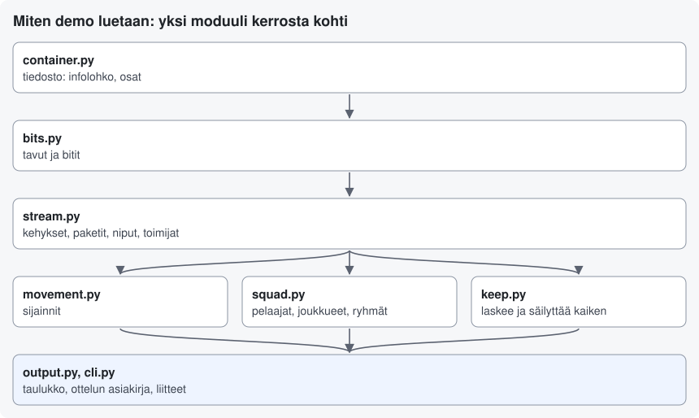

# Miten demo luetaan {#how-a-demo-is-read}

Yksinkertaisesti sanottuna: Squad-palvelin lähettää jokaisen pelaajan sijainnin kaikille
muille pelaajille. Demotiedosto on tallenne tästä liikenteestä. Tämä työkalu toistaa sen
ja kirjoittaa muistiin, kuka oli missäkin.



Unreal-verkkotoiston on palvelimen oma replikointiliikenne, jonka sen demoajuri on kirjannut
ylös. Sen lukeminen on sen liikenteen lukemista samalla tavalla kuin asiakas sen lukisi.

| Moduuli | Kerros |
|---|---|
| `container.py` | Paikallisen tiedostostriimerin tiedosto: infolohko (tunniste `0x1CA2E27F`), sitten osat. Osatyypit ovat otsikko (`FNetworkDemoHeader`, tunniste `0x2CF5A13D`), toistodata, tarkistuspisteet ja tapahtumat. |
| `bits.py` | Tavuarkistot kehyksille ja bittiarkistot paketeille. Paketit luetaan alimmasta bitistä ylöspäin. |
| `stream.py` | Kehykset, paketit, niput (osittaiset nipput yhdistetään), toimijakanavat, toimijoiden synnyt ja sisältölohkot. Jokainen lohko sisältää replikoidut ominaisuudet kahvana, bittimääränä ja bitteinä, sitten etäkutsut ja mukautetut delta-kentät kahvoina luokan `_ClassNetCache`-ryhmään. Objektit, joita viennit eivät nimeä, saavat luokkansa, kun koko demo on luettu (ks. alla). |
| `movement.py` | Moottorin `FRepMovement` ja Squadin helikopterin liike. |
| `keep.py` | Jokainen kohdattu kohde laskettuna ja säilytettynä: sivutiedostojen rivit ja itsetarkistus. |
| `squad.py` | Mitä Squad-luokat kantavat. `SQPlayerState` pitää nimen, joukkueen tilan, ryhmän tilan ja nykyisen pawnin; `SQTeamState` joukkueen numeron ja puolen; `SQSquadState` ryhmän numeron. Istuinpawnin omistaja on sen ajoneuvo. |
| `output.py`, `cli.py` | Taulukko ja ottelun asiakirja. |

Toisto nimeää omat kenttänsä. Se kantaa jokaiselle kahvalle luokkapolut ja ominaisuuksien nimet
sekä viittaamiensa objektien polut. Siksi jokainen ominaisuus löytyy nimellä ilman pelin koodia.
Ominaisuuden bitit tarvitsevat tyypin vain sitä varten. Liikkeelle tyyppi on moottorin oma;
Squadin ominaisuuksien tyypit ovat yksinkertaisia: merkkijonoja, kokonaislukuja,
objektiviittauksia ja nimiä.

Jotkin objektit nimetään vain itsensä kautta: kentän toimijat ilmentymänimellään
(`Team1SpawnPoint3`), komponentit omillaan (`MovementComponent`, `wheel_L1`). Niiden luokka
selvitetään vientitauluista striimin jälkeen: demoajuri vie luokan kentän siinä kehyksessä,
jossa se lähetetään ensimmäisen kerran (pitää paikkansa jokaiselle nimetyn objektin ensimmäiselle
lähetykselle testidemoissa), joten luokka on se ryhmä, joka vei täsmälleen nuo kahvat niissä
kehyksissä, joissa objekti lähetti ne ensimmäisen kerran; muuten mikä tahansa ryhmä, jolla oli
kaikki kahvansa siihen mennessä, kun kaikki antavat niille samat nimet; tai muuten saman nimisen
objektin luokka, numerot pois lukien, tai se yksi ryhmä, jonka nimi sisältää objektin nimen.
Näin nimettyjen objektien kahvoista, joiden luokka lähettää ne kiinteällä bittimäärällä, kaikki
tulivat sillä määrällä (ei yksikään toisella). Mitä mikään näistä ei ratkaise, jää sivutiedostoon
entities kokonaisena.

## Ominaisuuksien purkaminen {#decoding-properties}

Jokainen replikoitu ominaisuus puretaan niin pitkälle kuin sen bitit kertovat, mitä se on: yksi
bitti on lippu; viittaus objektiin (sen net GUID) silloin, kun nimi päättyy kuten viittauksen nimi
päättyy (`...State`, `...Seat`, `...Pawn`, `...Class`...); pituus ja niin monta tavua on
merkkijono; nimi; 8/16/32/64 bittiä on luku (liukuluku silloin, kun ominaisuuden nimi sanoo niin:
terveys, aika, nopeus, syöte...); muu kuin nämä on bitteinään heksadesimaalina sekä niiden sisällä
löydetyt merkkijonot. Etäkutsut luetaan samalla tavalla, demon viemien parametrinimien mukaan
jokaiselle funktiolle.

## Miten tapahtumat luetaan {#how-the-events-are-read}

Sotilaan `Health` ja `bWounded` tulevat palvelimelta: haavoittunut, kun `bWounded` kytkeytyy päälle,
elvytetty, kun se kytkeytyy pois ja terveys on yli 0, kuollut, kun terveys putoaa alle -100
(pelaaja, joka luovuttaa tai vuotaa verta pois, asetetaan arvoon -300); botti, joka ei koskaan
haavoitu, kuolee arvossa 0. Ajoneuvo tai siirrettävä tukikohta on `damaged` aina, kun sen `Health`
laskee, ja `destroyed`, kun se on 0 tai alle. Synnyt ja poistot ovat toimijakanavan avautumista ja
sulkeutumista; istuin on pelaajatilan `CurrentSeat` (viittaus istuinkomponenttiin, joka lähetetään
sen ajoneuvolla). Katsekulma on sotilaan `RemoteViewPitch`, tavu suoraan alas (0) suoraan ylös (255)
asti. Laukaus on aseen `MulticastFireProjectile` (lähtöpaikka ja suunta) tai sen
`MulticastFireMultipleProjectileEffects`, jos samalla suunnalla ei tullut sellaista kutsua; osuma
on ajoneuvon `MulticastPlayDamageEffects` (iskukohta, vahingon tyyppi).

## Mitä on todennettu ja miten {#what-was-verified-and-how}

Nämä tarkistettiin kahta julkista Squad v10.3.1 -palvelindemoa vastaan (Unreal Engine 5.5.4,
moottorin verkkoversio 36), squad-replay-projektin testiaineistosta:

- **Määrät.** Kehysten, pakettien, toimijoiden avausten, vientiryhmien ja vietyjen objektipolkujen
  määrät vastaavat täsmälleen tuon projektin riippumatonta jäsentäjää. Samoin sotilaiden liikenäytteiden määrä.
- **Liike nopeuteen verrattuna.** Jokaisen sotilasnäytteen askel edellisestä jaettuna niiden välisellä
  ajalla vastaa näytteen mukana kulkevaa nopeutta. Mediaanisuhde on 0,8–1,2 liikkuvilla pelaajilla.
- **Joukkueet ja blueprintit.** Jokaisen rivin joukkue on se joukkue, jonka puoleen sotilaan blueprint
  kuuluu. Tämä piti myös pelaajalla, joka vaihtoi puolta ottelun aikana.
- **Virheet.** Demoa kohden jää yksi striimivirhe: eksyvä bitti tallentajan oman katsojatoimijan
  avaavan nipun lopussa; se ei kanna mitään tässä käytettyä.
- **Haavoittuneet ja kuolleet verrattuna tuon projektin tappoihin.** Jokainen sen luettelema tappo on täällä luettu
  haavoittuminen tai kuolema samalla hetkellä ja samalle pelaajalle; sen ajoneuvotappot ovat täällä
  luettuja ajoneuvoja, joiden terveys saavuttaa 0 tai alle.
- **Siirrettävät tukikohdat.** Täällä luetut toimijat, joilla on rakennustila tai FOB-vaatimus,
  vastaavat tuon projektin siirrettäviä tukikohtia yhden tarkkuudella.
- **Katsekulma.** Katsekulmatavu on noin 120 levossa ja saavuttaa 255 (suoraan ylös). Se luetaan
  tavuna välillä -90..+90 astetta. Jos se luettaisiin moottorin tavallisena kokonaisen kierroksen
  tavuna, sotilaat olisivat jopa 128 astetta horisontin alla, mihin he eivät voi katsoa.
- **Botit.** Tappodemossa jokaisella botilla (`SQSquidBot`) on oma reittinsä, ja botit, jotka kuolevat,
  luetaan kuolemina.
- **Helikopterin liike** (`SQHelicopterMovementComponent.ReplicatedMovement`, Squadin oma asettelu: ei
  lippuja, sijainti sadasosina, nopeus ja kulmanopeus, kolme valinnaista 16-bittistä kulmaa, palvelimen
  kello liukulukuna). Jokainen helikopterinäyte täyttää bittinsä tarkasti. Pysäköidyn helikopterin
  sijainti ja kääntymä ovat sen synnyn, senttimetrin ja kulmayksikön tarkkuudella. Lennossa näytteiden
  välinen askel kellon askeleella jaettuna on nopeus (mediaanisuhde 0,997), ja kello etenee demon
  ajan mukana (mediaani 0,4 ms välein). Kulmanopeus seuraa kääntymisnopeutta (korrelaatio 0,91), mutta
  sen yksikköä ei ole varmistettu: se säilytetään, ei käytetä.
- **Istuimet.** Pelaajatilan `CurrentSeat` on viittaus (pakattu net GUID), ei luku kuten ennen luettuna:
  luettuna näin, jokaisessa vaihdossa se on istuin, jonka sotilaan oma `MulticastUpdateCurrentSeat`
  nimeää hetki aiemmin, ja muutokset ovat squad-replayn.
- **Laukaukset ja osumat.** Jokainen `ShootDir` on yksikkövektori (pituus 1, tarkkuus 0,00003);
  jokainen `MulticastFireMultipleProjectileEffects`-lähtöpaikka jaettuna 10:llä on vastaavan
  `MulticastFireProjectile`-kutsun `OriginZeroBased` 1 mm:n tarkkuudella; kun ampujan tai osuman
  kohteena olevan ajoneuvon sijainti tunnetaan, laukauksen lähtöpaikka tai iskukohta on mediaanina
  0,45 m sen päässä.
- **Ajoneuvojen ohjaus.** Liukulukuina luettuna seurattujen ajoneuvojen kaasu, jarru ja käsijarru ovat
  välillä 0..1 ja ohjaus välillä -1..1 jokaisessa päivityksessä.
- **Sulkemisen syyt.** Jokainen toimijakanava, joka avautui uudelleen, oli suljettu syyllä `Dormancy`;
  yksikään, joka suljettiin syyllä `Destroyed`, ei avautunut uudelleen.

Testit demoilla, jotka testit itse rakentavat, kattavat säiliön, bittiaineistot, striimin ja koko
polun taulukkoon asti sekä sen, että demo, jossa on yksi kaikenlaisia kohteita, ei menetä yhtäkään
([`tests/test_completeness.py`](https://github.com/Holdi601/3DHeat-Ext-Squad/blob/main/tests/test_completeness.py)):

```bash
python -m pip install -e .[test]
pytest                                   # synteettiset demot
HEAT3D_SQUAD_DEMOS=<folder> pytest       # sekä oikeat demot tuosta kansiosta
```
