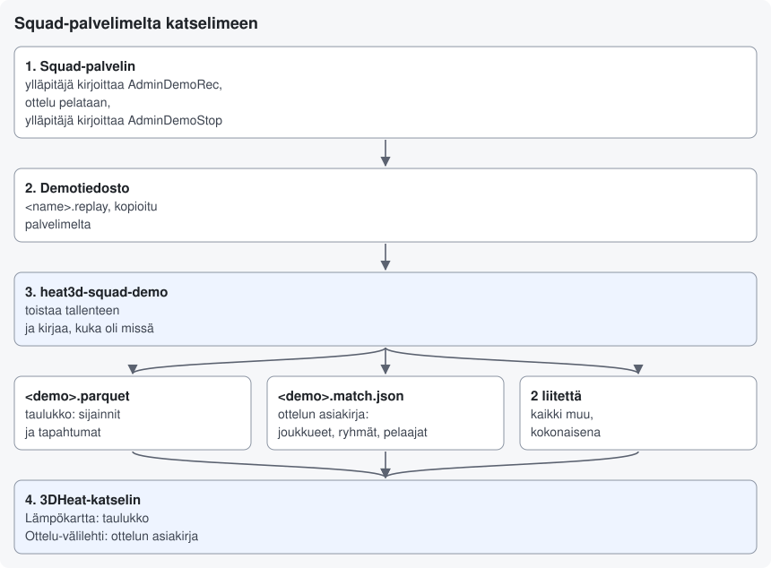

# 3DHeat Squad {#dheat-squad}

**Mitä se on?** Pieni ohjelma, joka muuttaa Squad-ottelun tallenteen
tiedostoiksi, jotka [3DHeat](https://github.com/Holdi601/3DHeat)-katselin
([dokumentaatio](https://holdi601.github.io/3DHeat/)) osaa piirtää: missä jokainen
pelaaja oli, sekunti sekunnilta, ja mitä missäkin tapahtui.

**Miksi käyttäisin sitä?** Nähdäksesi ottelun ylhäältä: missä taisteltiin,
mitä reittejä joukkueet kulkivat ja missä ajoneuvot tuhoutuivat.

**Esimerkki:** `match.replay` (Squad-palvelimella tallennettu demo) ->
`match.parquet` (yksi rivi jokaista sijaintia tai tapahtumaa kohden) + `match.match.json`
(ottelun asiakirja: joukkueet, joukkueiden ryhmät, pelaajat). Tulokset ovat tavallisia
Parquet- ja JSON-tiedostoja, joten muutkin ohjelmat osaavat lukea ne.

Tästä on hyötyä:

- **Missä ottelua käytiin.** Jokaisen pelaajan ja botin sijainti, jalan, maavoimilla
  ja helikoptereilla, noin kahdeksan kertaa sekunnissa, sekä joukkue, puoli, ryhmä,
  terveys ja katsekulma.
- **Mitä missäkin tapahtui.** Haavoittumiset, elvytykset ja kuolemat; jokainen laukaus
  ja jokainen osuma ajoneuvoon; jokainen ajoneuvo, siirrettävä tukikohta ja asema, joka
  syntyi, vaurioitui, tuhoutui tai poistui.
- **Koko ottelu yhdessä asiakirjassa.** Joukkueet, ryhmät, pelin tila, jokainen toimija,
  rivi jokaiselle pelaajalle ja botille sekä itsetarkistus sen varmistamiseksi, ettei
  demosta ole kadonnut mitään.



## Pikaohje {#quick-start}

Uusi komentorivin kanssa? Lue ensin [Ennen aloittamista](before-you-start.md).

```bash
python -m pip install -e .              # asentaa komennon heat3d-squad-demo
heat3d-squad-demo match.replay -o out   # tai kansio .replay-tiedostoja
```

Näet yhden rivin demoa kohden. Lataa sitten `out/<map>/<demo>.parquet` katselimen
Lämpökartta-välilehdelle ([Tietojen tuominen](https://holdi601.github.io/3DHeat/getting-data-in.html)).

## Sivut {#pages}

| Sivu | Mitä se kattaa |
|---|---|
| [Ennen aloittamista](before-you-start.md) | Python, pääte, ensimmäinen ajo |
| [Demon tallentaminen](recording.md) | palvelimen demon tallennus ja sen löytäminen |
| [Demojen muuntaminen](converting.md) | komento, jokainen asetus, esimerkkitulos |
| [Taulukko](output-table.md) | jokainen sarake ja jokainen `event` |
| [Ottelun asiakirja ja sivutiedostot](output-match.md) | `.match.json`, kaksi sivutiedostoa, itsetarkistus |
| [Miten demo luetaan](how-it-works.md) | lukijan kerrokset ja mitä on todennettu |
| [Rajoitukset, päivitykset ja ehdot](limits.md) | mitä ei lueta, mitä Squad-päivitys voi rikkoa, henkilötiedot, lisenssi |
| [Komentoviite](../cli-reference.md) | jokainen asetus ja sarake, luotu koodista |
| [Dokumentaation ylläpito](maintaining.md) | julkaisun tarkistuslista |

## Liittyvää {#related}

- 3DHeat-katselin: [github.com/Holdi601/3DHeat](https://github.com/Holdi601/3DHeat),
  dokumentaatio osoitteessa [holdi601.github.io/3DHeat](https://holdi601.github.io/3DHeat/).
- Katselimen lukemat tiedostomuodot, mukaan lukien yhden ottelun yhden tiedoston
  säiliö: [Yksi tiedosto ottelua kohden (.3dheat)](https://holdi601.github.io/3DHeat/container.html).
  Tämä muunnin kirjoittaa irralliset tiedostot: taulukon, ottelun asiakirjan ja sen
  sivutiedostot rinnakkain.
- 3DHeat Watcher ajaa tätä muunninta uusille demoille, kun se on asennettu
  (sovitin `squad-demos`): [3DHeat Watcher](https://holdi601.github.io/3DHeat-Watcher/).

## 3DHeat-työkalut {#the-3dheat-tools}

| Työkalu | Mitä se tekee | Koodi | Dokumentaatio |
|---|---|---|---|
| 3DHeat-katselin | näyttää tiedot: lämpökartat, kilpa-analyysin, ottelun tarkastelun | [3DHeat](https://github.com/Holdi601/3DHeat) | [dokumentaatio](https://holdi601.github.io/3DHeat/) |
| GameFiles | pelien omista tiedostoista saadut kentät ja radat | [3DHeat-GameFiles](https://github.com/Holdi601/3DHeat-GameFiles) | [dokumentaatio](https://holdi601.github.io/3DHeat-GameFiles/) |
| GameCapture | kierrosten telemetria ja videosta rakennetut kentät | [3DHeat-GameCapture](https://github.com/Holdi601/3DHeat-GameCapture) | [dokumentaatio](https://holdi601.github.io/3DHeat-GameCapture/) |
| Unreal Exporter | Unreal Editor -liitännäinen: kenttä yhtenä `.glb`-tiedostona | [3DHeat-UnrealExporter](https://github.com/Holdi601/3DHeat-UnrealExporter) | [dokumentaatio](https://holdi601.github.io/3DHeat-UnrealExporter/) |
| CS2 | Counter-Strike 2 -demot ja kartat | [3DHeat-CS2](https://github.com/Holdi601/3DHeat-CS2) | [dokumentaatio](https://holdi601.github.io/3DHeat-CS2/) |
| Watcher | tallentaa sen, mitä pelit julkaisevat pelatessasi | [3DHeat-Watcher](https://github.com/Holdi601/3DHeat-Watcher) | [dokumentaatio](https://holdi601.github.io/3DHeat-Watcher/) |
| Ext-WarThunder | War Thunder -tallenteet | [3DHeat-Ext-WarThunder](https://github.com/Holdi601/3DHeat-Ext-WarThunder) | [dokumentaatio](https://holdi601.github.io/3DHeat-Ext-WarThunder/) |
| Ext-WoT | World of Tanks -tallenteet | [3DHeat-Ext-WoT](https://github.com/Holdi601/3DHeat-Ext-WoT) | [dokumentaatio](https://holdi601.github.io/3DHeat-Ext-WoT/) |
| Ext-WoWs | World of Warships -tallenteet | [3DHeat-Ext-WoWs](https://github.com/Holdi601/3DHeat-Ext-WoWs) | [dokumentaatio](https://holdi601.github.io/3DHeat-Ext-WoWs/) |
| Ext-Squad | Squad-palvelindemot | [3DHeat-Ext-Squad](https://github.com/Holdi601/3DHeat-Ext-Squad) | [dokumentaatio](https://holdi601.github.io/3DHeat-Ext-Squad/) |
| Ext-DCS | DCS World -kartat 3D-kenttinä | [3DHeat-Ext-DCS](https://github.com/Holdi601/3DHeat-Ext-DCS) | [dokumentaatio](https://holdi601.github.io/3DHeat-Ext-DCS/) |
| Ext-IL2 | IL-2 Sturmovik -kartat 3D-kenttinä | [3DHeat-Ext-IL2](https://github.com/Holdi601/3DHeat-Ext-IL2) | [dokumentaatio](https://holdi601.github.io/3DHeat-Ext-IL2/) |
