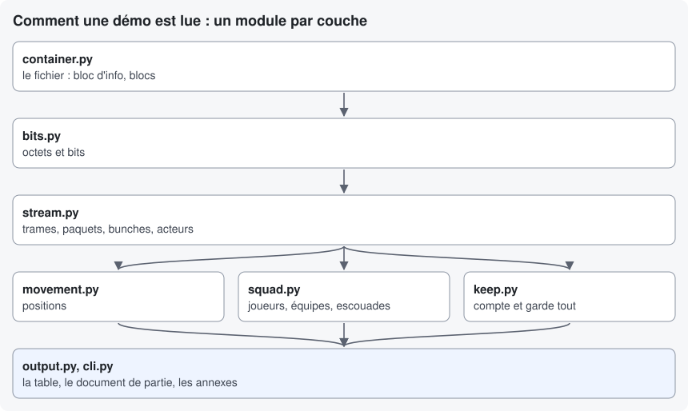

# Comment une démo est lue {#how-a-demo-is-read}

En clair : un serveur Squad envoie la position de chaque joueur à tous les autres joueurs. Le fichier de démo est un enregistrement de ce trafic. Cet outil le rejoue et note qui se trouvait où.



Une démo de réplication réseau Unreal est le trafic de réplication du serveur lui-même, consigné par son pilote de démo. La lire revient à lire ce trafic comme le ferait un client.

| Module | Couche |
|---|---|
| `container.py` | Le fichier du streamer de fichiers local : un bloc d'information (magic `0x1CA2E27F`), puis des blocs. Les types de blocs sont l'en-tête (`FNetworkDemoHeader`, magic `0x2CF5A13D`), les données de réplication, les points de contrôle et les événements. |
| `bits.py` | Archives d'octets pour les trames et archives de bits pour les paquets. Les paquets sont lus du bit de poids faible au bit de poids fort. |
| `stream.py` | Trames, paquets, bunches (bunches partiels réunis), canaux d'acteurs, apparitions d'acteurs et blocs de contenu. Chaque bloc contient les propriétés répliquées sous forme de poignée, nombre de bits et bits, puis les appels distants et les champs de delta personnalisés sous forme de poignées dans le groupe `_ClassNetCache` de la classe. Les objets que les exports ne nomment pas reçoivent leur classe une fois la démo entière lue (voir plus bas). |
| `movement.py` | Le `FRepMovement` du moteur, et le mouvement des hélicoptères de Squad. |
| `keep.py` | Chaque élément rencontré, compté et gardé : les lignes des fichiers annexes et la vérification. |
| `squad.py` | Quelles classes Squad portent quelles données. `SQPlayerState` porte le nom, l'état d'équipe, l'état d'escouade et le pion courant ; `SQTeamState` le numéro d'équipe et la faction ; `SQSquadState` le numéro d'escouade. Le propriétaire d'un pion de siège est son véhicule. |
| `output.py`, `cli.py` | La table et le document de match. |

Une réplication nomme ses propres champs. Elle porte les chemins de classe et les noms de propriétés pour chaque poignée, et les chemins des objets qu'elle référence. Ainsi chaque propriété peut être retrouvée par son nom, sans le code du jeu. Seuls les bits d'une propriété ont besoin de son type. Pour le mouvement, c'est le type propre du moteur ; pour les propriétés de Squad, les types sont simples : chaînes, entiers, références d'objets et noms.

Certains objets ne sont désignés que par eux-mêmes : les acteurs d'un niveau par leur nom d'instance (`Team1SpawnPoint3`), les composants par le leur (`MovementComponent`, `wheel_L1`). Leur classe se trouve dans les tables d'export, après le flux : le pilote de démo exporte le champ d'une classe dans la trame où il est envoyé pour la première fois (vrai pour chaque premier envoi d'un objet nommé dans les démos de test), donc la classe est le seul groupe qui a exporté exactement ces poignées dans les trames où l'objet les a envoyées pour la première fois ; sinon, tout groupe qui avait toutes ses poignées à ce moment-là, quand tous donnent les mêmes noms ; sinon la classe d'un objet de même nom, numéros omis, ou le seul groupe dont le nom contient celui de l'objet. Parmi les poignées des objets nommés ainsi dont la classe les envoie avec un nombre de bits fixe, toutes sont venues avec ce nombre (aucune avec un autre). Ce que aucune de ces règles ne tranche reste dans le fichier annexe des entités, en entier.

## Décodage des propriétés {#decoding-properties}

Chaque propriété répliquée est décodée autant que ses bits le permettent : un bit pour un drapeau, une référence à un objet (son GUID réseau) quand le nom se termine comme celui d'une référence (`...State`, `...Seat`, `...Pawn`, `...Class`...), une longueur suivie de ce nombre d'octets pour une chaîne, un nom, 8/16/32/64 bits pour un nombre (un flottant lorsque le nom de la propriété l'indique : santé, temps, taux, entrée...), et tout autre cas sous forme de bits en hexadécimal, avec les chaînes trouvées à l'intérieur. Les appels distants sont lus de la même façon, par les noms de paramètres que la démo exporte pour chaque fonction.

## Comment les événements sont lus {#how-the-events-are-read}

La `Health` et le `bWounded` d'un soldat viennent du serveur : blessé quand `bWounded` passe à vrai, réanimé quand il repasse à faux avec une santé supérieure à 0, mort quand la santé descend sous -100 (un joueur qui abandonne ou saigne à mort est mis à -300) ; un bot, qui n'est jamais blessé, meurt à 0. Un véhicule ou un déployable est `damaged` à chaque baisse de sa `Health`, `destroyed` à 0 ou moins. Les apparitions et disparitions sont l'ouverture et la fermeture du canal d'acteur ; un siège est le `CurrentSeat` de l'état du joueur (une référence au composant de siège, envoyé sur son véhicule). L'inclinaison du regard est le `RemoteViewPitch` du soldat, un octet allant de droit vers le bas (0) à droit vers le haut (255). Un tir est un `MulticastFireProjectile` d'arme (origine et direction), ou son `MulticastFireMultipleProjectileEffects` quand aucun appel de ce genre n'est venu avec la même direction ; un impact est le `MulticastPlayDamageEffects` d'un véhicule (lieu de l'impact, type de dégât).

## Ce qui a été vérifié, et comment {#what-was-verified-and-how}

Ces points ont été contrôlés sur deux démos publiques de serveur Squad v10.3.1 (Unreal Engine 5.5.4, version réseau du moteur 36), tirées des jeux de test du projet squad-replay :

- **Nombres.** Les nombres de trames, paquets, ouvertures d'acteurs, groupes d'export et chemins d'objets exportés correspondent exactement à ceux de l'analyseur indépendant de ce projet. Il en va de même du nombre d'échantillons de mouvement des soldats.
- **Mouvement face à la vitesse.** Le déplacement de chaque échantillon de soldat par rapport au précédent, divisé par le temps qui les sépare, correspond à la vitesse que transporte l'échantillon. Le rapport médian est compris entre 0,8 et 1,2 pour les joueurs en mouvement.
- **Équipes face aux blueprints.** L'équipe de chaque ligne est celle dont la faction appartient au blueprint du soldat. Cela tient pour un joueur qui a changé de camp en cours de partie.
- **Erreurs.** Une erreur de flux subsiste par démo : un bit perdu à la fin du bunch d'ouverture de l'acteur spectateur de l'enregistreur, qui ne porte rien d'utilisé ici.
- **Victimes face aux éliminations de ce projet.** Chaque élimination qu'il liste est une blessure ou une mort lue ici, au même moment et pour le même joueur ; ses éliminations de véhicules sont des véhicules lus ici qui atteignent 0 de santé ou moins.
- **Déployables.** Les acteurs lus ici avec un état de construction ou une exigence de FOB correspondent aux déployables de ce projet, à un près.
- **Inclinaison.** L'octet d'inclinaison du regard se situe vers 120 au repos et atteint 255 (droit vers le haut) : lu comme un octet sur -90..+90. Lu comme l'octet habituel du moteur pour un tour complet, il placerait les soldats jusqu'à 128 degrés sous l'horizon, ce qu'ils ne peuvent pas faire.
- **Bots.** Sur une démo d'attente, chaque bot (`SQSquidBot`) a sa propre trajectoire, et les bots qui meurent sont lus comme des morts.
- **Mouvement des hélicoptères** (`SQHelicopterMovementComponent.ReplicatedMovement`, la disposition propre à Squad : pas de drapeaux, la position en centièmes, la vitesse et la vitesse angulaire, trois angles optionnels sur 16 bits, l'horloge du serveur en flottant). Chaque échantillon d'hélicoptère remplit exactement ses bits. La position et le lacet d'un hélicoptère posé sont ceux de son point d'apparition, au centimètre et à l'unité d'angle près. En vol, le déplacement entre échantillons divisé par le pas de l'horloge donne la vitesse (rapport médian 0,997), et l'horloge avance avec le temps de la démo (médiane de 0,4 ms entre deux pas). La vitesse angulaire suit la vitesse de lacet (corrélation 0,91), mais son unité n'est pas établie : elle est gardée, non utilisée.
- **Sièges.** Le `CurrentSeat` d'un état de joueur est une référence (un GUID réseau compacté), et non un nombre comme lu auparavant : lu ainsi, à chaque changement il s'agit du siège que le propre `MulticastUpdateCurrentSeat` du soldat nomme un instant plus tôt, et les changements sont ceux de squad-replay.
- **Tirs et impacts.** Chaque `ShootDir` est un vecteur unitaire (longueur 1 à 0,00003 près) ; chaque origine de `MulticastFireMultipleProjectileEffects`, divisée par 10, est l'`OriginZeroBased` du `MulticastFireProjectile` correspondant à 1 mm près ; quand la position du tireur ou du véhicule touché est connue, l'origine du tir ou l'impact se situe à une médiane de 0,45 m de celle-ci.
- **Entrées des véhicules.** Lus comme des flottants, l'accélérateur, le frein et le frein à main des véhicules à chenilles se situent entre 0 et 1, et leur direction entre -1 et 1, à chaque mise à jour.
- **Raisons de fermeture.** Chaque acteur dont le canal a été rouvert avait été fermé avec `Dormancy` ; aucun fermé avec `Destroyed` n'a été rouvert.

Des tests sur des démos construites par les tests eux-mêmes couvrent le conteneur, les archives, le flux et tout le chemin jusqu'à la table, et vérifient qu'une démo contenant un élément de chaque sorte n'en perd aucun ([`tests/test_completeness.py`](https://github.com/Holdi601/3DHeat-Ext-Squad/blob/main/tests/test_completeness.py)) :

```bash
python -m pip install -e .[test]
pytest                                   # démos synthétiques
HEAT3D_SQUAD_DEMOS=<dossier> pytest      # plus les vraies démos de ce dossier
```
