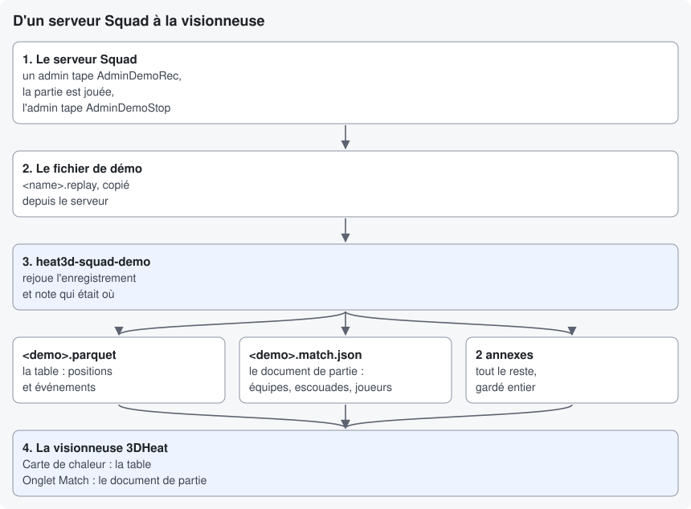

# 3DHeat Squad {#dheat-squad}

**Qu'est-ce que c'est ?** Un petit programme qui transforme un enregistrement
d'une partie de Squad en fichiers que la visionneuse [3DHeat](https://github.com/Holdi601/3DHeat)
([documentation](https://holdi601.github.io/3DHeat/)) peut afficher : où chaque
joueur se trouvait, seconde par seconde, et ce qui s'est passé à chaque endroit.

**À quoi ça sert ?** À voir une partie d'en haut : où les combats ont eu lieu,
quels itinéraires les escouades ont pris, où les véhicules ont été détruits.

**Exemple :** `match.replay` (une démo, enregistrée sur un serveur Squad) ->
`match.parquet` (une ligne par position ou événement) + `match.match.json` (le
document de match : équipes, escouades, joueurs). Les sorties sont des
fichiers Parquet et JSON ordinaires, que n'importe quel autre outil peut lire.

À quoi il sert :

- **Où la partie s'est jouée.** La position de chaque joueur et de chaque bot,
  à pied, dans les véhicules terrestres et dans les hélicoptères, environ huit
  fois par seconde, avec l'équipe, la faction, l'escouade, la santé et
  l'inclinaison du regard.
- **Ce qui s'est passé à chaque endroit.** Blessures, réanimations et morts ;
  chaque tir et chaque impact sur un véhicule ; chaque véhicule, déployable et
  emplacement apparu, endommagé, détruit et retiré.
- **Toute la partie dans un seul document.** Équipes, escouades, état de la
  partie, chaque acteur, une ligne par joueur et par bot, et une vérification
  que rien de ce que contient la démo n'a été perdu.



## Démarrage rapide {#quick-start}

Vous débutez avec la ligne de commande ? Lisez d'abord [Avant de commencer](before-you-start.md).

```bash
python -m pip install -e .              # installe la commande heat3d-squad-demo
heat3d-squad-demo match.replay -o out   # ou un dossier de fichiers .replay
```

Vous devez voir une ligne par démo. Chargez ensuite `out/<carte>/<démo>.parquet`
dans l'onglet Carte de chaleur de la visionneuse
([Charger des données](https://holdi601.github.io/3DHeat/getting-data-in.html)).

## Pages {#pages}

| Page | Ce qu'elle explique |
|---|---|
| [Avant de commencer](before-you-start.md) | Python, un terminal, un premier essai |
| [Enregistrer une démo](recording.md) | faire enregistrer une démo par le serveur, et la retrouver |
| [Convertir les démos](converting.md) | la commande, chaque option, un exemple de sortie |
| [La table](output-table.md) | chaque colonne et chaque `event` |
| [Le document de match et les fichiers annexes](output-match.md) | le `.match.json`, les deux fichiers annexes, la vérification |
| [Comment une démo est lue](how-it-works.md) | les couches du lecteur, et ce qui a été vérifié |
| [Limites, mises à jour et conditions](limits.md) | ce qui n'est pas lu, ce qu'une mise à jour de Squad peut casser, données personnelles, licence |
| [Référence des commandes](../cli-reference.md) | chaque option et chaque colonne, générées depuis le code |
| [Maintenir ces documents](maintaining.md) | la liste de contrôle des versions |

## Voir aussi {#related}

- La visionneuse 3DHeat : [github.com/Holdi601/3DHeat](https://github.com/Holdi601/3DHeat),
  documentation sur [holdi601.github.io/3DHeat](https://holdi601.github.io/3DHeat/).
- Les formats de fichiers que lit la visionneuse, dont le conteneur d'un
  fichier par match : [Un fichier par match (.3dheat)](https://holdi601.github.io/3DHeat/container.html).
  Ce convertisseur écrit les fichiers séparés : la table, le document de
  match et ses fichiers annexes, côte à côte.
- L'outil 3DHeat Watcher exécute ce convertisseur sur les nouvelles démos
  lorsqu'il est installé (adaptateur `squad-demos`) : [3DHeat Watcher](https://holdi601.github.io/3DHeat-Watcher/).

## Les outils 3DHeat {#the-3dheat-tools}

| Outil | Ce qu'il fait | Code | Documentation |
|---|---|---|---|
| Visionneuse 3DHeat | affiche les données : cartes de chaleur, analyse de course, revue de partie | [3DHeat](https://github.com/Holdi601/3DHeat) | [documentation](https://holdi601.github.io/3DHeat/) |
| GameFiles | niveaux et circuits tirés des fichiers du jeu | [3DHeat-GameFiles](https://github.com/Holdi601/3DHeat-GameFiles) | [documentation](https://holdi601.github.io/3DHeat-GameFiles/) |
| GameCapture | télémétrie de tour, et niveaux reconstruits à partir de vidéos de jeu | [3DHeat-GameCapture](https://github.com/Holdi601/3DHeat-GameCapture) | [documentation](https://holdi601.github.io/3DHeat-GameCapture/) |
| Unreal Exporter | un plugin de l'éditeur Unreal : un niveau en un seul `.glb` | [3DHeat-UnrealExporter](https://github.com/Holdi601/3DHeat-UnrealExporter) | [documentation](https://holdi601.github.io/3DHeat-UnrealExporter/) |
| CS2 | démos et cartes de Counter-Strike 2 | [3DHeat-CS2](https://github.com/Holdi601/3DHeat-CS2) | [documentation](https://holdi601.github.io/3DHeat-CS2/) |
| Watcher | enregistre ce que les jeux publient pendant que vous jouez | [3DHeat-Watcher](https://github.com/Holdi601/3DHeat-Watcher) | [documentation](https://holdi601.github.io/3DHeat-Watcher/) |
| Ext-WarThunder | replays de War Thunder | [3DHeat-Ext-WarThunder](https://github.com/Holdi601/3DHeat-Ext-WarThunder) | [documentation](https://holdi601.github.io/3DHeat-Ext-WarThunder/) |
| Ext-WoT | replays de World of Tanks | [3DHeat-Ext-WoT](https://github.com/Holdi601/3DHeat-Ext-WoT) | [documentation](https://holdi601.github.io/3DHeat-Ext-WoT/) |
| Ext-WoWs | replays de World of Warships | [3DHeat-Ext-WoWs](https://github.com/Holdi601/3DHeat-Ext-WoWs) | [documentation](https://holdi601.github.io/3DHeat-Ext-WoWs/) |
| Ext-Squad | démos de serveurs Squad | [3DHeat-Ext-Squad](https://github.com/Holdi601/3DHeat-Ext-Squad) | [documentation](https://holdi601.github.io/3DHeat-Ext-Squad/) |
| Ext-DCS | cartes de DCS World sous forme de niveaux 3D | [3DHeat-Ext-DCS](https://github.com/Holdi601/3DHeat-Ext-DCS) | [documentation](https://holdi601.github.io/3DHeat-Ext-DCS/) |
| Ext-IL2 | cartes d'IL-2 Sturmovik sous forme de niveaux 3D | [3DHeat-Ext-IL2](https://github.com/Holdi601/3DHeat-Ext-IL2) | [documentation](https://holdi601.github.io/3DHeat-Ext-IL2/) |
