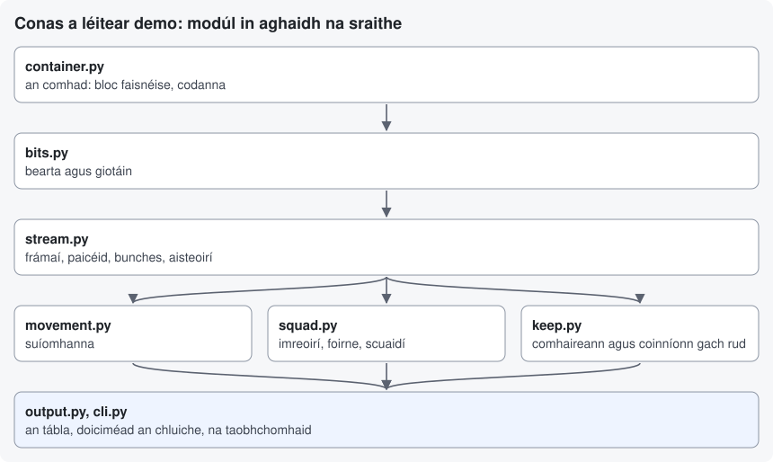

# Conas a léitear demo {#how-a-demo-is-read}

I bhfocail shimplí: seolann freastalaí Squad suíomh gach imreora chuig gach imreoir eile. Is taifeadadh den trácht sin an comhad demo. Seinneann an uirlis seo ar ais é agus scríobhann sí síos cé a bhí cén áit.



Is é an t-athsheinm líonra Unreal ná trácht macasamhlaithe an fhreastalaí féin, scríofa síos ag a thiománaí demo. Is é léamh ceann acu an trácht sin a léamh mar a dhéanfadh cliant.

| Modúl | Sraith |
|---|---|
| `container.py` | Comhad shruthaitheoir comhaid áitiúil: bloc faisnéise (draíocht `0x1CA2E27F`), ansin codanna. Is iad cineálacha na gcodanna an ceannteideal (`FNetworkDemoHeader`, draíocht `0x2CF5A13D`), sonraí athsheinm, seicphointí agus imeachtaí. |
| `bits.py` | Cartlanna bheart do fhrámaí agus cartlanna ghiotán do phaicéid. Léitear paicéid leis an ngiotán is ísle ar dtús. |
| `stream.py` | Frámaí, paicéid, bunches (bunches páirteacha ceangailte), cainéil aisteoirí, spawns aisteoirí agus bloic ábhair. Coinníonn gach bloc airí macasamhlaithe mar láimhseáil, comhaireamh giotán agus giotáin, ansin glaonna cianda agus réimsí delta saincheaptha mar láimhseálacha isteach i ngrúpa `_ClassNetCache` na haicme. Tugtar a n-aicme d'rudaí nach ainmníonn na honnmhairithe, nuair a bhíonn an demo iomlán léite (féach thíos). |
| `movement.py` | `FRepMovement` an innill, agus gluaiseacht héileacaptair Squad. |
| `keep.py` | Gach mír a casadh, comhairthe agus coinnithe: sraitheanna na dtaobhchomhad agus an féin-seic. |
| `squad.py` | Cé na haicmí Squad a iompraíonn cad. Coinníonn `SQPlayerState` an t-ainm, staid na foirne, staid na scuaide agus an pawn reatha; `SQTeamState` uimhir na foirne agus an faction; `SQSquadState` uimhir na scuaide. Is é gluaisteán pawn suíocháin a úinéir. |
| `output.py`, `cli.py` | An tábla agus doiciméad an chluiche. |

Ainmníonn athsheinm a réimsí féin. Iompraíonn sé cosáin na n-aicmí agus ainmneacha na n-airí do gach láimhseáil, agus cosáin na rudaí a thagraíonn sé dóibh. Mar sin is féidir gach aireach a aimsiú de réir ainm gan cód an chluiche. Ní theastaíonn cineál aireach ach do ghiotáin aireach. Maidir le gluaiseacht is cineál féin an innill é; maidir le hairí Squad tá na cineálacha simplí: teaghráin, slánuimhreacha, tagairtí rudaí agus ainmneacha.

Ní ainmnítear roinnt rudaí ach astu féin: aisteoirí leibhéil le hainm a n-imeachta (`Team1SpawnPoint3`), comhpháirteanna lena n-ainm féin (`MovementComponent`, `wheel_L1`). Aimsítear a n-aicme ó na táblaí onnmhairithe, tar éis an tsrutha: onnmhairíonn an tiománaí demo réimse aicme sa fhráma ina seoltar den chéad uair é (fíor de gach céad seoladh de rud ainmnithe sna demos tástála), mar sin is í an aicme an t-aon ghrúpa a d'onnmhairigh go díreach na láimhseálacha sin sna frámaí inar sheol an réad den chéad uair iad; nó ar shlí eile aon ghrúpa a raibh a láimhseálacha go léir aige faoin am sin, nuair a thugann siad go léir na hainmneacha céanna; nó aicme réada den ainm céanna, uimhreacha fágtha ar lár, nó an t-aon ghrúpa a bhfuil ainm an réad ina ainm. As láimhseálacha rudaí a ainmnítear mar seo a sheolann a n-aicme le comhaireamh giotán seasta amháin, tháinig siad go léir leis an gcomhaireamh sin (ceann ar bith le ceann eile). An rud nach socraíonn aon cheann acu seo, fanann sé sa taobhchomhad entities, iomlán.

## Airí a dhíchódú {#decoding-properties}

Díchódaítear gach aireach macasamhlaithe chomh fada agus a deir a ghiotáin cad é: giotán amháin bratach, tagairt do réad (a net GUID) nuair a chríochnaíonn an t-ainm mar a dhéanann tagairt (`...State`, `...Seat`, `...Pawn`, `...Class`...), fad agus an oiread sin beart teaghrán, ainm, 8/16/32/64 giotán uimhir (snámhphointe nuair a deir ainm an aireach amhlaidh: health, time, rate, input...), aon rud eile a ghiotáin i heicsidheachúlach leis na teaghráin a aimsíodh istigh. Léitear glaonna cianda ar an gcaoi chéanna, de réir ainmneacha na bparaiméadar a onnmhairíonn an demo do gach feidhm.

## Conas a léitear na himeachtaí {#how-the-events-are-read}

Tagann `Health` agus `bWounded` saighdiúra ón bhfreastalaí: créachtaithe nuair a chasann `bWounded` air, athbheoite nuair a chasann sé as agus sláinte os cionn 0, marbh nuair a thiteann an tsláinte faoi bhun -100 (socraítear imreoir a thugann suas nó a fhuil a chailleann go -300); faigheann bot, nach mbíonn créachtaithe choíche, bás ag 0. Bíonn gluaisteán nó earra imlonnaithe `damaged` ag gach titim ar a `Health`, `destroyed` ag 0 nó faoina bhun. Is é oscailt agus dúnadh an chainéil aisteora a spawns agus a bhaintí; is é `CurrentSeat` staid an imreora an suíochán (tagairt do chomhpháirt an tsuíocháin, a sheoltar ar a ghluaisteán). Is é pitch an radhairc `RemoteViewPitch` an tsaighdiúra, beart ó dhíreach síos (0) go dtí díreach suas (255). Is lámhaigh é `MulticastFireProjectile` airm (tionscnamh agus treo), nó a `MulticastFireMultipleProjectileEffects` nuair nár tháinig aon ghlao den sórt sin leis an treo céanna; is buille é `MulticastPlayDamageEffects` gluaisteáin (suíomh an bhuille, cineál damáiste).

## Cad a fíoraíodh, agus conas {#what-was-verified-and-how}

Seiceáladh iad seo i gcoinne dhá demo phoiblí de chuid freastalaí Squad v10.3.1 (Unreal Engine 5.5.4, leagan líonra innill 36), ó fhoirgnimh tástála an tionscadail squad-replay:

- **Comhaireamh.** Is ionann comhaireamh frámaí, paicéad, oscailtí aisteoirí, grúpaí onnmhairithe agus cosáin réad onnmhairithe agus parsálaí neamhspleách an tionscadail sin go beacht. Mar an gcéanna le líon samplaí gluaiseachta saighdiúirí.
- **Gluaiseacht i gcoinne treoluais.** Is ionann céim gach sampla saighdiúra ón gceann roimhe, roinnte ar an am eatarthu, agus an treoluas a iompraíonn an sampla. Tá an cóimheas airmheánach laistigh de 0.8 go 1.2 ar imreoirí atá ag gluaiseacht.
- **Foirne i gcoinne blueprints.** Is í foireann gach sraithe an fhoireann a bhfuil blueprint an tsaighdiúra mar chuid dá faction. Bhí sé seo fíor d'imreoir a d'athraigh taobh le linn an chluiche.
- **Earráidí.** Fanann earráid sruth amháin in aghaidh an demo: giotán fáin ag deireadh bunch oscailte aisteora lucht féachana an taifeadáin féin, nach n-iompraíonn aon rud a úsáidtear anseo.
- **Taismigh i gcoinne mharuithe an tionscadail sin.** Is créacht nó bás é gach marú a liostaíonn sé a léitear anseo, ag an am céanna agus den imreoir céanna; is gluaisteáin a léitear anseo a shroicheann sláinte 0 nó níos lú a mharuithe gluaisteán.
- **Earraí imlonnaithe.** Is ionann na haisteoirí a léitear anseo le staid tógála nó riachtanas FOB agus earraí imlonnaithe an tionscadail sin, laistigh d'aon cheann.
- **Pitch.** Luíonn beart pitch an radhairc timpeall 120 ar scíth agus sroicheann sé 255 (díreach suas): léite mar bheart thar -90..+90. Dá léifí é mar bheart gnáth an innill de chas iomlán chuirfeadh sé saighdiúirí suas le 128 céim faoin léaslíne, nach féidir leo breathnú.
- **Botanna.** Ar demo síolrúcháin tá a rian féin ag gach bot (`SQSquidBot`), agus léitear na botanna a fhaigheann bás mar bhásanna.
- **Gluaiseacht héileacaptair** (`SQHelicopterMovementComponent.ReplicatedMovement`, leagan amach Squad féin: gan brataí, an suíomh i gcéadú, an treoluas agus an treoluas uilleach, trí uillinn 16-ghiotán roghnacha, clog an fhreastalaí mar snámhphointe). Líonann gach sampla héileacaptair a ghiotáin go beacht. Is iad suíomh agus yaw héileacaptair páirceáilte a spawn, go dtí an ceintiméadar agus an t-aonad uillinne. Le linn eitilte, is é an chéim idir samplaí ar chéim an chloig an treoluas (cóimheas airmheánach 0.997), agus ceaptar an clog le am an demo (airmheánach 0.4 ms óna chéile). Leanann an treoluas uilleach ráta an yaw (comhghaol 0.91), ach níl a aonad greamaithe síos: coinnítear é, ní úsáidtear é.
- **Suíocháin.** Is tagairt (net GUID pacáilte) é `CurrentSeat` staid imreora, ní uimhir mar a léadh roimhe: léite mar sin, ag gach athrú is é an suíochán a ainmníonn `MulticastUpdateCurrentSeat` an tsaighdiúra féin nóiméad roimhe sin, agus is iad athruithe squad-replay na hathruithe.
- **Lámhaigh agus buillí.** Is veicteoir aonaid é gach `ShootDir` (fad 1 laistigh de 0.00003); is é gach tionscnamh `MulticastFireMultipleProjectileEffects`, roinnte ar 10, `OriginZeroBased` an `MulticastFireProjectile` comhfhreagrach laistigh de 1 mm; nuair is eol suíomh an lámhachóra nó an ghluaisteáin buailte, tá tionscnamh na lámhaí nó an bhuille 0.45 m ón gcéanna ar an meán.
- **Ionchuir ghluaisteáin.** Léite mar shnámhphointe, luíonn tochtadh, coscán agus laimhseáil láimhe na ngluaisteán lorgach in 0..1 agus a stiúradh in -1..1, i ngach nuashonrú.
- **Cúiseanna dúnta.** Bhí gach aisteoir a d'oscail a chainéal arís dúnta le `Dormancy`; níor oscail aon cheann a dúnadh le `Destroyed` arís.

Clúdaíonn tástálacha ar demos a thógann na tástálacha féin an coimeádán, na cartlanna, an sruth agus an cosán iomlán go dtí an tábla, agus nach gcailleann demo ina bhfuil gach cineál míre ceann ar bith ([`tests/test_completeness.py`](https://github.com/Holdi601/3DHeat-Ext-Squad/blob/main/tests/test_completeness.py)):

```bash
python -m pip install -e .[test]
pytest                                   # synthetic demos
HEAT3D_SQUAD_DEMOS=<folder> pytest       # plus real demos in that folder
```
