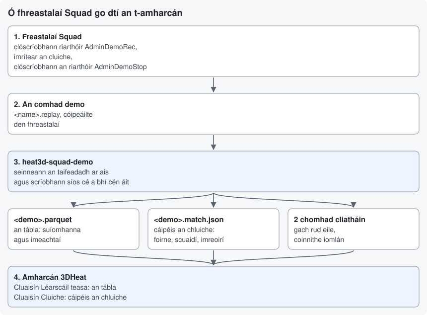

# 3DHeat Squad {#dheat-squad}

**Cad é?** Clár beag a thiontaíonn taifeadadh de chluiche Squad ina chomhaid a
fhéadann an lucht féachana [3DHeat](https://github.com/Holdi601/3DHeat)
([doiciméadúchán](https://holdi601.github.io/3DHeat/)) a tharraingt: cá raibh gach
imreoir, soicind ar shoicind, agus cad a tharla cén áit.

**Cén fáth a n-úsáidfinn é?** Chun cluiche a fheiceáil ón taobh thuas: cá raibh an troid,
cé na bealaí a ghlac scuaidí, cá bhfuair gluaisteáin bás.

**Sampla:** `match.replay` (demo, taifeadta ar fhreastalaí Squad) ->
`match.parquet` (sraith amháin in aghaidh an tsuímh nó an imeachta) + `match.match.json` (doiciméad an
chluiche: foirne, scuaidí, imreoirí). Is gnáthchomhaid Parquet
agus JSON na haschuir, mar sin is féidir le haon rud eile iad a léamh freisin.

Cad chuige a bhfuil sé úsáideach:

- **Cá raibh cluiche á throid.** Suíomh gach imreora agus bhota, ar shiúl na gcos, i
  ngluaisteáin talún agus in héileacaptair, thart ar ocht n-uaire san soicind, le foireann,
  faction, scuaid, sláinte agus pitch an radhairc.
- **Cad a tharla cén áit.** Créachtaí, athbheochan agus básanna; gach lámhaigh agus gach
  buille ar ghluaisteán; gach gluaisteán, earra imlonnaithe agus cás a spawnadh,
  a damáisteadh, a scriosadh agus a baineadh.
- **An cluiche ar fad in aon doiciméad amháin.** Foirne, scuaidí, staid an chluiche, gach
  aisteoir, líne in aghaidh an imreora agus an bhota, agus féin-seic nár cailleadh aon rud a
  bhí sa demo.



## Tús tapa {#quick-start}

An bhfuil tú nua leis an líne ordaithe? Léigh [Sula dtosaíonn tú](before-you-start.md) ar dtús.

```bash
python -m pip install -e .              # installs the heat3d-squad-demo command
heat3d-squad-demo match.replay -o out   # or a folder of .replay files
```

Ba chóir duit líne amháin a fheiceáil in aghaidh an demo. Ansin lódáil `out/<map>/<demo>.parquet` i gcluaisín Léarscáil teasa an lucht féachana
([Sonraí a thabhairt isteach](https://holdi601.github.io/3DHeat/getting-data-in.html)).

## Leathanaigh {#pages}

| Leathanach | Cad a chlúdaíonn sé |
|---|---|
| [Sula dtosaíonn tú](before-you-start.md) | Python, teirminéal, céad rith |
| [Demo a thaifead](recording.md) | freastalaí a chur ag scríobh demo, agus é a aimsiú |
| [Demos a thiontú](converting.md) | an t-ordú, gach rogha, aschur samplach |
| [An tábla](output-table.md) | gach colún agus gach `event` |
| [Doiciméad an chluiche agus na taobhchomhaid](output-match.md) | an `.match.json`, an dá thaobhchomhad, an féin-seic |
| [Conas a léitear demo](how-it-works.md) | sraitheanna an léitheora, agus cad a fíoraíodh |
| [Teorainneacha, nuashonruithe agus téarmaí](limits.md) | cad nach léitear, cad a fhéadfadh nuashonrú Squad a bhriseadh, sonraí pearsanta, ceadúnas |
| [Tagairt orduithe](../cli-reference.md) | gach rogha agus colún, ginte ón gcód |
| [Na doiciméid seo a chothabháil](maintaining.md) | an seicliosta eisiúna |

## Gaolmhar {#related}

- An lucht féachana 3DHeat: [github.com/Holdi601/3DHeat](https://github.com/Holdi601/3DHeat),
  doiciméadúchán ag [holdi601.github.io/3DHeat](https://holdi601.github.io/3DHeat/).
- Na formáidí comhaid a léann an lucht féachana, an coimeádán comhaid-amháin-in-aghaidh-an-chluiche san áireamh:
  [Comhad amháin in aghaidh an chluiche (.3dheat)](https://holdi601.github.io/3DHeat/container.html).
  Scríobhann an tiontaire seo na comhaid scaoilte: an tábla, doiciméad an chluiche agus
  a thaobhchomhaid taobh le taobh.
- Ritheann 3DHeat Watcher an tiontaire seo ar demos nua nuair atá sé suiteáilte
  (adapter `squad-demos`): [3DHeat Watcher](https://holdi601.github.io/3DHeat-Watcher/).

## Uirlisí 3DHeat {#the-3dheat-tools}

| Uirlis | Cad a dhéanann sí | Cód | Doiciméid |
|---|---|---|---|
| Lucht féachana 3DHeat | taispeánann sé na sonraí: léarscáileanna teasa, anailís rása, athbhreithniú cluiche | [3DHeat](https://github.com/Holdi601/3DHeat) | [docs](https://holdi601.github.io/3DHeat/) |
| GameFiles | leibhéil agus cúrsaí ó chomhaid féin cluiche | [3DHeat-GameFiles](https://github.com/Holdi601/3DHeat-GameFiles) | [docs](https://holdi601.github.io/3DHeat-GameFiles/) |
| GameCapture | telemetry cuarta, agus leibhéil atógtha ó fhíseán cluiche | [3DHeat-GameCapture](https://github.com/Holdi601/3DHeat-GameCapture) | [docs](https://holdi601.github.io/3DHeat-GameCapture/) |
| Unreal Exporter | breiseán d'Unreal Editor: leibhéal mar `.glb` amháin | [3DHeat-UnrealExporter](https://github.com/Holdi601/3DHeat-UnrealExporter) | [docs](https://holdi601.github.io/3DHeat-UnrealExporter/) |
| CS2 | demos agus léarscáileanna Counter-Strike 2 | [3DHeat-CS2](https://github.com/Holdi601/3DHeat-CS2) | [docs](https://holdi601.github.io/3DHeat-CS2/) |
| Watcher | taifeadann sé an méid a fhoilsíonn cluichí agus tú ag imirt | [3DHeat-Watcher](https://github.com/Holdi601/3DHeat-Watcher) | [docs](https://holdi601.github.io/3DHeat-Watcher/) |
| Ext-WarThunder | athsheinmeanna War Thunder | [3DHeat-Ext-WarThunder](https://github.com/Holdi601/3DHeat-Ext-WarThunder) | [docs](https://holdi601.github.io/3DHeat-Ext-WarThunder/) |
| Ext-WoT | athsheinmeanna World of Tanks | [3DHeat-Ext-WoT](https://github.com/Holdi601/3DHeat-Ext-WoT) | [docs](https://holdi601.github.io/3DHeat-Ext-WoT/) |
| Ext-WoWs | athsheinmeanna World of Warships | [3DHeat-Ext-WoWs](https://github.com/Holdi601/3DHeat-Ext-WoWs) | [docs](https://holdi601.github.io/3DHeat-Ext-WoWs/) |
| Ext-Squad | demos freastalaí Squad | [3DHeat-Ext-Squad](https://github.com/Holdi601/3DHeat-Ext-Squad) | [docs](https://holdi601.github.io/3DHeat-Ext-Squad/) |
| Ext-DCS | léarscáileanna DCS World mar leibhéil 3D | [3DHeat-Ext-DCS](https://github.com/Holdi601/3DHeat-Ext-DCS) | [docs](https://holdi601.github.io/3DHeat-Ext-DCS/) |
| Ext-IL2 | léarscáileanna IL-2 Sturmovik mar leibhéil 3D | [3DHeat-Ext-IL2](https://github.com/Holdi601/3DHeat-Ext-IL2) | [docs](https://holdi601.github.io/3DHeat-Ext-IL2/) |
