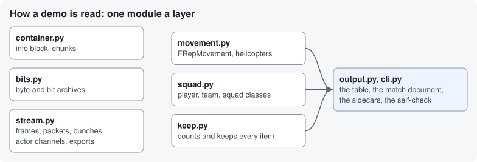

# How a demo is read



An Unreal network replay is the server's own replication traffic, written down by its demo driver. Reading one is reading that traffic as a client would.

| Module | Layer |
|---|---|
| `container.py` | The local file streamer's file: an info block (magic `0x1CA2E27F`), then chunks. Chunk types are the header (`FNetworkDemoHeader`, magic `0x2CF5A13D`), replay data, checkpoints and events. |
| `bits.py` | Byte archives for frames and bit archives for packets. Packets are read lowest bit first. |
| `stream.py` | Frames, packets, bunches (partial bunches joined), actor channels, actor spawns and content blocks. Each block holds replicated properties as handle, bit count and bits, then remote calls and custom-delta fields as handles into the class's `_ClassNetCache` group. Objects the exports do not name are given their class once the whole demo is read (see below). |
| `movement.py` | The engine's `FRepMovement`, and Squad's helicopter movement. |
| `keep.py` | Every item met, counted and kept: the sidecars' rows and the self-check. |
| `squad.py` | Which Squad classes carry what. `SQPlayerState` holds the name, team state, squad state and current pawn; `SQTeamState` the team number and faction; `SQSquadState` the squad number. A seat pawn's owner is its vehicle. |
| `output.py`, `cli.py` | The table and the match document. |

A replay names its own fields. It carries the class paths and property names for every handle, and the paths of the objects it references. So every property can be found by name without the game's code. Only the bits of a property need its type. For movement that is the engine's own type; for Squad's properties the types are simple: strings, integers, object references and names.

Some objects are named only by themselves: a level's actors by their instance name (`Team1SpawnPoint3`), components by their own (`MovementComponent`, `wheel_L1`). Their class is found from the export tables, after the stream: the demo driver exports a class's field in the frame where it is first sent (true of every one of the 1,991 first sends of named objects in the Jensen's Range demo), so the class is the one group that exported exactly those handles in the frames where the object first sent them; else any group that had all its handles by then, when all give them the same names; else the class of an object of the same name, numbers left out, or the one group whose name holds the object's. Of the handles of objects named this way whose class sends them with one fixed bit count, all came with that count (468 on Jensen's Range, 25 on Fallujah; 0 with another). What none of these settles stays in the entities sidecar, whole.

## Decoding properties

Every replicated property is decoded as far as its bits say what it is: one bit a flag, a reference to an object (its net GUID) where the name ends as a reference's does (`...State`, `...Seat`, `...Pawn`, `...Class`...), a length and that many bytes a string, a name, 8/16/32/64 bits a number (a float where the property's name says so: health, time, rate, input...), anything else its bits in hex with the strings found inside. Remote calls are read the same way, by the parameter names the demo exports for each function.

## How the events are read

A soldier's `Health` and `bWounded` come from the server: wounded when `bWounded` turns on, revived when it turns off with health above 0, dead when the health drops below -100 (a player who gives up or bleeds out is set to -300); a bot, never wounded, dies at 0. A vehicle or deployable is `damaged` at each fall of its `Health`, `destroyed` at 0 or below. Spawns and removals are the actor channel opening and closing; a seat is the player state's `CurrentSeat` (a reference to the seat component, which is sent on its vehicle). The view pitch is the soldier's `RemoteViewPitch`, a byte from straight down (0) to straight up (255). A shot is a weapon's `MulticastFireProjectile` (origin and direction), or its `MulticastFireMultipleProjectileEffects` where no such call came with the same direction; a hit is a vehicle's `MulticastPlayDamageEffects` (impact location, damage type).

## What was verified, and how

These were checked against two public Squad v10.3.1 server demos (Unreal Engine 5.5.4, engine network version 36), from the squad-replay project's test fixtures:

- **Counts.** The counts of frames, packets, actor opens, export groups and exported object paths match that project's independent parser exactly. So does the number of soldier movement samples.
- **Movement against velocity.** Each soldier sample's step from the previous one, divided by the time between them, matches the velocity the sample carries. The median ratio is within 0.8 to 1.2 on moving players.
- **Teams against blueprints.** Every row's team is the team whose faction the soldier's blueprint belongs to. This held for a player who changed sides during the match.
- **Errors.** One stream error per demo remains: a stray bit at the end of the opening bunch of the recorder's own spectator actor, which carries nothing used here.
- **Casualties against that project's kills.** On the Fallujah demo it counts 11 kills, the first at 75.399 s (the victim incapacitated), the last at 1,527.853 s; read here: 6 wounds and 5 deaths of players, the first wound of the same player at 75.399 s, the last wound of that kill's victim at 1,527.853 s. On the Jensen's Range demo its last kill, at 553.392 s, is when the M60T read here is destroyed (health -104).
- **Deployables.** 51 actors with a build state or an FOB requirement on Jensen's Range, against that project's 52 deployables.
- **Pitch.** The view pitch byte lies around 120 at rest and spans 34 to 255 over both demos: -66 to +90 degrees read as a byte over -90..+90. Read as the engine's usual byte of a whole turn it would put soldiers up to 128 degrees under the horizon, which they cannot look.
- **Bots.** The Fallujah seeding demo has 622 bots (`SQSquidBot`), each with its own track; 388 of them die.
- **Helicopter movement** (`SQHelicopterMovementComponent.ReplicatedMovement`, Squad's own layout: no flags, the location in hundredths, the velocity and angular velocity, three optional 16-bit angles, the server's clock as a float). All 7,209 samples of the five helicopters on Jensen's Range fill their bits exactly. A parked helicopter's location and yaw are its spawn's, to the centimetre and the angle unit. In flight, the step between samples over the clock's step is the velocity (median ratio 0.997 over 899 steps), and the clock steps with the demo's time (median 0.4 ms apart). The angular velocity follows the yaw rate (correlation 0.91), but its unit is not pinned down: it is kept, not used.
- **Seats.** A player state's `CurrentSeat` is a reference (a packed net GUID), not a number as read before: read so, it is at each of its 9 changes on Jensen's Range the seat the soldier's own `MulticastUpdateCurrentSeat` names a moment earlier, and those are squad-replay's 9 seat changes.
- **Shots and hits.** Every `ShootDir` is a unit vector (length 1 within 0.00003, 493 calls on Jensen's Range); every `MulticastFireMultipleProjectileEffects` origin, divided by 10, is the `OriginZeroBased` of the matching `MulticastFireProjectile` within 1 mm (217 pairs); where the shooter's or the hit vehicle's position is known (298 of 869 calls), the shot's origin or the impact is a median 0.45 m from it. On Jensen's Range, all 276 shots are the one player's, through his seat.
- **Vehicle inputs.** Read as floats, the tracked vehicles' throttle, brake and handbrake lie in 0..1 and their steering in -1..1, in every update.
- **Close reasons.** Each of the 64 actors whose channel opened again on Fallujah had been closed with `Dormancy`; none of the 1,763 closed with `Destroyed` opened again.

Tests on demos built by the tests themselves cover the container, the archives, the stream and the whole path to the table, and that a demo holding one of every kind of item loses none ([`tests/test_completeness.py`](https://github.com/Holdi601/3DHeat-Ext-Squad/blob/main/tests/test_completeness.py)):

```bash
pip install -e .[test]
pytest                                   # synthetic demos
HEAT3D_SQUAD_DEMOS=<folder> pytest       # plus real demos in that folder
```
