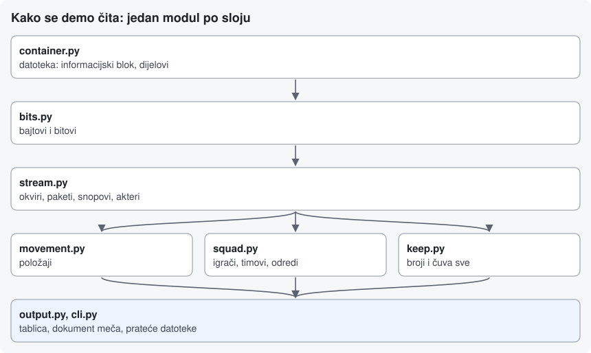

# Kako se demo čita {#how-a-demo-is-read}

Jednostavno rečeno: Squad server šalje položaj svakog igrača svakom drugom igraču. Demo datoteka je snimka tog prometa. Ovaj alat ga pušta unatrag i zapisuje tko je bio gdje.



Unreal mrežni replay je vlastiti promet replikacije servera, zapisan njegovim demo driverom. Čitati ga znači čitati taj promet onako kako bi ga čitao klijent.

| Modul | Sloj |
|---|---|
| `container.py` | Datoteka lokalnog streamera (file streamer): informacijski blok (magija `0x1CA2E27F`), zatim dijelovi. Vrste dijelova su zaglavlje (`FNetworkDemoHeader`, magija `0x2CF5A13D`), podaci replaya, kontrolne točke i događaji. |
| `bits.py` | Bajtni arhivi za okvire i bitni arhivi za pakete. Paketi se čitaju od najnižeg bita. |
| `stream.py` | Okviri, paketi, snopovi (djelomični snopovi spojeni), kanali aktera, pojave aktera i sadržajni blokovi. Svaki blok sadrži replicirana svojstva kao ručku, broj bitova i bitove, zatim udaljene pozive i polja delta-a po mjeri kao ručke u grupi `_ClassNetCache` klase. Objektima koje izvozi ne imenuju dodjeljuje se klasa tek nakon što je cijeli demo pročitan (vidi dolje). |
| `movement.py` | Motorov `FRepMovement` i Squadovo kretanje helikoptera. |
| `keep.py` | Svaka stavka koja je sretnuta, prebrojena i sačuvana: retci pratećih datoteka i samoprovjera. |
| `squad.py` | Koje Squad klase nose što. `SQPlayerState` sadrži ime, stanje tima, stanje odreda i trenutni pawn; `SQTeamState` broj tima i frakciju; `SQSquadState` broj odreda. Vlasnik pawna sjedala je njegovo vozilo. |
| `output.py`, `cli.py` | Tablica i dokument meča. |

Replay sam imenuje svoja polja. Nosi putanje klasa i imena svojstava za svaku ručku te putanje objekata na koje upućuje. Tako se svako svojstvo može pronaći po imenu bez koda igre. Samo bitovima svojstva treba tip: za kretanje je to motorov vlastiti tip; za Squadova svojstva tipovi su jednostavni: stringovi, cijeli brojevi, reference na objekte i imena.

Neke objekte imenuje samo njihova vlastita oznaka: akteri razine po imenu instance (`Team1SpawnPoint3`), komponente po svome (`MovementComponent`, `wheel_L1`). Njihova klasa nalazi se iz tablica izvoza, nakon toka: demo driver izvozi polje klase u okviru u kojem je ono prvi put poslano (vrijedi za svako prvo slanje imenovanog objekta u testnim demoima), pa je klasa ona jedina grupa koja je izvezla upravo te ručke u okvirima u kojima je objekt prvi put slao; inače bilo koja grupa koja je do tada imala sve svoje ručke, kad sve daju ista imena; inače klasa objekta istog imena, bez brojeva, ili jedina grupa čije ime sadrži ime objekta. Od ručki objekata imenovanih na ovaj način čije klasa šalje s jednim fiksnim brojem bitova, sve su stigle s tim brojem (nijedna s drugim). Ono što nijedno od ovoga ne riješi ostaje u pratećoj datoteci entiteta, cijelo.

## Dekodiranje svojstava {#decoding-properties}

Svako replicirano svojstvo dekodira se koliko god njegovi bitovi kažu što je: jedan bit je zastavica, referenca na objekt (njegov mrežni GUID) tamo gdje ime završava kao referenca (`...State`, `...Seat`, `...Pawn`, `...Class`...), duljina i toliko bajtova je string, ime je ime, 8/16/32/64 bita su broj (broj s pomičnom točkom tamo gdje ime svojstva to kaže: zdravlje, vrijeme, brzina, unos...), a sve ostalo svojim bitovima u heksu s pronađenim stringovima unutra. Udaljeni pozivi čitaju se na isti način, po imenima parametara koje demo izvozi za svaku funkciju.

## Kako se čitaju događaji {#how-the-events-are-read}

Vojnikovi `Health` i `bWounded` dolaze od servera: ranjen kad se `bWounded` uključi, oživljen kad se isključi, a zdravlje je veće od 0, mrtav kad zdravlje padne ispod -100 (igrač koji odustane ili iskrvari postavlja se na -300); bot, koji se nikad ne ranjava, umire na 0. Vozilo ili postavljeni objekt dobiva `damaged` pri svakom padu njegova `Health`, a `destroyed` na 0 ili ispod. Pojave i uklanjanja su otvaranje i zatvaranje kanala aktera; sjedalo je `CurrentSeat` stanja igrača (referenca na komponentu sjedala, koja se šalje na njezinom vozilu). Nagib pogleda je `RemoteViewPitch` vojnika, bajt od ravno dolje (0) do ravno gore (255). Hitac je `MulticastFireProjectile` oružja (ishodište i smjer), ili njegov `MulticastFireMultipleProjectileEffects` tamo gdje nije stigao takav poziv s istim smjerom; pogodak je `MulticastPlayDamageEffects` vozila (mjesto udarca, vrsta štete).

## Što je provjereno i kako {#what-was-verified-and-how}

Ovo je provjereno na dva javna Squad v10.3.1 demo servera (Unreal Engine 5.5.4, verzija mreže motora 36), iz testnih podataka projekta squad-replay:

- **Brojevi.** Brojevi okvira, paketa, otvaranja aktera, grupa izvoza i putanja izvezenih objekata točno se podudaraju s neovisnim parserom tog projekta. Isto vrijedi i za broj uzoraka kretanja vojnika.
- **Kretanje naspram brzine.** Korak svakog uzorka vojnika od prethodnog, podijeljen vremenom između njih, podudara se s brzinom koju uzorak nosi. Medijan omjera je između 0,8 i 1,2 za igrače u pokretu.
- **Timovi naspram nacrta.** Tim svakog retka je tim čija frakcija pripada nacrtu vojnika. To je vrijedilo i za igrača koji je tijekom meča promijenio strane.
- **Greške.** Po demou ostaje jedna greška toka: zalutali bit na kraju početnog snopa vlastitog spektatorskog aktera snimatelja, koji ne nosi ništa što se ovdje koristi.
- **Ubojstva naspram ubojstava tog projekta.** Svako ubojstvo koje on navodi jest ranjavanje ili smrt pročitana ovdje, u isto vrijeme i istom igraču; njegova ubojstva vozila su vozila pročitana ovdje kako dosežu zdravlje 0 ili manje.
- **Postavljeni objekti.** Akteri pročitani ovdje sa stanjem gradnje ili zahtjevom FOB-a podudaraju se s postavljenim objektima tog projekta, unutar jednog.
- **Nagib.** Bajt nagiba pogleda leži oko 120 u mirovanju i doseže 255 (ravno gore): čita se kao bajt u rasponu -90..+90. Čitan kao uobičajeni bajt motora za cijeli krug, stavljao bi vojnike do 128 stupnjeva pod horizont, u što ne mogu gledati.
- **Botovi.** Na demou zagrijavanja svaki bot (`SQSquidBot`) ima vlastitu putanju, a botovi koji umru čitaju se kao smrti.
- **Kretanje helikoptera** (`SQHelicopterMovementComponent.ReplicatedMovement`, Squadov vlastiti raspored: bez zastavica, lokacija u stotinkama, brzina i kutna brzina, tri neobavezna 16-bitna kuta, serverov sat kao broj s pomičnom točkom). Svaki uzorak helikoptera točno popunjava svoje bitove. Lokacija i yaw parkiranog helikoptera jednaki su njegovoj pojavi, do centimetra i jedinice kuta. U letu je korak između uzoraka podijeljen korakom sata brzina (medijan omjera 0,997), a sat koraca s vremenom demoa (medijan 0,4 ms razmaka). Kutna brzina prati brzinu rotacije yawa (korelacija 0,91), ali njezina jedinica nije utvrđena: čuva se, ne koristi se.
- **Sjedala.** `CurrentSeat` stanja igrača je referenca (spakirani mrežni GUID), a ne broj kao što se ranije čitao: tako pročitano, pri svakoj promjeni to je sjedalo koje vojnikov vlastiti `MulticastUpdateCurrentSeat` navodi trenutak ranije, a promjene su promjene iz squad-replay-a.
- **Hici i pogoci.** Svaki `ShootDir` je jedinični vektor (duljina 1 unutar 0,00003); svaki `MulticastFireMultipleProjectileEffects` ishodište, podijeljeno s 10, jest `OriginZeroBased` odgovarajućeg `MulticastFireProjectile` unutar 1 mm; tamo gdje je poznat položaj strijelca ili pogođenog vozila, ishodište hica ili udarac je medijan 0,45 m od njega.
- **Ulazi vozila.** Pročitani kao brojevi s pomičnom točkom, gas, kočnica i ručna kočnica gusjeničnih vozila leže u 0..1, a upravljanje u -1..1, u svakom ažuriranju.
- **Razlozi zatvaranja.** Svaki akter čiji se kanal ponovno otvorio bio je zatvoren s `Dormancy`; nijedan zatvoren s `Destroyed` nije se ponovno otvorio.

Testovi na demoima koje sami grade pokrivaju spremnik, nizove, tok i cijeli put do tablice, te provjeravaju da demo koji sadrži po jednu stavku svake vrste ne gubi nijednu ([`tests/test_completeness.py`](https://github.com/Holdi601/3DHeat-Ext-Squad/blob/main/tests/test_completeness.py)):

```bash
python -m pip install -e .[test]
pytest                                   # sintetički demoi
HEAT3D_SQUAD_DEMOS=<folder> pytest       # plus pravi demoi u toj mapi
```
