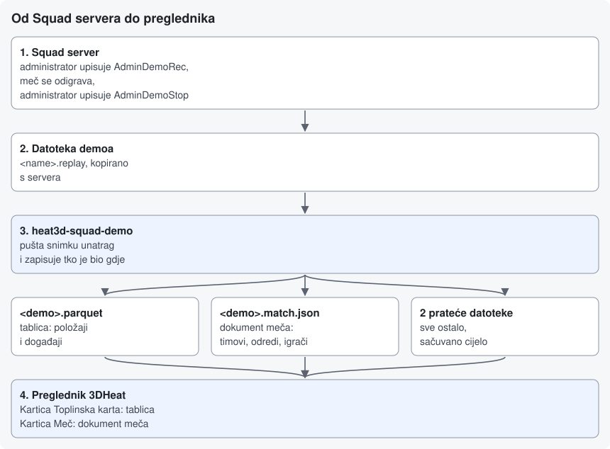

# 3DHeat Squad {#dheat-squad}

**Što je to?** Mali program koji pretvara snimku meča Squada u
datoteke koje [3DHeat](https://github.com/Holdi601/3DHeat) preglednik
([dokumentacija](https://holdi601.github.io/3DHeat/)) može prikazati: gdje je svaki igrač bio, sekundu po sekundu, i što se događalo na kojem mjestu.

**Zašto bih ga koristio?** Da vidite meč odozgo: gdje su se borbe vodile,
kojim su rutama odredi išli, gdje su vozila stradala.

**Primjer:** `match.replay` (demo snimljen na Squad serveru) ->
`match.parquet` (jedan redak po položaju ili događaju) + `match.match.json` (dokument
meča: timovi, odredi, igrači). Izlazne datoteke su obični Parquet
i JSON, pa ih može čitati i bilo što drugo.

Za što je korisno:

- **Gdje se meč vodio.** Položaj svakog igrača i bota, pješice, u kopnenim vozilima
  i u helikopterima, otprilike osam puta u sekundi, s timom, frakcijom, odredom, zdravljem i
  nagibom pogleda.
- **Što se događalo na kojem mjestu.** Ranjavanja, oživljavanja i smrti; svaki hitac i svaki
  pogodak u vozilo; svako vozilo, postavljeni objekt i utvrda koji su se pojavili, oštetili, uništili i uklonili.
- **Cijeli meč u jednom dokumentu.** Timovi, odredi, stanje igre, svaki akter, redak za
  svakog igrača i bota te samoprovjera da ništa što demo sadrži nije izgubljeno.



## Brzi početak {#quick-start}

Ne znate ništa o naredbenom retku? Prvo pročitajte [Prije nego što počnete](before-you-start.md).

```bash
python -m pip install -e .              # instalira naredbu heat3d-squad-demo
heat3d-squad-demo match.replay -o out   # ili mapu s .replay datotekama
```

Trebali biste vidjeti jedan redak po demu. Zatim učitajte `out/<map>/<demo>.parquet` u karticu Toplinska karta
preglednika ([Unos podataka](https://holdi601.github.io/3DHeat/getting-data-in.html)).

## Stranice {#pages}

| Stranica | Što obuhvaća |
|---|---|
| [Prije nego što počnete](before-you-start.md) | Python, terminal, prvo pokretanje |
| [Snimanje dema](recording.md) | kako server zapisuje demo i gdje ga naći |
| [Pretvaranje dema](converting.md) | naredba, svaka opcija, primjer izlaza |
| [Tablica](output-table.md) | svaki stupac i svaki `event` |
| [Dokument meča i prateće datoteke](output-match.md) | `.match.json`, dvije prateće datoteke, samoprovjera |
| [Kako se demo čita](how-it-works.md) | slojevi čitača i što je provjereno |
| [Ograničenja, ažuriranja i uvjeti](limits.md) | što se ne čita, što ažuriranje Squada može pokvariti, osobni podaci, licenca |
| [Referenca naredbi](../cli-reference.md) | svaka opcija i stupac, generirano iz koda |
| [Održavanje ovih stranica](maintaining.md) | popis za izdavanje verzije |

## Povezano {#related}

- Preglednik 3DHeat: [github.com/Holdi601/3DHeat](https://github.com/Holdi601/3DHeat),
  dokumentacija na [holdi601.github.io/3DHeat](https://holdi601.github.io/3DHeat/).
- Formati datoteka koje preglednik čita, uključujući spremnik jedne datoteke po meču:
  [Jedna datoteka po meču (.3dheat)](https://holdi601.github.io/3DHeat/container.html).
  Ovaj pretvarač piše zasebne datoteke: tablicu, dokument meča i njegove
  prateće datoteke jednu uz drugu.
- 3DHeat Watcher pokreće ovaj pretvarač na novim demoima kad je instaliran
  (adapter `squad-demos`): [3DHeat Watcher](https://holdi601.github.io/3DHeat-Watcher/).

## Alati 3DHeat {#the-3dheat-tools}

| Alat | Što radi | Kod | Dokumentacija |
|---|---|---|---|
| Preglednik 3DHeat | prikazuje podatke: toplinske karte, analizu utrka, pregled meča | [3DHeat](https://github.com/Holdi601/3DHeat) | [dokumentacija](https://holdi601.github.io/3DHeat/) |
| GameFiles | razine i staze iz vlastitih datoteka igre | [3DHeat-GameFiles](https://github.com/Holdi601/3DHeat-GameFiles) | [dokumentacija](https://holdi601.github.io/3DHeat-GameFiles/) |
| GameCapture | telemetrija krugova i razine rekonstruirane iz snimke igranja | [3DHeat-GameCapture](https://github.com/Holdi601/3DHeat-GameCapture) | [dokumentacija](https://holdi601.github.io/3DHeat-GameCapture/) |
| Unreal Exporter | dodatak za Unreal Editor: razina kao jedna `.glb` datoteka | [3DHeat-UnrealExporter](https://github.com/Holdi601/3DHeat-UnrealExporter) | [dokumentacija](https://holdi601.github.io/3DHeat-UnrealExporter/) |
| CS2 | demoi i mape Counter-Strike 2 | [3DHeat-CS2](https://github.com/Holdi601/3DHeat-CS2) | [dokumentacija](https://holdi601.github.io/3DHeat-CS2/) |
| Watcher | bilježi ono što igre objavljuju dok igrate | [3DHeat-Watcher](https://github.com/Holdi601/3DHeat-Watcher) | [dokumentacija](https://holdi601.github.io/3DHeat-Watcher/) |
| Ext-WarThunder | War Thunder replay-i | [3DHeat-Ext-WarThunder](https://github.com/Holdi601/3DHeat-Ext-WarThunder) | [dokumentacija](https://holdi601.github.io/3DHeat-Ext-WarThunder/) |
| Ext-WoT | World of Tanks replay-i | [3DHeat-Ext-WoT](https://github.com/Holdi601/3DHeat-Ext-WoT) | [dokumentacija](https://holdi601.github.io/3DHeat-Ext-WoT/) |
| Ext-WoWs | World of Warships replay-i | [3DHeat-Ext-WoWs](https://github.com/Holdi601/3DHeat-Ext-WoWs) | [dokumentacija](https://holdi601.github.io/3DHeat-Ext-WoWs/) |
| Ext-Squad | demoi Squad servera | [3DHeat-Ext-Squad](https://github.com/Holdi601/3DHeat-Ext-Squad) | [dokumentacija](https://holdi601.github.io/3DHeat-Ext-Squad/) |
| Ext-DCS | mape DCS Worlda kao 3D razine | [3DHeat-Ext-DCS](https://github.com/Holdi601/3DHeat-Ext-DCS) | [dokumentacija](https://holdi601.github.io/3DHeat-Ext-DCS/) |
| Ext-IL2 | mape IL-2 Sturmovik kao 3D razine | [3DHeat-Ext-IL2](https://github.com/Holdi601/3DHeat-Ext-IL2) | [dokumentacija](https://holdi601.github.io/3DHeat-Ext-IL2/) |
