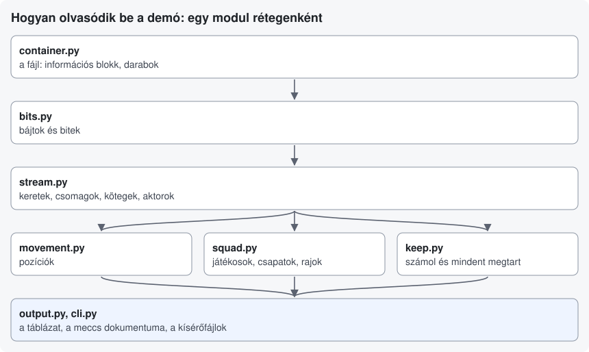

# Hogyan olvasódik be a demó {#how-a-demo-is-read}

Egyszerűen fogalmazva: egy Squad-szerver minden játékos pozícióját elküldi minden másik
játékosnak. A demófájl ennek a forgalomnak a felvétele. Ez az eszköz visszajátssza, és
leírja, hogy ki hol volt.



Egy Unreal-hálózati visszajátszás a szerver saját replikációs forgalma, amelyet a demó-meghajtója
írt le. Ezt úgy olvasni, ahogy egy kliens olvasná a forgalmat.

| Modul | Réteg |
|---|---|
| `container.py` | A helyi fájlfolyam-kezelő fájlja: egy információs blokk (`0x1CA2E27F` mágikus számmal), utána darabok. A darabtípusok: a fejléc (`FNetworkDemoHeader`, `0x2CF5A13D` mágikus számmal), a replikált adatok, az ellenőrzőpontok és az események. |
| `bits.py` | Bájtarchívumok a keretekhez és bitarchívumok a csomagokhoz. A csomagokat a legkisebb helyi bittel kezdve olvassa. |
| `stream.py` | Keretek, csomagok, kötegek (a részleges kötegek összeillesztve), aktor-csatornák, aktor-megjelenések és tartalmi blokkok. Minden blokk replikált tulajdonságokat tartalmaz: kezelő, bitszám és bitek formájában, majd távoli hívásokat és egyéni delta-mezőket, amelyek a osztály `_ClassNetCache` csoportjának kezelőire hivatkoznak. Azokat az objektumokat, amelyeket az exportok nem neveznek meg, az egész demó beolvasása után kapják meg osztályukat (lásd lent). |
| `movement.py` | Az motor `FRepMovement` és a Squad helikopter-mozgása. |
| `keep.py` | Minden elem, amelyet találtunk, megszámolva és megtartva: a kísérőfájlok sorai és az önellenőrzés. |
| `squad.py` | Melyik Squad-osztály mit hordoz. A `SQPlayerState` tartja a nevet, a csapatállapotot, a rajállapotot és az aktuális figurát; a `SQTeamState` a csapatszámot és a frakciót; a `SQSquadState` a rajszámot. Egy ülés figurájának tulajdonosa a járműve. |
| `output.py`, `cli.py` | A táblázat és a meccs dokumentuma. |

A visszajátszás a saját mezőit megnevezi. Minden kezelőhöz megadja az osztályútvonalakat és
a tulajdonságneveket, valamint az általa hivatkozott objektumok útvonalait. Így minden tulajdonság
név szerint megtalálható a játék kódja nélkül. Csak a tulajdonság bitjeihez kell a típus:
a mozgásnál ez a motor saját típusa; a Squad tulajdonságainál a típusok egyszerűek: szövegek,
egészek, objektumhivatkozások és nevek.

Néhány objektumot csak a saját nevük nevez meg: egy pálya aktorait a példánynevük
(`Team1SpawnPoint3`), a komponenseket a sajátjuk (`MovementComponent`, `wheel_L1`). Az
osztályukat az exporttáblákból találjuk meg, a folyam után: a demó-meghajtó abban a keretben
exportálja az osztály mezőjét, amelyben először elküldi (ez igaz minden megnevezett objektum
első küldésére a tesztdemókban), így az osztály az az egy csoport, amely pontosan azokat a
kezelőket exportálta abban a keretben, amelyben az objektum először elküldte őket; ha nincs ilyen,
akkor bármelyik csoport, amelynek addigra minden kezelője megvolt, ha mind ugyanazokat a neveket adja;
különben annak az objektumnak az osztálya, amelynek ugyanaz a neve, a számok nélkül, vagy az az
egyetlen csoport, amelynek a nevében benne van az objektum neve. Az így megnevezett objektumok
kezelőinek azon részéből, amelyeknek az osztálya egy rögzített bitszámmal küldi őket, mind azzal a
számmal érkezett (másikkal egy sem). Ami ezek egyikével sem dől el, az az entities kísérőfájlban
marad, teljes egészében.

## Tulajdonságok dekódolása {#decoding-properties}

Minden replikált tulajdonság annyira van dekódolva, amennyire a bitjei megmondják: egy bit jelzőként,
a hivatkozás egy objektumra (a hálózati GUID-ja), ha a neve úgy végződik, mint a hivatkozásoké
(`...State`, `...Seat`, `...Pawn`, `...Class`...), egy hossz és ennyi bájt szövegként, a 8/16/32/64
bit számként (lebegőpontosként, ha a neve úgy mondja: életerő, idő, sebesség, bemenet...), minden más
a bitjei hexadecimálisan, a bennük talált szövegekkel. A távoli hívásokat ugyanígy olvassuk, az
egyes függvényekhez a demó által exportált paraméternevek szerint.

## Hogyan olvasódnak be az események {#how-the-events-are-read}

Egy katona `Health` és `bWounded` értékei a szervertől jönnek: megsebesült, amikor a `bWounded`
bekapcsol, újraélesztett, amikor kikapcsol és az életerő 0 fölött van, meghalt, amikor az életerő
-100 alá esik (aki feladja vagy elvérzik, annak -300). Egy bot, amely sosem sebesült meg, 0-nál hal
meg. Egy jármű vagy telepíthető eszköz minden `Health` csökkenésnél `damaged` lesz, 0 vagy alatta
`destroyed`. A megjelenések és eltávolítások az aktor-csatorna nyitása és zárása; az ülés a
játékosállapot `CurrentSeat` mezője (az ülés-komponens hivatkozása, amelyet a járműve küld). A
nézés dőlésszöge a katona `RemoteViewPitch` értéke, egy bájt, a teljesen lefelé (0) és a teljesen
felfelé (255) közötti tartományban. Egy lövés egy fegyver `MulticastFireProjectile` hívása (kiindulási
pont és irány), vagy ha ugyanazzal az iránnyal nem jött ilyen hívás, akkor a `MulticastFireMultipleProjectileEffects`.
Egy találat egy jármű `MulticastPlayDamageEffects` hívása (becsapódási hely, sérülés típusa).

## Mit ellenőriztünk, és hogyan {#what-was-verified-and-how}

Ezeket két nyilvános Squad v10.3.1 szerverdemón ellenőriztük (Unreal Engine 5.5.4, motor
hálózati verzió 36), a squad-replay projekt tesztfájljaiból:

- **Számok.** A keretek, csomagok, aktor-megnyitások, exportcsoportok és exportált objektumútvonalak
  száma pontosan egyezik ennek a projektnek a független elemzőjével. Ugyanígy a katonák mozgási
  mintáinak száma is.
- **Mozgás a sebességhez mérve.** Minden katonamintának az előzőhöz képesti lépése, elosztva az
  időkülönbséggel, egyezik a minta által hordozott sebességgel. A medián arány 0,8 és 1,2 között van
  a mozgó játékosokon.
- **Csapatok a blueprintekhez mérve.** Minden sor csapata az a csapat, amelynek a frakciója a katona
  blueprintjéhez tartozik. Ez igaz volt egy olyan játékosra is, aki a meccs közben oldalt váltott.
- **Hibák.** Demónként egy folyamhiba marad: egy eltévedt bit az ügynök saját megfigyelő aktorának
  nyitó kötegének végén; ez nem hordoz itt használt adatot.
- **Halálesetek a projekt saját öléseihez mérve.** Minden kill, amelyet ő listáz, itt olvasott
  sebesülés vagy halál, ugyanabban az időben és ugyanannál a játékosnál; a jármű-kilések itt olvasott,
  0 vagy az alatti életerőre jutó járművek.
- **Telepíthető eszközök.** Az itt olvasott aktorok, amelyeknek van építési állapotuk vagy FOB-követelménye,
  egy eltéréssel egyeznek a projekt telepíthető eszközeivel.
- **Nézési dőlés.** A nézési dőlés bájtja nyugalomban körülbelül 120 körül van, és eléri a 255-öt (teljesen
  felfelé). A -90..+90 tartományon bájtként olvasva. Ha a motor szokásos, teljes fordulatot jelentő bájtként
  olvasnánk, a katonák akár 128 fokkal a horizont alatt is néznének, amit nem tudnak.
- **Botok.** Egy seeding demón minden bot (`SQSquidBot`) saját nyomvonallal rendelkezik, és a meghaló
  botok halálként olvasódnak be.
- **Helikopter-mozgás** (`SQHelicopterMovementComponent.ReplicatedMovement`, a Squad saját elrendezése:
  nincsenek jelzők, a hely századmilliméterekben, a sebesség és a szögsebesség, három opcionális 16 bites
  szög, és a szerver órája lebegőpontosan). Minden helikopter-minta pontosan kitölti a bitjeit. Egy
  parkoló helikopter helye és elfordulása a megjelenéséé, centiméter és szögegység pontossággal. Repülés
  közben a minták közötti lépés az óra lépésével osztva adja a sebességet (medián arány 0,997), és az óra a
  demó idejével együtt lép (medián 0,4 ms-re). A szögsebesség követi a yaw-sebességet (korreláció 0,91),
  de a mértékegysége nincs rögzítve: megtartjuk, nem használjuk.
- **Ülések.** A játékosállapot `CurrentSeat` mezője hivatkozás (egy tömörített hálózati GUID), nem szám,
  ahogy korábban olvastuk: így olvasva minden váltásnál az az ülés, amelyet a katona saját
  `MulticastUpdateCurrentSeat` hívása egy pillanattal korábban megnevez, és a váltások a squad-replay-éi.
- **Lövések és találatok.** Minden `ShootDir` egységvektor (hossza 1, 0,00003 pontossággal); minden
  `MulticastFireMultipleProjectileEffects` kiindulási pontja, elosztva 10-zel, az egyező
  `MulticastFireProjectile` `OriginZeroBased` értéke 1 mm-en belül; ahol a lövő vagy a talált jármű helye
  ismert, a lövés kiindulási pontja vagy a becsapódás medián 0,45 m-re van tőle.
- **Járműbemenetek.** Lebegőpontosként olvasva a lánctalpas járművek gázpedálja, féke és kézifékje 0..1
  között, a kormányzásuk -1..1 között van, minden frissítésben.
- **Kilépési okok.** Minden aktor, amelynek a csatornája újra nyílt, `Dormancy` okkal zárult le; egyik sem
  zárult `Destroyed` okkal, és nyílt újra.

A tesztek, amelyeket a tesztek maguk építenek, lefedik a tárolót, a kötegeket, a folyamot és az egész
utat a táblázatig, és azt, hogy egy minden fajta elemet tartalmazó demó egyet sem veszít el
([`tests/test_completeness.py`](https://github.com/Holdi601/3DHeat-Ext-Squad/blob/main/tests/test_completeness.py)):

```bash
python -m pip install -e .[test]
pytest                                   # szintetikus demók
HEAT3D_SQUAD_DEMOS=<folder> pytest       # plusz a valódi demók abban a mappában
```
