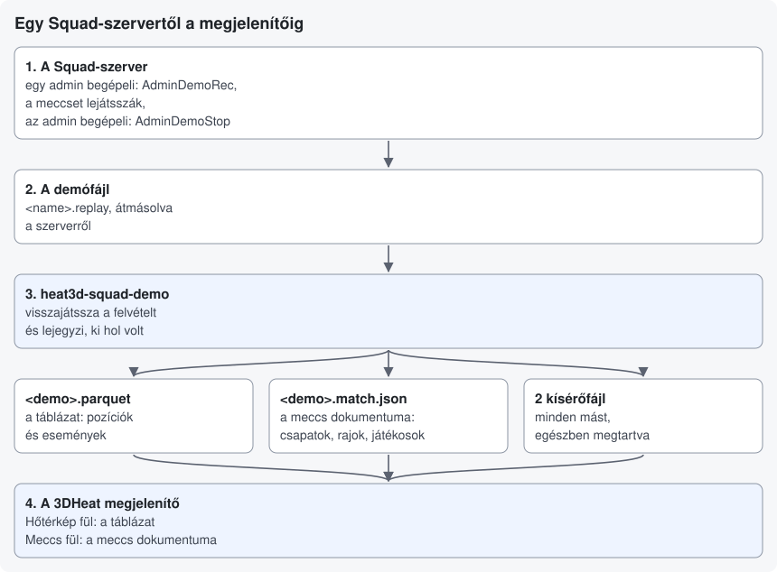

# 3DHeat Squad {#dheat-squad}

**Mi ez?** Egy kis program, amely egy Squad-meccs felvételét olyan fájlokká alakítja,
amelyeket a [3DHeat](https://github.com/Holdi601/3DHeat) megjelenítő
([dokumentáció](https://holdi601.github.io/3DHeat/)) ki tud rajzolni: hogy hol volt minden
játékos, másodpercről másodpercre, és mi történt hol.

**Mire jó?** Hogy felülnézetből lásd a meccset: hol folyt a harc, milyen útvonalakon
mentek a rajok, hol pusztultak el a járművek.

**Példa:** `match.replay` (egy demó, amelyet Squad-szerveren vettek fel) ->
`match.parquet` (egy sor minden pozícióhoz vagy eseményhez) + `match.match.json` (a
meccsdokumentuma: csapatok, rajok, játékosok). A kimenet közönséges Parquet- és
JSON-fájl, így bármilyen más program is be tudja olvasni.

Mire használható:

- **Hol zajlott a meccs.** Minden játékos és bot pozíciója, gyalogosan, szárazföldi
  járműben és helikopterben, körülbelül másodpercenként nyolcszor, csapattal,
  frakcióval, rajjal, életerővel és a nézés dőlésszögével.
- **Mi történt hol.** Sebesülések, újraélesztések és halálesetek; minden lövés és minden
  találat egy járművön; minden jármű, telepíthető eszköz és fegyverállás megjelenése,
  megrongálódása, megsemmisülése és eltávolítása.
- **Az egész meccs egy dokumentumban.** Csapatok, rajok, a játék állapota, minden
  szereplő, egy sor játékosonként és botonként, valamint önellenőrzés, amely megmutatja,
  hogy a demóból semmi nem veszett el.



## Gyors kezdés {#quick-start}

Még nem használt parancssort? Először olvasd el a [Mielőtt elkezded](before-you-start.md)
oldalt.

```bash
python -m pip install -e .              # telepíti a heat3d-squad-demo parancsot
heat3d-squad-demo match.replay -o out   # vagy egy .replay fájlokat tartalmazó mappa
```

Demónként egy sort kell látnod. Ezután töltsd be az `out/<map>/<demo>.parquet` fájlt a
megjelenítő Hőtérkép fülén ([Adatok betöltése](https://holdi601.github.io/3DHeat/getting-data-in.html)).

## Oldalak {#pages}

| Oldal | Mit tartalmaz |
|---|---|
| [Mielőtt elkezded](before-you-start.md) | Python, egy terminál, az első futtatás |
| [Demó felvétele](recording.md) | hogyan rögzítsd a demót a szerveren, és hol találod |
| [Demók konvertálása](converting.md) | a parancs, minden kapcsoló, példakimenet |
| [A táblázat](output-table.md) | minden oszlop és minden `event` |
| [A meccsdokumentum és a kísérőfájlok](output-match.md) | a `.match.json`, a két kísérőfájl, az önellenőrzés |
| [Hogyan olvasódik be a demó](how-it-works.md) | az olvasó rétegei és az ellenőrzések |
| [Korlátok, frissítések és feltételek](limits.md) | mi nem olvasódik be, mit törhet el egy Squad-frissítés, személyes adatok, licenc |
| [Parancsleírás](../cli-reference.md) | minden kapcsoló és oszlop, a kódból generálva |
| [A dokumentáció karbantartása](maintaining.md) | a kiadási ellenőrzőlista |

## Kapcsolódó oldalak {#related}

- A 3DHeat megjelenítő: [github.com/Holdi601/3DHeat](https://github.com/Holdi601/3DHeat),
  dokumentáció: [holdi601.github.io/3DHeat](https://holdi601.github.io/3DHeat/).
- A megjelenítő által olvasott fájlformátumok, köztük a meccsenkénti egyfájlos tároló:
  [Egy fájl meccsenként (.3dheat)](https://holdi601.github.io/3DHeat/container.html).
  Ez a konverter a laza fájlokat írja: a táblázatot, a meccsdokumentumát és a
  kísérőfájljait egymás mellett.
- A 3DHeat Watcher a konvertert futtatja az új demókon, ha telepítve van
  (adapter: `squad-demos`): [3DHeat Watcher](https://holdi601.github.io/3DHeat-Watcher/).

## A 3DHeat eszközei {#the-3dheat-tools}

| Eszköz | Mit csinál | Kód | Dokumentáció |
|---|---|---|---|
| 3DHeat megjelenítő | megmutatja az adatokat: hőtérképeket, versenyelemzést, meccsáttekintést | [3DHeat](https://github.com/Holdi601/3DHeat) | [dokumentáció](https://holdi601.github.io/3DHeat/) |
| GameFiles | pályák és versenypályák egy játék saját fájljaiból | [3DHeat-GameFiles](https://github.com/Holdi601/3DHeat-GameFiles) | [dokumentáció](https://holdi601.github.io/3DHeat-GameFiles/) |
| GameCapture | körtelemetria, és pályák rekonstruálva játékvideóból | [3DHeat-GameCapture](https://github.com/Holdi601/3DHeat-GameCapture) | [dokumentáció](https://holdi601.github.io/3DHeat-GameCapture/) |
| Unreal Exporter | Unreal Editor bővítmény: egy pálya egyetlen `.glb` fájlban | [3DHeat-UnrealExporter](https://github.com/Holdi601/3DHeat-UnrealExporter) | [dokumentáció](https://holdi601.github.io/3DHeat-UnrealExporter/) |
| CS2 | Counter-Strike 2 demók és pályák | [3DHeat-CS2](https://github.com/Holdi601/3DHeat-CS2) | [dokumentáció](https://holdi601.github.io/3DHeat-CS2/) |
| Watcher | azt rögzíti, amit a játékok közzétesznek játék közben | [3DHeat-Watcher](https://github.com/Holdi601/3DHeat-Watcher) | [dokumentáció](https://holdi601.github.io/3DHeat-Watcher/) |
| Ext-WarThunder | War Thunder visszajátszások | [3DHeat-Ext-WarThunder](https://github.com/Holdi601/3DHeat-Ext-WarThunder) | [dokumentáció](https://holdi601.github.io/3DHeat-Ext-WarThunder/) |
| Ext-WoT | World of Tanks visszajátszások | [3DHeat-Ext-WoT](https://github.com/Holdi601/3DHeat-Ext-WoT) | [dokumentáció](https://holdi601.github.io/3DHeat-Ext-WoT/) |
| Ext-WoWs | World of Warships visszajátszások | [3DHeat-Ext-WoWs](https://github.com/Holdi601/3DHeat-Ext-WoWs) | [dokumentáció](https://holdi601.github.io/3DHeat-Ext-WoWs/) |
| Ext-Squad | Squad-szerverdemók | [3DHeat-Ext-Squad](https://github.com/Holdi601/3DHeat-Ext-Squad) | [dokumentáció](https://holdi601.github.io/3DHeat-Ext-Squad/) |
| Ext-DCS | DCS World térképek 3D pályaként | [3DHeat-Ext-DCS](https://github.com/Holdi601/3DHeat-Ext-DCS) | [dokumentáció](https://holdi601.github.io/3DHeat-Ext-DCS/) |
| Ext-IL2 | IL-2 Sturmovik térképek 3D pályaként | [3DHeat-Ext-IL2](https://github.com/Holdi601/3DHeat-Ext-IL2) | [dokumentáció](https://holdi601.github.io/3DHeat-Ext-IL2/) |
