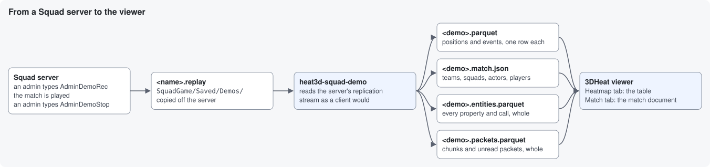

# 3DHeat Squad

3DHeat Squad reads **Squad server demos** (`.replay`) and writes, per demo, a
heatmap table and a match document for the
[3DHeat](https://github.com/Holdi601/3DHeat) viewer
([documentation](https://holdi601.github.io/3DHeat/)). The outputs are
ordinary Parquet and JSON files, so anything else can read them too.

What it is useful for:

- **Where a match was fought.** Every player's and bot's position, on foot, in
  ground vehicles and in helicopters, about eight times a second, with team,
  faction, squad, health and view pitch.
- **What happened where.** Wounds, revives and deaths; every shot and every
  hit on a vehicle; every vehicle, deployable and emplacement spawned,
  damaged, destroyed and removed.
- **The whole match in one document.** Teams, squads, the game state, every
  actor, a line per player and per bot, and a self-check that nothing the
  demo holds was lost.



## Quick start

```bash
pip install -e .                        # installs the heat3d-squad-demo command
heat3d-squad-demo match.replay -o out   # or a folder of .replay files
```

Then load `out/<map>/<demo>.parquet` in the viewer's Heatmap tab
([Getting data in](https://holdi601.github.io/3DHeat/getting-data-in.html)).

## Pages

| Page | What it covers |
|---|---|
| [Recording a demo](recording.md) | making a server write a demo, and finding it |
| [Converting demos](converting.md) | the command, every option, example output |
| [The table](output-table.md) | every column and every `event` |
| [The match document and sidecars](output-match.md) | the `.match.json`, the two sidecars, the self-check |
| [How a demo is read](how-it-works.md) | the layers of the reader, and what was verified |
| [Limits, updates and terms](limits.md) | what is not read, what a Squad update can break, personal data, licence |

## Related

- The 3DHeat viewer: [github.com/Holdi601/3DHeat](https://github.com/Holdi601/3DHeat),
  documentation at [holdi601.github.io/3DHeat](https://holdi601.github.io/3DHeat/).
- The file formats the viewer reads, including the one-file-a-match
  container: [One file a match (.3dheat)](https://holdi601.github.io/3DHeat/container.html).
  This converter writes the loose files: the table, the match document and
  its sidecars side by side.
- The 3DHeat Watcher runs this converter on new demos when it is installed
  (adapter `squad-demos`): [3DHeat Watcher](https://holdi601.github.io/3DHeat-Watcher/).
