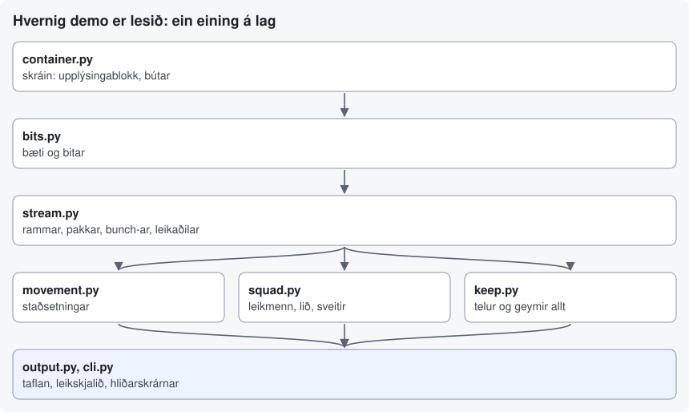

# Hvernig demo er lesið {#how-a-demo-is-read}

Í einföldum orðum: Squad-þjónn sendir staðsetningu hvers leikmanns til allra hinna. Demo-skráin er upptaka á þeirri umferð. Þetta verkfæri spilar hana aftur og skrifar niður hver var hvar.



Unreal-netupptaka er eigin afritunarumferð þjónsins, skrifuð niður af demo driver hans. Að lesa hana er að lesa þá umferð eins og biðlari myndi gera.

| Eining | Lag |
|---|---|
| `container.py` | Skrá staðbundna skráastreymisins: upplýsingablokk (magic `0x1CA2E27F`), síðan bútar. Bútategundirnar eru haus (`FNetworkDemoHeader`, magic `0x2CF5A13D`), upptökugögn, checkpoint og atburðir. |
| `bits.py` | Bætaskjalasöfn fyrir ramma og bitaskjalasöfn fyrir pakka. Pakkar eru lesnir lægsta bit fyrst. |
| `stream.py` | Rammar, pakkar, bunch-ar (hlutabunch sameinuð), leikaðilarásir, leikaðilaspawn og efnisblokkir. Hver blokk geymir afritaðar eigindir sem handfang, bitafjölda og bita, síðan fjarkall og custom-delta reiti sem handföng inn í `_ClassNetCache` hóp flokksins. Hlutir sem exports nefna ekki fá flokk sinn þegar allt demo-ið hefur verið lesið (sjá hér að neðan). |
| `movement.py` | `FRepMovement` vélarinnar og hreyfing þyrlna í Squad. |
| `keep.py` | Sérhvert atriði sem mætt er, talið og geymt: raðir hliðarskránna og sjálfsskoðunin. |
| `squad.py` | Hvaða Squad-flokkar bera hvað. `SQPlayerState` geymir nafnið, liðsstöðu, sveitarstöðu og núverandi pawn; `SQTeamState` liðsnúmerið og fylkinguna; `SQSquadState` sveitarnúmerið. Eigandi sætis-pawn er ökutæki þess. |
| `output.py`, `cli.py` | Taflan og leikjaskjalið. |

Upptaka nefnir sín eigin svið. Hún ber flokkaslóðir og eigindanöfn fyrir hvert handfang, og slóðir hlutanna sem hún vísar í. Þess vegna má finna sérhverja eigind eftir nafni án kóða leiksins. Aðeins bitar eigindar þurfa gerð hennar. Fyrir hreyfingu er það eigin gerð vélarinnar; fyrir eigindir Squad eru gerðirnar einfaldar: strengir, heiltölur, hlutatilvísanir og nöfn.

Sumir hlutir eru aðeins nefndir af sjálfum sér: leikaðilar borðs með tilvikanafni sínu (`Team1SpawnPoint3`), íhlutir með sínu eigin (`MovementComponent`, `wheel_L1`). Flokkur þeirra er fundinn úr export-töflunum, eftir strauminn: demo driver flytur reit flokks út í rammanum þar sem hann er fyrst sendur (rétt um sérhverja fyrstu sendingu nefnds hlutar í prófunardemo-unum), svo flokkurinn er sá eini hópur sem flutti út nákvæmlega þau handföng í römmunum þar sem hluturinn sendi þau fyrst; annars hver hópur sem hafði öll handföng sín fyrir þann tíma, þegar allir gefa þeim sömu nöfn; annars flokkur hlutar með sama nafn, án talna, eða sá eini hópur sem nafn hans geymir nafn hlutarins. Af handföngum hluta sem nefndir eru á þennan hátt, þar sem flokkurinn sendir þau með einum föstum bitafjölda, komu öll með þeim fjölda (engin með öðrum). Það sem ekkert af þessu útkljáir helst í entities-hliðarskránni, í heild.

## Afkóðun eiginda {#decoding-properties}

Sérhver afrituð eigind er afkóðuð eins langt og bitar hennar segja hvað hún er: einn biti er fáni, tilvísun í hlut (net GUID hans) þar sem nafnið endar eins og tilvísun gerir (`...State`, `...Seat`, `...Pawn`, `...Class`...), lengd og svo mörg bæti er strengur, nafn, 8/16/32/64 bitar er tala (fleytitala þar sem nafn eigindarinnar segir til um: heilsa, tími, hraði, inntak...), allt annað eru bitar þess í hex með strengjunum sem finnast inni í. Fjarköll eru lesin eins, eftir færibreytunöfnunum sem demo-ið flytur út fyrir hvert fall.

## Hvernig atburðir eru lesnir {#how-the-events-are-read}

`Health` og `bWounded` hermanns koma frá þjóninum: særður þegar `bWounded` kveikir á sér, endurlífgaður þegar það slokknar með heilsu yfir 0, dáinn þegar heilsan fellur undir -100 (leikmaður sem gefst upp eða blæðir út er settur á -300); bot, sem er aldrei særður, deyr við 0. Ökutæki eða uppsett mannvirki er `damaged` við hvert fall `Health`, `destroyed` við 0 eða lægra. Spawn og fjarlægingar eru opnun og lokun leikaðilarásarinnar; sæti er `CurrentSeat` leikmannsstöðunnar (tilvísun í sætishlutinn, sem er sendur á ökutæki hans). Sjónhallinn er `RemoteViewPitch` hermannsins, bæti frá beint niður (0) til beint upp (255). Skot er `MulticastFireProjectile` vopns (uppruni og stefna), eða `MulticastFireMultipleProjectileEffects` þess þar sem ekkert slíkt kall kom með sömu stefnu; högg er `MulticastPlayDamageEffects` ökutækis (höggstaðsetning, skaðategund).

## Hvað var staðfest, og hvernig {#what-was-verified-and-how}

Þetta var borið saman við tvö opinber Squad v10.3.1 þjónsdemo (Unreal Engine 5.5.4, netútgáfa vélarinnar 36), úr prófunargögnum squad-replay verkefnisins:

- **Talningar.** Fjöldi ramma, pakka, opnana leikaðila, export-hópa og útfluttra hlutaslóða passar nákvæmlega við óháðan þáttara þess verkefnis. Það á líka við um fjölda hreyfisýna hermanna.
- **Hreyfing gegn hraða.** Skref hvers hermannasýnis frá því fyrra, deilt með tímanum á milli þeirra, passar við hraðann sem sýnið ber. Miðgildishlutfallið er innan 0,8 til 1,2 hjá leikmönnum á hreyfingu.
- **Lið gegn blueprints.** Lið hverrar raðar er liðið sem fylking blueprint hermannsins tilheyrir. Þetta hélt fyrir leikmann sem skipti um lið í miðjum leik.
- **Villur.** Ein straumvilla er eftir í hverju demo: villandi biti í lok opnunarbunch áhorfenda-leikaðila upptökutækisins sjálfs, sem ber ekkert sem hér er notað.
- **Mannfall gegn drápum þess verkefnis.** Hvert dráp sem það telur upp er sár eða dauði lesið hér, á sama tíma og hjá sama leikmanni; ökutækjadráp þess eru ökutæki lesin hér sem ná heilsu 0 eða lægra.
- **Uppsett mannvirki.** Leikaðilarnir sem lesnir eru hér með byggingarstöðu eða FOB-kröfu passa við uppsett mannvirki þess verkefnis, innan eins.
- **Halli.** Sjónhallabætið liggur í kringum 120 í hvíld og nær 255 (beint upp): lesið sem bæti yfir -90..+90. Lesið sem venjulegt bæti vélarinnar fyrir heilan snúning myndi setja hermenn allt að 128 gráður undir sjóndeildarhring, sem þeir geta ekki litið.
- **Bots.** Í seeding-demo hefur hver bot (`SQSquidBot`) sína eigin braut, og botarnir sem deyja eru lesnir sem dauðsföll.
- **Þyrluhreyfing** (`SQHelicopterMovementComponent.ReplicatedMovement`, eigin uppsetning Squad: engir fánar, staðsetningin í hundruðustu hlutum, hraðinn og hornhraðinn, þrjú valkvæð 16 bita horn, klukka þjónsins sem fleytitala). Sérhvert þyrlusýni fyllir bita sína nákvæmlega. Staðsetning og yaw lagðrar þyrlu er spawn hennar, upp á sentímetra og hornaeiningu. Á flugi er skrefið milli sýna deilt með skrefi klukkunnar hraðinn (miðgildishlutfall 0,997), og klukkan stígur með tíma demo-sins (miðgildi 0,4 ms á milli). Hornhraðinn fylgir yaw-hraðanum (fylgni 0,91), en eining hans er ekki negld niður: hann er geymdur, ekki notaður.
- **Sæti.** `CurrentSeat` leikmannsstöðu er tilvísun (pakkað net GUID), ekki tala eins og áður var lesið: lesið þannig er það við hverja breytingu sætið sem eigið `MulticastUpdateCurrentSeat` hermannsins nefnir augnabliki fyrr, og breytingarnar eru þær sömu og hjá squad-replay.
- **Skot og högg.** Sérhver `ShootDir` er einingarvigur (lengd 1 innan 0,00003); uppruni hvers `MulticastFireMultipleProjectileEffects`, deilt með 10, er `OriginZeroBased` samsvarandi `MulticastFireProjectile` innan 1 mm; þar sem staðsetning skotmannsins eða ökutækisins sem varð fyrir höggi er þekkt er uppruni skotsins eða höggið að miðgildi 0,45 m frá henni.
- **Inntak ökutækja.** Lesið sem fleytitölur liggja inngjöf, hemlar og handbremsa beltaökutækjanna í 0..1 og stýring þeirra í -1..1, í hverri uppfærslu.
- **Lokunarástæður.** Sérhver leikaðili þar sem rásin opnaðist aftur hafði verið lokaður með `Dormancy`; enginn lokaður með `Destroyed` opnaðist aftur.

Prófanir á demo sem prófanirnar smíða sjálfar ná yfir gáminn, skjalasöfnin, strauminn og alla leiðina að töflunni, og að demo sem geymir eitt af hverri tegund atriða tapar engu ([`tests/test_completeness.py`](https://github.com/Holdi601/3DHeat-Ext-Squad/blob/main/tests/test_completeness.py)):

```bash
python -m pip install -e .[test]
pytest                                   # synthetic demos
HEAT3D_SQUAD_DEMOS=<folder> pytest       # plus real demos in that folder
```
