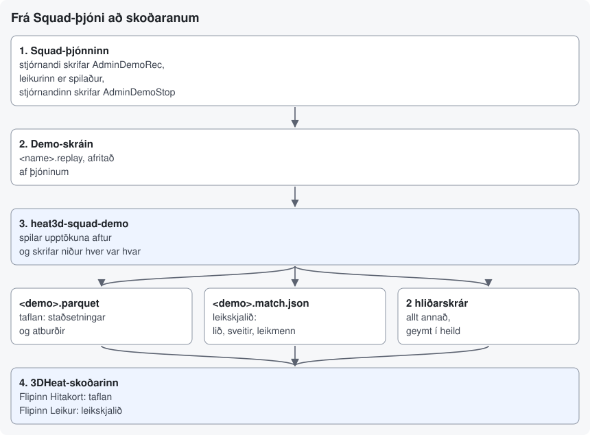

# 3DHeat Squad {#dheat-squad}

**Hvað er þetta?** Lítið forrit sem breytir upptöku af Squad-leik í
skrár sem [3DHeat](https://github.com/Holdi601/3DHeat)-skoðarinn
([skjöl](https://holdi601.github.io/3DHeat/)) getur teiknað: hvar sérhver
leikmaður var, sekúndu fyrir sekúndu, og hvað gerðist hvar.

**Hvers vegna ætti ég að nota það?** Til að sjá leik að ofan: hvar var barist,
hvaða leiðir sveitir fóru, hvar ökutæki eyðilögðust.

**Dæmi:** `match.replay` (demo, tekið upp á Squad-þjóni) ->
`match.parquet` (ein röð fyrir hverja staðsetningu eða atburð) + `match.match.json` (leikskjalið:
lið, sveitir, leikmenn). Úttakið eru venjulegar Parquet- og JSON-skrár,
svo allt annað getur lesið þær líka.

Til hvers það nýtist:

- **Hvar leikurinn var barinn.** Staðsetning sérhvers leikmanns og bots, fótgangandi, í
  landökutækjum og í þyrlum, um átta sinnum á sekúndu, með liði,
  fylkingu, sveit, heilsu og halla sjónar.
- **Hvað gerðist hvar.** Sár, endurlífgun og dauðsföll; hvert skot og hvert
  högg á ökutæki; hvert ökutæki, uppsett mannvirki og skotstæði sem birtist,
  skemmdist, eyðilagðist og hvarf.
- **Allur leikurinn í einu skjali.** Lið, sveitir, leikstaðan, sérhver
  leikaðili, lína fyrir hvern leikmann og hvern bot, og sjálfsskoðun um að ekkert sem
  demo-ið geymir hafi tapast.



## Fljótleg byrjun {#quick-start}

Ertu ný/r í skipanalínunni? Lestu fyrst [Áður en þú byrjar](before-you-start.md).

```bash
python -m pip install -e .              # installs the heat3d-squad-demo command
heat3d-squad-demo match.replay -o out   # or a folder of .replay files
```

Þú ættir að sjá eina línu fyrir hvert demo. Hladdu síðan `out/<map>/<demo>.parquet` í flipann Hitakort í skoðaranum
([Að koma gögnum inn](https://holdi601.github.io/3DHeat/getting-data-in.html)).

## Síður {#pages}

| Síða | Hvað hún fjallar um |
|---|---|
| [Áður en þú byrjar](before-you-start.md) | Python, skipanalína, fyrsta keyrsla |
| [Upptaka á demo](recording.md) | að láta þjón skrifa demo og finna það |
| [Umbreyting á demo](converting.md) | skipunin, hver valkostur, dæmi um úttak |
| [Taflan](output-table.md) | hver dálkur og hver `event` |
| [Leikskjalið og hliðarskrár](output-match.md) | `.match.json`, hliðarskrárnar tvær, sjálfsskoðunin |
| [Hvernig demo er lesið](how-it-works.md) | lög lesarans og hvað var staðfest |
| [Takmarkanir, uppfærslur og skilmálar](limits.md) | hvað er ekki lesið, hvað Squad-uppfærsla getur brotið, persónuupplýsingar, leyfi |
| [Skipanayfirlit](../cli-reference.md) | hver valkostur og dálkur, búið til úr kóðanum |
| [Viðhald þessara skjala](maintaining.md) | gátlisti útgáfu |

## Tengt {#related}

- 3DHeat-skoðarinn: [github.com/Holdi601/3DHeat](https://github.com/Holdi601/3DHeat),
  skjöl á [holdi601.github.io/3DHeat](https://holdi601.github.io/3DHeat/).
- Skráasniðin sem skoðarinn les, þar á meðal gámurinn með eina skrá fyrir hvern leik:
  [Ein skrá fyrir hvern leik (.3dheat)](https://holdi601.github.io/3DHeat/container.html).
  Þessi umbreytir skrifar lausu skrárnar: töfluna, leikskjalið og
  hliðarskrár þess hlið við hlið.
- 3DHeat Watcher keyrir þennan umbreyti á ný demo þegar hann er uppsettur
  (adapter `squad-demos`): [3DHeat Watcher](https://holdi601.github.io/3DHeat-Watcher/).

## 3DHeat tólin {#the-3dheat-tools}

| Tól | Hvað það gerir | Kóði | Skjöl |
|---|---|---|---|
| 3DHeat viewer | sýnir gögnin: hitakort, kappakstursgreiningu, leikjayfirlit | [3DHeat](https://github.com/Holdi601/3DHeat) | [skjöl](https://holdi601.github.io/3DHeat/) |
| GameFiles | borð og brautir úr eigin skrám leiks | [3DHeat-GameFiles](https://github.com/Holdi601/3DHeat-GameFiles) | [skjöl](https://holdi601.github.io/3DHeat-GameFiles/) |
| GameCapture | hringtímagögn og borð endurbyggð úr leikmyndbandi | [3DHeat-GameCapture](https://github.com/Holdi601/3DHeat-GameCapture) | [skjöl](https://holdi601.github.io/3DHeat-GameCapture/) |
| Unreal Exporter | viðbót fyrir Unreal Editor: borð sem ein `.glb` | [3DHeat-UnrealExporter](https://github.com/Holdi601/3DHeat-UnrealExporter) | [skjöl](https://holdi601.github.io/3DHeat-UnrealExporter/) |
| CS2 | Counter-Strike 2 demo og kort | [3DHeat-CS2](https://github.com/Holdi601/3DHeat-CS2) | [skjöl](https://holdi601.github.io/3DHeat-CS2/) |
| Watcher | skráir það sem leikir birta meðan þú spilar | [3DHeat-Watcher](https://github.com/Holdi601/3DHeat-Watcher) | [skjöl](https://holdi601.github.io/3DHeat-Watcher/) |
| Ext-WarThunder | War Thunder upptökur | [3DHeat-Ext-WarThunder](https://github.com/Holdi601/3DHeat-Ext-WarThunder) | [skjöl](https://holdi601.github.io/3DHeat-Ext-WarThunder/) |
| Ext-WoT | World of Tanks upptökur | [3DHeat-Ext-WoT](https://github.com/Holdi601/3DHeat-Ext-WoT) | [skjöl](https://holdi601.github.io/3DHeat-Ext-WoT/) |
| Ext-WoWs | World of Warships upptökur | [3DHeat-Ext-WoWs](https://github.com/Holdi601/3DHeat-Ext-WoWs) | [skjöl](https://holdi601.github.io/3DHeat-Ext-WoWs/) |
| Ext-Squad | Squad þjónadem | [3DHeat-Ext-Squad](https://github.com/Holdi601/3DHeat-Ext-Squad) | [skjöl](https://holdi601.github.io/3DHeat-Ext-Squad/) |
| Ext-DCS | DCS World kort sem 3D borð | [3DHeat-Ext-DCS](https://github.com/Holdi601/3DHeat-Ext-DCS) | [skjöl](https://holdi601.github.io/3DHeat-Ext-DCS/) |
| Ext-IL2 | IL-2 Sturmovik kort sem 3D borð | [3DHeat-Ext-IL2](https://github.com/Holdi601/3DHeat-Ext-IL2) | [skjöl](https://holdi601.github.io/3DHeat-Ext-IL2/) |
