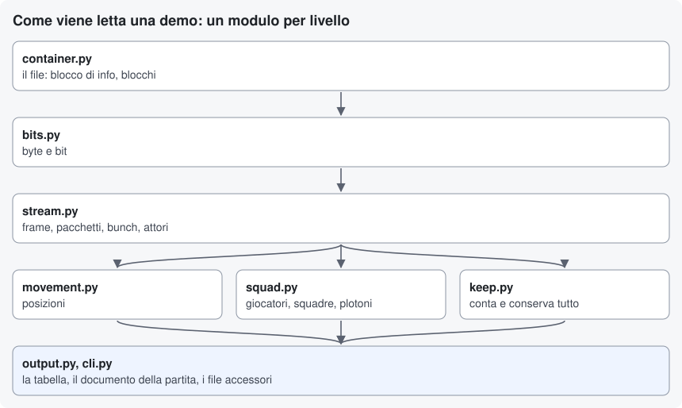

# Come viene letta una demo {#how-a-demo-is-read}

In parole semplici: un server di Squad invia la posizione di ogni giocatore a tutti gli altri giocatori. Il file della demo è una registrazione di quel traffico. Questo strumento lo riproduce e annota chi si trovava dove.



Un replay di rete di Unreal è il traffico di replica del server stesso, annotato dal suo driver delle demo. Leggerlo significa leggere quel traffico come lo leggerebbe un client.

| Modulo | Livello |
|---|---|
| `container.py` | Il file del flusso locale: un blocco di informazioni (magic `0x1CA2E27F`), poi i blocchi. I tipi di blocco sono l'intestazione (`FNetworkDemoHeader`, magic `0x2CF5A13D`), i dati di replay, i checkpoint e gli eventi. |
| `bits.py` | Archivi di byte per i frame e archivi di bit per i pacchetti. I pacchetti si leggono dal bit meno significativo. |
| `stream.py` | Frame, pacchetti, bunch (bunch parziali uniti), canali degli attori, creazioni di attori e blocchi di contenuto. Ogni blocco contiene le proprietà replicate come handle, numero di bit e bit, poi le chiamate remote e i campi di delta personalizzati come handle nel gruppo `_ClassNetCache` della classe. Gli oggetti che le esportazioni non nominano ricevono la loro classe dopo la lettura dell'intero file (vedi sotto). |
| `movement.py` | Il `FRepMovement` del motore, e il movimento degli elicotteri di Squad. |
| `keep.py` | Ogni elemento incontrato, contato e conservato: le righe dei file accessori e il controllo automatico. |
| `squad.py` | Quali classi di Squad contengono cosa. `SQPlayerState` contiene il nome, lo stato della squadra, lo stato del plotone e il pawn attuale; `SQTeamState` il numero di squadra e la fazione; `SQSquadState` il numero del plotone. Il proprietario di un pawn di posto è il suo veicolo. |
| `output.py`, `cli.py` | La tabella e il documento della partita. |

Un replay dichiara da sé i suoi campi. Contiene i percorsi delle classi e i nomi delle proprietà per ogni handle, e i percorsi degli oggetti a cui fa riferimento. Quindi ogni proprietà può essere trovata per nome senza il codice del gioco. Solo i bit di una proprietà richiedono il suo tipo. Per il movimento è il tipo proprio del motore; per le proprietà di Squad i tipi sono semplici: stringhe, interi, riferimenti a oggetti e nomi.

Alcuni oggetti sono nominati solo da sé: gli attori di un livello dal loro nome d'istanza (`Team1SpawnPoint3`), i componenti dal proprio (`MovementComponent`, `wheel_L1`). La loro classe si trova nelle tabelle di esportazione, dopo il flusso: il driver della demo esporta il campo di una classe nel frame in cui viene inviato per la prima volta (vero per ogni primo invio di un oggetto con nome nelle demo di prova), quindi la classe è il gruppo che ha esportato esattamente quegli handle nei frame in cui l'oggetto li ha inviati per la prima volta; altrimenti un gruppo qualsiasi che aveva tutti i suoi handle a quel punto, quando tutti danno gli stessi nomi; oppure la classe di un oggetto dello stesso nome, numeri esclusi, o l'unico gruppo il cui nome contiene quello dell'oggetto. Tra gli handle di oggetti così nominati, quelli la cui classe li invia con un numero fisso di bit, tutti sono arrivati con quel numero (nessuno con un altro). Ciò che nessuna di queste regole risolve resta nel file accessorio delle entità, per intero.

## Decodifica delle proprietà {#decoding-properties}

Ogni proprietà replicata viene decodificata fin dove i suoi bit dicono di cosa si tratta: un bit un flag, un riferimento a un oggetto (il suo GUID di rete) dove il nome finisce come quello di un riferimento (`...State`, `...Seat`, `...Pawn`, `...Class`...), una lunghezza e quel numero di byte una stringa, un nome, 8/16/32/64 bit un numero (un numero in virgola mobile dove il nome della proprietà lo dice: salute, tempo, velocità, input...), tutto il resto i suoi bit in esadecimale con le stringhe trovate al suo interno. Le chiamate remote si leggono allo stesso modo, con i nomi dei parametri che la demo esporta per ogni funzione.

## Come vengono letti gli eventi {#how-the-events-are-read}

La `Health` e il `bWounded` di un soldato provengono dal server: ferito quando `bWounded` si accende, rianimato quando si spegne con salute sopra 0, morto quando la salute scende sotto -100 (un giocatore che si arrende o dissanguato viene portato a -300); un bot, che non viene mai ferito, muore a 0. Un veicolo o un dispositivo è `damaged` a ogni calo della sua `Health`, `destroyed` a 0 o meno. Le creazioni e le rimozioni sono l'apertura e la chiusura del canale dell'attore; un posto è il `CurrentSeat` dello stato del giocatore (un riferimento al componente del posto, che viene inviato sul suo veicolo). L'inclinazione dello sguardo è il `RemoteViewPitch` del soldato, un byte da dritto in basso (0) a dritto in alto (255). Un colpo è un `MulticastFireProjectile` di un'arma (origine e direzione), oppure il suo `MulticastFireMultipleProjectileEffects` dove non è arrivata una chiamata simile con la stessa direzione; un colpo a segno è un `MulticastPlayDamageEffects` di un veicolo (punto d'impatto, tipo di danno).

## Cosa è stato verificato, e come {#what-was-verified-and-how}

Questi controlli sono stati fatti su due demo pubbliche di server di Squad v10.3.1 (Unreal Engine 5.5.4, versione di rete del motore 36), dai dati di prova del progetto squad-replay:

- **Conteggi.** I conteggi di frame, pacchetti, aperture di attori, gruppi di esportazione e percorsi di oggetti esportati corrispondono esattamente a quelli del parser indipendente di quel progetto. Così anche il numero di campioni di movimento dei soldati.
- **Movimento contro velocità.** Il passo di ogni campione di soldato rispetto al precedente, diviso per il tempo tra i due, corrisponde alla velocità che il campione porta con sé. Il rapporto mediano è tra 0,8 e 1,2 sui giocatori in movimento.
- **Squadre contro blueprint.** La squadra di ogni riga è quella a cui appartiene il blueprint della fazione del soldato. Ha retto anche per un giocatore che ha cambiato schieramento durante la partita.
- **Errori.** Rimane un errore di flusso per demo: un bit isolato alla fine del bunch di apertura dell'attore spettatore del registratore, che non contiene nulla di usato qui.
- **Perdite contro le uccisioni di quel progetto.** Ogni uccisione da esso elencata è una ferita o una morte letta qui, nello stesso momento e dello stesso giocatore; le sue uccisioni di veicoli sono veicoli letti qui con salute che scende a 0 o meno.
- **Dispositivi schierabili.** Gli attori letti qui con uno stato di costruzione o un requisito di FOB corrispondono ai dispositivi schierabili di quel progetto, entro uno.
- **Inclinazione.** Il byte dell'inclinazione dello sguardo sta intorno a 120 a riposo e arriva a 255 (dritto in alto): letto come byte su -90..+90. Letto come il byte abituale del motore, che copre un giro intero, metterebbe i soldati fino a 128 gradi sotto l'orizzonte, cosa che non possono fare.
- **Bot.** In una demo di riempimento ogni bot (`SQSquidBot`) ha la sua traccia, e i bot che muoiono sono letti come morti.
- **Movimento degli elicotteri** (`SQHelicopterMovementComponent.ReplicatedMovement`, il layout proprio di Squad: nessun flag, la posizione in centesimi, la velocità e la velocità angolare, tre angoli opzionali a 16 bit, l'orologio del server come numero in virgola mobile). Ogni campione di elicottero riempie esattamente i suoi bit. La posizione e l'imbardata di un elicottero parcheggiato sono quelle della sua creazione, al centimetro e all'unità di angolo. In volo, il passo tra i campioni diviso per il passo dell'orologio è la velocità (rapporto mediano 0,997), e l'orologio avanza con il tempo della demo (distanza mediana 0,4 ms). La velocità angolare segue la velocità di imbardata (correlazione 0,91), ma la sua unità non è stabilita: viene conservata, non usata.
- **Posti.** Il `CurrentSeat` di uno stato del giocatore è un riferimento (un GUID di rete compresso), non un numero come si leggeva prima: letto così, a ogni cambio è il posto che la `MulticastUpdateCurrentSeat` del soldato stesso indica un attimo prima, e i cambi sono quelli di squad-replay.
- **Colpi e colpi a segno.** Ogni `ShootDir` è un vettore unitario (lunghezza 1 entro 0,00003); ogni origine di `MulticastFireMultipleProjectileEffects`, divisa per 10, è l'`OriginZeroBased` della `MulticastFireProjectile` corrispondente entro 1 mm; dove è nota la posizione del tiratore o del veicolo colpito, l'origine del colpo o l'impatto distano in mediana 0,45 m da essa.
- **Comandi dei veicoli.** Letti come numeri in virgola mobile, l'acceleratore, il freno e il freno a mano dei veicoli cingolati stanno tra 0 e 1, lo sterzo tra -1 e 1, in ogni aggiornamento.
- **Motivi di chiusura.** Ogni attore il cui canale si è riaperto era stato chiuso con `Dormancy`; nessuno chiuso con `Destroyed` si è riaperto.

I test su demo create dai test stessi coprono il contenitore, gli archivi, il flusso e l'intero percorso fino alla tabella, e verificano che una demo con un esemplare di ogni tipo di elemento non ne perda nessuno ([`tests/test_completeness.py`](https://github.com/Holdi601/3DHeat-Ext-Squad/blob/main/tests/test_completeness.py)):

```bash
python -m pip install -e .[test]
pytest                                   # demo sintetiche
HEAT3D_SQUAD_DEMOS=<folder> pytest       # più le demo reali in quella cartella
```
