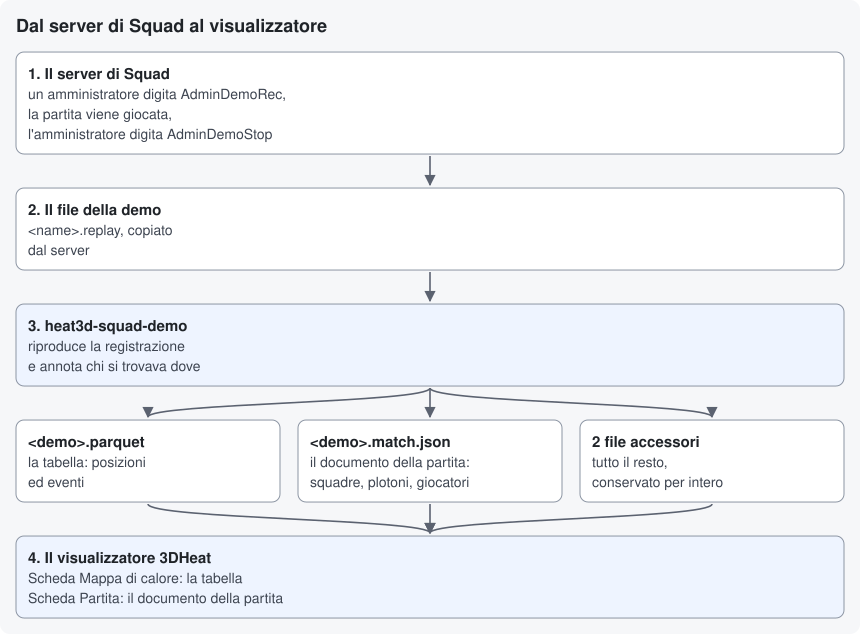

# 3DHeat Squad {#dheat-squad}

**Che cos'è?** Un piccolo programma che trasforma la registrazione di una partita di Squad in
file che il visualizzatore [3DHeat](https://github.com/Holdi601/3DHeat)
([documentazione](https://holdi601.github.io/3DHeat/)) può disegnare: dove si trovava ogni
giocatore, secondo per secondo, e cosa è successo dove.

**A cosa serve?** A vedere una partita dall'alto: dove si combatteva, quali percorsi hanno
seguito le squadre, dove sono stati distrutti i veicoli.

**Esempio:** `match.replay` (una demo, registrata su un server di Squad) ->
`match.parquet` (una riga per ogni posizione o evento) + `match.match.json` (il
documento della partita: squadre, plotoni, giocatori). I risultati sono normali file Parquet
e JSON, quindi anche altri programmi possono leggerli.

Ecco a cosa serve:

- **Dove si è combattuto.** La posizione di ogni giocatore e di ogni bot, a piedi, su veicoli
  di terra e su elicotteri, circa otto volte al secondo, con squadra, fazione, plotone, salute
  e inclinazione dello sguardo.
- **Cosa è successo dove.** Ferite, rianimazioni e morti; ogni colpo sparato e ogni colpo a un
  veicolo; ogni veicolo, dispositivo schierabile e postazione creato, danneggiato, distrutto e
  rimosso.
- **L'intera partita in un solo documento.** Squadre, plotoni, lo stato della partita, ogni
  oggetto, una riga per giocatore e per bot, e un controllo automatico che verifica che non sia
  andato perso nulla di quanto contiene la demo.



## Avvio rapido {#quick-start}

Non hai mai usato la riga di comando? Leggi prima [Prima di iniziare](before-you-start.md).

```bash
python -m pip install -e .              # installa il comando heat3d-squad-demo
heat3d-squad-demo match.replay -o out   # oppure una cartella di file .replay
```

Dovresti vedere una riga per ogni demo. Poi carica `out/<map>/<demo>.parquet` nella scheda
Mappa di calore del visualizzatore ([Come caricare i dati](https://holdi601.github.io/3DHeat/getting-data-in.html)).

## Pagine {#pages}

| Pagina | Cosa contiene |
|---|---|
| [Prima di iniziare](before-you-start.md) | Python, un terminale, una prima esecuzione |
| [Registrare una demo](recording.md) | far registrare una demo al server, e trovarla |
| [Convertire le demo](converting.md) | il comando, ogni opzione, un esempio di risultato |
| [La tabella](output-table.md) | ogni colonna e ogni `event` |
| [Il documento della partita e i file accessori](output-match.md) | il `.match.json`, i due file accessori, il controllo automatico |
| [Come viene letta una demo](how-it-works.md) | i livelli del lettore e ciò che è stato verificato |
| [Limiti, aggiornamenti e condizioni](limits.md) | cosa non viene letto, cosa può rompere un aggiornamento di Squad, dati personali, licenza |
| [Riferimento dei comandi](../cli-reference.md) | ogni opzione e ogni colonna, generati dal codice |
| [Manutenzione di questa documentazione](maintaining.md) | la lista di controllo per ogni rilascio |

## Collegamenti {#related}

- Il visualizzatore 3DHeat: [github.com/Holdi601/3DHeat](https://github.com/Holdi601/3DHeat),
  documentazione su [holdi601.github.io/3DHeat](https://holdi601.github.io/3DHeat/).
- I formati di file che legge il visualizzatore, incluso il contenitore con una partita per
  file: [Una partita in un file (.3dheat)](https://holdi601.github.io/3DHeat/container.html).
  Questo convertitore scrive i file separati: la tabella, il documento della partita e i suoi
  file accessori, uno accanto all'altro.
- Il 3DHeat Watcher esegue questo convertitore sulle nuove demo quando è installato
  (adattatore `squad-demos`): [3DHeat Watcher](https://holdi601.github.io/3DHeat-Watcher/).

## Gli strumenti 3DHeat {#the-3dheat-tools}

| Strumento | Cosa fa | Codice | Documentazione |
|---|---|---|---|
| Visualizzatore 3DHeat | mostra i dati: mappe di calore, analisi di gara, revisione della partita | [3DHeat](https://github.com/Holdi601/3DHeat) | [documentazione](https://holdi601.github.io/3DHeat/) |
| GameFiles | livelli e percorsi dai file di un gioco | [3DHeat-GameFiles](https://github.com/Holdi601/3DHeat-GameFiles) | [documentazione](https://holdi601.github.io/3DHeat-GameFiles/) |
| GameCapture | telemetria dei giri, e livelli ricostruiti dai video di gioco | [3DHeat-GameCapture](https://github.com/Holdi601/3DHeat-GameCapture) | [documentazione](https://holdi601.github.io/3DHeat-GameCapture/) |
| Unreal Exporter | un plugin per l'Editor di Unreal: un livello come un unico `.glb` | [3DHeat-UnrealExporter](https://github.com/Holdi601/3DHeat-UnrealExporter) | [documentazione](https://holdi601.github.io/3DHeat-UnrealExporter/) |
| CS2 | demo e mappe di Counter-Strike 2 | [3DHeat-CS2](https://github.com/Holdi601/3DHeat-CS2) | [documentazione](https://holdi601.github.io/3DHeat-CS2/) |
| Watcher | registra ciò che i giochi pubblicano mentre giochi | [3DHeat-Watcher](https://github.com/Holdi601/3DHeat-Watcher) | [documentazione](https://holdi601.github.io/3DHeat-Watcher/) |
| Ext-WarThunder | replay di War Thunder | [3DHeat-Ext-WarThunder](https://github.com/Holdi601/3DHeat-Ext-WarThunder) | [documentazione](https://holdi601.github.io/3DHeat-Ext-WarThunder/) |
| Ext-WoT | replay di World of Tanks | [3DHeat-Ext-WoT](https://github.com/Holdi601/3DHeat-Ext-WoT) | [documentazione](https://holdi601.github.io/3DHeat-Ext-WoT/) |
| Ext-WoWs | replay di World of Warships | [3DHeat-Ext-WoWs](https://github.com/Holdi601/3DHeat-Ext-WoWs) | [documentazione](https://holdi601.github.io/3DHeat-Ext-WoWs/) |
| Ext-Squad | demo dei server di Squad | [3DHeat-Ext-Squad](https://github.com/Holdi601/3DHeat-Ext-Squad) | [documentazione](https://holdi601.github.io/3DHeat-Ext-Squad/) |
| Ext-DCS | mappe del mondo di DCS come livelli 3D | [3DHeat-Ext-DCS](https://github.com/Holdi601/3DHeat-Ext-DCS) | [documentazione](https://holdi601.github.io/3DHeat-Ext-DCS/) |
| Ext-IL2 | mappe di IL-2 Sturmovik come livelli 3D | [3DHeat-Ext-IL2](https://github.com/Holdi601/3DHeat-Ext-IL2) | [documentazione](https://holdi601.github.io/3DHeat-Ext-IL2/) |
