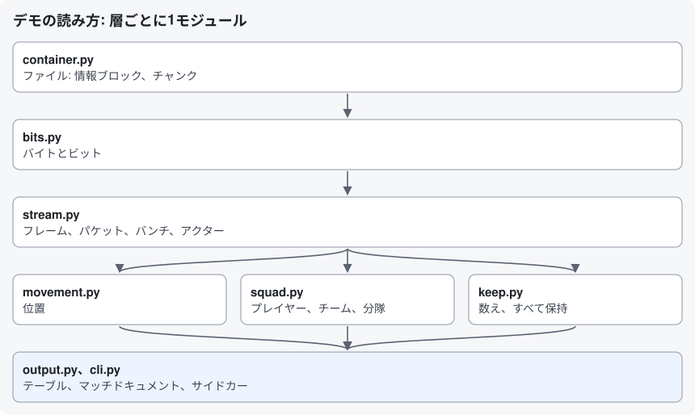

# デモの読み方 {#how-a-demo-is-read}

ざっくり言うと: Squadサーバーは、全プレイヤーの位置を他の全プレイヤーに送ります。デモファイルは、その通信の録画です。このツールはそれを再生して、誰がどこにいたかを書き留めます。



Unrealのネットワークリプレイは、サーバー自身のレプリケーション通信を、そのデモドライバーが書き留めたものです。それを読むことは、クライアントとしてその通信を読むことと同じです。

| モジュール | 層 |
|---|---|
| `container.py` | ローカルのファイルストリーマーのファイル：情報ブロック（マジック `0x1CA2E27F`）、その後にチャンク。チャンクの種類は、ヘッダー（`FNetworkDemoHeader`、マジック `0x2CF5A13D`）、リプレイデータ、チェックポイント、出来事です。 |
| `bits.py` | フレームのバイト配列と、パケットのビット配列。パケットは下位ビットから順に読みます。 |
| `stream.py` | フレーム、パケット、バンチ（分割されたバンチは結合）、アクターのチャンネル、アクターのスポーン、コンテンツブロック。各ブロックは、レプリケートされたプロパティを、ハンドル、ビット数、ビットの順で持ち、続いて遠隔呼び出しと、カスタムデルタのフィールドを、そのクラスの `_ClassNetCache` グループへのハンドルとして持ちます。エクスポートに名前がないオブジェクトには、デモ全体を読んだあとでクラスを割り当てます（下記を参照）。 |
| `movement.py` | エンジンの `FRepMovement`、およびSquadのヘリコプターの移動。 |
| `keep.py` | 出会ったすべての項目を数え、保持します。サイドカーの行と自己チェックです。 |
| `squad.py` | どのSquadのクラスが何を持つか。`SQPlayerState` は名前、チームの状態、分隊の状態、現在のポーンを持ちます。`SQTeamState` はチーム番号と陣営、`SQSquadState` は分隊番号。座席ポーンの所有者は、その乗り物です。 |
| `output.py`, `cli.py` | テーブルとマッチドキュメント。 |

リプレイは自分でフィールドに名前を付けています。すべてのハンドルについてクラスのパスとプロパティ名、そして参照しているオブジェクトのパスを持っています。そのため、どのプロパティもゲームのコードなしで名前から見つけられます。プロパティのビットだけは、型が必要です。移動については、それはエンジン自身の型です。Squadのプロパティの型は単純です: 文字列、整数、オブジェクト参照、名前。

いくつかのオブジェクトは、自分自身の名前だけで示されます。レベルのアクターはインスタンス名（`Team1SpawnPoint3`）で、コンポーネントは自身の名前（`MovementComponent`、`wheel_L1`）で示されます。そのクラスは、ストリームの後にエクスポートテーブルから見つけます。デモドライバーは、クラスのフィールドを、その最初に送られるフレームでエクスポートします（テストデモでは、名前の付いたオブジェクトの最初の送信すべてで成り立ちます）。そこで、クラスは次のいずれかで決めます: そのオブジェクトが最初に送ったハンドルを、フレームごとに正確にエクスポートしたグループ。それがなければ、その時点までにすべてのハンドルを持っていたグループのうち、同じ名前を与えるもの。それもなければ、数字を除いた同じ名前のオブジェクトのクラス、またはそのオブジェクトの名前を含む唯一のグループ。このように名付けられたオブジェクトのハンドルのうち、クラスが一定のビット数で送るものは、すべてがその数で届いていました（別の数で届いたものはありません）。これらで決まらないものは、エンティティのサイドカーにそのまま残ります。

## プロパティのデコード {#decoding-properties}

レプリケートされたプロパティは、そのビットが示す範囲で、すべてデコードされます。1ビットはフラグ。参照の名前が `...State`、`...Seat`、`...Pawn`、`...Class` などで終わる場合は、オブジェクトへの参照（そのネットGUID）。長さとそのバイト数は文字列。名前は名前。8、16、32、64ビットは数値（プロパティ名が示す場合は小数: 体力、時間、率、入力など）。それ以外は、そのビットを16進数で、中に見つかった文字列とともに保持します。遠隔呼び出しも同じように読みます。関数ごとにデモがエクスポートしたパラメーター名で。

## 出来事の読み方 {#how-the-events-are-read}

兵士の `Health` と `bWounded` はサーバーから来ます。`bWounded` がオンになったら負傷、オフになり体力が0より大きければ蘇生、体力が -100 未満に落ちたら死亡（降参したり出血で死んだプレイヤーは -300 に設定されます）。ボットは負傷せず、0で死亡します。車両や設置物は、その `Health` が下がるたびに `damaged`、0以下になったら `destroyed`。スポーンと削除は、アクターのチャンネルが開くことと閉じること。座席は、プレイヤーステートの `CurrentSeat`（座席コンポーネントへの参照。それは乗り物の上で送られます）。視線の上下角は、兵士の `RemoteViewPitch`。真下（0）から真上（255）までのバイトです。発砲は、武器の `MulticastFireProjectile`（発射位置と方向）。同じ方向で呼び出しがない場合は、`MulticastFireMultipleProjectileEffects` です。命中は、車両の `MulticastPlayDamageEffects`（着弾位置、ダメージの種類）です。

## 確かめたこと、その方法 {#what-was-verified-and-how}

これは、squad-replayプロジェクトのテストフィクスチャにある、公開されたSquad v10.3.1のサーバーデモ2つ（Unreal Engine 5.5.4、エンジンのネットワークバージョン36）で確認しました:

- **数。** フレーム、パケット、アクターの開き、エクスポートグループ、エクスポートされたオブジェクトパスの数が、そのプロジェクトの独立したパーサーと完全に一致します。兵士の移動サンプル数も同じです。
- **移動と速度の比較。** 兵士のサンプルごとに、前のサンプルからの移動量を、その間の時間で割った値が、そのサンプルが持つ速度と一致します。移動しているプレイヤーについて、中央値の比は 0.8 から 1.2 の範囲内です。
- **チームと設計図の比較。** すべての行のチームは、その兵士の設計図が属する陣営のチームです。試合中に陣営を変えたプレイヤーでも成り立ちました。
- **エラー。** デモごとに、ストリームのエラーが1つ残ります。記録者自身の観戦アクターの、最初のバンチの末尾の迷い1ビットです。ここで使う情報は含まれていません。
- **そのプロジェクトのキルとの比較。** そこに載っているすべてのキルは、ここで読んだ負傷または死亡で、同じ時刻、同じプレイヤーのものです。車両のキルは、ここで読んだ車両が体力0以下に達したものです。
- **設置物。** ビルド状態またはFOB要件を持つ、ここで読んだアクターは、そのプロジェクトの設置物と1つの差の範囲で一致します。
- **視線の上下角。** 視線の上下角のバイトは、静止時に約120付近にあり、255（真上）に達します。これは -90 から +90 の範囲のバイトとして読んだ値です。エンジンで通常の、一周分のバイトとして読むと、兵士は地平線の下128度まで見下ろすことになってしまい、それは不可能です。
- **ボット。** 配置用のデモでは、すべてのボット（`SQSquidBot`）が独自の軌跡を持ち、死んだボットは死亡として読まれます。
- **ヘリコプターの移動**（`SQHelicopterMovementComponent.ReplicatedMovement`、Squad独自の形式: フラグなし、位置は百分の一単位、速度と角速度、3つの任意の16ビット角度、サーバーの時計を小数で）。すべてのヘリコプターのサンプルは、そのビットをちょうど埋めます。駐機中のヘリコプターの位置と向きは、そのスポーンの位置と向きと、センチメートルと角度の単位まで一致します。飛行中は、サンプル間の移動量を時計の進みで割ったものが速度になります（中央値の比 0.997）。時計はデモの時間と共に進みます（中央値 0.4ミリ秒ずつ）。角速度は向きの回転速度に従いますが（相関 0.91）、その単位は確定していません。保持されていますが、使われてはいません。
- **座席。** プレイヤーステートの `CurrentSeat` は参照（パックされたネットGUID）です。以前読んだような数値ではありません。その形で読むと、変更のたびに、兵士自身の `MulticastUpdateCurrentSeat` がその少し前に指定している座席になります。そしてその変更は、squad-replayのものと一致します。
- **発砲と命中。** すべての `ShootDir` は単位ベクトルです（長さ 1 から 0.00003 以内）。すべての `MulticastFireMultipleProjectileEffects` の位置を10で割ったものは、対応する `MulticastFireProjectile` の `OriginZeroBased` と1ミリメートル以内で一致します。射手または命中した車両の位置が分かっている場合、発砲位置または着弾点は、そこから中央値で 0.45m の距離にあります。
- **車両の入力。** 浮動小数点として読むと、無限軌道の車両のスロットル、ブレーキ、ハンドブレーキは 0..1 に、操舵は -1..1 に入ります。すべての更新で。
- **閉じた理由。** チャンネルが再び開いたアクターはすべて、`Dormancy` で閉じられていました。`Destroyed` で閉じられたものが再び開いたことはありません。

テスト自身が作ったデモでのテストは、コンテナ、アーカイブ、ストリーム、テーブルまでの全経路を網羅し、あらゆる種類の項目を1つずつ持つデモで何も失われないことを確かめます（[`tests/test_completeness.py`](https://github.com/Holdi601/3DHeat-Ext-Squad/blob/main/tests/test_completeness.py)）:

```bash
python -m pip install -e .[test]
pytest                                   # 合成デモ
HEAT3D_SQUAD_DEMOS=<folder> pytest       # そのフォルダーの実デモも加えて
```
