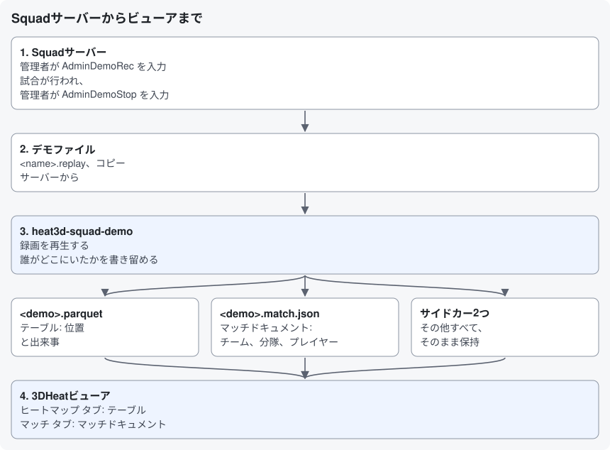

# 3DHeat Squad {#dheat-squad}

**これは何？** Squadの試合の録画を、[3DHeat](https://github.com/Holdi601/3DHeat)ビューア（[ドキュメント](https://holdi601.github.io/3DHeat/)）が描画できるファイルに変換する小さなプログラムです。全プレイヤーがどこにいたかを一秒ごとに、そして何がどこで起きたかを示します。

**何に使うの？** 試合を上から見るためです。どこで戦闘があったか、分隊がどの経路を進んだか、車両がどこで壊れたかが分かります。

**例:** `match.replay`（Squadサーバーで録画されたデモ）→ `match.parquet`（位置または出来事ごとに1行）＋ `match.match.json`（試合の文書：チーム、分隊、プレイヤー）。出力は普通のParquetとJSONのファイルなので、他のソフトでも読めます。

役に立つ点:

- **試合がどこで戦われたか。** 全プレイヤーとボットの位置を、徒歩、地上の乗り物、ヘリコプターごとに、約毎秒8回。チーム、陣営、分隊、体力、視線の上下角も含みます。
- **何がどこで起きたか。** 負傷、蘇生、死亡。すべての発砲と、車両への命中。スポーンし、ダメージを受け、破壊され、取り除かれた車両、設置物、陣地のすべて。
- **試合全体が一つの文書に。** チーム、分隊、ゲームの状態、すべてのアクター、プレイヤーとボットごとの1行。そして、デモが持っているものが何も失われていないことの自己チェック。



## クイックスタート {#quick-start}

コマンドラインは初めてですか？ まず[始める前に](before-you-start.md)を読んでください。

```bash
python -m pip install -e .              # heat3d-squad-demo コマンドをインストール
heat3d-squad-demo match.replay -o out   # または .replay ファイルのフォルダ
```

デモごとに1行ずつ表示されるはずです。その後、ビューアのヒートマップタブで `out/<map>/<demo>.parquet` を読み込みます（[データの取り込み](https://holdi601.github.io/3DHeat/getting-data-in.html)）。

## ページ {#pages}

| ページ | 内容 |
|---|---|
| [始める前に](before-you-start.md) | Python、ターミナル、最初の実行 |
| [デモの録画](recording.md) | サーバーにデモを書き出させる方法と、その見つけ方 |
| [デモの変換](converting.md) | コマンド、すべてのオプション、出力例 |
| [テーブル](output-table.md) | すべての列と、すべての `event` |
| [試合文書とサイドカー](output-match.md) | `.match.json`、二つのサイドカー、自己チェック |
| [デモの読み方](how-it-works.md) | 読み取りの各層と、確かめたこと |
| [制限、更新、利用条件](limits.md) | 読まれないもの、Squadの更新で壊れうるもの、個人データ、ライセンス |
| [コマンドリファレンス](../cli-reference.md) | すべてのオプションと列。コードから生成 |
| [このドキュメントの保守](maintaining.md) | リリースのチェックリスト |

## 関連 {#related}

- 3DHeatビューア: [github.com/Holdi601/3DHeat](https://github.com/Holdi601/3DHeat)。ドキュメントは [holdi601.github.io/3DHeat](https://holdi601.github.io/3DHeat/)。
- ビューアが読むファイル形式。1試合1ファイルのコンテナを含みます: [1試合1ファイル (.3dheat)](https://holdi601.github.io/3DHeat/container.html)。この変換器は、テーブル、試合文書、そのサイドカーを、別々のファイルとして並べて書き出します。
- 3DHeat Watcherは、インストールされていれば新しいデモにこの変換器を実行します（アダプター `squad-demos`）: [3DHeat Watcher](https://holdi601.github.io/3DHeat-Watcher/)。

## 3DHeatのツール {#the-3dheat-tools}

| ツール | 内容 | コード | ドキュメント |
|---|---|---|---|
| 3DHeat viewer | データを表示：ヒートマップ、レース分析、試合の振り返り | [3DHeat](https://github.com/Holdi601/3DHeat) | [ドキュメント](https://holdi601.github.io/3DHeat/) |
| GameFiles | ゲーム自身のファイルからのレベルとコース | [3DHeat-GameFiles](https://github.com/Holdi601/3DHeat-GameFiles) | [ドキュメント](https://holdi601.github.io/3DHeat-GameFiles/) |
| GameCapture | ラップのテレメトリ、およびゲーム映像から再構築したレベル | [3DHeat-GameCapture](https://github.com/Holdi601/3DHeat-GameCapture) | [ドキュメント](https://holdi601.github.io/3DHeat-GameCapture/) |
| Unreal Exporter | Unreal Editorのプラグイン：レベルを1つの `.glb` として書き出し | [3DHeat-UnrealExporter](https://github.com/Holdi601/3DHeat-UnrealExporter) | [ドキュメント](https://holdi601.github.io/3DHeat-UnrealExporter/) |
| CS2 | Counter-Strike 2のデモとマップ | [3DHeat-CS2](https://github.com/Holdi601/3DHeat-CS2) | [ドキュメント](https://holdi601.github.io/3DHeat-CS2/) |
| Watcher | プレイ中にゲームが公開する情報を記録 | [3DHeat-Watcher](https://github.com/Holdi601/3DHeat-Watcher) | [ドキュメント](https://holdi601.github.io/3DHeat-Watcher/) |
| Ext-WarThunder | War Thunderのリプレイ | [3DHeat-Ext-WarThunder](https://github.com/Holdi601/3DHeat-Ext-WarThunder) | [ドキュメント](https://holdi601.github.io/3DHeat-Ext-WarThunder/) |
| Ext-WoT | World of Tanksのリプレイ | [3DHeat-Ext-WoT](https://github.com/Holdi601/3DHeat-Ext-WoT) | [ドキュメント](https://holdi601.github.io/3DHeat-Ext-WoT/) |
| Ext-WoWs | World of Warshipsのリプレイ | [3DHeat-Ext-WoWs](https://github.com/Holdi601/3DHeat-Ext-WoWs) | [ドキュメント](https://holdi601.github.io/3DHeat-Ext-WoWs/) |
| Ext-Squad | Squadサーバーのデモ | [3DHeat-Ext-Squad](https://github.com/Holdi601/3DHeat-Ext-Squad) | [ドキュメント](https://holdi601.github.io/3DHeat-Ext-Squad/) |
| Ext-DCS | DCS Worldのマップを3Dレベルとして | [3DHeat-Ext-DCS](https://github.com/Holdi601/3DHeat-Ext-DCS) | [ドキュメント](https://holdi601.github.io/3DHeat-Ext-DCS/) |
| Ext-IL2 | IL-2 Sturmovikのマップを3Dレベルとして | [3DHeat-Ext-IL2](https://github.com/Holdi601/3DHeat-Ext-IL2) | [ドキュメント](https://holdi601.github.io/3DHeat-Ext-IL2/) |
