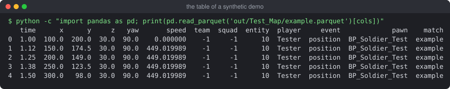

# テーブル: `<demo>.parquet` {#the-table-parquet}

サンプルまたは出来事ごとに1行です。サーバーがアクターの移動をレプリケートするたびにサンプルを取ります。移動している間、最大で毎秒8回です（デモの録画レート）。

## 列 {#columns}

| 列 | 内容 |
|---|---|
| `time` | 録画が始まってからの秒数 |
| `x`、`y`、`z` | Unrealの単位（センチメートル）での位置。Zが上 |
| `dirX`、`dirY`、`dirZ` | 兵士が見ている方向: 体の向き（ヨー）と視線の上下角（ピッチ）を、単位ベクトルで（乗り物は水平） |
| `yaw`、`pitch` | 同じものを度で。`pitch` は地平線からの上向き。兵士のみ |
| `health` | その瞬間の兵士、ボット、または車両の体力。サーバーが送った場合（負傷中の兵士の体力は 0 未満に下がります） |
| `speed` | レプリケートされた速さ、cm/s |
| `player` | プレイヤーの名前。ボットは `bot <id>`。誰も所有していない車両や設置物は、そのクラス。乗り物の武器による発砲は、その乗り物に座っているプレイヤー |
| `team`、`faction` | その**瞬間の**Squadのチーム番号（1、2）と陣営の設定。プレイヤーは陣営を変えることがあります |
| `squad` | 分隊番号。分隊に入っていない場合は -1 |
| `event` | その行が何か（下記） |
| `pawn` | 兵士の設計図（ボットなら `SQSquidBot`）、乗り物、または `fire` の場合は武器 |
| `seat` | タレットや同乗者の座席の場合、その座席自身のポーン |
| `detail` | `fire` の場合は、発砲を置いた武器の呼び出し。`hit` の場合はダメージの種類。`removed` の場合はチャンネルが閉じた理由（`Destroyed`、`Dormancy`...） |
| `entity` | その行が関係するアクター（そのネットGUID）。サイドカーの行の `entity` |
| `match` | デモの名前 |

## 出来事 {#events}

| `event` | 行の対象 | 内容 |
|---|---|---|
| `position` | 徒歩の兵士またはボット | 移動のサンプル |
| `vehicle` | 地上の乗り物またはヘリコプターに乗った兵士 | 乗り物の位置でのサンプル |
| `wounded`、`revived`、`death` | 兵士とボット | 起きた場所 |
| `spawn`、`damaged`、`destroyed`、`removed` | 車両、設置物、陣地、弾薬箱、ヘリコプター | あった場所 |
| `seat` | プレイヤー | 座席に座った |
| `fire` | 射手 | 発砲。弾が出た位置、その方向を `yaw`/`pitch`/`dirX..Z` で |
| `hit` | 車両 | 車両への命中。場所 |

出来事の読み方は [デモの読み方](how-it-works.md#出来事の読み方) にあります。

## ビューアで {#in-the-viewer}

Parquetのフッターには、`heat3d` キーの下に読み込みの指示があります。Zが上、どの軸も反転なし、単位スケールは 1。そのため、ビューアには列の対応づけが要りません。テーブルは、ヒートマップ タブで読み込んでください。ビューア自身の[データの取り込み](https://holdi601.github.io/3DHeat/getting-data-in.html)と[列マッピング](https://holdi601.github.io/3DHeat/column-mapping.html)を参照してください。
