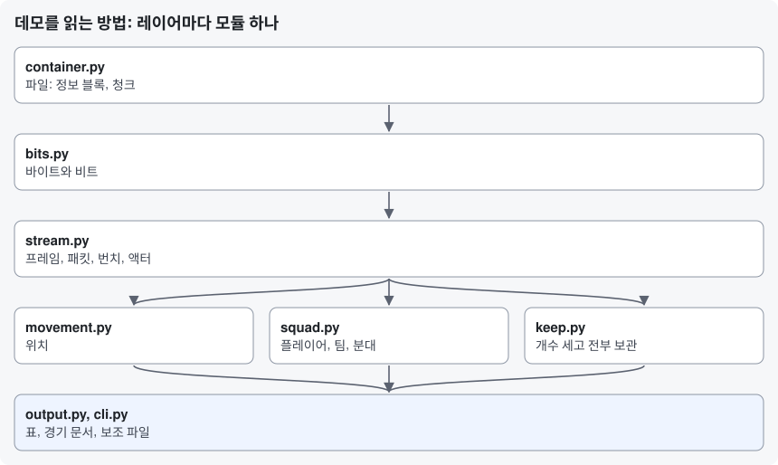

# 데모를 읽는 방법 {#how-a-demo-is-read}

쉽게 말하면 이렇습니다. Squad 서버는 모든 플레이어의 위치를 다른 모든 플레이어에게 보냅니다. 데모 파일은 그 통신을 녹화한 것입니다. 이 도구는 그것을 다시 재생하여 누가 어디에 있었는지 기록합니다.



Unreal 네트워크 리플레이는 서버 자신의 복제 통신을, 서버의 데모 드라이버가 기록한 것입니다. 이것을 읽는다는 것은 클라이언트가 그 통신을 받아 보는 것과 같습니다.

| 모듈 | 레이어 |
|---|---|
| `container.py` | 로컬 파일 스트리머의 파일: 정보 블록(매직 `0x1CA2E27F`), 그다음 청크들. 청크 종류는 헤더(`FNetworkDemoHeader`, 매직 `0x2CF5A13D`), 리플레이 데이터, 체크포인트, 이벤트입니다. |
| `bits.py` | 프레임용 바이트 아카이브와 패킷용 비트 아카이브. 패킷은 가장 낮은 비트부터 읽습니다. |
| `stream.py` | 프레임, 패킷, 번치(나뉜 번치는 이어 붙임), 액터 채널, 액터 생성, 콘텐츠 블록. 각 블록에는 복제된 속성이 핸들, 비트 수, 비트 순서로 들어 있고, 그다음 원격 호출과 커스텀 델타 필드가 클래스의 `_ClassNetCache` 그룹을 가리키는 핸들로 들어 있습니다. 내보내기 표가 이름을 주지 않은 객체에는 전체 데모를 다 읽은 뒤에 클래스를 붙입니다 (아래 참고). |
| `movement.py` | 엔진의 `FRepMovement`와 Squad의 헬리콥터 이동. |
| `keep.py` | 만난 모든 항목을 세고 보관합니다. 보조 파일의 행과 자체 검사를 담당합니다. |
| `squad.py` | 어떤 Squad 클래스가 무엇을 담는지. `SQPlayerState`에는 이름, 팀 상태, 분대 상태, 현재 폰이 있고, `SQTeamState`에는 팀 번호와 진영, `SQSquadState`에는 분대 번호가 있습니다. 좌석 폰의 소유자는 그 차량입니다. |
| `output.py`, `cli.py` | 표와 매치 문서. |

리플레이는 자기 필드 이름을 스스로 담고 있습니다. 모든 핸들의 클래스 경로와 속성 이름, 그리고 참조하는 객체들의 경로를 들고 있습니다. 그래서 게임의 코드 없이도 모든 속성을 이름으로 찾을 수 있습니다. 속성의 비트를 해석하려면 타입만 있으면 됩니다. 이동 데이터는 엔진의 고유 타입이고, Squad 속성의 타입은 문자열, 정수, 객체 참조, 이름처럼 단순합니다.

어떤 객체는 자기 자신의 이름으로만 식별됩니다. 레벨의 액터는 인스턴스 이름(`Team1SpawnPoint3`)으로, 컴포넌트는 자기 이름(`MovementComponent`, `wheel_L1`)으로 식별됩니다. 이들의 클래스는 스트림을 다 읽은 뒤 내보내기 표에서 찾습니다. 데모 드라이버는 이름이 붙은 객체가 처음 전송되는 프레임에 그 클래스의 필드를 내보냅니다(테스트 데모에서는 이름이 붙은 객체의 첫 전송마다 이것이 참이었습니다). 그래서 클래스는 다음 순서로 정합니다. 객체가 처음 전송한 프레임들에서 정확히 그 핸들들을 내보낸 그룹, 그럴 수 없으면 그때까지 모든 핸들을 가진 그룹(모두 같은 이름을 줄 때), 그럴 수 없으면 숫자를 뺀 이름이 같은 객체의 클래스, 또는 그 이름이 객체의 이름을 포함하는 그룹 하나. 이런 방식으로 이름이 붙은 객체의 핸들 중, 클래스가 고정된 비트 수로 보내는 것은 모두 그 수로 왔습니다(다른 수로 온 것은 없습니다). 이 방법으로도 정해지지 않는 것은 보조 파일의 엔티티에 통째로 남습니다.

## 속성 해석 {#decoding-properties}

복제된 속성은 비트가 말해 주는 만큼 모두 해석합니다. 1비트는 플래그, 이름이 참조로 끝나는 속성(`...State`, `...Seat`, `...Pawn`, `...Class`...)은 객체 참조(네트 GUID), 길이와 그만큼의 바이트는 문자열, 이름은 이름, 8/16/32/64비트는 숫자입니다(속성 이름이 그렇다고 말하면 실수: 체력, 시간, 비율, 입력...). 그 밖의 것은 비트를 16진수로 두고, 안에서 찾은 문자열을 함께 보여 줍니다. 원격 호출도 같은 방식으로 읽으며, 각 함수의 매개변수 이름은 데모가 내보낸 이름을 따릅니다.

## 이벤트를 읽는 방법 {#how-the-events-are-read}

보병의 `Health`와 `bWounded`는 서버에서 옵니다. `bWounded`가 켜지면 부상, 꺼질 때 체력이 0보다 크면 소생, 체력이 -100 아래로 떨어지면 사망입니다(포기하거나 출혈로 쓰러진 플레이어는 -300으로 설정됩니다). 부상당하지 않는 봇은 0에서 사망합니다. 차량이나 설치물은 `Health`가 떨어질 때마다 `damaged`, 0 이하가 되면 `destroyed`입니다. 생성과 제거는 액터 채널이 열리고 닫히는 것입니다. 좌석은 플레이어 상태의 `CurrentSeat`입니다(좌석 컴포넌트를 가리키는 참조이며, 그 차량에 실려 옵니다). 시점의 피치는 보병의 `RemoteViewPitch`로, 완전히 아래(0)에서 완전히 위(255)까지의 바이트입니다. 발사는 무기의 `MulticastFireProjectile`(시작점과 방향)이고, 같은 방향의 호출이 없으면 `MulticastFireMultipleProjectileEffects`를 씁니다. 명중은 차량의 `MulticastPlayDamageEffects`(충돌 위치, 피해 종류)입니다.

## 검증한 내용과 방법 {#what-was-verified-and-how}

공개된 Squad v10.3.1 서버 데모 두 개(Unreal Engine 5.5.4, 엔진 네트워크 버전 36)로 확인했습니다. 이 데모는 squad-replay 프로젝트의 테스트 자료입니다.

- **개수.** 프레임, 패킷, 액터 열림, 내보내기 그룹, 내보낸 객체 경로의 개수가 그 프로젝트의 독립된 파서와 정확히 일치합니다. 보병 이동 샘플 수도 같습니다.
- **이동과 속도.** 각 보병 샘플이 이전 샘플에서 얼마나 움직였는지를 그 사이 시간으로 나눈 값이, 샘플이 가진 속도와 일치합니다. 움직이는 플레이어에서 중앙값 비율은 0.8에서 1.2 사이입니다.
- **팀과 블루프린트.** 모든 행의 팀은, 보병의 블루프린트가 속한 진영의 팀입니다. 매치 중 편을 바꾼 플레이어에서도 이것이 맞았습니다.
- **오류.** 데모마다 스트림 오류가 하나 남습니다. 기록자 자신의 관전자 액터의 첫 부분 번치 끝에 있는 잉여 비트인데, 여기서 쓰이지 않는 내용입니다.
- **사망과 그 프로젝트의 킬 목록.** 그 프로젝트가 나열한 킬은 모두 여기서 읽은 부상이나 사망과, 같은 시간, 같은 플레이어에 해당합니다. 차량 킬은 여기서 읽은 차량이 체력 0 이하에 이른 것과 일치합니다.
- **설치물.** 건설 상태나 FOB 요구 조건이 있는 여기서 읽은 액터는, 그 프로젝트의 설치물과 1개 차이 이내로 일치합니다.
- **피치.** 시점 피치 바이트는 쉴 때 약 120이고, 최대 255(완전히 위)에 이릅니다. -90에서 +90 범위의 바이트로 읽은 것입니다. 엔진이 흔히 쓰는 한 바퀴 기준 바이트로 읽으면, 보병이 지평선 아래 최대 128도를 보는 것이 되는데 실제로는 그렇게 볼 수 없습니다.
- **봇.** 서버 대기(시딩) 데모에서 모든 봇(`SQSquidBot`)은 자기 궤적을 가지며, 죽은 봇은 사망으로 읽힙니다.
- **헬리콥터 이동** (`SQHelicopterMovementComponent.ReplicatedMovement`, Squad 고유의 구조: 플래그 없음, 위치는 1/100 단위, 속도와 각속도, 선택적인 16비트 각도 셋, 서버 시계를 나타내는 실수). 모든 헬리콥터 샘플이 비트를 정확히 채웁니다. 주차된 헬리콥터의 위치와 방향은 생성 위치와 같으며, 1cm와 각도 단위까지 일치합니다. 비행 중에는 샘플 사이의 이동을 시계의 간격으로 나눈 값이 속도입니다(중앙값 비율 0.997). 시계는 데모의 시간과 함께 흐르며(중앙값 간격 0.4ms), 각속도는 방향 전환 속도를 따릅니다(상관 0.91). 다만 그 단위는 확정되지 않았으므로 보관만 하고 쓰지 않습니다.
- **좌석.** 플레이어 상태의 `CurrentSeat`는 숫자가 아니라 참조(압축된 네트 GUID)입니다. 이전에 숫자로 읽은 것은 잘못이었습니다. 이렇게 읽으면, 바뀔 때마다 그 보병의 `MulticastUpdateCurrentSeat`가 잠시 전에 가리킨 좌석이 되며, 그 변화는 squad-replay의 것과 같습니다.
- **발사와 명중.** 모든 `ShootDir`은 단위 벡터입니다(길이 1, 오차 0.00003 이내). `MulticastFireMultipleProjectileEffects`의 시작점을 10으로 나눈 값은, 대응하는 `MulticastFireProjectile`의 `OriginZeroBased`와 1mm 이내로 같습니다. 사수나 맞은 차량의 위치를 알 수 있을 때, 발사 시작점이나 충돌 지점은 그 위치에서 중앙값 0.45m 떨어져 있습니다.
- **차량 입력.** 실수로 읽으면, 궤도 차량의 스로틀, 브레이크, 핸드브레이크는 모든 업데이트에서 0에서 1 사이, 조향은 -1에서 1 사이입니다.
- **닫힘 사유.** 채널이 다시 열린 액터는 모두 `Dormancy`로 닫혔던 것입니다. `Destroyed`로 닫혔던 것이 다시 열린 경우는 없습니다.

테스트 자체가 만든 데모로 실행하는 테스트는 컨테이너, 아카이브, 스트림, 표까지 이어지는 전체 경로를 다룹니다. 또 한 종류의 항목을 하나씩 모두 담은 데모가 아무것도 잃지 않는지도 확인합니다([`tests/test_completeness.py`](https://github.com/Holdi601/3DHeat-Ext-Squad/blob/main/tests/test_completeness.py)):

```bash
python -m pip install -e .[test]
pytest                                   # 가상 데모
HEAT3D_SQUAD_DEMOS=<folder> pytest       # 그 폴더의 실제 데모도 함께
```
