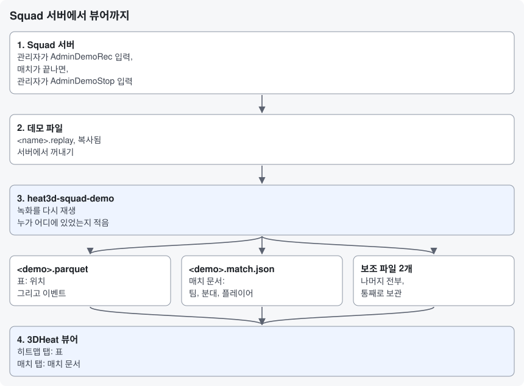

# 3DHeat Squad {#dheat-squad}

**무엇입니까?** Squad 매치의 녹화 파일을 [3DHeat](https://github.com/Holdi601/3DHeat) 뷰어([문서](https://holdi601.github.io/3DHeat/))가 그릴 수 있는 파일로 바꿔 주는 작은 프로그램입니다. 모든 플레이어가 어디에 있었는지를 초 단위로, 그리고 어디서 무슨 일이 있었는지를 보여 줍니다.

**왜 씁니까?** 매치를 위에서 내려다보기 위해서입니다. 싸움이 어디서 벌어졌는지, 분대들이 어떤 길로 움직였는지, 차량이 어디서 파괴되었는지 볼 수 있습니다.

**예시:** `match.replay` (Squad 서버에서 녹화한 데모) ->
`match.parquet` (위치 또는 이벤트 한 줄에 하나씩) + `match.match.json` (매치 문서: 팀, 분대, 플레이어). 결과물은 일반 Parquet과 JSON 파일이므로, 다른 프로그램도 읽을 수 있습니다.

이런 일에 쓸 수 있습니다:

- **매치가 어디서 벌어졌나.** 모든 플레이어와 봇의 위치를 보병, 지상 차량, 헬리콥터 탑승 상태별로 초당 약 8번 기록합니다. 팀, 진영, 분대, 체력, 시점 피치도 함께 담깁니다.
- **무슨 일이 어디서 있었나.** 부상, 소생, 사망. 모든 발사와 차량 명중. 생성, 피해, 파괴, 제거된 모든 차량, 설치물, 거치 진지.
- **매치 전체를 한 문서에.** 팀, 분대, 게임 상태, 모든 액터, 플레이어와 봇마다 한 줄, 그리고 데모에 든 내용이 하나도 빠지지 않았는지 확인하는 자체 검사.



## 빠른 시작 {#quick-start}

명령줄이 처음입니까? 먼저 [시작하기 전에](before-you-start.md)를 읽으세요.

```bash
python -m pip install -e .              # heat3d-squad-demo 명령을 설치합니다
heat3d-squad-demo match.replay -o out   # 또는 .replay 파일이 든 폴더
```

데모마다 한 줄씩 출력됩니다. 그다음 뷰어의 히트맵 탭에서 `out/<map>/<demo>.parquet`을 여세요 ([데이터 넣기](https://holdi601.github.io/3DHeat/getting-data-in.html)).

## 페이지 {#pages}

| 페이지 | 내용 |
|---|---|
| [시작하기 전에](before-you-start.md) | Python, 터미널, 첫 실행 |
| [데모 녹화하기](recording.md) | 서버에서 데모를 기록하게 하고, 파일 찾기 |
| [데모 변환하기](converting.md) | 명령, 모든 옵션, 결과 예시 |
| [표](output-table.md) | 모든 열과 모든 `event` |
| [매치 문서와 보조 파일](output-match.md) | `.match.json`, 보조 파일 두 개, 자체 검사 |
| [데모를 읽는 방법](how-it-works.md) | 리더의 레이어, 검증한 내용 |
| [한계, 업데이트, 약관](limits.md) | 읽지 않는 것, Squad 업데이트로 깨질 수 있는 것, 개인 정보, 라이선스 |
| [명령 참조](../cli-reference.md) | 코드에서 만든, 모든 옵션과 열 |
| [문서 관리](maintaining.md) | 릴리스 체크리스트 |

## 관련 자료 {#related}

- 3DHeat 뷰어: [github.com/Holdi601/3DHeat](https://github.com/Holdi601/3DHeat),
  문서는 [holdi601.github.io/3DHeat](https://holdi601.github.io/3DHeat/)에 있습니다.
- 뷰어가 읽는 파일 형식, 매치 하나를 파일 하나에 담는 컨테이너 포함: [매치 하나를 파일 하나로 (.3dheat)](https://holdi601.github.io/3DHeat/container.html).
  이 변환기는 낱개 파일을 씁니다. 표, 매치 문서, 보조 파일을 나란히 저장합니다.
- 3DHeat Watcher가 설치되어 있으면 새 데모에 이 변환기를 자동으로 실행합니다 (어댑터 `squad-demos`): [3DHeat Watcher](https://holdi601.github.io/3DHeat-Watcher/).

## 3DHeat 도구들 {#the-3dheat-tools}

| 도구 | 하는 일 | 코드 | 문서 |
|---|---|---|---|
| 3DHeat 뷰어 | 데이터를 보여 줍니다: 히트맵, 레이스 분석, 매치 리뷰 | [3DHeat](https://github.com/Holdi601/3DHeat) | [문서](https://holdi601.github.io/3DHeat/) |
| GameFiles | 게임 자체 파일에서 얻는 레벨과 코스 | [3DHeat-GameFiles](https://github.com/Holdi601/3DHeat-GameFiles) | [문서](https://holdi601.github.io/3DHeat-GameFiles/) |
| GameCapture | 랩 텔레메트리, 그리고 게임 영상에서 복원한 레벨 | [3DHeat-GameCapture](https://github.com/Holdi601/3DHeat-GameCapture) | [문서](https://holdi601.github.io/3DHeat-GameCapture/) |
| Unreal Exporter | 레벨을 `.glb` 하나로 내보내는 Unreal 에디터 플러그인 | [3DHeat-UnrealExporter](https://github.com/Holdi601/3DHeat-UnrealExporter) | [문서](https://holdi601.github.io/3DHeat-UnrealExporter/) |
| CS2 | Counter-Strike 2 데모와 맵 | [3DHeat-CS2](https://github.com/Holdi601/3DHeat-CS2) | [문서](https://holdi601.github.io/3DHeat-CS2/) |
| Watcher | 플레이하는 동안 게임이 공개하는 데이터를 기록합니다 | [3DHeat-Watcher](https://github.com/Holdi601/3DHeat-Watcher) | [문서](https://holdi601.github.io/3DHeat-Watcher/) |
| Ext-WarThunder | 워 썬더 리플레이 | [3DHeat-Ext-WarThunder](https://github.com/Holdi601/3DHeat-Ext-WarThunder) | [문서](https://holdi601.github.io/3DHeat-Ext-WarThunder/) |
| Ext-WoT | 월드 오브 탱크 리플레이 | [3DHeat-Ext-WoT](https://github.com/Holdi601/3DHeat-Ext-WoT) | [문서](https://holdi601.github.io/3DHeat-Ext-WoT/) |
| Ext-WoWs | 월드 오브 워십 리플레이 | [3DHeat-Ext-WoWs](https://github.com/Holdi601/3DHeat-Ext-WoWs) | [문서](https://holdi601.github.io/3DHeat-Ext-WoWs/) |
| Ext-Squad | Squad 서버 데모 | [3DHeat-Ext-Squad](https://github.com/Holdi601/3DHeat-Ext-Squad) | [문서](https://holdi601.github.io/3DHeat-Ext-Squad/) |
| Ext-DCS | DCS World 맵을 3D 레벨로 | [3DHeat-Ext-DCS](https://github.com/Holdi601/3DHeat-Ext-DCS) | [문서](https://holdi601.github.io/3DHeat-Ext-DCS/) |
| Ext-IL2 | IL-2 Sturmovik 맵을 3D 레벨로 | [3DHeat-Ext-IL2](https://github.com/Holdi601/3DHeat-Ext-IL2) | [문서](https://holdi601.github.io/3DHeat-Ext-IL2/) |
