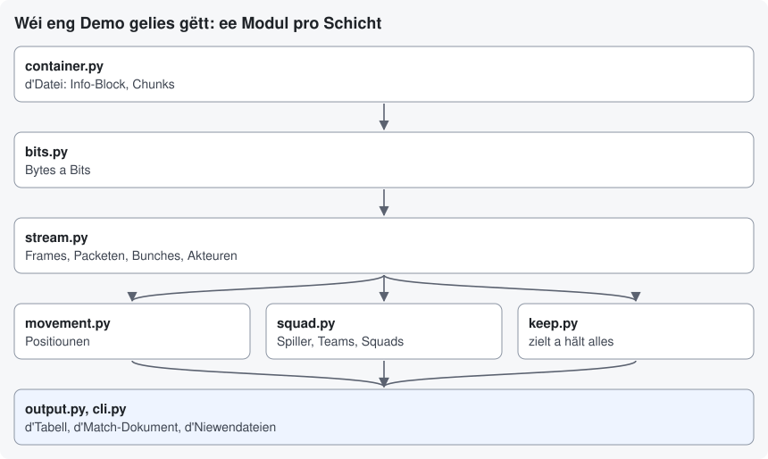

# Wéi eng Demo gelies gëtt {#how-a-demo-is-read}

A kloren Wierder: E Squad-Server schéckt d'Positioun vun all Spiller un all aneren Spiller. D'Demo-Datei ass eng Opnam vun deem Traffic. Dëst Tool spillt se of a schreift op, wien wou war.



Eng Unreal-Netzwierk-Replay ass dem Server säin eegenen Replikatiouns-Traffic, vum Demo-Driver opgeschriwwen. Eng ze liesen heescht, deen Traffic ze liesen, wéi e Client et géif maachen.

| Modul | Schicht |
|---|---|
| `container.py` | D'Datei vum lokale File-Streamer: en Info-Block (Magic `0x1CA2E27F`), dann Chunks. D'Chunk-Zorte si den Header (`FNetworkDemoHeader`, Magic `0x2CF5A13D`), Replay-Daten, Checkpoints an Evenementer. |
| `bits.py` | Byte-Archiver fir Frames a Bit-Archiver fir Packeten. Packete ginn mam niddregste Bit zuerst gelies. |
| `stream.py` | Frames, Packeten, Bunches (deelweis Bunches zesummegesat), Akteur-Kanäl, Akteur-Spawns an Inhaltsblocken. All Block hält replizéiert Properties als Handle, Bit-Unzuel a Bits, dann Remote-Calls a Custom-Delta-Felder als Handles an d'`_ClassNetCache`-Grupp vun der Klass. Objeten, déi d'Exports net nennen, kréien hir Klass, wann déi ganz Demo gelies ass (kuckt ënnen). |
| `movement.py` | Dem Engine säin `FRepMovement`, an dem Squad seng Helikopter-Beweegung. |
| `keep.py` | All Element, dat begéint gouf, gezielt a gehalen: d'Zeilen vun de Begleetdateien an de Selbstcheck. |
| `squad.py` | Wéi eng Squad-Klasse wat droen. `SQPlayerState` hält den Numm, den Team-State, de Squad-State an de aktuelle Pawn; `SQTeamState` d'Teamnummer an d'Fraktioun; `SQSquadState` d'Squad-Nummer. Den Besëtzer vun engem Sëtz-Pawn ass säi Gefier. |
| `output.py`, `cli.py` | D'Tabell an d'Match-Dokument. |

Eng Replay nennt hir Felder selwer. Si hält d'Klasseweeër an d'Property-Nimm fir all Handle, an d'Weeër vun den Objeten, op déi si verweist. Also kann all Property mam Numm fonnt ginn, ouni de Code vum Spill. Nëmmen d'Bits vun enger Property brauchen hiren Typ. Bei der Beweegung ass dat dem Engine säin eegenen Typ; bei de Properties vu Squad sinn d'Typen einfach: Strings, Ganzzuelen, Objet-Referenzen an Nimm.

E puer Objete ginn nëmme vun hinnen selwer genannt: d'Akteuren vun engem Level mat hirem Instanznumm (`Team1SpawnPoint3`), Komponenten mat hirem eegenen (`MovementComponent`, `wheel_L1`). Hir Klass gëtt aus den Export-Tabellen fonnt, nom Stream: den Demo-Driver exportéiert d'Feld vun enger Klass am Frame, wou et fir d'éischt geschéckt gëtt (wouer bei all éischtem Schécken vun engem benannten Objet an den Test-Demoen), also ass d'Klass déi eng Grupp, déi genau dës Handles exportéiert huet an de Frames, wou d'Objet se fir d'éischt geschéckt huet; soss all Grupp, déi all hir Handles bis dohin hat, wann all déiselwecht Nimm ginn; soss d'Klass vun engem Objet mam selwechten Numm, Zuelen ausgelooss, oder déi eng Grupp, deenen hire Numm dem Objet säin hält. Vun den Handles vun Objeten, déi esou genannt ginn, an deenen hir Klass se mat enger fixer Bit-Unzuel schéckt, koumen all mat där Unzuel (keng mat enger anerer). Wat keng vun dëse Weeër klärt, bleift ganz an der Entities-Begleetdatei.

## Properties dekodéieren {#decoding-properties}

All replizéiert Property gëtt dekodéiert, sou wäit hir Bits soen, wat se ass: ee Bit ass e Flag, eng Referenz op en Objet (säin Net-GUID), wou den Numm op d'Aart vun enger Referenz ophält (`...State`, `...Seat`, `...Pawn`, `...Class`...), eng Längt a sou vill Bytes ee String, een Numm, 8/16/32/64 Bits eng Zuel (e Float, wou dem Property säin Numm dat seet: Gesondheet, Zäit, Rate, Input...), alles anescht seng Bits an Hex mat de Strings, déi dran fonnt ginn. Remote-Calls ginn op déiselwecht Aart gelies, no de Parameternimm, déi d'Demo fir all Funktioun exportéiert.

## Wéi d'Evenementer gelies ginn {#how-the-events-are-read}

Dem Zaldot seng `Health` an `bWounded` kommen vum Server: verwonnt, wann `bWounded` ugeet, belieft, wann et ausgeet mat Gesondheet iwwer 0, dout, wann d'Gesondheet ënner -100 fällt (e Spiller, deen opgitt oder ausbluddt, gëtt op -300 gesat); e Bot, ni verwonnt, stierft bei 0. E Gefier oder Deployable ass `damaged` bei all Fall vu senger `Health`, `destroyed` bei 0 oder drënner. Spawns an Ewechhuelen sinn d'Opmaachen an d'Zoumaache vum Akteur-Kanal; e Sëtz ass dem Player-State säin `CurrentSeat` (eng Referenz op d'Sëtz-Komponent, déi um Gefier geschéckt gëtt). De Bléck-Pitch ass dem Zaldot säin `RemoteViewPitch`, e Byte vu gerued no ënnen (0) bis gerued no uewen (255). E Schoss ass dem Waff säin `MulticastFireProjectile` (Urspronk a Richtung), oder säin `MulticastFireMultipleProjectileEffects`, wou kee sou Call mat der selwechter Richtung koum; en Treffer ass dem Gefier säin `MulticastPlayDamageEffects` (Opschlagplaz, Schuedenstyp).

## Wat gepréift gouf, a wéi {#what-was-verified-and-how}

Dës goufen géint zwou ëffentlech Squad-v10.3.1-Server-Demoe gepréift (Unreal Engine 5.5.4, Engine-Netzwierk-Versioun 36), aus den Test-Fixtures vum squad-replay-Projet:

- **Zuelen.** D'Zuele vu Frames, Packeten, Akteur-Opmaachen, Export-Gruppen an exportéierte Objetweeër stëmmen exakt mat dem onofhängege Parser vun deem Projet iwwereneen. Och d'Zuel vun de Beweegungs-Echantillone vun den Zaldoten.
- **Beweegung géint Vitesse.** De Schrëtt vun all Zaldoten-Echantillon vum viregten, gedeelt duerch d'Zäit tëscht hinnen, stëmmt mat der Vitesse iwwereneen, déi den Echantillon dréit. Dat mëttelt Verhältnis läit bei bewegende Spiller tëscht 0,8 an 1,2.
- **Teams géint Blueprints.** D'Team vun all Zeil ass d'Team, dem seng Fraktioun dem Zaldot säi Blueprint gehéiert. Dat hat och Bestand bei engem Spiller, deen während dem Match d'Säit gewiesselt huet.
- **Feeler.** Ee Stream-Feeler pro Demo bleift: e verirrte Bit um Enn vum Opmaachs-Bunch vum Zuschauer-Akteur vum Recorder selwer, deen näischt dréit, wat hei benotzt gëtt.
- **Verloschter géint d'Kills vun deem Projet.** All Kill, deen et opléscht, ass eng Verwonnung oder en Doud, dee hei gelies gouf, zur selwechter Zäit a vum selwechte Spiller; seng Gefier-Kills sinn Gefierer, déi hei gelies goufen, wéi se Gesondheet 0 oder drënner erreechen.
- **Deployables.** D'Akteuren, déi hei mat engem Build-State oder enger FOB-Ufuerderung gelies goufen, passen zu de Deployables vun deem Projet, bis op een.
- **Pitch.** Dat Pitch-Byte läit ronderëm 120 a Rou a geet bis 255 (gerued no uewen): als Byte iwwer -90..+90 gelies. Als dem Engine säi gewéinleche Byte vun enger ganzer Dréiung gelies, géif et Zaldoten bis zu 128 Grad ënnert den Horizont setzen, wat si net kucke kënnen.
- **Boten.** Op enger Seeding-Demo huet all Bot (`SQSquidBot`) säin eegene Spuer, an d'Boten, déi stierwen, ginn als Doudesfäll gelies.
- **Helikopter-Beweegung** (`SQHelicopterMovementComponent.ReplicatedMovement`, dem Squad säin eegent Layout: keng Flags, d'Plaz an Honnertstel, d'Vitesse an d'Wénkelvitesse, dräi optionell 16-Bit-Wénkel, dem Server seng Auer als Float). All Helikopter-Echantillon fëllt seng Bits genau. D'Plaz an de Yaw vun engem geparkten Helikopter si vu sengem Spawn, bis op de Zentimeter an d'Wénkeleenheet. Am Fluch ass de Schrëtt tëscht Echantillone gedeelt duerch de Schrëtt vun der Auer d'Vitesse (mëttelt Verhältnis 0,997), an d'Auer geet mat der Zäit vun der Demo (mëttel 0,4 ms ausernee). D'Wénkelvitesse follegt der Yaw-Rate (Korrelatioun 0,91), awer hir Eenheet ass net festgeluecht: si gëtt gehalen, net benotzt.
- **Sëtzer.** Dem Player-State säin `CurrentSeat` ass eng Referenz (e gepackte Net-GUID), keng Zuel, wéi virdrun gelies: esou gelies ass et bei all Wiessel de Sëtz, deen dem Zaldot säin eegene `MulticastUpdateCurrentSeat` e Moment virdrun nennt, an d'Wiessele sinn déi vu squad-replay.
- **Schëss an Treffer.** All `ShootDir` ass en Eenheetsvektor (Längt 1 bannent 0,00003); all Urspronk vun `MulticastFireMultipleProjectileEffects`, gedeelt duerch 10, ass den `OriginZeroBased` vum passenden `MulticastFireProjectile` bannent 1 mm; wou d'Positioun vum Schéisser oder vum getraffene Gefier bekannt ass, ass den Urspronk vum Schoss oder den Opschlag mëttel 0,45 m dovunner ewech.
- **Gefier-Inputen.** Als Floats gelies, läit d'Gas, d'Brems an d'Handbrems vun de Kettefahrzeugen an 0..1 an hir Lenkung an -1..1, bei all Update.
- **Zouginn-Grënn.** All Akteur, dessen Kanal nach eng Kéier opgaangen ass, war mat `Dormancy` zougaangen; keen, deen mat `Destroyed` zougaangen ass, ass nach eng Kéier opgaangen.

Tester op Demoen, déi d'Tester selwer bauen, decken de Container, d'Archiver, de Stream an de ganze Wee bis bei d'Tabell of, an datt eng Demo, déi vun all Zort Element ee hält, keent verléiert ([`tests/test_completeness.py`](https://github.com/Holdi601/3DHeat-Ext-Squad/blob/main/tests/test_completeness.py)):

```bash
python -m pip install -e .[test]
pytest                                   # synthetic demos
HEAT3D_SQUAD_DEMOS=<folder> pytest       # plus real demos in that folder
```
