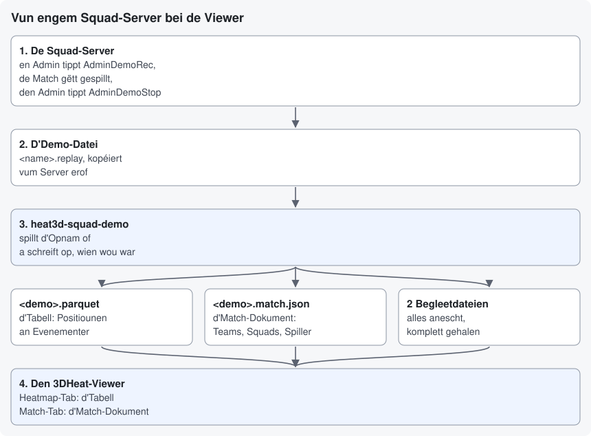

# 3DHeat Squad {#dheat-squad}

**Wat ass et?** E klengt Programm, dat eng Opnam vun engem Squad-Match an Dateie verwandelt,
déi den [3DHeat](https://github.com/Holdi601/3DHeat)-Viewer
([Dokumentatioun](https://holdi601.github.io/3DHeat/)) zeechne kann: wou all
Spiller war, Sekonn fir Sekonn, a wat wou geschitt ass.

**Firwat sollt ech et benotzen?** Fir e Match vun uewen ze gesinn: wou gekämpft gouf,
wéi eng Weeër d'Squads geholl hunn, wou Gefierer zerstéiert goufen.

**Beispill:** `match.replay` (eng Demo, op engem Squad-Server opgeholl) ->
`match.parquet` (eng Zeil pro Positioun oder Evenement) + `match.match.json` (d'Match-Dokument:
Teams, Squads, Spiller). D'Ausgabe si ganz normal Parquet- a JSON-Dateien, sou datt
alles anescht se och liese kann.

Wofir et nëtzlech ass:

- **Wou e Match gekämpft gouf.** D'Positioun vun all Spiller a Bot, zu Fouss, a
  Buedemgefierer an an Helikopteren, ongeféier aacht Mol d'Sekonn, mat Team,
  Fraktioun, Squad, Gesondheet a Bléckwénkel.
- **Wat wou geschitt ass.** Verwonnungen, Wiederbeliewungen an Doudesfäll; all Schoss an all
  Treffer op e Gefier; all Gefier, Deployable an Emplacement, dat erschafft,
  beschiedegt, zerstéiert an ewechgeholl gouf.
- **Dee ganze Match an engem Dokument.** Teams, Squads, de Spillstand, all
  Akteur, eng Zeil pro Spiller a pro Bot, an e Selbstcheck, datt näischt, wat d'Demo
  hält, verluer gaangen ass.



## Séier Start {#quick-start}

Nei op der Kommandozeil? Liest fir d'éischt [Ier Dir ufänkt](before-you-start.md).

```bash
python -m pip install -e .              # installs the heat3d-squad-demo command
heat3d-squad-demo match.replay -o out   # or a folder of .replay files
```

Dir sollt eng Zeil pro Demo gesinn. Dann lued `out/<map>/<demo>.parquet` am Heatmap-Tab vum Viewer
([Daten eran kréien](https://holdi601.github.io/3DHeat/getting-data-in.html)).

## Säiten {#pages}

| Säit | Wat se ofdeckt |
|---|---|
| [Ier Dir ufänkt](before-you-start.md) | Python, e Terminal, e éischte Start |
| [Eng Demo ophuelen](recording.md) | e Server eng Demo schreiwe loossen, a se fannen |
| [Demoe konvertéieren](converting.md) | de Kommando, all Optioun, Beispill-Ausgab |
| [D'Tabell](output-table.md) | all Kolonn an all `event` |
| [D'Match-Dokument a Begleetdateien](output-match.md) | den `.match.json`, déi zwou Begleetdateien, de Selbstcheck |
| [Wéi eng Demo gelies gëtt](how-it-works.md) | d'Schichte vum Reader, a wat gepréift gouf |
| [Grenzen, Updates a Bedingungen](limits.md) | wat net gelies gëtt, wat en Squad-Update futti maache kann, perséinlech Daten, Lizenz |
| [Kommando-Referenz](../cli-reference.md) | all Optioun an all Kolonn, aus dem Code generéiert |
| [Dës Dokumentatioun ënnerhalen](maintaining.md) | d'Release-Checklëscht |

## Verwandt {#related}

- Den 3DHeat-Viewer: [github.com/Holdi601/3DHeat](https://github.com/Holdi601/3DHeat),
  Dokumentatioun op [holdi601.github.io/3DHeat](https://holdi601.github.io/3DHeat/).
- D'Dateiformater, déi de Viewer liest, och de Container mat enger Datei pro Match:
  [Eng Datei pro Match (.3dheat)](https://holdi601.github.io/3DHeat/container.html).
  Dëse Konverter schreift déi lose Dateien: d'Tabell, d'Match-Dokument an
  seng Begleetdateien niewenteneen.
- De 3DHeat Watcher féiert dëse Konverter op nei Demoen aus, wann en installéiert ass
  (Adapter `squad-demos`): [3DHeat Watcher](https://holdi601.github.io/3DHeat-Watcher/).

## Déi 3DHeat-Tools {#the-3dheat-tools}

| Tool | Wat et mécht | Code | Docs |
|---|---|---|---|
| 3DHeat-Viewer | weist d'Daten: Heatmaps, Course-Analys, Match-Iwwerpréiwung | [3DHeat](https://github.com/Holdi601/3DHeat) | [Docs](https://holdi601.github.io/3DHeat/) |
| GameFiles | Levelen a Course aus de Dateie vun engem Spill | [3DHeat-GameFiles](https://github.com/Holdi601/3DHeat-GameFiles) | [Docs](https://holdi601.github.io/3DHeat-GameFiles/) |
| GameCapture | Ronn-Telemetrie, a Levelen aus Gameplay-Video nei opgebaut | [3DHeat-GameCapture](https://github.com/Holdi601/3DHeat-GameCapture) | [Docs](https://holdi601.github.io/3DHeat-GameCapture/) |
| Unreal Exporter | en Unreal-Editor-Plugin: e Level als eng `.glb` | [3DHeat-UnrealExporter](https://github.com/Holdi601/3DHeat-UnrealExporter) | [Docs](https://holdi601.github.io/3DHeat-UnrealExporter/) |
| CS2 | Counter-Strike-2-Demoen a -Mappen | [3DHeat-CS2](https://github.com/Holdi601/3DHeat-CS2) | [Docs](https://holdi601.github.io/3DHeat-CS2/) |
| Watcher | hält fest, wat Spiller wärend dem Spillen publizéieren | [3DHeat-Watcher](https://github.com/Holdi601/3DHeat-Watcher) | [Docs](https://holdi601.github.io/3DHeat-Watcher/) |
| Ext-WarThunder | War-Thunder-Replays | [3DHeat-Ext-WarThunder](https://github.com/Holdi601/3DHeat-Ext-WarThunder) | [Docs](https://holdi601.github.io/3DHeat-Ext-WarThunder/) |
| Ext-WoT | World-of-Tanks-Replays | [3DHeat-Ext-WoT](https://github.com/Holdi601/3DHeat-Ext-WoT) | [Docs](https://holdi601.github.io/3DHeat-Ext-WoT/) |
| Ext-WoWs | World-of-Warships-Replays | [3DHeat-Ext-WoWs](https://github.com/Holdi601/3DHeat-Ext-WoWs) | [Docs](https://holdi601.github.io/3DHeat-Ext-WoWs/) |
| Ext-Squad | Squad-Server-Demoen | [3DHeat-Ext-Squad](https://github.com/Holdi601/3DHeat-Ext-Squad) | [Docs](https://holdi601.github.io/3DHeat-Ext-Squad/) |
| Ext-DCS | DCS-World-Mappen als 3D-Levelen | [3DHeat-Ext-DCS](https://github.com/Holdi601/3DHeat-Ext-DCS) | [Docs](https://holdi601.github.io/3DHeat-Ext-DCS/) |
| Ext-IL2 | IL-2-Sturmovik-Mappen als 3D-Levelen | [3DHeat-Ext-IL2](https://github.com/Holdi601/3DHeat-Ext-IL2) | [Docs](https://holdi601.github.io/3DHeat-Ext-IL2/) |
