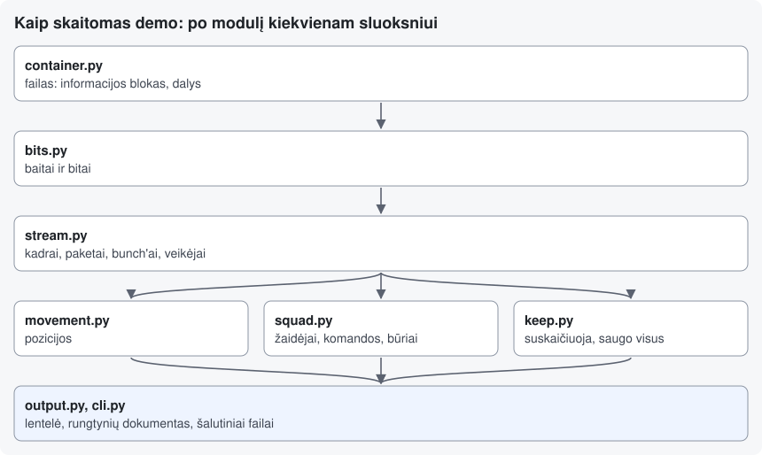

# Kaip skaitomas demo {#how-a-demo-is-read}

Paprastais žodžiais: Squad serveris siunčia kiekvieno žaidėjo poziciją visiems kitiems žaidėjams.
Demo failas – tai to srauto įrašas. Šis įrankis jį atkuria ir užrašo, kas kur buvo.



Unreal tinklo įrašas – tai paties serverio replikacijos srautas, užrašytas jo demo tvarkyklės.
Jį skaityti reiškia skaityti tą srautą taip, kaip jį skaitytų klientas.

| Modulis | Sluoksnis |
|---|---|
| `container.py` | vietinio failų srautintuvo failas: informacijos blokas (magija `0x1CA2E27F`), tada dalys. Dalių tipai: antraštė (`FNetworkDemoHeader`, magija `0x2CF5A13D`), įrašo duomenys, kontrolniai taškai ir įvykiai. |
| `bits.py` | baitų archyvai kadrams ir bitų archyvai paketams. Paketai skaitomi nuo mažiausio bito. |
| `stream.py` | kadrai, paketai, bunch'ai (dalinai bunch'ai sujungiami), veikėjų kanalai, veikėjų atsiradimai ir turinio blokai. Kiekviename bloke replikuojamos savybės kaip rankenėlė, bitų skaičius ir bitai, tada nuotoliniai kvietimai ir pasirinktinių delta laukai kaip rankenėlės į klasės `_ClassNetCache` grupę. Objektams, kurių eksportai neįvardija, klasė priskiriama, kai perskaitomas visas demo (žr. žemiau). |
| `movement.py` | variklio `FRepMovement` ir Squad sraigtasparnio judėjimas. |
| `keep.py` | kiekvienas sutiktas, suskaičiuotas ir išsaugotas elementas: papildomų failų eilutės ir savitikra. |
| `squad.py` | kokios Squad klasės ką saugo. `SQPlayerState` turi vardą, komandos būseną, būrio būseną ir dabartinį pawn; `SQTeamState` – komandos numerį ir frakciją; `SQSquadState` – būrio numerį. Sėdynės pawn savininkas yra jo transporto priemonė. |
| `output.py`, `cli.py` | lentelė ir rungtynių dokumentas. |

Įrašas pats įvardija savo laukus. Jame yra kiekvienos rankenėlės klasių keliai ir savybių pavadinimai bei
objektų, į kuriuos jis nurodo, keliai. Todėl kiekvieną savybę galima rasti pagal pavadinimą be žaidimo kodo.
Tik savybės bitams reikia tipo. Judėjimui tai yra paties variklio tipas; Squad savybėms tipai paprasti:
eilutės, sveikieji skaičiai, objektų nuorodos ir vardai.

Kai kuriuos objektus įvardija tik jie patys: lygio veikėjus – jų egzemplioriaus vardas (`Team1SpawnPoint3`),
komponentus – jų pačių vardas (`MovementComponent`, `wheel_L1`). Jų klasė randama iš eksporto lentelių,
po srauto: demo tvarkyklė eksportuoja klasės lauką kadre, kuriame jis pirmą kartą išsiunčiamas
(tai tiesa kiekvienam pirmam įvardyto objekto siuntimui testiniuose demo), todėl klasė yra ta vienintelė grupė,
kuri tiksliai eksportavo tuos rankenėles kadruose, kuriuose objektas jas pirmą kartą išsiuntė; kitaip – bet kuri grupė,
turinti visas savo rankenėles iki tol, kai visos jos suteikia tuos pačius vardus; kitaip – objekto, turinčio tokį patį vardą
(be skaičių), klasė, arba vienintelė grupė, kurios vardas apima objekto vardą. Iš rankenėlių objektų, įvardytų šiuo
būdu, kurių klasė jas siunčia su vienu fiksuotu bitų skaičiumi, visos atėjo su tuo skaičiumi (nė viena su kitu).
Tai, ko nieko iš šių nesprendžia, lieka papildomame veikėjų faile, visa.

## Savybių dekodavimas {#decoding-properties}

Kiekviena replikuojama savybė dekoduojama tiek, kiek jos bitai nurodo jos tipą: vienas bitas – žymė, nuoroda į objektą
(jo tinklo GUID) ten, kur pavadinimas baigiasi kaip nuorodos (`...State`, `...Seat`, `...Pawn`, `...Class`...),
ilgis ir tiek baitų – eilutė, vardas, 8/16/32/64 bitai – skaičius (slankiojo kablelio, kai savybės pavadinimas tai nurodo:
sveikata, laikas, greitis, įvestis...), o viskas kita – jos bitai šešioliktainiu kodu su rastomis eilutėmis viduje.
Nuotoliniai kvietimai skaitomi tuo pačiu būdu pagal parametrų pavadinimus, kuriuos demo eksportuoja kiekvienai funkcijai.

## Kaip skaitomi įvykiai {#how-the-events-are-read}

Kareivio `Health` ir `bWounded` ateina iš serverio: sužeistas, kai įsijungia `bWounded`; atgaivintas, kai išsijungia
ir sveikata didesnė nei 0; miręs, kai sveikata nukrenta žemiau -100 (žaidėjas, kuris pasiduoda ar nukraujuoja, nustatomas į -300);
botas, kuris niekada nebuvo sužeistas, miršta ties 0. Transporto priemonė ar įrenginys yra `damaged` kiekvieną kartą, kai
nukrinta jo `Health`, `destroyed` – kai pasiekia 0 ar mažiau. Atsiradimai ir pašalinimai yra veikėjo kanalo atidarymas ir
uždarymas; sėdynė yra žaidėjo būsenos `CurrentSeat` (nuoroda į sėdynės komponentą, kuris siunčiamas su jo transporto priemone).
Žvilgsnio kampas yra kareivio `RemoteViewPitch`, baitas nuo tiesiai žemyn (0) iki tiesiai aukštyn (255). Šūvis yra ginklo
`MulticastFireProjectile` (kilmė ir kryptis), arba jo `MulticastFireMultipleProjectileEffects`, jei tokio kvietimo su ta pačia
kryptimi nebuvo; pataikymas yra transporto priemonės `MulticastPlayDamageEffects` (smūgio vieta, žalos tipas).

## Kas patikrinta ir kaip {#what-was-verified-and-how}

Tai patikrinta dviejuose viešuose Squad v10.3.1 serverių demo (Unreal Engine 5.5.4, variklio tinklo versija 36),
iš squad-replay projekto testinių pavyzdžių:

- **Skaičiai.** Kadrų, paketų, veikėjų atidarymų, eksporto grupių ir eksportuotų objektų kelių skaičiai tiksliai sutampa
  su to projekto nepriklausomu skaitytuvu. Tiksliai sutampa ir kareivio judėjimo matavimų skaičius.
- **Judėjimas pagal greitį.** Kiekvieno kareivio matavimo žingsnis nuo ankstesnio, padalintas iš laiko tarp jų, sutampa
  su greičiu, kurį matavimas nešioja. Mediana santykio judantiems žaidėjams yra nuo 0,8 iki 1,2.
- **Komandos pagal blueprint'us.** Kiekvienos eilutės komanda yra ta komanda, kurios frakcijai priklauso kareivio blueprint.
  Tai galioja ir žaidėjui, kuris rungtynių metu perėjo į kitą pusę.
- **Klaidos.** Vienas srauto klaidos pranešimas kiekviename demo lieka: klaidingas bitas pirmojo bunch'o pabaigoje
  įrašytojo paties stebėtojo veikėjo, kuris čia nenaudojamas.
- **Žuvimai pagal to projekto žudynes.** Kiekviena to projekto nurodyta žudynė yra čia nuskaityta žaizda ar mirtis tuo pačiu
  laiku ir tam pačiam žaidėjui; jo transporto priemonių žudynės yra čia nuskaitytos transporto priemonės, pasiekusios
  sveikatą 0 ar mažiau.
- **Įrenginiai.** Čia nuskaityti veikėjai su statybos būsena ar FOB reikalavimu sutampa su to projekto įrenginiais
  vieno tikslumu.
- **Žvilgsnio kampas.** Žvilgsnio kampo baitas ramybėje yra apie 120 ir pasiekia 255 (tiesiai aukštyn): skaitomas kaip
  baitas, nuo -90 iki +90. Jei būtų skaitomas kaip įprastas variklio baitas visam apsisukimui, kareiviai atrodytų
  iki 128 laipsnių po horizontu, ko jie negali.
- **Botai.** Demo iš pasirengimo (seeding) laiko kiekvienas botas (`SQSquidBot`) turi savo trajektoriją, o botai, kurie žūva, nuskaitomi kaip mirtys.
- **Sraigtasparnio judėjimas** (`SQHelicopterMovementComponent.ReplicatedMovement`, Squad'o paties išdėstymas: be žymių,
  vieta šimtosiomis, greitis ir kampinis greitis, trys neprivalomi 16 bitų kampai, serverio laikrodis kaip slankiojo kablelio skaičius).
  Kiekvienas sraigtasparnio matavimas tiksliai užpildo savo bitus. Stovinčio sraigtasparnio vieta ir kryptis yra jo atsiradimo vieta
  iki centimetro ir kampo vieneto. Skrendant žingsnis tarp matavimų, padalintas iš laikrodžio žingsnio, yra greitis
  (mediana santykio 0,997), o laikrodis žingsniuoja kartu su demo laiku (mediana 0,4 ms tarp žingsnių). Kampinis greitis
  seka posūkio greitį (koreliacija 0,91), bet jo vienetas nėra tiksliai nustatytas: jis išsaugomas, bet nenaudojamas.
- **Sėdynės.** Žaidėjo būsenos `CurrentSeat` yra nuoroda (supakuotas tinklo GUID), o ne skaičius, kaip buvo skaitoma anksčiau:
  nuskaitytas taip, kiekvieno pakeitimo metu tai yra ta sėdynė, kurią kareivio paties `MulticastUpdateCurrentSeat` nurodo akimirką prieš tai,
  o pakeitimai yra squad-replay pakeitimai.
- **Šūviai ir pataikymai.** Kiekvienas `ShootDir` yra vienetinis vektorius (ilgis 1 su 0,00003 tikslumu); kiekvienas
  `MulticastFireMultipleProjectileEffects` pradžios taškas, padalintas iš 10, yra atitinkamo `MulticastFireProjectile`
  `OriginZeroBased` su 1 mm tikslumu; kur žinoma šaulio ar pataikytos transporto priemonės pozicija, šūvio kilmė ar smūgio vieta
  yra vidutiniškai 0,45 m nuo jos.
- **Transporto priemonių įvestys.** Nuskaityti kaip slankiojo kablelio skaičiai, vikšrinių transporto priemonių dujos, stabdis ir
  rankinis stabdis yra intervale 0..1, o vairas – intervale -1..1, kiekviename atnaujinime.
- **Uždarymo priežastys.** Kiekvienas veikėjas, kurio kanalas buvo atidarytas iš naujo, buvo uždarytas su `Dormancy`;
  nė vienas, uždarytas su `Destroyed`, nebuvo atidarytas iš naujo.

Testai, sukurti patiems testams, apima konteinerį, archyvus, srautą ir visą kelią iki lentelės, ir patvirtina, kad demo su
vieno kiekvienos rūšies elemento įrašais nieko nepraranda ([`tests/test_completeness.py`](https://github.com/Holdi601/3DHeat-Ext-Squad/blob/main/tests/test_completeness.py)):

```bash
python -m pip install -e .[test]
pytest                                   # sintetiniai demo
HEAT3D_SQUAD_DEMOS=<folder> pytest       # ir tikri demo tame aplanke
```
