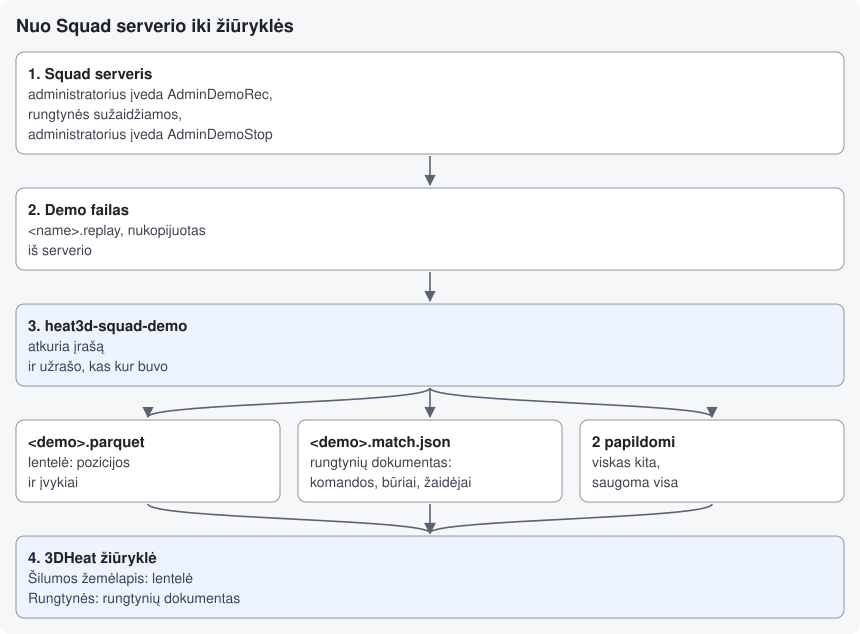

# 3DHeat Squad {#dheat-squad}

**Kas tai?** Nedidelė programa, kuri paverčia Squad rungtynių įrašą failais, kuriuos
[3DHeat](https://github.com/Holdi601/3DHeat) žiūryklė
([dokumentacija](https://holdi601.github.io/3DHeat/)) gali nupiešti: kur buvo kiekvienas žaidėjas,
sekundė po sekundės, ir kas kur įvyko.

**Kam tai naudoti?** Kad matytumėte rungtynes iš viršaus: kur vyko kovos, kokius maršrutus
rinkosi būriai, kur žuvo transporto priemonės.

**Pavyzdys:** `match.replay` (demo įrašas, padarytas Squad serveryje) ->
`match.parquet` (viena eilutė vienai pozicijai ar įvykiui) + `match.match.json` (rungtynių
dokumentas: komandos, būriai, žaidėjai). Rezultatai yra įprasti Parquet ir JSON failai, todėl juos
gali skaityti ir kiti įrankiai.

Kam tai naudinga:

- **Kur vyko rungtynės.** Kiekvieno žaidėjo ir boto pozicija, pėsčiomis, sausumos transporto
  priemonėmis ir sraigtasparniais, maždaug aštuonis kartus per sekundę, su komanda, frakcija,
  būriu, sveikata ir žvilgsnio kampu.
- **Kas kur įvyko.** Žaizdos, atgaivinimai ir mirtys; kiekvienas šūvis ir kiekvienas
  pataikymas į transporto priemonę; kiekviena pastatyta, pažeista, sunaikinta ir pašalinta
  transporto priemonė, įrenginys ir įtvirtinimas.
- **Visas rungtynes viename dokumente.** Komandos, būriai, žaidimo būsena, kiekvienas objektas,
  eilutė kiekvienam žaidėjui ir botui bei savitikra, kad nieko iš demo nepražuvo.



## Greita pradžia {#quick-start}

Nesate įpratę prie komandinės eilutės? Pirmiausia perskaitykite [Prieš pradedant](before-you-start.md).

```bash
python -m pip install -e .              # įdiegia komandą heat3d-squad-demo
heat3d-squad-demo match.replay -o out   # arba aplanką su .replay failais
```

Turėtumėte matyti po vieną eilutę kiekvienam demo. Tada įkelkite `out/<map>/<demo>.parquet`
žiūryklės skirtuke Šilumos žemėlapis
([Duomenų įkėlimas](https://holdi601.github.io/3DHeat/getting-data-in.html)).

## Puslapiai {#pages}

| Puslapis | Ką jame rasite |
|---|---|
| [Prieš pradedant](before-you-start.md) | Python, terminalas, pirmas paleidimas |
| [Demo įrašymas](recording.md) | kaip serveris įrašo demo ir kaip jį rasti |
| [Demo konvertavimas](converting.md) | komanda, kiekviena parinktis, pavyzdinis rezultatas |
| [Lentelė](output-table.md) | kiekvienas stulpelis ir kiekvienas `event` |
| [Rungtynių dokumentas ir papildomi failai](output-match.md) | `.match.json`, du papildomi failai, savitikra |
| [Kaip skaitomas demo](how-it-works.md) | skaitytuvo sluoksniai ir kas patikrinta |
| [Apribojimai, atnaujinimai ir sąlygos](limits.md) | kas nenuskaitoma, ką gali sugadinti Squad atnaujinimas, asmens duomenys, licencija |
| [Komandų nuoroda](../cli-reference.md) | kiekviena parinktis ir stulpelis, sugeneruoti iš kodo |
| [Šių dokumentų priežiūra](maintaining.md) | išleidimo kontrolinis sąrašas |

## Susiję {#related}

- 3DHeat žiūryklė: [github.com/Holdi601/3DHeat](https://github.com/Holdi601/3DHeat),
  dokumentacija – [holdi601.github.io/3DHeat](https://holdi601.github.io/3DHeat/).
- Failų formatai, kuriuos skaito žiūryklė, įskaitant vieno failo rungtynių konteinerį:
  [Vienas failas rungtynėms (.3dheat)](https://holdi601.github.io/3DHeat/container.html).
  Šis konvertuotojas rašo atskirus failus: lentelę, rungtynių dokumentą ir jo papildomus
  failus šalia vienas kito.
- 3DHeat Watcher, įdiegtas, paleidžia šį konvertuotoją naujiems demo
  (adapteris `squad-demos`): [3DHeat Watcher](https://holdi601.github.io/3DHeat-Watcher/).

## 3DHeat įrankiai {#the-3dheat-tools}

| Įrankis | Ką daro | Kodas | Dokumentacija |
|---|---|---|---|
| 3DHeat žiūryklė | rodo duomenis: šilumos žemėlapius, lenktynių analizę, rungtynių apžvalgą | [3DHeat](https://github.com/Holdi601/3DHeat) | [dokumentacija](https://holdi601.github.io/3DHeat/) |
| GameFiles | lygiai ir trasos iš žaidimo pačio failų | [3DHeat-GameFiles](https://github.com/Holdi601/3DHeat-GameFiles) | [dokumentacija](https://holdi601.github.io/3DHeat-GameFiles/) |
| GameCapture | ratų telemetrija ir lygiai, atkurti iš žaidimo vaizdo | [3DHeat-GameCapture](https://github.com/Holdi601/3DHeat-GameCapture) | [dokumentacija](https://holdi601.github.io/3DHeat-GameCapture/) |
| Unreal Exporter | Unreal Editor papildinys: lygis kaip vienas `.glb` | [3DHeat-UnrealExporter](https://github.com/Holdi601/3DHeat-UnrealExporter) | [dokumentacija](https://holdi601.github.io/3DHeat-UnrealExporter/) |
| CS2 | Counter-Strike 2 demo ir žemėlapiai | [3DHeat-CS2](https://github.com/Holdi601/3DHeat-CS2) | [dokumentacija](https://holdi601.github.io/3DHeat-CS2/) |
| Watcher | įrašo, ką žaidimai skelbia, kol žaidžiate | [3DHeat-Watcher](https://github.com/Holdi601/3DHeat-Watcher) | [dokumentacija](https://holdi601.github.io/3DHeat-Watcher/) |
| Ext-WarThunder | War Thunder įrašai | [3DHeat-Ext-WarThunder](https://github.com/Holdi601/3DHeat-Ext-WarThunder) | [dokumentacija](https://holdi601.github.io/3DHeat-Ext-WarThunder/) |
| Ext-WoT | World of Tanks įrašai | [3DHeat-Ext-WoT](https://github.com/Holdi601/3DHeat-Ext-WoT) | [dokumentacija](https://holdi601.github.io/3DHeat-Ext-WoT/) |
| Ext-WoWs | World of Warships įrašai | [3DHeat-Ext-WoWs](https://github.com/Holdi601/3DHeat-Ext-WoWs) | [dokumentacija](https://holdi601.github.io/3DHeat-Ext-WoWs/) |
| Ext-Squad | Squad serverių demo | [3DHeat-Ext-Squad](https://github.com/Holdi601/3DHeat-Ext-Squad) | [dokumentacija](https://holdi601.github.io/3DHeat-Ext-Squad/) |
| Ext-DCS | DCS World žemėlapiai kaip 3D lygiai | [3DHeat-Ext-DCS](https://github.com/Holdi601/3DHeat-Ext-DCS) | [dokumentacija](https://holdi601.github.io/3DHeat-Ext-DCS/) |
| Ext-IL2 | IL-2 Sturmovik žemėlapiai kaip 3D lygiai | [3DHeat-Ext-IL2](https://github.com/Holdi601/3DHeat-Ext-IL2) | [dokumentacija](https://holdi601.github.io/3DHeat-Ext-IL2/) |
