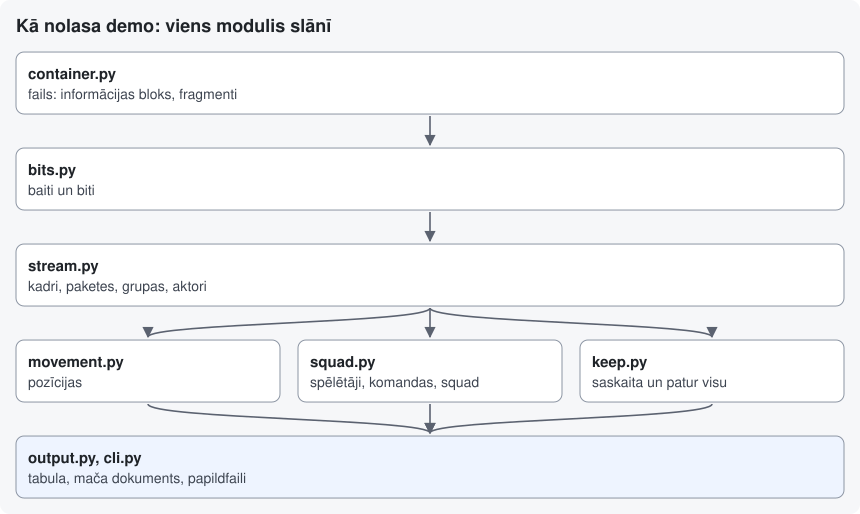

# Kā tiek nolasīts demo {#how-a-demo-is-read}

Vienkārši sakot: Squad serveris nosūta katra spēlētāja pozīciju visiem pārējiem spēlētājiem. Demo fails ir šī satiksmes ieraksts. Šis rīks to atskaņo un pieraksta, kurš kur bija.



Unreal tīkla ieraksts ir paša servera replikācijas satiksme, ko tā demo draiveris ieraksta. Šī satiksme tiek nolasīta tā, kā to nolasītu klients.

| Modulis | Slānis |
|---|---|
| `container.py` | Vietējā failu straumētāja fails: informācijas bloks (magic `0x1CA2E27F`), tam seko fragmenti. Fragmentu tipi ir galvene (`FNetworkDemoHeader`, magic `0x2CF5A13D`), replikācijas dati, kontrolpunkti un notikumi. |
| `bits.py` | Baitu arhīvi kadriem un bitu arhīvi paketēm. Paketes tiek lasītas no zemākā bita uz augstāko. |
| `stream.py` | Kadri, paketes, grupas (daļējās grupas tiek savienotas), aktoru kanāli, aktoru parādīšanās un satura bloki. Katrs bloks satur replicētās īpašības kā rokturi, bitu skaitu un bitus, pēc tam attālos izsaukumus un pielāgotos delta laukus kā rokturus klases `_ClassNetCache` grupā. Objektiem, kurus eksporti nenosauc, klase tiek piešķirta pēc tam, kad viss demo ir nolasīts (skat. zemāk). |
| `movement.py` | Motora `FRepMovement` un Squad helikoptera kustība. |
| `keep.py` | Katrs sastaptais vienums, saskaitīts un paturēts: papildfailu rindas un pašpārbaude. |
| `squad.py` | Kuras Squad klases ko satur. `SQPlayerState` satur vārdu, komandas stāvokli, squad stāvokli un pašreizējo pawn; `SQTeamState` komandas numuru un frakciju; `SQSquadState` squad numuru. Sēdekļa pawn īpašnieks ir tā transportlīdzeklis. |
| `output.py`, `cli.py` | Tabula un mača dokuments. |

Ieraksts pats nosauc savus laukus. Tajā ir klašu ceļi un īpašību nosaukumi katram rokturim, kā arī to objektu ceļi, uz kuriem tas atsaucas. Tāpēc katru īpašību var atrast pēc nosaukuma bez spēles koda. Tikai īpašības bitiem vajag tipu. Kustībai tas ir paša motora tips; Squad īpašībām tipi ir vienkārši: virknes, veseli skaitļi, objektu atsauces un nosaukumi.

Dažus objektus nosaka tikai paši: līmeņa aktorus pēc instances nosaukuma (`Team1SpawnPoint3`), komponentus pēc to pašu nosaukuma (`MovementComponent`, `wheel_L1`). To klasi atrod no eksporta tabulām pēc straumes: demo draiveris eksportē klases lauku kadrā, kurā tas tiek nosūtīts pirmo reizi (tas attiecas uz katru pirmo nosūtījumu nosauktam objektam testa demo), tātad klase ir tā grupa, kas tieši tajos kadros eksportēja tieši šos rokturus; citādi jebkura grupa, kurai līdz tam bija visi rokturi, ja visas dod vienādus nosaukumus; citādi tās objekta klase, kuram ir tāds pats nosaukums, skaitļus neskaitot, vai tā vienīgā grupa, kuras nosaukums satur objekta nosaukumu. No šādi nosaukto objektu rokturiem, kuru klase tos sūta ar vienu fiksētu bitu skaitu, visi ienāca ar šo skaitu (neviens ar citu). Ko neviens no šiem noteikumiem neizlemj, paliek papildfailā entities, pilnībā.

## Īpašību dekodēšana {#decoding-properties}

Katra replicētā īpašība tiek dekodēta tik tālu, cik tās biti par to pastāsta: viens bits ir karogs; atsauce uz objektu (tā tīkla GUID), ja nosaukums beidzas kā atsaucei (`...State`, `...Seat`, `...Pawn`, `...Class`...); garums un tik baitu, cik tas nosaka, ir virkne; nosaukums, 8/16/32/64 biti ir skaitlis (peldošais punkts, ja īpašības nosaukums to norāda: veselība, laiks, ātrums, ievade...); viss pārējais ir bitu heksadecimālā formā, kā arī tajā atrastās virknes. Attālie izsaukumi tiek nolasīti tāpat, pēc parametru nosaukumiem, ko demo eksportē katrai funkcijai.

## Kā tiek nolasīti notikumi {#how-the-events-are-read}

Karavīra `Health` un `bWounded` nāk no servera: ievainots, kad `bWounded` ieslēdzas; atdzīvināts, kad tas izslēdzas un veselība ir virs 0; miris, kad veselība nokrīt zem -100 (spēlētājs, kas padodas vai asiņo līdz nāvei, tiek iestatīts uz -300); bots, kas nekad nav ievainots, mirst pie 0. Transportlīdzeklis vai deployable tiek atzīmēts kā `damaged` katrā `Health` kritumā, `destroyed` pie 0 vai zemāk. Parādīšanās un noņemšana ir aktoru kanāla atvēršana un aizvēršana; sēdeklis ir spēlētāja stāvokļa `CurrentSeat` (atsauce uz sēdekļa komponentu, kas tiek nosūtīts uz tā transportlīdzekli). Skata augstums ir karavīra `RemoteViewPitch`, baits no tieši lejup (0) līdz tieši augšup (255). Šāviens ir ieroča `MulticastFireProjectile` (izcelsme un virziens) vai tā `MulticastFireMultipleProjectileEffects`, ja nav bijis neviena tāda paša virziena izsaukuma; trāpījums ir transportlīdzekļa `MulticastPlayDamageEffects` (trieciena vieta, bojājuma tips).

## Ko pārbaudījām un kā {#what-was-verified-and-how}

Tas pārbaudīts pret diviem publiskiem Squad v10.3.1 servera demo (Unreal Engine 5.5.4, motora tīkla versija 36), no squad-replay projekta testa paraugiem:

- **Skaitļi.** Kadru, paketu, aktoru atvēršanas, eksporta grupu un eksportēto objektu ceļu skaiti precīzi sakrīt ar šī projekta neatkarīgo parsētāju. Tāpat sakrīt karavīra kustības paraugu skaits.
- **Kustība pret ātrumu.** Katra karavīra parauga solis no iepriekšējā, dalīts ar laiku starp tiem, sakrīt ar ātrumu, ko paraugs nes. Vidējais attiecums ir no 0,8 līdz 1,2 kustīgiem spēlētājiem.
- **Komandas pret blueprint.** Katras rindas komanda ir tā komanda, kuras frakcija pieder karavīra blueprint. Tas bija patiesi arī spēlētājam, kurš mača laikā mainīja pusi.
- **Kļūdas.** Katrā demo paliek viena straumes kļūda: klīstošs bits pirmās grupas beigās servera ierakstītāja pašu skatītāja aktoram, kas nenes nekā, ko šeit izmanto.
- **Upuri pret šī projekta nogalinājumiem.** Katrs nogalinājums, ko tas uzskaita, ir šeit nolasīts ievainojums vai nāve tajā pašā laikā un tam pašam spēlētājam; tā transportlīdzekļu nogalinājumi ir šeit nolasīti transportlīdzekļi, kuru veselība sasniedz 0 vai zemāk.
- **Deployables.** Šeit nolasītie aktori ar būvēšanas stāvokli vai FOB prasību sakrīt ar šī projekta deployables, ar kļūdu līdz vienam.
- **Skata augstums.** Skata augstuma baits atrodas ap 120 miera stāvoklī un sasniedz 255 (tieši augšup): tas nolasīts kā baits diapazonā -90..+90. Ja to nolasa kā parasto motora baitu pilnam apgriezienam, karavīri būtu līdz 128 grādiem zem horizonta, un tie nevar skatīties tik zemu.
- **Boti.** Spēles sēklošanas demo katram botam (`SQSquidBot`) ir sava trase, un botu nāves tiek nolasītas kā nāves.
- **Helikoptera kustība** (`SQHelicopterMovementComponent.ReplicatedMovement`, Squad pašu izkārtojums: bez karogiem, atrašanās vieta simtdaļās, ātrums un leņķiskais ātrums, trīs neobligāti 16 bitu leņķi, servera pulkstenis kā peldošais punkts). Katrs helikoptera paraugs precīzi aizpilda savus bitus. Novietota helikoptera atrašanās vieta un virziens ir tie paši kā tā parādīšanās vietā, līdz centimetram un leņķa vienībai. Lidojumā solis starp paraugiem, dalīts ar pulksteņa soli, ir ātrums (vidējais attiecums 0,997), un pulkstenis soļo kopā ar demo laiku (vidēji 0,4 ms starp soļiem). Leņķiskais ātrums seko virziena ātrumam (korelācija 0,91), bet tā mērvienība nav noteikta: tas tiek saglabāts, bet netiek izmantots.
- **Sēdekļi.** Spēlētāja stāvokļa `CurrentSeat` ir atsauce (iepakots tīkla GUID), nevis skaitlis, kā tas tika nolasīts iepriekš: nolasīts tādējādi, katrā maiņā tas ir sēdeklis, ko karavīra pats `MulticastUpdateCurrentSeat` nosauc mirkli iepriekš, un maiņas ir squad-replay maiņas.
- **Šāvieni un trāpījumi.** Katrs `ShootDir` ir vienības vektors (garums 1 ar kļūdu 0,00003); katrs `MulticastFireMultipleProjectileEffects` izcelsme, dalīta ar 10, ir atbilstošā `MulticastFireProjectile` `OriginZeroBased` ar kļūdu līdz 1 mm; kur zināma šāvēja vai trāpītā transportlīdzekļa pozīcija, šāviena izcelsme vai trieciena vieta ir vidēji 0,45 m attālumā.
- **Transportlīdzekļu ievades.** Nolasīti kā peldoši punkti, kāpurķēžu transportlīdzekļu gāze, bremze un rokas bremze atrodas diapazonā 0..1, bet stūre -1..1, katrā atjauninājumā.
- **Aizvēršanas iemesli.** Katrs aktors, kura kanāls tika atkal atvērts, bija aizvērts ar `Dormancy`; neviens, kas aizvērts ar `Destroyed`, netika atkal atvērts.

Testi uz demo, ko paši testi izveido, pārbauda konteineru, arhīvus, straumi un visu ceļu līdz tabulai, kā arī to, ka demo ar vienu katra veida vienumu nekas nepazūd ([`tests/test_completeness.py`](https://github.com/Holdi601/3DHeat-Ext-Squad/blob/main/tests/test_completeness.py)):

```bash
python -m pip install -e .[test]
pytest                                   # sintētiski demo
HEAT3D_SQUAD_DEMOS=<folder> pytest       # plus īsti demo šajā mapē
```
