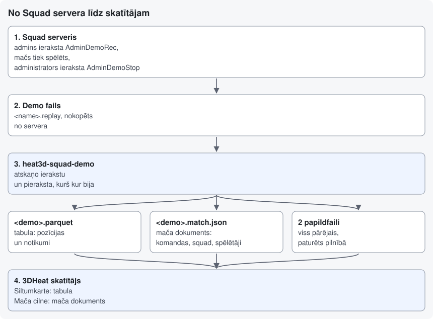

# 3DHeat Squad {#dheat-squad}

**Kas tas ir?** Neliela programma, kas pārvērš Squad mača ierakstu failos,
ko [3DHeat](https://github.com/Holdi601/3DHeat) skatītājs
([dokumentācija](https://holdi601.github.io/3DHeat/)) var uzzīmēt: kur bija katrs
spēlētājs, sekundi pa sekundei, un kas notika kur.

**Kāpēc to lietot?** Lai redzētu maču no augšas: kur notika cīņas, pa kurām maršrutām
gāja squad, kur gāja bojā transportlīdzekļi.

**Piemērs:** `match.replay` (demo, ierakstīts Squad serverī) ->
`match.parquet` (viena rinda katrai pozīcijai vai notikumam) + `match.match.json` (mača
dokuments: komandas, squad, spēlētāji). Izvade ir parastie Parquet un JSON faili, tāpēc
arī citi rīki tos var nolasīt.

Kam tas noder:

- **Kur notika mačs.** Katra spēlētāja un bota pozīcija, kājām, sauszemes
  transportlīdzekļos un helikopteros, apmēram astoņas reizes sekundē, ar komandu, frakciju,
  squad, veselību un skata augstumu.
- **Kas notika kur.** Ievainojumi, atdzīvināšanas un nāves; katrs šāviens un katrs
  trāpījums transportlīdzeklim; katrs transportlīdzeklis, deployable, ierīkojums, kas
  parādījās, tika bojāts, iznīcināts vai noņemts.
- **Viss mačs vienā dokumentā.** Komandas, squad, spēles stāvoklis, katrs aktors, rinda
  katram spēlētājam un katram botam, kā arī pašpārbaude, ka nekas no demo nav pazudis.



## Ātrais sākums {#quick-start}

Nekad neesat strādājis ar komandrindu? Vispirms izlasiet [Pirms sākat](before-you-start.md).

```bash
python -m pip install -e .              # uzstāda komandu heat3d-squad-demo
heat3d-squad-demo match.replay -o out   # vai mape ar .replay failiem
```

Redzēsiet pa vienai rindai katram demo. Pēc tam ielādējiet `out/<map>/<demo>.parquet` skatītāja
cilnē Siltumkarte ([Datu ievade](https://holdi601.github.io/3DHeat/getting-data-in.html)).

## Lapas {#pages}

| Lapa | Ko tā aptver |
|---|---|
| [Pirms sākat](before-you-start.md) | Python, termināls, pirmā palaišana |
| [Demo ierakstīšana](recording.md) | kā panākt, lai serveris ieraksta demo, un kā to atrast |
| [Demo konvertēšana](converting.md) | komanda, katra iespēja, piemēra izvade |
| [Tabula](output-table.md) | katra kolonna un katrs `event` |
| [Mača dokuments un papildfaili](output-match.md) | `.match.json`, abi papildfaili, pašpārbaude |
| [Kā tiek nolasīts demo](how-it-works.md) | lasītāja slāņi un tas, kas ir pārbaudīts |
| [Ierobežojumi, atjauninājumi un noteikumi](limits.md) | kas netiek nolasīts, ko var salauzt Squad atjauninājums, personas dati, licence |
| [Komandu atsauce](../cli-reference.md) | katra iespēja un kolonna, ģenerēta no koda |
| [Šo lapu uzturēšana](maintaining.md) | izlaides kontrolsaraksts |

## Saistītais {#related}

- 3DHeat skatītājs: [github.com/Holdi601/3DHeat](https://github.com/Holdi601/3DHeat),
  dokumentācija vietnē [holdi601.github.io/3DHeat](https://holdi601.github.io/3DHeat/).
- Failu formāti, ko lasa skatītājs, tostarp viena faila mača konteiners:
  [Viens fails vienam maču (.3dheat)](https://holdi601.github.io/3DHeat/container.html).
  Šis konvertētājs raksta atsevišķos failus: tabulu, mača dokumentu un tā papildfailus blakus.
- 3DHeat Watcher palaiž šo konvertētāju jaunajiem demo, ja tas ir uzstādīts (adapteris
  `squad-demos`): [3DHeat Watcher](https://holdi601.github.io/3DHeat-Watcher/).
- Katrs spēļu lasītājs ir atsevišķs neliels projekts ar savu licences failu, laidieniem un problēmu izsekotāju, tāpēc to var instalēt, atjaunināt, uzturēt - vai pēc tiesību īpašnieka lūguma atsaukt - atsevišķi, neietekmējot skatītāju vai citus rīkus.

## 3DHeat rīki {#the-3dheat-tools}

| Rīks | Ko tas dara | Kods | Dokumentācija |
|---|---|---|---|
| 3DHeat skatītājs | rāda datus: siltumkartes, sacensību analīzi, maču pārskatu | [3DHeat](https://github.com/Holdi601/3DHeat) | [dokumentācija](https://holdi601.github.io/3DHeat/) |
| GameFiles | līmeņi un trases no spēles pašu failiem | [3DHeat-GameFiles](https://github.com/Holdi601/3DHeat-GameFiles) | [dokumentācija](https://holdi601.github.io/3DHeat-GameFiles/) |
| GameCapture | telemetrija no apļiem un līmeņi, atjaunoti no spēles video | [3DHeat-GameCapture](https://github.com/Holdi601/3DHeat-GameCapture) | [dokumentācija](https://holdi601.github.io/3DHeat-GameCapture/) |
| Unreal Exporter | Unreal Editor spraudnis: līmenis kā viens `.glb` | [3DHeat-UnrealExporter](https://github.com/Holdi601/3DHeat-UnrealExporter) | [dokumentācija](https://holdi601.github.io/3DHeat-UnrealExporter/) |
| CS2 | Counter-Strike 2 demo un kartes | [3DHeat-CS2](https://github.com/Holdi601/3DHeat-CS2) | [dokumentācija](https://holdi601.github.io/3DHeat-CS2/) |
| Watcher | ieraksta to, ko spēles publicē, kamēr tu spēlē | [3DHeat-Watcher](https://github.com/Holdi601/3DHeat-Watcher) | [dokumentācija](https://holdi601.github.io/3DHeat-Watcher/) |
| Ext-WarThunder | War Thunder ieraksti | [3DHeat-Ext-WarThunder](https://github.com/Holdi601/3DHeat-Ext-WarThunder) | [dokumentācija](https://holdi601.github.io/3DHeat-Ext-WarThunder/) |
| Ext-WoT | World of Tanks ieraksti | [3DHeat-Ext-WoT](https://github.com/Holdi601/3DHeat-Ext-WoT) | [dokumentācija](https://holdi601.github.io/3DHeat-Ext-WoT/) |
| Ext-WoWs | World of Warships ieraksti | [3DHeat-Ext-WoWs](https://github.com/Holdi601/3DHeat-Ext-WoWs) | [dokumentācija](https://holdi601.github.io/3DHeat-Ext-WoWs/) |
| Ext-Squad | Squad servera demo | [3DHeat-Ext-Squad](https://github.com/Holdi601/3DHeat-Ext-Squad) | [dokumentācija](https://holdi601.github.io/3DHeat-Ext-Squad/) |
| Ext-DCS | DCS World kartes kā 3D līmeņi | [3DHeat-Ext-DCS](https://github.com/Holdi601/3DHeat-Ext-DCS) | [dokumentācija](https://holdi601.github.io/3DHeat-Ext-DCS/) |
| Ext-IL2 | IL-2 Sturmovik kartes kā 3D līmeņi | [3DHeat-Ext-IL2](https://github.com/Holdi601/3DHeat-Ext-IL2) | [dokumentācija](https://holdi601.github.io/3DHeat-Ext-IL2/) |
