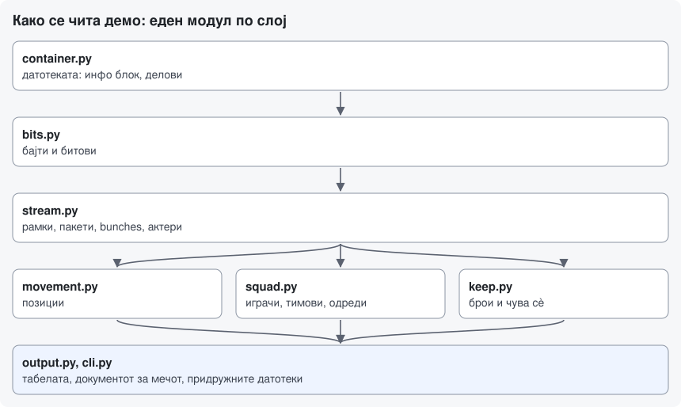

# Како се чита едно демо {#how-a-demo-is-read}

Едноставно кажано: серверот на Squad ја испраќа позицијата на секој играч до секој друг играч. Датотеката со демо е снимка на тој сообраќај. Оваа алатка го пушта назад и запишува кој каде бил.



Мрежниот реплеј на Unreal е сопствениот сообраќај за репликација на серверот, запишан од неговиот demo driver. Читањето на еден е читање на тој сообраќај како што би го прочитал клиент.

| Модул | Слој |
|---|---|
| `container.py` | Датотеката на локалниот стример на датотеки: информациски блок (magic `0x1CA2E27F`), па делови (chunks). Типовите на делови се заглавието (`FNetworkDemoHeader`, magic `0x2CF5A13D`), податоците од реплејот, контролните точки и настаните. |
| `bits.py` | Бајтни архиви за рамките и битови архиви за пакетите. Пакетите се читаат од најнискиот бит. |
| `stream.py` | Рамки, пакети, bunches (парцијалните bunches споени), канали на актери, појавувања на актери и блокови со содржина. Секој блок ги содржи реплицираните својства како handle, број на битови и битови, потоа оддалечени повикувања и полиња со прилагодена delta како handles во групата `_ClassNetCache` на класата. На објектите што извозите не ги именуваат им се дава класа откако целото демо е прочитано (видете подолу). |
| `movement.py` | `FRepMovement` на моторот, и движењето на хеликоптерите на Squad. |
| `keep.py` | Секоја сретната ставка, избројана и зачувана: редовите на придружните датотеки и самопроверката. |
| `squad.py` | Кои класи на Squad што носат. `SQPlayerState` го содржи името, состојбата на тимот, состојбата на одредот и тековниот pawn; `SQTeamState` бројот на тимот и фракцијата; `SQSquadState` бројот на одредот. Сопственикот на pawn на седиште е неговото возило. |
| `output.py`, `cli.py` | Табелата и документот за мечот. |

Реплејот ги именува сопствените полиња. Ги носи патеките на класите и имињата на својствата за секој handle, и патеките на објектите на кои упатува. Така секое својство може да се најде по име без кодот на играта. Само битовите на едно својство бараат неговиот тип. За движењето тоа е сопствениот тип на моторот; за својствата на Squad типовите се едноставни: низи, цели броеви, референци на објекти и имиња.

Некои објекти се именувани само по себе: актерите на ниво по името на нивната инстанца (`Team1SpawnPoint3`), компонентите по своето (`MovementComponent`, `wheel_L1`). Нивната класа се наоѓа од табелите за извоз, по потокот: demo driver го извезува полето на една класа во рамката во која прв пат се испраќа (точно за секое прво испраќање на именуван објект во тест-демоата), па класата е онаа единствена група што ги извезла точно тие handles во рамките во кои објектот прв пат ги испратил; во спротивно секоја група што дотогаш ги имала сите свои handles, кога сите им даваат исти имиња; во спротивно класата на објект со исто име, без броевите, или онаа единствена група чие име го содржи името на објектот. Од handles на објекти именувани на овој начин чија класа ги испраќа со еден фиксен број на битови, сите дошле со тој број (ниту еден со друг). Што ниту едно од овие не го решава останува целосно во придружната датотека entities.

## Декодирање на својства {#decoding-properties}

Секое реплицирано својство се декодира колку што неговите битови кажуваат што е: еден бит е знаме, референца на објект (неговиот net GUID) таму каде што името завршува како на референца (`...State`, `...Seat`, `...Pawn`, `...Class`...), должина и толку бајти е низа, име, 8/16/32/64 бита е број (float таму каде што името на својството го вели тоа: health, time, rate, input...), сè друго неговите битови во hex со низите пронајдени внатре. Оддалечените повикувања се читаат на ист начин, според имињата на параметрите што демото ги извезува за секоја функција.

## Како се читаат настаните {#how-the-events-are-read}

`Health` и `bWounded` на војникот доаѓаат од серверот: ранет кога `bWounded` се вклучува, оживеан кога се исклучува со здравје над 0, мртов кога здравјето паѓа под -100 (играч што се предава или искрвавува се поставува на -300); бот, никогаш ранет, умира на 0. Возило или поставен објект е `damaged` при секое паѓање на неговиот `Health`, `destroyed` на 0 или под. Појавувањата и отстранувањата се отворање и затворање на каналот на актерот; седиштето е `CurrentSeat` на состојбата на играчот (референца на компонентата на седиштето, која се испраќа на неговото возило). Навалата (pitch) на погледот е `RemoteViewPitch` на војникот, бајт од право надолу (0) до право нагоре (255). Истрел е `MulticastFireProjectile` на оружје (потекло и насока), или неговиот `MulticastFireMultipleProjectileEffects` таму каде што не дошло такво повикување со иста насока; погодок е `MulticastPlayDamageEffects` на возило (локација на удар, тип на штета).

## Што е проверено, и како {#what-was-verified-and-how}

Ова беше проверено со две јавни серверски демоа на Squad v10.3.1 (Unreal Engine 5.5.4, мрежна верзија на моторот 36), од тест-фикстурите на проектот squad-replay:

- **Броеви.** Броевите на рамки, пакети, отворања на актери, групи за извоз и извезени патеки на објекти точно се совпаѓаат со независниот парсер на тој проект. Така е и со бројот на примероци на движење на војници.
- **Движење наспроти брзина.** Чекорот на секој примерок на војник од претходниот, поделен со времето меѓу нив, се совпаѓа со брзината што ја носи примерокот. Медијаната на односот е меѓу 0,8 и 1,2 кај играчи што се движат.
- **Тимови наспроти blueprints.** Тимот на секој ред е тимот чија фракција ѝ припаѓа на blueprint-ата на војникот. Ова важеше и за играч што сменил страна за време на мечот.
- **Грешки.** По демо останува една грешка на потокот: залутан бит на крајот на отворачкиот bunch на сопствениот актер-набљудувач на снимачот, кој не носи ништо што се користи тука.
- **Жртви наспроти убиствата на тој проект.** Секое убиство што го наведува е рана или смрт прочитана тука, во исто време и за истиот играч; неговите убиства на возила се возила прочитани тука што стигнуваат до здравје 0 или под.
- **Поставени објекти.** Актерите прочитани тука со состојба на градба или барање за FOB се совпаѓаат со поставените објекти на тој проект, со разлика од најмногу еден.
- **Навала (pitch).** Бајтот на навалата на погледот стои околу 120 во мирување и стигнува до 255 (право нагоре): читан како бајт над -90..+90. Читан како вообичаениот бајт на моторот за цел оборт, би ги ставил војниците до 128 степени под хоризонтот, што тие не можат да го гледаат.
- **Ботови.** На демо за „seeding“ секој бот (`SQSquidBot`) има своја патека, а ботовите што умираат се читаат како смртни случаи.
- **Движење на хеликоптер** (`SQHelicopterMovementComponent.ReplicatedMovement`, сопствен распоред на Squad: без знамиња, локацијата во стотинки, брзината и аголната брзина, три опционални 16-битни агли, часовникот на серверот како float). Секој примерок на хеликоптер ги пополнува своите битови точно. Локацијата и yaw на паркиран хеликоптер се оние на неговото појавување, до сантиметар и единица на агол. Во лет, чекорот меѓу примероците поделен со чекорот на часовникот е брзината (медијана на односот 0,997), а часовникот чекори со времето на демото (медијана 0,4 ms растојание). Аголната брзина го следи yaw-темпото (корелација 0,91), но нејзината единица не е утврдена: се чува, не се користи.
- **Седишта.** `CurrentSeat` на состојбата на играчот е референца (спакуван net GUID), не број како што се читаше порано: читан така, при секоја промена е седиштето што го именува сопственото `MulticastUpdateCurrentSeat` на војникот миг порано, а промените се оние на squad-replay.
- **Истрели и погодоци.** Секој `ShootDir` е единичен вектор (должина 1 со разлика до 0,00003); потеклото на секој `MulticastFireMultipleProjectileEffects`, поделено со 10, е `OriginZeroBased` на соодветниот `MulticastFireProjectile` со разлика до 1 mm; таму каде што позицијата на стрелецот или на погодениот возило е позната, потеклото на истрелот или ударот е медијана од 0,45 m од неа.
- **Влезови на возила.** Читани како float, гасот, сопирачката и рачната сопирачка на гасеничните возила лежат во 0..1, а нивното управување во -1..1, во секое ажурирање.
- **Причини за затворање.** Секој актер чиј канал се отворил повторно бил затворен со `Dormancy`; ниту еден затворен со `Destroyed` не се отворил повторно.

Тестовите на демоа што ги градат самите тестови го опфаќаат контејнерот, архивите, потокот и целиот пат до табелата, и дека демо што содржи по една од секој вид ставка не губи ниедна ([`tests/test_completeness.py`](https://github.com/Holdi601/3DHeat-Ext-Squad/blob/main/tests/test_completeness.py)):

```bash
python -m pip install -e .[test]
pytest                                   # synthetic demos
HEAT3D_SQUAD_DEMOS=<folder> pytest       # plus real demos in that folder
```
