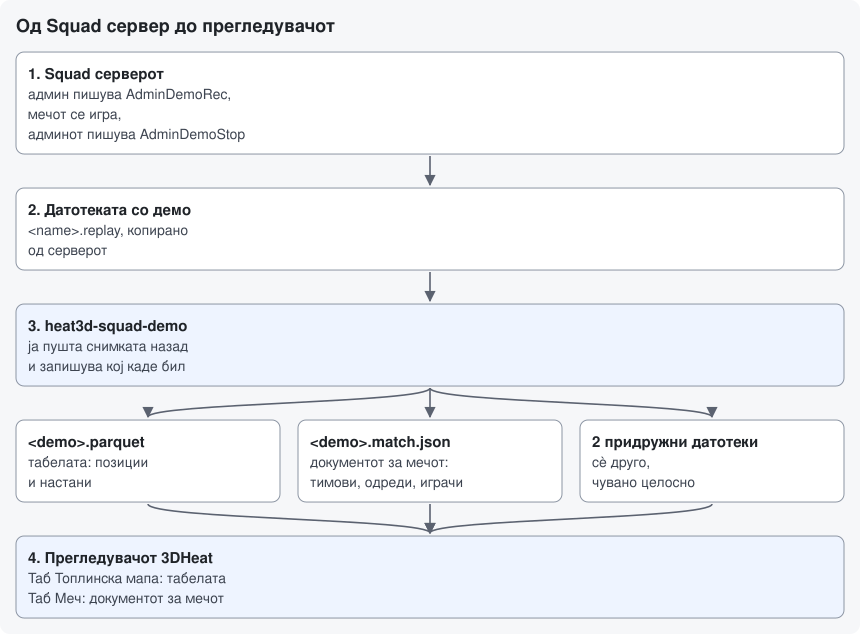

# 3DHeat Squad {#dheat-squad}

**Што е тоа?** Мала програма што снимка од меч во Squad ја претвора во
датотеки што прегледувачот [3DHeat](https://github.com/Holdi601/3DHeat)
([документација](https://holdi601.github.io/3DHeat/)) може да ги исцрта: каде бил секој
играч, секунда по секунда, и што се случило каде.

**Зошто би ја користел?** За да видите меч одозгора: каде се водела борбата,
кои патишта ги минале одредите, каде загинале возилата.

**Пример:** `match.replay` (демо, снимено на Squad сервер) ->
`match.parquet` (еден ред по позиција или настан) + `match.match.json` (документот
за мечот: тимови, одреди, играчи). Излезите се обични Parquet
и JSON датотеки, па може да ги чита и сè друго.

За што е корисна:

- **Каде се водел мечот.** Позицијата на секој играч и бот, пешки, во
  копнени возила и во хеликоптери, околу осум пати во секунда, со тим,
  фракција, одред, здравје и навалата (pitch) на погледот.
- **Што се случило каде.** Рани, оживувања и смртни случаи; секој истрел и секој
  погодок во возило; секое возило, поставен објект и утврдување што се појавило,
  се оштетило, се уништило и се отстранило.
- **Целиот меч во еден документ.** Тимови, одреди, состојбата на играта, секој
  актер, линија за секој играч и бот, и самопроверка дека ништо од она што го
  содржи демото не е изгубено.



## Брз почеток {#quick-start}

Нови сте со командната линија? Прво прочитајте [Пред да започнете](before-you-start.md).

```bash
python -m pip install -e .              # installs the heat3d-squad-demo command
heat3d-squad-demo match.replay -o out   # or a folder of .replay files
```

Треба да видите по една линија за секое демо. Потоа вчитајте `out/<map>/<demo>.parquet` во табот Топлинска мапа на прегледувачот
([Внесување податоци](https://holdi601.github.io/3DHeat/getting-data-in.html)).

## Страници {#pages}

| Страница | Што опфаќа |
|---|---|
| [Пред да започнете](before-you-start.md) | Python, терминал, прво извршување |
| [Снимање демо](recording.md) | како да го натерате серверот да запише демо, и како да го најдете |
| [Претворање демоа](converting.md) | командата, секоја опција, пример за излез |
| [Табелата](output-table.md) | секоја колона и секој `event` |
| [Документот за мечот и придружните датотеки](output-match.md) | `.match.json`, двете придружни датотеки, самопроверката |
| [Како се чита едно демо](how-it-works.md) | слоевите на читачот и што е проверено |
| [Ограничувања, ажурирања и услови](limits.md) | што не се чита, што може да го скрши ажурирање на Squad, лични податоци, лиценца |
| [Упатство за команди](../cli-reference.md) | секоја опција и колона, генерирано од кодот |
| [Одржување на оваа документација](maintaining.md) | списокот за проверка при издание |

## Поврзано {#related}

- Прегледувачот 3DHeat: [github.com/Holdi601/3DHeat](https://github.com/Holdi601/3DHeat),
  документација на [holdi601.github.io/3DHeat](https://holdi601.github.io/3DHeat/).
- Форматите на датотеки што ги чита прегледувачот, вклучително и контејнерот
  со една датотека по меч: [Една датотека по меч (.3dheat)](https://holdi601.github.io/3DHeat/container.html).
  Овој конвертор пишува одделни датотеки: табелата, документот за мечот и
  неговите придружни датотеки една покрај друга.
- 3DHeat Watcher го пушта овој конвертор на нови демоа кога е инсталиран
  (адаптер `squad-demos`): [3DHeat Watcher](https://holdi601.github.io/3DHeat-Watcher/).

## Алатките на 3DHeat {#the-3dheat-tools}

| Алатка | Што прави | Код | Документација |
|---|---|---|---|
| 3DHeat viewer | ги прикажува податоците: топлински мапи, анализа на трки, преглед на мечеви | [3DHeat](https://github.com/Holdi601/3DHeat) | [docs](https://holdi601.github.io/3DHeat/) |
| GameFiles | нивоа и патеки од сопствените датотеки на играта | [3DHeat-GameFiles](https://github.com/Holdi601/3DHeat-GameFiles) | [docs](https://holdi601.github.io/3DHeat-GameFiles/) |
| GameCapture | телеметрија на кругови, и нивоа обновени од видео од игра | [3DHeat-GameCapture](https://github.com/Holdi601/3DHeat-GameCapture) | [docs](https://holdi601.github.io/3DHeat-GameCapture/) |
| Unreal Exporter | приклучок за Unreal Editor: ниво како една `.glb` | [3DHeat-UnrealExporter](https://github.com/Holdi601/3DHeat-UnrealExporter) | [docs](https://holdi601.github.io/3DHeat-UnrealExporter/) |
| CS2 | демоа и мапи од Counter-Strike 2 | [3DHeat-CS2](https://github.com/Holdi601/3DHeat-CS2) | [docs](https://holdi601.github.io/3DHeat-CS2/) |
| Watcher | снима што играта објавува додека играте | [3DHeat-Watcher](https://github.com/Holdi601/3DHeat-Watcher) | [docs](https://holdi601.github.io/3DHeat-Watcher/) |
| Ext-WarThunder | снимки од War Thunder | [3DHeat-Ext-WarThunder](https://github.com/Holdi601/3DHeat-Ext-WarThunder) | [docs](https://holdi601.github.io/3DHeat-Ext-WarThunder/) |
| Ext-WoT | снимки од World of Tanks | [3DHeat-Ext-WoT](https://github.com/Holdi601/3DHeat-Ext-WoT) | [docs](https://holdi601.github.io/3DHeat-Ext-WoT/) |
| Ext-WoWs | снимки од World of Warships | [3DHeat-Ext-WoWs](https://github.com/Holdi601/3DHeat-Ext-WoWs) | [docs](https://holdi601.github.io/3DHeat-Ext-WoWs/) |
| Ext-Squad | демоа од Squad сервери | [3DHeat-Ext-Squad](https://github.com/Holdi601/3DHeat-Ext-Squad) | [docs](https://holdi601.github.io/3DHeat-Ext-Squad/) |
| Ext-DCS | мапи од DCS World како 3D нивоа | [3DHeat-Ext-DCS](https://github.com/Holdi601/3DHeat-Ext-DCS) | [docs](https://holdi601.github.io/3DHeat-Ext-DCS/) |
| Ext-IL2 | мапи од IL-2 Sturmovik како 3D нивоа | [3DHeat-Ext-IL2](https://github.com/Holdi601/3DHeat-Ext-IL2) | [docs](https://holdi601.github.io/3DHeat-Ext-IL2/) |
